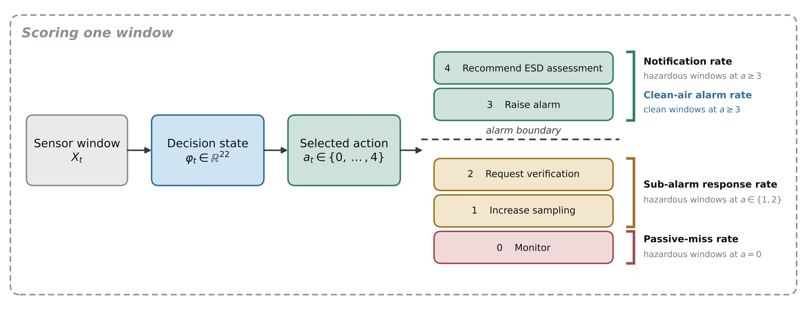
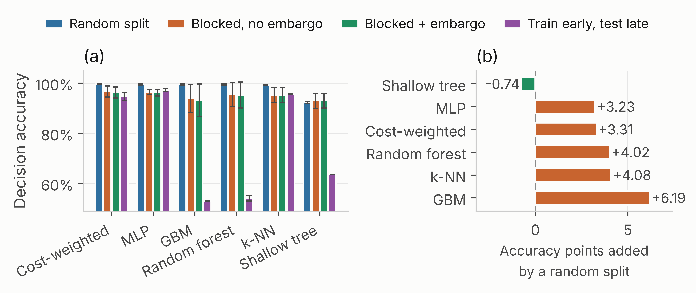
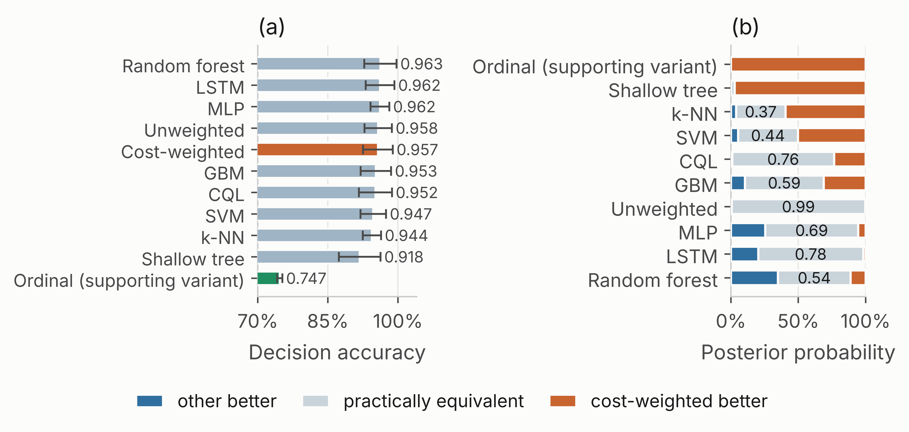
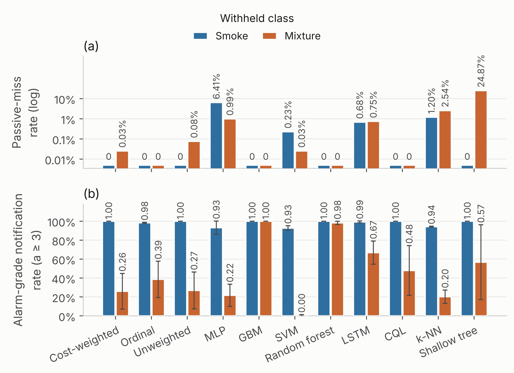

# A Process-Safety Benchmark for Learned Gas-Monitoring Models Under Class Exclusion and Sensor Degradation

Benjamin C. Nweke^1,2,\*^, Gholamreza Ramezan^2^, Soheil Saraji^1^

^1^ Subsurface Energy and Digital Innovation Center of Excellence, Department of Energy and Petroleum Engineering, University of Wyoming, 1000 E. University Avenue, Laramie, WY 82071, USA\
^2^ Fides Innova Labs, Vancouver, BC, Canada

^\*^ Corresponding author; email: bnweke@uwyo.edu

Keywords: Process safety; Alarm management; Gas monitoring; Machine learning; Sensor degradation; Class exclusion; Metal-oxide sensors

---

## Abstract

Learned gas-monitoring models are usually ranked by classification accuracy, yet accuracy does not show how often a hazard draws no response or clean air draws an alarm. We benchmark sensor-based decision models on a public seven-channel metal-oxide sensor corpus of four labeled conditions from one campaign. Model outputs are mapped to a constructed five-level response ladder and scored on decision accuracy, passive misses, sub-alarm responses that notify no operator, alarm-grade notification and clean-air alarms. Comparisons used a leakage-controlled block-wise holdout, class exclusion and synthetic sensor degradation. Random splitting of overlapping windows raised accuracy by 3.23 to 6.19 percentage points over the blocked protocol for models using temporal features. Ten comparators fell within 4.43 accuracy points nominally, but withholding a hazardous class pulled them apart. Over five fits, the multilayer perceptron passively missed a mean of 6.4% of withheld Smoke windows (14.8% in its worst fit) and a shallow decision tree a mean of 24.9% of withheld Mixture windows (62.5% in its worst fit). A low passive-miss rate did not guarantee notification: on withheld Mixture, mean notification was 0.5% for the support-vector classifier and 98.3% for the random forest, both with near-zero passive misses. Clamping all seven raw channels at their training maxima sent every hazardous window to a sub-alarm action, with no passive miss, in all six tested configurations. These results concern surrogate analytes, a constructed action ladder and synthetic faults, not hydrocarbon detection or physical sensor failure. They suggest evaluating passive misses, notification failures and false-alarm burden together.

---

## 1. Introduction

Process-safety incidents often involve warning indications that do not lead to timely intervention. In the final eleven minutes before the 1994 explosion at the Texaco refinery in Milford Haven, the control-room operators were presented with 275 alarms (HSE, 1997; Goel et al., 2017). Several equipment, control-system, management and human-factor failures contributed to that event. We cite it only because it shows how alarm overload can get in the way of responding to what has been sensed.

Fixed gas detectors at upstream and midstream facilities feed alarm systems, and the performance of those systems is judged against guidance on what a single operator can manage (Engineering Equipment and Materials Users' Association [EEMUA], 2024; International Society of Automation [ISA], 2016). A learned model added to that path raises an obvious question: could it worsen alarm loading or delay a response? Published gas-detection models are ranked mainly by classification accuracy. The reported figures are high, but they come from different tasks and test sets (Table S17), and accuracy treats every error alike. A hazard that draws no response may delay intervention, and unnecessary alarms may add to operator workload, although what actually follows depends on other protective layers and on how alarms are managed.

This study is about disposition, meaning how a model's prediction is mapped to a response, from passive monitoring through sub-alarm actions to operator notification. Recognition, alarm prioritization and the operator's own decision lie outside its scope. Earlier work has covered the pieces separately: alarm-system performance (Wang, J. et al., 2016; Kaced et al., 2021), asymmetric error costs (Elkan, 2001), unknown-gas recognition (Qu et al., 2022; Yao et al., 2024) and drift compensation (Vergara et al., 2012). Among the studies we reviewed, none compared passive silence, active sub-alarm responses and alarm-grade notification for several learned models under one partitioning protocol and one set of stress tests. That combined evaluation is the gap we address.

The evidence base is the public MultimodalGasData corpus (Narkhede et al., 2022a, 2022b): a seven-channel metal-oxide (MOX) sensor array recording clean air, two surrogate hazardous conditions and a nuisance odorant in a single acquisition campaign. Below, an "unfamiliar hazard" means a hazardous class withheld from training within that corpus, not a new gas met in the field, and every sensor fault is synthetic. Six research questions (RQ) follow.

i. RQ0. Does the partitioning protocol change the accuracy a comparison reports?
ii. RQ1. Do models ranked highly by nominal accuracy also show low passive-miss rates and high alarm-grade notification when a hazardous class is withheld?
iii. RQ2. Do models with similar nominal accuracy respond similarly to a withheld hazardous class?
iv. RQ3. Can a low passive-miss rate coexist with failure to notify an operator?
v. RQ4. How do these responses change under synthetic perturbation of the standardized decision features, and under synthetic faults injected into the raw sensor windows?
vi. RQ5. Does closed-set confidence-threshold rejection, with rejected windows sent to an alarm, raise notification on a withheld class, and at what clean-air cost?

We contribute an evaluation protocol that combines a leakage-controlled block-wise holdout, a graded action target that keeps passive misses, sub-alarm responses and clean-air alarms apart, class exclusion, and two kinds of synthetic degradation, all applied to the same configurations. The main finding is that configurations with similar nominal accuracy can respond very differently once a hazardous class is withheld or the sensing is degraded, and that a passive-miss rate on its own can hide a failure to notify. The objective is to find out whether models with similar nominal classification accuracy differ in notification, sub-alarm response and false-alarm behavior under controlled class exclusion and synthetic sensor degradation. Improving classification accuracy on this corpus is not an aim.

---

## 2. Related Work and Positioning

### 2.1 Gas detection methods and their evaluation targets

Gas-leak detection draws on distributed acoustic and fiber-optic sensing, mass balance and model-based diagnostics (Murvay and Silea, 2012; Adegboye et al., 2019; Zhang et al., 2013; Rousselet et al., 2011). In pipeline monitoring, combining statistical and pressure-wave methods has been used to improve detection performance (Han and Kim, 2014). Deep-learning electronic-nose classifiers have been built for gas recognition (Faleh and Kachouri, 2023) and tuned for edge hardware (Dehnaw et al., 2024), and temporal deep-learning models have been applied to optical gas imaging (Korjani et al., 2024). Most of these methods are evaluated on an indication, a location or a concentration. Whether the response that follows would be adequate needs a further step. Reconstruction-based sequence models trained on normal operation are a common unsupervised route to sensor anomaly detection (Malhotra et al., 2016; Liang et al., 2023; Lima et al., 2026), but training on normal data alone does not calibrate an anomaly score to hazard severity. The decision models evaluated here read the score as one input among twenty-two, so we examine its relation to the action ladder below instead of assuming it.

Process-safety studies have also tied learned gas sensing to uncertainty and hazard assessment. Li et al. (2024) used unsupervised deep learning with an uncertainty-based score to detect natural-gas plumes in optical gas images on an offshore platform. Wang, Y. et al. (2026) proposed a deep-learning network, HGD-Net, that assesses flammable-gas hazards from photoionization gas sensors and anemometer airflow measurements. [TBD: after checking Wang, Y. et al. (2026), state which of class exclusion, notification failure and sensor degradation it does not evaluate.]{.mark} These studies address detection and hazard estimation. Our question comes one step later: how candidate models should be evaluated once their predictions are mapped to a constructed response ladder, including when a hazardous class is withheld and the sensing is degraded.

### 2.2 Gas-monitoring benchmarks and evaluation protocols

MultimodalGasData pairs thermal frames with a seven-channel MOX array, and the original work reported that fusion outperformed either modality alone: 96% fused against 82% for MOX and 93% for thermal (Narkhede et al., 2021, 2022a). Later results on related tasks are high but not directly comparable. Sharma et al. (2024) report 99.7% validation accuracy for a federated multimodal model; El Barkani et al. (2024) report 91.7% on thermal images on embedded hardware; and Zhang and Zhang (2025) report 98.9% for a binary leak task on a simulated test set of their own and 95.4% on field data from a methane emissions test facility. Wang, X. et al. (2025) proposed a spatio-temporal cross-attention model that fuses thermal-image features (ShuffleNetV2) with gas-sensor temporal features (CNN-BiGRU), used the MultimodalGasData corpus together with a simulation dataset of their own, and reported 99.22% recognition accuracy. Modality, task and evaluation protocol differ from study to study, so these accuracies do not establish a ranking, and they cannot be compared with action-level quantities.

Temporal dependence is the reason we control the partitioning. Dennler et al. (2022) showed, on a different and widely used MOX dataset, that drift over the acquisition period can inflate reported classification performance. Whether a comparable effect exists on MultimodalGasData has to be measured on that corpus, and Experiment 1 does so. Neither a random nor a controlled split establishes deployment performance; a controlled split only removes one known source of optimism.

### 2.3 Unknown-gas recognition and sensor drift

Open-set recognition of gases is an established problem. Qu et al. (2022) showed that closed-set classifiers assign unknown analytes to known classes with high confidence, Ma et al. (2024) addressed open-set gas classification with a multi-scale temporal convolutional network, and Yao et al. (2024) treated unknown-gas recognition jointly with drift compensation. Drift compensation has a literature of its own, from classifier ensembles (Vergara et al., 2012) to knowledge distillation (Lin and Zhan, 2026). Work on gas-leakage detection is commonly scored on recognition (Kumar, G. et al., 2024). The class-exclusion experiment here is not an open-set method. It withholds a class, lets ordinary closed-set models respond as they will, and records the action. The reject option evaluated later is closed-set confidence thresholding (Section 4.9), not an open-set or out-of-distribution detector, and we evaluate no such detector.

### 2.4 Alarm analytics and cost-sensitive learning

Industrial alarm systems have an analytics literature of their own. Wang, J. et al. (2016) survey the causes of alarm overloading, and EEMUA (2024) and ISA (2016) set out performance targets for alarm systems. Kaced et al. (2021) treat nuisance alarms in chemical processes as a multivariate problem, and Laberge et al. (2014) address alarm floods through alarm summary display design and response strategy. Wang, Z. and Wang, J. (2020) introduced the false alarm duration ratio and the missed alarm duration ratio as duration-based performance indices for univariate alarm systems. Those studies evaluate and improve alarm systems. Our question comes earlier: what should be measured before a learned model becomes a source of alarms? Cost-sensitive learning, in which errors are weighted unequally, has a standard treatment (Elkan, 2001). We test it directly here, asking whether the hazard weighting used in training reduces passive misses on hazardous windows and how it changes notification and false-alarm behavior.

### 2.5 Research gap and study contribution

Table S17 compares the closest prior studies on prediction target, partitioning, withheld classes, sensor degradation, and the reporting of passive misses, notification and alarm burden. Our contribution is a research benchmark that separates recognition correctness, passive misses, operator notification and alarm burden, and measures all four under controlled class exclusion and synthetic degradation. MultimodalGasData pairs the MOX array with thermal frames, which the broader implementation uses (Section 3.3); it has no concentration annotation and no multi-session coverage (Section 6.1). It is meant to inform future screening of learned components before deployment. It is not an acceptance procedure. The present evaluation uses surrogate analytes, a constructed action ladder and synthetic faults, and applying the approach at a facility would need site-specific hazard definitions, response requirements, fault models and independent validation.

---

## 3. Methodology

The study combines established components, so its contribution lies in the evaluation protocol and the metric set. Fig. 1 gives the workflow, from the corpus and action map through one partitioning protocol to the stress tests every model goes through, all scored with the same metric set.

{width=6.50in}

Fig. 1. Workflow of the study: one corpus, one partitioning protocol, the stress tests applied to every fitted model, and the metric set used to score them.

### 3.1 Corpus

The study uses MultimodalGasData (version 2, Narkhede et al., 2022b), described by Narkhede et al. (2022a) and distributed under CC BY 4.0. It pairs a seven-channel MQ-series metal-oxide (MOX) array with thermal frames from a Seek Compact camera, sampled at 2 s intervals. There are 6,400 labeled samples in four classes of 1,600: clean air (NoGas), incense smoke (Smoke), alcohol-based deodorant vapor (Perfume), and a mixture of the two (Mixture). Smoke and Mixture serve as the hazardous surrogate conditions throughout; they are not facility hazards. Table S18 lists the array and the gases each element is marketed to sense. We used the sensor readings in file order. Apart from discarding windows that span a class boundary (Section 3.2), no reading was filtered or reordered.

The dataset article says each gas source was logged as a separate class, that readings were logged every 2 s for 90 min, and that gas was released at 15 s intervals for the first 30 min, then at 30 s and 45 s intervals in the following 30 min periods (Narkhede et al., 2022a). The released files hold 1,600 readings per class. The article does not say which part of each session they cover or when each release began. In the files, the serial-number column restarts three times across the 6,400 readings, and we take this to mark four class-specific recordings. That reading is inferred from the files, not documented by the dataset authors. The analytes are surrogates: they exercise the MOX transduction mechanism, the array's cross-sensitivity and its baseline behavior, but they tell us nothing about methane or heavier hydrocarbons.

Because each class appears in only one recording, class identity is confounded with recording identity. A model may be exploiting conditions specific to a session, such as its baseline level or ambient state, as well as the analyte response. The partitioning below stops training and test windows from sharing readings. It does not remove this confounding, and it does not show that a model would generalize to another session (Section 6.1).

### 3.2 Leakage-controlled partitioning

Readings form sliding windows of 20 consecutive samples, each labeled by its final reading, and windows that span a class boundary are discarded. That leaves 6,324 windows, 1,581 per class. Consecutive windows share 19 of 20 readings, so a random split puts near-duplicates in both partitions. A sequential split is unusable because the corpus is ordered by class.

The protocol is a block-wise holdout. Inside each class, a contiguous 20% of windows (316) forms the test block, separated from the training windows by an embargo of *G* = 20 windows on each side. Two windows share no reading once their start positions are at least 20 apart, which an embargo of 19 already ensures; the twentieth window is a one-window margin against off-by-one error. The start of the test block is drawn uniformly, per run seed, from the 1,226 positions (20 to 1,245 of 1,581) that leave the full embargo on both sides, so the reported spreads include partition variation (Bouthillier et al., 2021). Each run has 4,900 training windows (1,225 per class, in a leading and a trailing segment), 1,264 test windows and 160 embargoed windows. Fig. S12 draws the layout.

Two analyses read model confidence: the calibration comparison (Section 4.1) and the reject option (Experiment 7). For these, the last 20% of each class's training windows in acquisition order (245 windows) form a calibration band, the 20 training windows before it are discarded, and the model is fitted on the remaining 960 windows per class. The band is defined on the training windows left after the test block is removed, so it moves with the test block. When the trailing training segment of a class is shorter than the band, the band spans the removed block: it is contiguous in training-window order but not in time. The 20 discarded windows still separate it from every fitting window, so no fitting window shares a reading with a band window. The band is carved before anything is fitted. Feature scaling, the anomaly autoencoder and anomaly normalization are fitted on the 960 fitting windows per class alone, and the band is then scored through that fitted pipeline like any other unseen window. No test window, no calibration window and no window of a withheld class contributes to a fitted upstream quantity.

### 3.3 What is evaluated

Every safety-benchmark result below comes from sensor-based decision models. Each takes the 22-dimensional state of Eq. 1, built from one sensor window, and returns an action *a*ₜ ∈ {0, …, 4}. The thermal classifier contributes no term to that state. The broader implementation also contains a thermal classifier, an explanation component and deterministic guardrails (an anomaly-threshold override and a promotion rule driven by the thermal classifier), and none of these is benchmarked. We left the guardrails out so that each model's own behavior could be measured. A guardrail that raises actions could reduce passive responses while increasing false alarms, and its effect would then be mixed into every comparison. No result below describes the end-to-end behavior of the implementation.

The implementation is advisory and actuates nothing. *Recommend ESD assessment* (ESD, emergency shutdown) refers a condition for assessment under a facility's procedure; it does not command a trip. IEC 61511 (IEC, 2016) sets lifecycle and independence expectations for safety instrumented systems, and a component of this kind would sit in the operator-support layer, outside any safety instrumented function.

### 3.4 Component models

The decision state depends on one learned upstream component, a long short-term memory (LSTM) autoencoder that supplies a scalar anomaly score (Section 3.5). The reference decision model is a feedforward network trained by weighted cross-entropy on the target action (Eq. 3), not by reinforcement learning. It keeps the two-stream output head of Wang, Z. et al. (2016). Under a cross-entropy objective, though, the value stream adds the same constant to every action score, cancels in the softmax and receives no gradient, so it plays no part in training or prediction and the network behaves as an ordinary classifier over five actions. Architectures and training settings are in Table 2 and Supplementary Section S17, with diagrams in Figs. S7 to S9.

The thermal classifier (YOLOv8n-cls; Jocher et al., 2023) and the explanation component (a local Gemma 3 1B model; Gemma Team, 2025) belong to the broader implementation and are described in Supplementary Sections S1 and S2. Thermal results appear in Section 4.1 only to characterize that supporting component.

### 3.5 Decision state and preprocessing

The 22-dimensional decision state is

&nbsp;&nbsp;&nbsp;&nbsp;φₜ = [ ρ̃ₜ , Xₜ[−1,:] , δₜ , σₜ ] ∈ ℝ²²  ............ (1)

with ρ̃ₜ the normalized anomaly score, Xₜ[−1,:] the current seven-channel reading, δₜ = Xₜ[−1,:] − Xₜ[0,:] the per-sensor change across the window, and σₜ the per-sensor standard deviation over the 20 readings (population convention). There is no visual term.

Preprocessing runs in the following order, inside each training partition. (i) An input scaler (z-score, per channel) and an LSTM autoencoder (one LSTM layer of 32 units in the encoder, one in the decoder and a linear output layer; mean squared error, Adam with learning rate 10⁻³, batch 64, 30 epochs) are fitted on the NoGas training windows only. (ii) Each window's anomaly score is its mean squared reconstruction error over the full 20-by-7 window. (iii) The score is min-max normalized between its 1st and 99th percentiles over all training windows of the retained classes, not over NoGas windows alone, and clipped to [0, 1], which gives ρ̃ₜ. (iv) The 21 sensor features are standardized with the mean and standard deviation of the same training windows. Because the percentiles come from every retained class, withholding Smoke or Mixture changes the normalization scale in class-exclusion fits; we did not measure how much that matters. All four steps are refitted for every run and for every class-exclusion fit, where they use the training windows of the three retained classes only. No test window or withheld-class window contributes to any fitted quantity.

### 3.6 Action ladder and training targets

Training targets come from the single-valued map *y*(·) of Eq. 2a; evaluation scores against the acceptable set *A*(·) of Eq. 2b.

> The action labels in Eqs. 2a and 2b are constructed evaluation targets. They are not facility alarm requirements, not a safety instrumented function specification, and not derived from any concentration, release rate, lower-explosive-limit fraction, toxic-exposure limit or consequence model; no such quantity exists in this corpus. Every metric defined on this ladder measures agreement with the constructed target, not consequence avoided.

&nbsp;&nbsp;&nbsp;&nbsp;*y*(NoGas) = 0, *y*(Smoke) = 3, *y*(Mixture) = 4, *y*(Perfume) = 1;  ............ (2a)

&nbsp;&nbsp;&nbsp;&nbsp;*A*(NoGas) = {0}, *A*(Smoke) = {3}, *A*(Mixture) = {4}, *A*(Perfume) = {1, 2}.  ............ (2b)

| Action | Label | Operational response under this protocol |
|---|---|---|
| 0 | Monitor | Routine monitoring; no operator notification |
| 1 | Increase sampling | Elevated scan frequency and event logging; no operator notification |
| 2 | Request verification | Secondary sensor check and event logging; no operator notification |
| 3 | Raise alarm | Alarm to the operator, incident logging, field dispatch |
| 4 | Recommend ESD assessment | Refer the condition for emergency-shutdown assessment under the facility procedure |

Table 1. Action ladder. Actions 3 and 4 are alarm-grade; actions 1 and 2 are sub-alarm responses that notify no operator under this protocol.

Perfume, a nuisance odorant, is the only class with two acceptable actions: raising the sampling rate and requesting verification are both acceptable, and training uses the lower. Action 2 is never a positive training target. We keep five actions so that the metrics can separate passive monitoring (action 0) from active responses that still notify no one (actions 1 and 2). The neural models have five outputs and can emit action 2, whereas the scikit-learn models can only predict actions that appear as training targets. None of the seven configurations in the per-class action analysis (Fig. S11) selected action 2; the ordinal variant of Experiment 4 did (Section 4.5). Because *y*(·) is a deterministic function of the class, decision accuracy (Eq. 4) equals four-class classification accuracy composed with a fixed map, with one exception: a Perfume window assigned action 2 also counts as correct.

Smoke and Mixture get different alarm-grade targets (actions 3 and 4) to keep the two surrogate hazards distinct in training. The assignment does not represent different physical severities, and the passive-miss and notification metrics would still separate hazardous from nonhazardous responses if both shared one target. The choice does have a consequence under class exclusion: withholding a class also removes its unique target action from the training data (Section 3.12).

### 3.7 Training objective

Each training sample carries a weight *w*(*g*ₜ) equal to *w*~haz~ for the hazardous classes (Smoke, Mixture) and *w*~non~ for the nonhazardous classes (NoGas, Perfume), with ratio *C* = *w*~haz~ / *w*~non~. The objective is

&nbsp;&nbsp;&nbsp;&nbsp;*L*(θ) = − (1/*N*) Σₜ *w*(*g*ₜ) · log *p*~θ~( *y*(*g*ₜ) | φₜ )  ............ (3)

where *p*~θ~ is the softmax over the five action scores. Eq. 3 weights every error on a hazardous sample equally. It does not price passive silence differently from a sub-alarm response or from the wrong alarm-grade action, and *C* is not a validated ratio of missed-hazard to false-alarm cost. Experiment 4 tests a separate, action-dependent cost matrix that does price those errors differently. The reference ratio *C* = 8:1 was chosen in the original experiment design from dispersion on test partitions, which is not an independent selection. Section 4.5 reports the validation-based choice and repeats the class-exclusion and degradation tests at that ratio.

### 3.8 Comparators

Ten primary configurations are compared (Table 2). They differ in inputs, objectives, class weighting and training settings, so the comparison is between these implemented configurations and not between model families in general. CUSUM (Page, 1954), run on the anomaly score with settings given in Supplementary Section S5, is an auxiliary reference evaluated only under nominal conditions. Its output has two states, and each state can be correct for at most one of the four disjoint acceptable sets of Eq. 2b, which bounds its decision accuracy near 50% by construction, so it is not a ranking. Two supporting variants are reported but not counted among the comparators: the ordinal-cost objective of Experiment 4, and the clean-air-weighted gradient boosting released with an earlier version of this work (Section 4.7).

| Configuration | Input | Outputs | Objective and class weighting | Training settings |
|---|---|---|---|---|
| Cost-weighted policy | 22-feature state | 5 actions | Weighted cross-entropy, Eq. 3, *C* = 8:1 | 256-256-128 network with layer normalization, dropout 0.15; Adam, learning rate 2 × 10⁻⁴; batch 256 |
| Unweighted network | 22-feature state | 5 actions | Cross-entropy, unweighted | Same as the cost-weighted policy |
| Multilayer perceptron | 22-feature state | Training actions | Cross-entropy, unweighted | 256-256-128, ReLU; up to 400 iterations with early stopping |
| Gradient boosting | 22-feature state | Training actions | Sample weights: Smoke and Mixture 2.5, NoGas and Perfume 1.0 | 300 trees, learning rate 0.1, depth 3 |
| Random forest | 22-feature state | Training actions | Unweighted | 300 trees |
| Support-vector classifier | 22-feature state | Training actions | Unweighted | RBF kernel, *C* = 1, γ = scale, probability outputs |
| k-nearest neighbors | 22-feature state | Training actions | Unweighted | *k* = 5, uniform weights |
| Recurrent (LSTM) | Ten consecutive states | 5 actions | Cross-entropy, unweighted | One LSTM layer of 64 units, dropout 0.2; Adam, 2 × 10⁻⁴; 40 epochs |
| Conservative Q-learning | 22-feature state | 5 actions | Offline TD(0) value fit with a conservative penalty; class-by-action reward (Supplementary Section S5) | Same network as the policy; γ = 0.99, α = 1.0; Adam, 2 × 10⁻⁴; 80 epochs |
| Shallow decision tree | Seven current readings | Training actions | Unweighted | Depth 3 |

Table 2. Primary comparator configurations. "Training actions" means the model can predict only actions present as training targets. In the 30-run comparison the number of epochs is drawn per run from 60 to 100 for the cost-weighted policy, the unweighted network and the ordinal variant; in the five-seed experiments these use 60 or 80 epochs as stated in Supplementary Section S5. All other settings are fixed, and no configuration was tuned on test data.

The recurrent model reads the states of the current window and the nine before it. Its sequences are assembled only inside one contiguous stretch of windows. A training sequence never spans the removed test block or a class boundary, and a test sequence uses test windows only. In training and in testing alike, the first nine windows of a stretch are padded by repeating the stretch's first state, so no training window is dropped. Because training and test windows share no reading, the full raw support of a test sequence (29 readings) lies inside the test block.

We adapted conservative Q-learning (Kumar, A. et al., 2020) to a fixed offline dataset. The behavior action for each training window is its target action, the reward depends on class and action only, and the successor of a window is the next window in time within the same contiguous stretch. The last window of every stretch, whether at a class boundary or at the edge of the removed test block or embargo, is terminal. Because every behavior action is the target action, only the rewards of correct actions occur in the data (+2 for a hazardous class, +1 otherwise). The penalties the reward function assigns to wrong actions never enter training, and the conservative penalty alone pushes down the values of the other actions. A one-step temporal-difference target with γ = 0.99 still carries future value through the successor state, so the objective is not myopic. The target comes from the network being trained, with no separate target network, under a Huber loss and a batch of 256; a terminal window's target is its immediate reward. The selected action does not change the next observation, though, so sequential control is not what this comparator tests. It asks whether a value-based offline objective behaves differently from supervised training on the same windows. Within a stretch every transition has the same class and reward, so the fitted value of a window depends partly on how many windows remain before the stretch ends, which is set by where the test block fell. We did not test how much that boundary dependence affects the selected actions.

### 3.9 Metric set

The proposed set reports five quantities together: decision accuracy, the passive-miss rate, the sub-alarm response rate, the alarm-grade notification rate, and the clean-air alarm rate (Table 3, Fig. 2). Let the test windows be *t* = 1 … *N*~test~ with true classes *g*ₜ and selected actions *a*ₜ. Let *H* = {*t* : *g*ₜ ∈ {Smoke, Mixture}} be the hazardous windows and *Z* = {*t* : *g*ₜ = NoGas} the clean-air windows, and let 1[·] be the indicator function.

&nbsp;&nbsp;&nbsp;&nbsp;Acc = (1/*N*~test~) Σₜ 1[ *a*ₜ ∈ *A*(*g*ₜ) ]  ............ (4)

&nbsp;&nbsp;&nbsp;&nbsp;*R*~miss~ = (1/|*H*|) Σ~t∈H~ 1[ *a*ₜ = 0 ]  ............ (5)

&nbsp;&nbsp;&nbsp;&nbsp;*R*~esc~ = (1/|*H*|) Σ~t∈H~ 1[ *a*ₜ ≥ 3 ]  ............ (6)

&nbsp;&nbsp;&nbsp;&nbsp;*R*~under~ = (1/|*H*|) Σ~t∈H~ 1[ *a*ₜ ∈ {1, 2} ]  ............ (7)

&nbsp;&nbsp;&nbsp;&nbsp;*R*~fa~ = (1/|*Z*|) Σ~t∈Z~ 1[ *a*ₜ ≥ 3 ]  ............ (8)

&nbsp;&nbsp;&nbsp;&nbsp;*B* = 1000 · *R*~fa~  ............ (9)

We report decision accuracy (Eq. 4) for continuity with prior work and do not treat it as a safety metric. The passive-miss rate (Eq. 5) counts hazardous windows left at Monitor. The alarm-grade notification rate (Eq. 6) counts hazardous windows that reach an operator. It does not check that the class-specific action was chosen: a Mixture window sent to *Raise alarm* counts as notified although its acceptable set is {4}, and nothing here measures timely mitigation. The sub-alarm response rate (Eq. 7) counts hazardous windows given an active response that notifies no one. By construction *R*~miss~ + *R*~under~ + *R*~esc~ = 1, so the three partition the hazardous windows. Three failures are kept apart: passive response (Eq. 5), failure to notify despite an active response (Eq. 7), and selection of the wrong alarm-grade action, which the per-class action distributions show (Fig. S11).

The clean-air alarm rate (Eq. 8) is the share of NoGas windows sent to an alarm-grade action, and *B* (Eq. 9) expresses it per 1,000 clean windows. NoGas is a deliberately narrow denominator. Perfume windows are nonhazardous too, so wherever a value of Eq. 8 is reported, we give the rate over all nonhazardous windows beside it.

| Quantity | Symbol | Reads | Catches | Does not catch | Report with |
|---|---|---|---|---|---|
| Decision accuracy | Acc, Eq. 4 | all windows | overall agreement with the ladder | any asymmetry between error types | SD across seed-varying partitions |
| Passive-miss rate | *R*~miss~, Eq. 5 | hazardous windows at *a* = 0 | hazards left at Monitor | active responses that notify no one | observed counts, with independence-reference and disjoint-support reference values (Eq. 10) |
| Alarm-grade notification rate | *R*~esc~, Eq. 6 | hazardous windows at *a* ≥ 3 | whether an operator is notified | whether the class-specific action was chosen | SD across partitions, and the boundary assumed |
| Sub-alarm response rate | *R*~under~, Eq. 7 | hazardous windows at *a* ∈ {1, 2} | active responses that notify no one | how severe the under-served hazard was | beside *R*~esc~, since the three hazard rates sum to 1 |
| Clean-air alarm rate | *R*~fa~, *B*, Eqs. 8 and 9 | clean-air windows at *a* ≥ 3 | alarms raised on clean air | nonhazardous alarms on Perfume; sub-alarm nuisance actions | the companion rate over all nonhazardous windows, and eventized episodes (Section 3.10) |

Table 3. The proposed metric set, with what each quantity does not catch. Mean ± SD are taken over runs.

{width=6.50in}

Fig. 2. One window, one action, and the boundary each metric reads.

### 3.10 Alarm burden and eventization

We keep three levels apart. Alarm-grade indication density is *B*, a property of the model's window-level outputs. Eventized alarm rate collapses contiguous alarm-grade windows into annunciated episodes: an episode begins after three consecutive alarm-grade windows (6 s at the 2 s cadence) and ends after fifteen consecutive windows below alarm grade (30 s). Operator burden would compare episode rates with a facility's alarm philosophy, which we do not attempt. Rates per hour assume continuous evaluation at 1,800 windows per hour and are extrapolated from 316 clean-air test windows per partition, about 10.5 min, so they are illustrative only. The persistence rule is a convention we chose, and Supplementary Section S9 re-eventizes the same outputs over 25 settings.

### 3.11 Reference calculations for zero counts

An observed zero is not a demonstrated zero. Each zero count is reported with a one-sided 95% Clopper-Pearson upper value (Clopper and Pearson, 1934). For *k* observed failures in *N*~opp~ opportunities at confidence *c*,

&nbsp;&nbsp;&nbsp;&nbsp;*U*(*k*, *N*~opp~) = BetaInv( *c*; *k* + 1, *N*~opp~ − *k* ),  ............ (10)

which for *k* = 0 reduces to *U* = 1 − (1 − *c*)^(1/*N*~opp~)^. Clopper-Pearson is exact only for independent Bernoulli trials, and consecutive windows here share 19 of 20 readings, so we use two reference conventions. The independence-reference value takes every window of one partition as an opportunity. The disjoint-support reference value counts only windows whose readings do not overlap, floor(*N*/20) of *N* consecutive windows, and is applied to zero counts only. Selecting non-overlapping windows removes shared readings but does not establish independence, because windows from one recording remain dependent. Neither value is a confidence bound on an operational failure rate. Each is computed for one partition, no statement is made jointly across partitions, and the worst partition is reported. On a zero count the two conventions differ by about a factor of twenty (Supplementary Section S18).

### 3.12 Experimental design

Every experiment uses the partitioning and preprocessing of Sections 3.2 and 3.5, and all fitted quantities are refitted inside the training data of each run.

*Experiment 1, partitioning protocols.* Six configurations are fitted under four protocols: a random 80/20 split of each class (5,060 training, 1,264 test windows); a contiguous test block without embargo (5,060 and 1,264); the block with the 20-window embargo used elsewhere (4,900 and 1,264, with 160 excluded); and training on the first 60% of each class with testing on the last 20% (3,792 and 1,268, with 1,264 excluded). Model settings are otherwise identical, and scaling and anomaly fitting are repeated within each training partition.

*Experiment 2, nominal comparison.* Every configuration of Table 2 is fitted 30 times (seeds 1000 to 1029, each with its own test-block position) and scored on its test windows.

*Experiment 3, class exclusion.* Smoke or Mixture is withheld from training. Models are fitted on the training windows of the three retained classes and scored on all 1,581 windows of the withheld class, over five fits (seeds 42, 1337, 7, 2024 and 99). Each fit scores the same withheld windows, while the retained-class partition and the model initialization vary. The neural models keep five outputs, so the withheld class's target action remains possible but has no positive training example; the scikit-learn models can only predict the three retained targets. The same fits are also scored on the test windows of the three retained classes, which gives clean-air, Perfume and other-hazard rates for each fit.

*Experiment 4, cost weighting and training objective.* The cost-weighted policy is refitted at nine values of *C* from 1:1 to 20:1. The ordinal variant replaces Eq. 3 with the expected cost of the predicted action distribution under one hand-chosen class-by-action matrix (Table S25). The ratio is also selected on a validation band inside the training data (Section 4.5).

*Experiment 5, decision-state contribution.* The cost-weighted policy is refitted with feature groups removed: the anomaly score, the changes, the SDs, both the changes and the SDs, everything but the current readings, and everything but the anomaly score (Supplementary Table S6). Separately, each fitted model is re-scored with the normalized anomaly input replaced by each of 0, 0.25, 0.5, 0.75 and 1 while the other 21 features keep their observed values. This probes a fixed model and involves no refitting.

*Experiment 6, feature-space perturbation.* Six configurations are fitted once per seed and re-scored on perturbed copies of the standardized test features. With *x* a standardized feature (training mean 0, SD 1):

&nbsp;&nbsp;&nbsp;&nbsp;noise: *x*′ = *x* + ε, ε ~ N(0, σ~n~²), on all 21 sensor features;  ............ (11)

&nbsp;&nbsp;&nbsp;&nbsp;drift: *x*′~c~ = *x*~c~ (1 + *s*~c~ *d*) + *s*′~c~ *d*, on the seven current readings;  ............ (12)

&nbsp;&nbsp;&nbsp;&nbsp;masking: *x*′ = 0 for the current reading, change and SD of *k* channels.  ............ (13)

Eq. 11 adds noise to all 21 sensor features, Eq. 12 applies drift to the seven current readings, and Eq. 13 masks the current reading, change and SD of *k* channels. Here σ~n~ and *d* are in training-SD units, and the signs *s*~c~ and *s*′~c~ are drawn independently per channel, so *d* = 0.5 means a 50% gain change together with an offset of half a training SD. Setting a standardized feature to 0 substitutes its training mean. The *k* masked channels are drawn without replacement once per seed, with the same channels for every model, and they are not nested across *k* (Supplementary Section S29 lists them). The anomaly input keeps its unperturbed value, so a model with all seven channels masked still receives information derived from the original readings. Experiment 6 tests sensitivity to feature masking and perturbation, not loss of all sensor information. Perturbing derived features independently also need not correspond to a physically consistent sensor trace.

*Experiment 7, confidence-threshold rejection.* Within class-exclusion fits, the confidence of a window is the model's maximum class probability. The threshold τ~q~ is the *q*-th percentile of confidence on the calibration band (Section 3.2), for *q* = 0, 5, 10, 20 and 30. A window is rejected when its confidence is strictly below τ~q~, so tied scores are kept and the realized rejection rate can fall short of *q*% for models with few distinct confidence values. Rejected windows are assigned *Raise alarm* in the main analysis and *Monitor* in the alternative. Seven configurations with a probability output take part.

*Experiment 8, raw-signal faults.* Six configurations are fitted once per seed. Each raw test window (20 readings by 7 channels) is faulted and then passed through the training-fitted pipeline: the current readings, changes and SDs are recomputed, the autoencoder rescores the window, and the training normalization and scaler are applied. The faults are of four kinds. Stuck: each faulted channel is held at that window's first reading. Zero: the raw value is set to 0. Clamp: the value is set to the channel's maximum on the training windows. Raw noise: Gaussian, added to all seven channels, with SD equal to 0.5, 1 or 2 times the channel's training SD. The other three faults are applied to 1, 4 or 7 channels, drawn per seed as in Experiment 6. Each window is faulted independently, so a stuck channel is a window-level perturbation and not one continuously frozen trace, and the clamp is a synthetic constant value, not a measured hardware saturation level.

### 3.13 Statistics

The five-seed experiments are reported descriptively. With five nonzero paired differences, the exact two-sided Wilcoxon signed-rank test cannot reach *p* < 0.05 (its minimum attainable *p* is 0.0625), so we do not present any five-seed difference as statistically established.

The 30-run comparison uses the Bayesian correlated *t*-test (Benavoli et al., 2017) on decision accuracy. Its correlation term ρ is an assumed correction for the overlap between repeated training sets, not a correlation measured from these runs. Benavoli et al. trace the heuristic to random train/test splits (Nadeau and Bengio, 2003) and its later use in cross-validation. Here we set it to the test fraction, ρ = 1,264/(4,900 + 1,264) = 0.2051 (excluding the 160 embargoed windows; including them gives 0.1999). Repeated blocked splits from one recording session are not the design the heuristic was derived for, so results are reported across ρ from 0 to 0.5 and across equivalence widths (Supplementary Section S6). The region of practical equivalence is ±1 accuracy point, which we chose as a difference too small to decide between models on its own. That is a judgment, so Table S5 repeats the analysis at ±0.5 and ±2 points. Equivalence in accuracy does not imply equivalence in any safety response.

### 3.14 Software and AI assistance

The experiment drivers, figure scripts and verification scripts were written in Python with assistance from Claude (Anthropic), and the authors reviewed and ran them (Declaration of Generative AI). Every plotted and tabulated value is read by the released scripts from stored result files written by the experiment drivers, and the architecture diagrams (Figs. S7 to S9) are drawn by script from the stated configurations. Runs are seeded and limited to two threads. No global determinism flag is set, so neural results can differ slightly across hardware and library builds; all reported results come from one computing environment recorded in the run manifest.

---

## 4. Results

This section presents the component results, the six experiments that address the research questions (Experiments 1, 2, 3, 6, 7 and 8), and the two supporting experiments on cost weighting and the decision state (Experiments 4 and 5). Table 4 maps each research question onto the experiments that address it.

| Research question | Experiments | Summary of the answer |
|---|---|---|
| RQ0. Does the partitioning protocol change the accuracy a comparison reports? | 1 | Yes. For the five configurations using temporal features, a random split gave 3.23 to 6.19 percentage points higher accuracy than the blocked protocol. |
| RQ1. Do models ranked highly by nominal accuracy also show low passive-miss rates and high alarm-grade notification when a hazardous class is withheld? | 2, 3 | Not consistently. The safety metrics are weakly discriminative under nominal conditions; with a class withheld, nominal rank did not predict passive misses or notification. |
| RQ2. Do models with similar nominal accuracy respond similarly to a withheld hazardous class? | 3 | No. On withheld Mixture, mean alarm-grade notification ranged from 0.49% to 100% among configurations whose nominal accuracies lie within 4.43 points. |
| RQ3. Can a low passive-miss rate coexist with failure to notify an operator? | 3, 8 | Yes. Several configurations left almost no withheld Mixture window at Monitor but sent most of them to sub-alarm actions; under the seven-channel clamp every tested configuration sent every hazardous window to a sub-alarm action, with no passive miss. |
| RQ4. How do these responses change under feature-space perturbation and raw-signal faults? | 6, 8 | The responses are configuration- and condition-specific: alarm-biased, passive and mixed patterns all occur, and nominal results do not anticipate which. |
| RQ5. Does confidence-threshold rejection, with rejected windows sent to an alarm, raise notification on a withheld class, and at what clean-air cost? | 7 | It raised notification on withheld Mixture for every tested configuration, at clean-air rejection rates of 16.8% to 56.8% at the strictest threshold. |

Table 4. Research questions and the experiments that address them.

### 4.1 Component behavior

The thermal classifier is a supporting component. Its predictions do not enter the decision state of Eq. 1, so these results do not describe the benchmarked models. Retrained under the block-wise holdout over five seed-varying partitions, it reached 85.0% ± 4.9 percentage points top-1 accuracy (range 79.2% to 92.1%). In each run between 0 and 65 of the 640 hazardous test frames (0% to 10.2%) were classified as nonhazardous. These are thermal-classification errors, not the passive-miss rate of Eq. 5, and their spread reflects partition and training variation within one acquisition campaign (Supplementary Section S1, Table S1c). Retraining under a random split gave 98.0% to 98.3% over three seeds. The 98.8% top-1 accuracy of the original checkpoint, also from a random split, is a historical training-record result. The original weights are unavailable, and that figure was not rerun.

The anomaly score departs from learned normal behavior, but it does not follow the action ordering. Mean reconstruction error on test windows is 0.023 for NoGas, 0.107 for Perfume, 164.7 for Smoke and 80.6 for Mixture. Smoke scores higher than Mixture even though Mixture has the higher target action, so the score should not be read as an estimate of hazard severity. Fitted inside each training partition, the detector's ROC-AUC for separating NoGas (negative) from all other classes (positive) is 0.9251 ± 0.0618, against 0.9622 under the earlier procedure that fitted it on the whole corpus. At a threshold set at the 95th percentile of reconstruction error on the NoGas training windows, the true-positive rate is 0.8015 and the false-positive rate 0.1101. Some of the overlap lies between the two nonhazardous classes, NoGas and Perfume, which is not an error in separating hazardous from nonhazardous windows. The lower AUC reflects the removal of evaluation windows from the fitting data, not damage to the detector (Supplementary Section S21).

We compared four confidence estimators for the cost-weighted policy on the known classes, over five runs, with the temperature fitted on the calibration band of Section 3.2: the raw softmax, Monte Carlo dropout with 20 passes, temperature scaling and a five-member deep ensemble. Pooled expected calibration error with 15 equal-mass bins lay between 0.029 and 0.043, with overlapping bootstrap intervals, so no ordering among the four is established. On the hazardous windows the expected calibration error was at most 0.0003 for three estimators and 0.0056 for temperature scaling. The fitted temperature was 1.48 ± 0.24 and never below 1.26, which suggests the network is over-confident. An earlier implementation that drew the band at random from overlapping training windows had fitted a temperature below 1 (Supplementary Section S4). These results concern one model on classes present in training. They do not establish calibration for the other comparators or on a withheld class.

### 4.2 Experiment 1: Partitioning protocol

Randomly splitting overlapping windows can place near-duplicates in both the training and the test partition. Dennler et al. (2022) showed the resulting optimism on a different MOX dataset, and Experiment 1 measures it on this corpus (Table 5, Fig. 3).

| Model | Random split | Blocked, no embargo | Blocked with embargo | Train early, test late |
|---|---|---|---|---|
| Cost-weighted policy | 0.9956 ± 0.0009 | 0.9669 ± 0.0224 | 0.9625 ± 0.0215 | 0.9462 ± 0.0155 |
| Multilayer perceptron | 0.9945 ± 0.0015 | 0.9638 ± 0.0103 | 0.9622 ± 0.0129 | 0.9724 ± 0.0064 |
| Gradient boosting | 0.9938 ± 0.0027 | 0.9389 ± 0.0553 | 0.9320 ± 0.0649 | 0.5300 ± 0.0018 |
| Random forest | 0.9927 ± 0.0031 | 0.9549 ± 0.0485 | 0.9525 ± 0.0512 | 0.5409 ± 0.0108 |
| k-nearest neighbors | 0.9929 ± 0.0024 | 0.9525 ± 0.0291 | 0.9521 ± 0.0295 | 0.9566 ± 0.0000 |
| Shallow decision tree | 0.9223 ± 0.0037 | 0.9294 ± 0.0298 | 0.9297 ± 0.0295 | 0.6349 ± 0.0000 |
| Mean | 0.9820 | 0.9511 | 0.9485 | 0.7635 |

Table 5. Decision accuracy under four partitioning protocols, mean ± SD over five runs. Training, excluded and test windows: random split 5,060, 0 and 1,264; blocked without embargo 5,060, 0 and 1,264; blocked with embargo 4,900, 160 and 1,264; train early, test late 3,792, 1,264 and 1,268. The first three protocols draw a new partition in each run; the train-early, test-late protocol uses one fixed partition, so its SD reflects model initialization only.

For the five configurations using temporal features, a random split gave 3.23 to 6.19 percentage points higher accuracy than the blocked protocol with embargo, 4.16 points on average. Those same five spanned 3.05 points under the blocked protocol, so within this group the protocol-related difference is about 1.4 times as large as the between-model range. We read this as a descriptive comparison, not a decomposition of protocol and model effects. It also does not hold once the shallow tree is included: the tree reads only current readings and is barely affected by the protocol, which brings the two quantities to 3.35 and 3.28 points.

Blocking and the embargo do different things. Mean accuracy across the six models is close with and without the embargo (0.9511 and 0.9485), so in this experiment the embargo produced a small average change, about 0.26 points. We keep it because it prevents training and test windows from sharing raw readings, and a small average change is not evidence that it is unnecessary.

The random-versus-blocked contrast changes two things at once. Near-duplicate windows can appear on both sides of a random split, and a random split also draws training data from the whole recording. A control using non-overlapping windows (stride 20) at a matched budget of 256 training windows did not separate the two (Supplementary Section S10, Table S8). Its effects vary in magnitude and direction across models. On average, moving from a random to a blocked split increased accuracy by 1.09 points in that control (0.8443 to 0.8552). The decomposition is inconclusive, and the protocol difference should not be attributed to overlap alone.

Training on the earliest 60% of each class block and testing on the last 20% reduced accuracy by 41.2 points for the random forest, 40.2 for gradient boosting and 29.5 for the shallow tree, while the perceptron and k-nearest neighbors changed little. This protocol tests later observations and also uses less training data (3,792 rather than 4,900 windows), so the loss cannot be assigned to temporal change within the recording. The mechanism is not isolated here.

{width=6.50in}

Fig. 3. Partitioning protocol. (a) Decision accuracy under four protocols; bars are means and error bars SDs over five runs; the chronological protocol uses one fixed partition, so its SD excludes variation in partition position. (b) Accuracy difference, random split minus blocked with embargo, in percentage points.

### 4.3 Experiment 2: Nominal comparison

Every configuration was fitted 30 times and scored on its blocked test windows (Table 6, Fig. 4). Study-defined cost is the mean, over test windows, of the cost of the selected action under the class-by-action matrix of Supplementary Table S25. It is a study-internal quantity, not a deployment-derived cost.

| Model | Accuracy | Passive misses | Sub-alarm | Notified | Clean-air alarms | Study cost | P(ref. better) | P(equiv.) | P(other better) |
|---|---|---|---|---|---|---|---|---|---|
| Random forest | 0.9625 ± 0.0346 | 0 | 0 | 18,960 | 0 | 0.0510 | 0.111 | 0.539 | 0.349 |
| Multilayer perceptron | 0.9615 ± 0.0202 | 3 | 0 | 18,957 | 0 | 0.0637 | 0.055 | 0.691 | 0.254 |
| Recurrent (LSTM) | 0.9608 ± 0.0366 | 0 | 21 | 18,939 | 0 | 0.0682 | 0.039 | 0.767 | 0.194 |
| Unweighted network | 0.9578 ± 0.0293 | 0 | 0 | 18,960 | 0 | 0.0670 | 0.003 | 0.992 | 0.005 |
| Cost-weighted policy | 0.9573 ± 0.0318 | 0 | 0 | 18,960 | 0 | 0.0690 | reference |  |  |
| Conservative Q-learning | 0.9515 ± 0.0362 | 0 | 0 | 18,960 | 0 | 0.0865 | 0.254 | 0.738 | 0.008 |
| Support-vector classifier | 0.9472 ± 0.0274 | 0 | 0 | 18,960 | 0 | 0.0946 | 0.502 | 0.445 | 0.053 |
| Gradient boosting | 0.9472 ± 0.0352 | 1 | 8 | 18,951 | 0 | 0.0721 | 0.505 | 0.423 | 0.072 |
| k-nearest neighbors | 0.9443 ± 0.0196 | 0 | 0 | 18,960 | 0 | 0.0939 | 0.595 | 0.367 | 0.038 |
| Shallow decision tree | 0.9183 ± 0.0445 | 0 | 0 | 18,960 | 0 | 0.1233 | 0.972 | 0.027 | 0.001 |
| Ordinal variant | 0.7470 ± 0.0057 | 0 | 0 | 18,960 | 0 | 0.2590 | 1.000 | 0.000 | 0.000 |
| Clean-air-weighted gradient boosting | 0.9529 ± 0.0325 | 62 | 73 | 18,825 | 0 | 0.0903 | 0.311 | 0.586 | 0.103 |

Table 6. Nominal comparison over 30 seed-varying blocked-holdout runs. Accuracy is mean ± SD over runs. Passive misses (Eq. 5), sub-alarm responses (Eq. 7) and notified windows (Eq. 6) are counts pooled over the 30 runs out of 18,960 hazardous test windows (632 per run); clean-air alarms (Eq. 8) are pooled out of 9,480 NoGas test windows (316 per run). The last three columns are posterior probabilities from the Bayesian correlated *t*-test on decision accuracy against the cost-weighted policy (ρ = 0.2051, region of practical equivalence ±1 accuracy point). The last two rows are supporting variants, not comparators. Accuracy for the cost-weighted policy differs from Table 5 (five runs) and Supplementary Table S2 (a five-seed sweep) because the runs differ.

The ten comparators span 4.43 accuracy points, from 0.9183 for the shallow tree to 0.9625 for the random forest, which also has the lowest study-defined cost. The safety metrics are only weakly discriminative under nominal conditions. Eight of the ten comparators left no hazardous window at Monitor in any of the 30 runs. The perceptron did so for 3 and gradient boosting for 1 of 18,960 windows, so the highest model-mean passive-miss rate is 0.016%. The recurrent model and gradient boosting sent 21 and 8 hazardous windows to sub-alarm actions, and no comparator raised an alarm on any of the 9,480 clean-air windows. For any model and partition with a zero count, the independence-reference value of Eq. 10 is 0.47% for the 632 hazardous windows and 0.94% for the 316 clean-air windows, and the disjoint-support reference values are 9.2% and 18.1%. Neither is a validated upper limit on an operational failure rate (Section 3.11).

The CUSUM reference, evaluated over five seeds and outside Table 6, notified every hazardous window but raised alarms on 18.61% of clean-air windows. That trade-off belongs to the CUSUM configuration we evaluated, since several comparators in Table 6 notified every hazardous window without a single observed clean-air alarm. CUSUM's decision accuracy, 0.4535 ± 0.1010, is bounded by its two-state output and is not comparable.

In nominal decision accuracy, the cost-weighted policy and the unweighted network are practically equivalent with posterior probability 0.992. This is the only comparison that stays equivalent across the tested ranges of ρ and equivalence width (Supplementary Table S5). The statement is conditional on the assumed dependence correction and the ±1-point region, and it concerns accuracy only; the two networks differ under raw-signal faults (Section 4.10). Equivalence is the most probable outcome against the recurrent model (0.767), conservative Q-learning (0.738), the perceptron (0.691) and the random forest (0.539), but none of these survives a narrower region. Against the support-vector classifier, gradient boosting and k-nearest neighbors, the most probable outcome is that the reference has practically higher accuracy (0.502, 0.505 and 0.595), with equivalence close behind (0.445, 0.423 and 0.367). Against the shallow tree the probability is 0.972. The ordinal variant has a posterior probability rounded to 1.000 that the reference has practically higher accuracy. It did not select Monitor in any of the five fits whose action counts were recorded, and a model that never selects Monitor cannot score a NoGas window correctly, which caps its accuracy at 75% on the balanced four-class test set. Its 30-run accuracy of 74.70% is consistent with that ceiling. The ceiling is a different matter from its zero passive misses, although both follow from the same behavior (Section 6.7).

Two sensitivity analyses show how far this reading depends on analysis choices (Supplementary Section S6). The width of the equivalence region matters more than ρ: eight of the nine comparisons keep their most probable outcome from ρ = 0 to ρ = 0.5, while six of the nine change outcome between ±0.5 and ±2 points. A paired bootstrap agrees with the correlated *t*-test on the most probable outcome in 26 of 27 model-by-width comparisons. That suggests the result is not very sensitive to the analysis method, but it is not independent confirmation.

{width=6.50in}

Fig. 4. Nominal comparison over 30 seed-varying blocked-holdout runs. (a) Decision accuracy; bars are means and error bars SDs over runs. (b) Posterior probabilities from the Bayesian correlated *t*-test comparing each configuration's decision accuracy with the cost-weighted policy, at ρ = 0.2051 and a region of practical equivalence of ±1 accuracy point; segments show the probability that the reference is better, that the two are practically equivalent and that the other configuration is better, and the printed number is the probability of practical equivalence. The ordinal objective is a supporting variant, not a comparator.

A supporting analysis of seven configurations over five seed-varying partitions resolves accuracy by class (Fig. S11, Table S20). Most of the between-model spread lies on the nonhazardous classes: accuracy spans 15.0 points across models on NoGas and 9.1 on Perfume, against 100% on both Smoke and Mixture. In the same analysis the cost-weighted policy and the perceptron, which raised no alarm on clean air, sent 1.14% and 0.57% of Perfume windows to an alarm-grade action, or 0.57% and 0.28% of all nonhazardous windows. The narrow denominator of Eq. 8 does not register these alarms. None of the seven configurations selected action 2 in any run. Because this analysis uses five partitions, its per-class ordering is not a decomposition of the 30-run ranking in Table 6.

### 4.4 Experiment 3: Class exclusion

With Smoke or Mixture withheld, each configuration was refitted five times on the three retained classes and scored on all 1,581 windows of the withheld class (Table 7, Fig. 5). Every fit scores the same withheld windows while the retained-class partition and the fitting vary, so the five values are repeated fits, not five independent hazardous recordings. The withheld class shares the device and ambient conditions with the retained classes; what is withheld is its label and the feature region it occupies. No comparator has a reject option, so the experiment measures how closed-set models route an unfamiliar hazardous class, not whether they recognize it as unfamiliar.

Decision accuracy on the withheld class was zero in every fit. For the scikit-learn models this follows from their output space, which contains only the three retained target actions. The neural models keep five outputs, so the withheld class's target action remained available, and the fact that no fit selected it is an observed result.

| Withheld | Model | Passive-miss rate | Passive misses per fit | Worst-fit reference value | Notification | Sub-alarm |
|---|---|---|---|---|---|---|
| Smoke | Cost-weighted policy | 0.00% | 0, 0, 0, 0, 0 | 0.19% | 100.0% ± 0.0 | 0.0% |
| Smoke | Unweighted network | 0.00% | 0, 0, 0, 0, 0 | 0.19% | 100.0% ± 0.0 | 0.0% |
| Smoke | Conservative Q-learning | 0.00% | 0, 0, 0, 0, 0 | 0.19% | 100.0% ± 0.0 | 0.0% |
| Smoke | Gradient boosting | 0.00% | 0, 0, 0, 0, 0 | 0.19% | 100.0% ± 0.0 | 0.0% |
| Smoke | Random forest | 0.00% | 0, 0, 0, 0, 0 | 0.19% | 100.0% ± 0.0 | 0.0% |
| Smoke | Shallow decision tree | 0.00% | 0, 0, 0, 0, 0 | 0.19% | 100.0% ± 0.0 | 0.0% |
| Smoke | Support-vector classifier | 0.23% | 2, 4, 5, 0, 7 | 0.83% | 92.8% ± 2.4 | 7.0% |
| Smoke | Recurrent (LSTM) | 0.68% | 0, 23, 31, 0, 0 | 2.64% | 99.3% ± 1.0 | 0.1% |
| Smoke | k-nearest neighbors | 1.20% | 43, 17, 12, 15, 8 | 3.49% | 94.3% ± 0.5 | 4.5% |
| Smoke | Multilayer perceptron | 6.41% | 30, 23, 216, 234, 4 | 16.35% | 93.2% ± 7.1 | 0.4% |
| Mixture | Conservative Q-learning | 0.00% | 0, 0, 0, 0, 0 | 0.19% | 47.9% ± 26.3 | 52.1% |
| Mixture | Gradient boosting | 0.00% | 0, 0, 0, 0, 0 | 0.19% | 100.0% ± 0.0 | 0.0% |
| Mixture | Random forest | 0.00% | 0, 0, 0, 0, 0 | 0.19% | 98.3% ± 1.6 | 1.7% |
| Mixture | Support-vector classifier | 0.03% | 1, 0, 1, 0, 0 | 0.30% | 0.49% ± 0.80 | 99.5% |
| Mixture | Cost-weighted policy | 0.03% | 0, 0, 0, 2, 0 | 0.40% | 25.9% ± 18.8 | 74.0% |
| Mixture | Unweighted network | 0.08% | 0, 0, 6, 0, 0 | 0.75% | 26.8% ± 19.5 | 73.1% |
| Mixture | Recurrent (LSTM) | 0.75% | 10, 17, 32, 0, 0 | 2.71% | 66.8% ± 12.3 | 32.4% |
| Mixture | Multilayer perceptron | 0.99% | 0, 0, 24, 54, 0 | 4.27% | 21.7% ± 11.7 | 77.3% |
| Mixture | k-nearest neighbors | 2.54% | 31, 28, 80, 38, 24 | 6.06% | 20.2% ± 7.1 | 77.3% |
| Mixture | Shallow decision tree | 24.87% | 489, 988, 489, 0, 0 | 64.51% | 56.7% ± 39.5 | 18.4% |

Table 7. Class exclusion. Each fit scores the same 1,581 windows of the withheld class. Passive misses per fit are listed in seed order (42, 1337, 7, 2024, 99). The worst-fit reference value is the independence-reference value of Eq. 10 for the largest count; it is not a validated upper limit. Notification is the alarm-grade notification rate (Eq. 6), mean ± SD in percentage points over fits; sub-alarm is the mean sub-alarm response rate (Eq. 7). The three rates sum to 100% for each fit; the means are rounded separately, so a row can differ from 100% by up to 0.1 point. The clean-air-weighted gradient boosting of Section 4.7 gave the same values as the gradient-boosting rows on both withheld classes.

Notification here means that an operator is notified, not that the class-specific action was chosen. With Mixture withheld, a configuration that routes Mixture as Smoke selects action 3 and counts as notified, although Mixture's acceptable set is {4}.

Specificity has to be read alongside these results, because a configuration could reach high notification on the withheld class simply by alarming broadly. So we scored the same fits on the test windows of the three retained classes. No configuration raised an alarm on any of the 1,580 clean-air test windows pooled over the five fits, with either class withheld. The rate over all nonhazardous windows, which includes Perfume, ranged from 0 to 0.54% across configurations with Smoke withheld and from 0 to 0.60% with Mixture withheld (Supplementary Table S23). The four-class results of Table 6 come from different fitted models and do not establish specificity after refitting on three classes.

The answers to RQ2 and RQ3 follow from Table 7. Nominal accuracy did not anticipate behavior on a withheld class. With Smoke withheld, the perceptron, third by nominal accuracy in Table 6, left a mean of 6.41% of Smoke windows at Monitor, and 234 of 1,581 (14.80%) in its worst fit, while six configurations left none in any fit. With Mixture withheld, the support-vector classifier left 0.03% of Mixture windows at Monitor but notified an operator for only 0.49% and sent the rest to sub-alarm actions. The random forest, with a similarly low passive-miss rate, notified for 98.3%. Low passive-miss rates and adequate notification are different properties, and the passive-miss rate alone did not identify the configurations that failed to notify.

Among the eight configurations with a mean passive-miss rate below 1% on withheld Mixture, mean notification ranged from 0.49% to 100%. Most of that difference lies in the sub-alarm band. Suppose the same predicted actions are rescored with the boundary lowered to any action above Monitor (*a* ≥ 1). The notification rate of these eight then becomes one minus their passive-miss rate and rises to at least 99.0% (Supplementary Section S27). The rescoring does not change any selected action, improve recognition or cause any additional notification. What it shows is that the escalation results depend on treating actions 1 and 2 as responses that notify no one, so the response definitions must be stated whenever the benchmark is interpreted. The sub-alarm band does not explain every difference. The shallow tree left a mean of 24.87% of withheld Mixture windows at Monitor, so its deficit remains when the boundary is lowered, where its rate is 75.1%.

{width=6.50in}

Fig. 5. Responses to a hazardous class withheld from training. (a) Passive-miss rate, logarithmic axis. (b) Alarm-grade notification rate. Bars are means over five fits; error bars are SDs over fits. Worst-fit reference values are given in Table 7.

### 4.5 Experiment 4: Cost weighting and the training objective

Scalar class weighting produced no observed change in the nominal safety metrics. Across nine values of *C* from 1:1 to 20:1, the cost-weighted policy left no hazardous window at Monitor, notified every hazardous window and raised no clean-air alarm, while five-seed accuracy fell from 0.9646 at 1:1 to 0.9090 at 20:1 (Supplementary Table S2). The unweighted configuration already had no observed passive miss in this evaluation, so there was no measured passive-miss reduction for weighting to show. That is an observation about this benchmark, not evidence against cost-sensitive learning (Elkan, 2001).

The reference ratio *C* = 8:1 was chosen from dispersion on test partitions. Re-selecting it by mean accuracy on the embargoed calibration band of Section 3.2, inside the training data, gives 6:1, with ratios from 1:1 to 10:1 within 0.35 validation points of each other and accuracy falling sharply from 12:1. This identifies a selection, not a reliable optimum. A later validation analysis does not make the original choice independent of the test results, so we keep 8:1 as a historical reference configuration. The cost-weighted policy was refitted at both ratios, with the same seeds and code, for class exclusion, feature-space perturbation and raw-signal faults (Supplementary Table S24). The conclusions hold at 6:1. With Smoke withheld, notification stayed at 100% at both ratios. With Mixture withheld, mean notification was 28.2% at 6:1 against 25.9% at 8:1 and the passive-miss count fell from 2 to 0 of 7,905 windows. Under feature perturbation and raw-signal faults the largest accuracy differences were at the heaviest dropout (0.293 against 0.350 with seven channels dropped, 0.673 against 0.725 with four), and the largest clean-air alarm difference was under raw noise at 0.5 training standard deviations (95.5% against 98.7%). Saturating four channels left 10.2% of hazardous windows at Monitor at 6:1 and 10.6% at 8:1, and saturating all seven sent every hazardous window to a sub-alarm action at both. These are descriptive differences from five fits, not tests.

An ordinal objective that minimizes the expected cost of the predicted action distribution under one hand-chosen class-by-action matrix (Supplementary Table S25) does change held-out behavior. On withheld Mixture its mean notification rate was 38.6% against 25.9% for the cost-weighted policy, a descriptive difference of 12.6 percentage points over five fits each. In the separate 30-run nominal comparison its accuracy was 21.0 points lower, and its study-defined cost was 0.2590 against 0.0690 for the reference. Both configurations are scored with the same matrix, on the selected action, without further normalization. The higher cost comes from clean air: in all five fits whose action counts were recorded, every NoGas window was sent to action 1 or 2, each costing 1 in the matrix, and 19 of 1,580 Perfume windows were sent to an alarm-grade action. A loss that is linear in the predicted probabilities favors a sub-alarm action for any window whose probability of being NoGas rather than Perfume is below two-thirds, which would account for the observed hedge if the network were uncertain about clean air. That explanation is not established, however. The unweighted network has the same architecture and reaches a nominal accuracy of 0.9578 (Table 6). For a window that a model places confidently in NoGas, the minimizer of a linear expected-cost loss is the single lowest-cost action, which for clean air is Monitor at a cost of 0. Slow or saturating optimization on a linear loss is therefore an alternative explanation that these runs do not exclude. We did not test longer training, another optimizer, or applying the expected-cost decision rule after training to the unweighted network's probabilities (Elkan, 2001), which would separate the cost matrix from the training loss. The objective did not achieve its intended cost reduction, and the change in notification does not show successful cost optimization. Only one numerical matrix was evaluated, so the experiment cannot separate the matrix's structure from its values.

### 4.6 Experiment 5: Decision-state ablation and anomaly-input sensitivity

Refitting the cost-weighted policy with feature groups removed changed mean nominal accuracy by −0.43 points without the anomaly score and +0.40 points without the standard deviations (Supplementary Table S6). Across the ablations, the passive-miss rate stayed at zero, the notification rate at 100% and the clean-air alarm rate at zero. These small differences over five fits hint at some feature redundancy under nominal conditions. They do not establish equivalence or identify a minimal state, and they say nothing about the removed features under class exclusion or degradation.

The anomaly-input sweep re-scores fixed models without refitting. For each test window, the normalized anomaly input was replaced in turn by 0, 0.25, 0.5, 0.75 and 1 with the other 21 features unchanged, and a window counts as sensitive if its selected action changes at least once over the sweep. The denominator is all 1,264 test windows of a fit, and the reported ± is the SD over five fits. The share of sensitive windows was 0% for the shallow tree, which does not read the input, 0.03% ± 0.07 for k-nearest neighbors, 0.79% ± 1.03 for the support-vector classifier, 2.99% ± 1.99 for the perceptron, 6.65% ± 3.83 for the cost-weighted policy, 23.59% ± 8.81 for the random forest and 53.39% ± 12.53 for gradient boosting (64.22% ± 7.65 for the clean-air-weighted variant). Several configurations depend on this input, gradient boosting most strongly. The quantity is a sensitivity of fixed models, not a probability of component failure or a passive-miss rate.

A synthetic zero-score override sets the input to 0 for every window. Zero is also a valid low score, and the implementation has no fallback that substitutes it when the autoencoder fails, so this is a conditional sensitivity probe with the other features fixed, not a model of a physical failure. Under the override only gradient boosting left hazardous windows at Monitor: 32.66% of them, while notifying 67.15% (42.03% and 49.75% for the clean-air-weighted variant; Section 4.7).

### 4.7 Effects of hazard-directed weighting in gradient boosting

The gradient-boosting comparator released with the earlier version of this work was described as cost-sensitive, but its code weighted samples by target action and gave clean air the largest weight. That was an implementation error relative to the intended configuration, not a deliberate baseline. The corrected, hazard-weighted configuration is the primary comparator in every experiment above, and the earlier configuration is retained as a supporting variant for provenance (Table 8). Apart from the weights, the two share partitions, preprocessing, seeds and settings (300 trees, learning rate 0.1, depth 3), and the weights are passed to the fitting routine without normalization.

| Class | Clean-air-weighted (earlier) | Hazard-weighted (primary) |
|---|---|---|
| NoGas | 3.0 | 1.0 |
| Perfume | 1.0 | 1.0 |
| Smoke | 1.2 | 2.5 |
| Mixture | 1.2 | 2.5 |

Table 8. Sample weights of the two gradient-boosting configurations. The earlier configuration favors clean air over the hazardous classes by 2.5 to 1; the corrected one favors the hazardous classes by the same ratio.

Under nominal conditions, the hazard-weighted configuration left fewer hazardous windows at Monitor. In the 30-run comparison (Table 6) it left 1 of 18,960 windows at Monitor and sent 8 to sub-alarm actions, against 62 and 73 for the earlier weighting, and its study-defined cost was 0.0721 against 0.0903. Its mean accuracy was 0.57 points lower (0.9472 against 0.9529). Against the cost-weighted policy, the posterior probabilities on nominal accuracy are 0.505 that the reference is practically better and 0.423 that the two are equivalent. Equivalence is therefore not the leading outcome, and the evidence is not decisive either way.

Under faults the comparison depends on the condition. Under the synthetic zero-score override, the hazard-weighted configuration left 32.66% of hazardous windows at Monitor, notified 67.15% and sent 0.19% to sub-alarm actions, against 42.03%, 49.75% and 8.23% for the earlier weighting. The dependence on the anomaly input is reduced but not removed. Under the raw high-end clamp the hazard-weighted configuration had the higher passive-miss rate. With one channel clamped it left 9.65% of hazardous windows at Monitor, notified 72.34% and sent 18.01% to sub-alarm actions, against 0%, 89.15% and 10.85% for the earlier weighting. With four channels clamped the values were 16.36%, 39.53% and 44.11% against 0%, 83.01% and 16.99%. With all seven channels clamped both configurations sent every hazardous window to a sub-alarm action. With either hazardous class withheld, the two configurations gave identical passive misses, notification and sub-alarm counts in every fit (compared as integer counts; Table 7).

### 4.8 Experiment 6: Feature-space perturbation

Six configurations were scored under additive noise, gain-and-offset drift and channel masking applied to the standardized features (Eqs. 11 to 13; Fig. 6; selected values in Supplementary Table S21). Because the anomaly input keeps its unperturbed value, this experiment tests sensitivity to feature perturbation and masking, not loss of all sensor information.

Several response patterns appear. Under noise and drift, accuracy declined gradually for every configuration. Drift raised few clean-air alarms: the largest mean clean-air alarm rate under drift was 0.19%, for the unweighted network at *d* = 0.5. Masking was where the configurations parted. Some became alarm-biased. As more channels were masked, the cost-weighted policy, the unweighted network and the shallow tree kept notifying every hazardous window but raised alarms on a growing share of clean air, reaching 100% at *k* = 7, and the random forest reached 51.9% at *k* = 7. Others became partly passive: the perceptron left 50.0% of hazardous windows at Monitor at *k* = 7, whereas gradient boosting left at most 0.25% at Monitor (at *k* = 2) and none at *k* = 7, sent no hazardous window to a sub-alarm action at any severity, and raised at most a single clean-air alarm in the five partitions at any severity. These patterns are specific to the configuration and condition. The nominal results of Table 6, where all six raised no clean-air alarm, did not anticipate them.

A single masked channel already separated the configurations. At *k* = 1, the clean-air alarm rate rose from zero to 12.8% for the cost-weighted policy, 14.2% for the unweighted network and 20.0% for the shallow tree, and to 0.70% for the random forest, pooled over five partitions. For the first three, every one of these alarms came from the partition of seed 2024, in which the masked channel was MQ3; the masked channels for the other seeds were MQ2, MQ6, MQ135 and MQ135. Channel identity, training partition and fitting vary together across seeds, so channel sensitivity cannot be separated from fitting variability here. Evaluating every single-channel choice within each fit would separate them, and we did not do that.

{width=6.50in}

Fig. 6. Feature-space perturbation. Columns: additive noise (σ~n~ in training-SD units), drift (*d*, a relative gain change of *d* with an offset of *d* training SDs) and masking (*k* of seven channels). Rows: decision accuracy, passive-miss rate, alarm-grade notification rate and clean-air alarm rate. Lines are means and bands ±1 SD over five seed-varying partitions; the inset shows the clean-air alarm rate under drift on an expanded scale.

### 4.9 Experiment 7: Confidence-threshold rejection

We tested rejection within the class-exclusion fits, with the models fitted on 960 windows per retained class so that the 245-window calibration band could set the threshold (Section 3.2). At *q* = 30, rejected windows were mapped to *Raise alarm*, and the notification rate on withheld Mixture rose from 33.1% to 85.4% for the cost-weighted policy, from 0.82% to 77.2% for the support-vector classifier, from 26.0% to 74.1% for the unweighted network, from 21.6% to 52.6% for the perceptron, from 77.6% to 98.8% for the random forest, from 23.7% to 35.1% for k-nearest neighbors and from 79.1% to 86.0% for gradient boosting. The baselines differ from Table 7 because the fit partition is smaller. The increase measures the effect of the fallback rule, which sends uncertain windows to an alarm. It is not improved identification of the withheld gas.

The cost falls on nonhazardous windows. At *q* = 30 the cost-weighted policy rejected 56.6% of clean-air windows, the support-vector classifier 40.9%, the random forest 56.8%, the perceptron 42.2%, the unweighted network 35.4%, k-nearest neighbors 16.8% and gradient boosting 55.1%. These are rejection rates. No model raised a clean-air alarm before rejection, so the final clean-air alarm rates equal these rejection rates, and the final rates over all nonhazardous windows, which include Perfume, were 47.4%, 33.8%, 43.4%, 38.4%, 31.6%, 16.3% and 46.7% in the same order (Supplementary Table S11). By construction, a threshold at the 30th percentile of band confidence rejects about 30% of in-distribution windows, and more of a class whose confidence is lower than the others', so these rates reflect the rule as well as the models' uncertainty. The realized rejection rate of k-nearest neighbors is below 30% because uniform five-neighbor voting over three classes gives only four possible maximum confidences (0.4, 0.6, 0.8 and 1.0), and tied windows at the threshold are kept.

The fallback rule decides the outcome. If rejected windows are mapped to *Monitor* instead, rejection converts sub-alarm responses into passive misses: at *q* = 30 the support-vector classifier left 77.2% of withheld Mixture windows at Monitor and the random forest 87.5%. We did not check the confidence scores used here for calibration on these three-class fits or on the withheld class; Section 4.1 concerns one model on known classes. Neural models normalize their probabilities over five outputs and scikit-learn models over the three retained targets, so confidences are not on a common footing across the seven. Closed-set maximum probability is also the simplest score available, and we did not compare it with open-set or post-hoc out-of-distribution scores, so the clean-air cost reported here cannot be called unavoidable.

### 4.10 Experiment 8: Raw-signal faults

In Experiment 8 each raw test window was faulted first, and its current readings, changes, standard deviations and anomaly score were then recomputed with the training-fitted transformations (Section 3.12). The clamp sets a channel to its maximum on the training windows. It is a synthetic constant-value perturbation, not a measured hardware saturation level.

With all seven channels clamped, each of the six tested configurations sent every hazardous window to a sub-alarm action: the passive-miss rate was zero, the notification rate zero and the sub-alarm rate 100%, in every fit. The failure is an absence of operator notification despite an active response, not assignment to Monitor, and the passive-miss rate alone would not reveal it. The result holds for the hazard-weighted gradient boosting used here and for the earlier clean-air-weighted variant (Section 4.7). Under the clamp, the mean normalized anomaly score fell from 0.245 on the unperturbed test windows of all four classes to 0.011. All of the clamped windows exceeded the detector's threshold (the 95th percentile of reconstruction error on NoGas training windows), against 62.9% of unperturbed windows, 100% of unperturbed hazardous windows and 11.0% of unperturbed NoGas windows. The clamp therefore did not push the raw reconstruction error below the threshold. The normalized input fell to 0.011 anyway because the normalization scale is set by the 1st and 99th percentiles of training reconstruction errors across the retained classes, and the hazardous classes have far larger errors than clean air (class means of 229 for Smoke and 118 for Mixture against 0.74 for NoGas in the whole-corpus fit), so an error that is large for clean air still maps close to zero.

With four channels clamped, the responses were mixed. The cost-weighted policy left 10.6% of hazardous windows at Monitor, notified 68.5% and sent 20.9% to sub-alarm actions. The unweighted network and the perceptron left 27.6% and 39.3% at Monitor, the random forest notified 61.9% and left 0.35% at Monitor, and gradient boosting left 16.4% at Monitor (five-fit means; Supplementary Section S16). The same configuration can show alarm-biased, passive and sub-alarm responses under different faults, which is why we report the response profile per fault condition.

### 4.11 Eventized alarm burden

Window-level indications and eventized episodes rank the configurations differently (Supplementary Section S9). With one channel masked, the shallow tree produced 200 alarm-grade indications per 1,000 clean-air windows against 128 for the cost-weighted policy. All of the tree's indications fell in one partition as one standing condition, though, so eventization under the stated rule (three-window on-delay, fifteen-window off-delay) gave it 1.1 episodes per hour against 5.7. These hourly values are extrapolated from 316 clean-air windows per partition, about 10.5 min, at 1,800 windows per hour. The tree also spent more time in alarm: 20.0% of clean-air time against 12.8%. Over the 25 persistence settings tested, the tree produced no more episodes than the cost-weighted policy at every setting and strictly fewer at 20. Fewer annunciated episodes coexisted with a longer standing alarm. Event counts, time in alarm and operator workload are distinct quantities, and we ran no workload or acknowledgment study.

---

## 5. Process-Safety Implications

The benchmark characterizes how candidate models respond under constructed targets and synthetic stress. It is a form of preliminary screening, not an assurance or acceptance procedure, and no deployment was performed. Adapting it to a facility would need site-specific hazard definitions and response requirements, fault models drawn from the installed instrumentation, eventization rules taken from the facility's alarm philosophy, and independent validation on data from the site.

### 5.1 When the metrics favor different configurations

Supplementary Fig. S16 summarizes selected evaluation conditions (nominal comparison, class exclusion and feature-space perturbation). For each condition and metric it shows the configuration with the highest observed mean and the configurations tied with it. The figure illustrates metric-dependent trade-offs and does not select a preferred model. Most conditions rest on five fits, which are reported descriptively, and the highest nominal mean accuracy is not established as unique under the equivalence analysis of Section 4.3.

Two patterns appear. Under nominal conditions, accuracy separates the configurations while the safety metrics tie most of them, so a choice made on nominal evidence is in effect a choice made on accuracy. Under the conditions that do separate configurations, the metrics stop agreeing. On withheld Mixture, gradient boosting has the highest notification rate, yet under the synthetic zero-score override it left 32.7% of hazardous windows at Monitor, and with four raw channels clamped 16.4%.

### 5.2 An illustrative evaluation screen

Favorable nominal results, including zero observed clean-air alarms, did not fully characterize the responses to the tested perturbations. Table 9 sets out an illustrative screen derived from the patterns observed here, with each element placed beside the measurement that motivates it. It is not a substitute for site-specific functional-safety or alarm-management requirements, and a facility would have to set its own pass criteria.

| Element | What to report | Motivating measurement |
|---|---|---|
| Nominal counts with reference values | Observed counts and rates of passive misses, sub-alarm responses, notification and clean-air alarms, each with its independence-reference and disjoint-support reference values and their assumptions | A zero over one partition's 316 clean-air windows corresponds to 0.94% (9.4 per 1,000 windows) under the independence reference and 18.1% under the disjoint-support convention; neither is an operational upper limit |
| Withheld hazardous class | Passive-miss, sub-alarm and notification rates on each withheld hazardous class, with the clean-air and nonhazardous alarm rates of the same fits | On withheld Mixture, eight configurations with mean passive-miss rates below 1% had notification rates from 0.49% to 100% |
| Single-channel masking | All four rates with one channel's standardized features set to their training means, by channel and fit | One masked channel raised the clean-air alarm rate from zero to between 12.8% and 20.0% for three of six configurations, all from one partition |
| Raw-signal faults | All four rates per fault condition (stuck, zero, clamp, raw noise), with faults applied to raw windows and every dependent feature recomputed | Clamping all seven channels sent every hazardous window of every tested configuration to a sub-alarm action, with no passive miss |
| Upstream-input overrides | All four rates when each upstream input is overridden, identified as a sensitivity probe unless a documented fallback value exists | Under a synthetic zero-score override, gradient boosting left 32.7% of hazardous windows at Monitor |

Table 9. An illustrative evaluation screen for a learned gas-monitoring component. Each element asks for a response profile per condition, with variation across fits, rather than one label for the model.

Once predictions are available, the metric set adds little computation. On a 1,264-window test partition the five quantities took 0.455 ms against 0.290 ms for accuracy alone on our machine (Supplementary Section S8). These times depend on hardware and implementation, and they leave out acquiring representative data, setting response targets, validating fault models, reviewing alarms and qualifying a component. Retraining is the larger cost: the class-exclusion element needs one refit per withheld class for each repeated fit.

### 5.3 Expressing alarms in reviewable units

Multiplying a clean-air alarm rate by 1,000 changes its presentation, not its meaning. *B* remains a property of one model on one evaluation set under the stated response definitions, and converting window indications to hourly rates still does not give annunciated alarm events. Eventization does, under an explicit persistence rule, and Section 4.11 shows that it can reorder configurations. With one channel masked, the shallow tree produced more indications than the cost-weighted policy but fewer episodes, while spending more time in alarm. Operator-load guidance such as EEMUA (2024) and ISA (2016) concerns annunciated alarms at a whole operator position. Any comparison with it needs eventized rates under stated operating assumptions, and it belongs in a facility's alarm-management review.

One point may carry over beyond gas monitoring. Wherever a graded response is learned, a metric defined only on the most passive response can be satisfied by systematic responses one level above it. Eqs. 6 and 7 make that visible, and the passive-miss rate alone does not. Defining the notification boundary at the point where an operator is notified, and stating it, is what makes the distinction measurable.

### 5.4 Trade-offs among the evaluated configurations

Under nominal conditions the cost-weighted policy showed the same observed safety counts as the shallow tree, whose mean accuracy was 3.90 points lower (Table 6). The differences between configurations show up under specific conditions. With Smoke withheld, the cost-weighted policy notified for every Smoke window in every fit, where the perceptron left a mean of 6.41% at Monitor. Under masking it became alarm-biased, as did the unweighted network and the shallow tree. The random forest also raised clean-air alarms under masking, reaching 51.9% at *k* = 7, and gradient boosting raised at most a single clean-air alarm under masking but left hazardous windows at Monitor under the zero-score override and the four-channel clamp. These are measured trade-offs under the specified conditions. We do not claim that an advantage in one experiment causes a disadvantage in another.

Published classification accuracies on this corpus range from 91.7% to 99.7%, and the decision accuracies here are below most of them. Those studies differ in modality, task and protocol, so the numbers do not establish a common ranking, and Experiment 1 measures protocol sensitivity within this study only. We claim no accuracy advantage.

### 5.5 Future work

Cross-session and cross-device validation should come first, since every result here comes from one device in one acquisition campaign. The metric set and ladder could also be applied to public multi-batch MOX corpora such as the gas sensor array drift dataset (Vergara et al., 2012), which spans ten batches over 36 months with known concentrations, although its analytes are not hazardous classes and a response ladder would have to be defined for them. Post-hoc out-of-distribution scores, such as an energy score, a feature-space distance or a threshold on the anomaly score, could be applied to the trained models of Experiment 7 and compared with maximum-probability rejection, as could the established open-set methods in the gas-recognition literature (Qu et al., 2022). A controlled hydrocarbon release would be the most direct route to hydrocarbon-specific validity, and a corpus with instrumented release onsets would allow time-to-notification to be measured. Class-conditional conformal prediction (Angelopoulos and Bates, 2023) could give coverage guarantees for the hazardous classes represented in calibration data, under an exchangeability assumption that the dependence documented here puts in question. It would need class-specific calibration windows and an explicit rule translating prediction sets into actions, and it does not by itself detect a previously unseen gas or choose an appropriate response. Other upstream components, and documented fallback values for them, also need systematic treatment, since we probed only one upstream input.

---

## 6. Limitations and Threats to Validity

### 6.1 Analytes, acquisition and confounding

Incense smoke, an alcohol-based deodorant and their mixture are surrogates, and nothing here establishes performance for methane or heavier hydrocarbons. All 6,400 samples come from one device, and each class appears in only one recording. Class identity and recording identity are therefore confounded, and the models may be exploiting conditions specific to a recording as well as the analyte response. Blocking and the embargo remove shared-reading leakage but do not resolve this confounding. Sensor aging, device-to-device variation, ambient variability and long-term drift are uncharacterized and untested here.

### 6.2 Dependence between windows and partitions

Consecutive windows share 19 of 20 readings, and because the test block moves with the seed, a window can be evaluated in more than one partition. The independent-trial counts behind the reference values of Eq. 10 are taken within one partition, and the worst partition is reported. Counts and rates pooled across fits elsewhere in the paper are repeated evaluations of overlapping recordings, not additional independent observations. Selecting non-overlapping windows does not establish independence, and the worst observed fit is not an operational worst case.

### 6.3 Statistical power and the dependence correction

Two separate limits apply. For the five-seed experiments, the exact two-sided Wilcoxon signed-rank test with five pairs cannot reach *p* < 0.05, so these experiments are reported descriptively. That does not make descriptive comparisons impossible. For the 30-run comparison, the limit is the assumed dependence correction ρ and the repeated use of one acquisition campaign, which is why its posterior probabilities are reported across ρ and equivalence widths. The SDs reported throughout describe partition and fitting variability within one corpus, not uncertainty across independent acquisitions.

### 6.4 No onset or latency evidence

The dataset article describes gas releases at 15 s, 30 s and 45 s intervals during 90 min sessions (Narkhede et al., 2022a), whereas each released class file holds 1,600 readings, about 53 min at 2 s. Which part of each session the files cover, and when each release began, is not stated, and the chronological order used here is inferred from serial-number resets, not from acquisition metadata. Without release-onset timestamps we cannot measure time-to-notification. That is a lack of onset information, not evidence that no onset transients occurred. For the same reason, a held-out block is a contiguous labeled test segment and not one identified physical release, and notification of a segment is not a measured probability of responding to a release from its onset.

### 6.5 Metric scope and the alarm boundary

The passive-miss rate counts only Monitor, which is why the sub-alarm and notification rates are reported beside it. The notification rate measures whether an operator is notified, not whether the class-specific action was selected or mitigation was timely: action 3 counts as notification for Mixture although its acceptable set is {4}. The rates also depend on the boundary at *a* ≥ 3, and rescoring at *a* ≥ 1 changes them because it counts responses that, in this protocol, notify no one (Section 4.4). Class exclusion evaluates how closed-set models route an unfamiliar class. It does not demonstrate unknown-gas detection or recognition of a new hazard category.

### 6.6 The persistence rule and the action ladder are conventions

The persistence rule (three-window on-delay, fifteen-window off-delay) was chosen by us and not taken from a facility's alarm specification. Across the 25 settings tested, the complete model ordering is not preserved, but one specific result holds at every setting: the shallow tree annunciates no more often than the cost-weighted policy (Supplementary Section S9). Any comparison with operator-level rates is illustrative, and compliance was not assessed under any setting. The class-to-action map of Eqs. 2a and 2b was likewise imposed, since no concentration, release rate, lower-explosive-limit fraction, toxic-exposure limit or consequence model is available for this corpus, and a facility would define its own ladder.

### 6.7 The ordinal objective did not select Monitor

The matrix behind the ordinal objective was chosen by hand and not optimized, and only one matrix was tested. In the five fits whose action counts were recorded, the fitted models selected no Monitor action (0 of 6,320 windows), so their zero passive misses follow from that observed behavior. The objective does not guarantee it, because Monitor remained available. The models sent every clean-air window to *Increase sampling* or *Request verification* and 19 of 1,580 Perfume windows to *Recommend ESD assessment*. These are the action labels the models selected, and no operating state was implemented. The 30-run accuracy of 0.7470 ± 0.0057 is consistent with the same behavior. Whether the models hedged under real uncertainty or failed to optimize the linear loss is not resolved (Section 4.5).

### 6.8 Realism of the perturbations

Experiment 6 perturbs standardized features and keeps the anomaly feature computed from unperturbed readings. Masking every channel's other features does not remove all sensor-derived information, and the experiment is a conditional feature-masking test. Experiment 8 faults raw windows and recomputes every dependent feature, but its four faults (window-level stuck values, raw zero, a clamp at the training maximum and raw noise) are synthetic stand-ins, not measured device failures. Gain and offset changes were applied only in feature space, so raw-space bias, missing values, long-term drift and physically consistent multi-channel fault traces remain untested.

### 6.9 Components outside the benchmark

The thermal classifier, its promotion rule, the guardrails and the explanation component are not benchmarked. We evaluated the thermal classifier as a component only (Section 4.1), and any end-to-end claim about the implementation would need the promotion rule evaluated under the block-wise protocol. The explanation component cannot change a selected action, but its text could influence how an operator interprets one, and we did not evaluate that.

### 6.10 Reference ratio and configuration differences

The reference ratio *C* = 8:1 was selected from dispersion on test partitions, so the nominal comparisons involving the cost-weighted policy are not fully independent of the test data. A later validation-based selection gives 6:1, but it does not undo the earlier choice. We repeated the class-exclusion, feature-perturbation and raw-fault tests for the cost-weighted policy at 6:1 (Section 4.5). The conclusions did not change at 6:1; the largest differences were 2.3 percentage points of notification on withheld Mixture and 5.7 accuracy points under seven-channel dropout. More generally, the configurations differ in feature access (the shallow tree reads only current readings, the recurrent model reads sequences), class weighting and training variation (the number of epochs varies only for the neural policies in the 30-run comparison). The neural policies have five outputs and the scikit-learn models only the actions present in training, and no unweighted gradient-boosting model was fitted, so the effect of the algorithm cannot be separated from its 2.5:1 hazard weighting. Results therefore describe the implemented configurations and cannot be attributed to model family alone. The gradient-boosting weighting error of the earlier version was corrected, and every experiment was rerun with the corrected configuration (Section 4.7).

---

## 7. Conclusions

We benchmarked sensor-based gas-monitoring decision models, not a complete monitoring pipeline, on a public seven-channel MOX corpus of surrogate analytes. The contribution is an evaluation protocol that scores passive misses, sub-alarm responses, operator notification and clean-air alarms together under a leakage-controlled block-wise holdout, class exclusion and synthetic degradation.

Three findings stand out. First, the partitioning protocol changed reported accuracy. For the five configurations using temporal features, a random split over overlapping windows gave 3.23 to 6.19 percentage points higher accuracy than the blocked protocol, and that contrast changes temporal coverage as well as overlap. Second, configurations with similar nominal accuracy responded very differently to a withheld hazardous class, and nominal rankings did not anticipate those responses. Third, a low passive-miss rate can coexist with a failure to notify. On withheld Mixture, configurations with near-zero passive misses notified an operator for between 0.49% and 100% of windows, and clamping all seven raw channels sent every hazardous window to a sub-alarm action in every tested configuration. Lowering the notification boundary rescores these predictions but does not improve the response.

The results concern surrogate analytes, a constructed action ladder and synthetic faults within one acquisition campaign. They support reporting passive misses, sub-alarm responses, notification and false-alarm burden together, with observed counts, dependence-qualified reference values and eventized alarm rates under stated assumptions, when learned models are evaluated under class exclusion and sensor degradation.

---

## Data and Code Availability

The study uses MultimodalGasData, version 2 (Narkhede et al., 2022b; https://doi.org/10.17632/zkwgkjkjn9.2), described in Narkhede et al. (2022a) and distributed under CC BY 4.0. We used the sensor files as downloaded and in file order. The only preparation was forming 20-reading windows and discarding windows that span a class boundary (Section 3.2).

The code, configurations and stored result files are at https://github.com/CryptoGuy1/ARXIS, in the release tagged [TBD: tag of the rerun release]{.mark} (commit [TBD]{.mark}). Three levels of reproduction are supported. Manuscript numbers can be checked against the stored result files with verify_v15.py. The figures can be regenerated from those files. Every sensor-side benchmark model can be refitted from the raw corpus with run_pipeline.py, which runs all experiments in one environment and records it. Reproducing the complete application is not supported: the thermal classifier checkpoints and the runtime decision-agent checkpoint are not included, and their recorded hashes identify the files but cannot replace them. The result files of the earlier version are kept in the repository for provenance, and Supplementary Section S19 lists the files. An archival deposit of the tagged release is pending, and its persistent identifier will be supplied to the journal before publication.

## Author Contributions (CRediT)

B. C. Nweke: Conceptualization; Methodology; Software; Investigation; Formal analysis; Data curation; Visualization; Writing – original draft. G. Ramezan: Conceptualization; Methodology; Writing – review and editing. S. Saraji: Conceptualization; Supervision; Project administration; Resources; Writing – review and editing.

## Declaration of Competing Interests

The authors declare no known competing financial interests or personal relationships that could have appeared to influence the work reported here.

## Funding

This work was supported by the Subsurface Energy and Digital Innovation Center of Excellence at the University of Wyoming.

## Declaration of Generative AI and AI-Assisted Technologies in the Manuscript Preparation Process

During the preparation of this work the authors used Claude (Anthropic) to help write and revise the experiment drivers, figure scripts and verification scripts, to draft and edit manuscript text, and to check the manuscript against its stored result files. They used ChatGPT and Codex (OpenAI) for editorial revision, bibliographic checks, document formatting, and figure and script corrections. Section 3.14 describes the role of AI assistance in the research code. These tools did not generate experimental observations; every reported result comes from the released code run by the authors. [The authors inspected the analyses, figures and cited sources, resolved the inconsistencies identified in review, and take full responsibility for the content of the published article.]{.mark}

## Acknowledgments

We thank Narkhede et al. for making the MultimodalGasData corpus publicly available.

---

## References

Adegboye, M.A., Fung, W.K., Karnik, A., 2019. Recent Advances in Pipeline Monitoring and Oil Leakage Detection Technologies: Principles and Approaches. Sensors 19, 2548. https://doi.org/10.3390/s19112548.

Angelopoulos, A.N., Bates, S., 2023. Conformal Prediction: A Gentle Introduction. Found. Trends Mach. Learn. 16, 494–591. https://doi.org/10.1561/2200000101.

Benavoli, A., Corani, G., Demšar, J., Zaffalon, M., 2017. Time for a Change: A Tutorial for Comparing Multiple Classifiers Through Bayesian Analysis. J. Mach. Learn. Res. 18, 1–36.

Bouthillier, X., Delaunay, P., Bronzi, M., et al., 2021. Accounting for Variance in Machine Learning Benchmarks. Proceedings of Machine Learning and Systems 3, 747–769.

Clopper, C.J., Pearson, E.S., 1934. The Use of Confidence or Fiducial Limits Illustrated in the Case of the Binomial. Biometrika 26, 404–413. https://doi.org/10.1093/biomet/26.4.404.

Dehnaw, A.M., Lu, Y.-J., Shih, J.-H., et al., 2024. Deep Neural Network Optimization for Efficient Gas Detection Systems in Edge Intelligence Environments. Processes 12, 2638. https://doi.org/10.3390/pr12122638.

Dennler, N., Rastogi, S., Fonollosa, J., et al., 2022. Drift in a Popular Metal Oxide Sensor Dataset Reveals Limitations for Gas Classification Benchmarks. Sens. Actuators B Chem. 361, 131668. https://doi.org/10.1016/j.snb.2022.131668.

EEMUA, 2024. Alarm Systems: A Guide to Design, Management and Procurement, revised fourth edition. EEMUA Publication 191. London: Engineering Equipment and Materials Users' Association.

El Barkani, M., Benamar, N., Talei, H., et al., 2024. Gas Leakage Detection Using Tiny Machine Learning. Electronics 13, 4768. https://doi.org/10.3390/electronics13234768.

Elkan, C., 2001. The Foundations of Cost-Sensitive Learning. In: Proceedings of the 17th International Joint Conference on Artificial Intelligence (IJCAI), Seattle, Washington, 4–10 August, pp. 973–978.

Faleh, R., Kachouri, A., 2023. A Hybrid Deep Convolutional Neural Network-Based Electronic Nose for Pollution Detection Purposes. Chemom. Intell. Lab. Syst. 237, 104825. https://doi.org/10.1016/j.chemolab.2023.104825.

Gemma Team, Google DeepMind, 2025. Gemma 3 Technical Report. arXiv:2503.19786 (preprint, submitted 25 March 2025).

Goel, P., Datta, A., Mannan, M.S., 2017. Industrial Alarm Systems: Challenges and Opportunities. J. Loss Prev. Process Ind. 50, 23–36. https://doi.org/10.1016/j.jlp.2017.09.001.

Han, P., Kim, M., 2014. Optimizing Leak Detection Performance by Combining Statistical and Pressure Wave Leak Detection Technologies. Paper presented at the PSIG Annual Meeting, Baltimore, Maryland.

Health and Safety Executive (HSE), 1997. The Explosion and Fires at the Texaco Refinery, Milford Haven, 24 July 1994: A Report of the Investigation by the Health and Safety Executive into the Explosion and Fires on the Pembroke Cracking Company Plant at the Texaco Refinery, Milford Haven on 24 July 1994. Sudbury: HSE Books. ISBN 0 7176 1413 1.

IEC, 2016. Functional Safety: Safety Instrumented Systems for the Process Industry Sector, Part 1: Framework, Definitions, System, Hardware and Application Programming Requirements, IEC 61511-1:2016 with Amendment 1:2017. Geneva: International Electrotechnical Commission.

ISA, 2016. Management of Alarm Systems for the Process Industries, ANSI/ISA-18.2-2016. Research Triangle Park, North Carolina: International Society of Automation.

Jocher, G., Qiu, J., Chaurasia, A., 2023. Ultralytics YOLO. https://github.com/ultralytics/ultralytics.

Kaced, R., Kouadri, A., Baiche, K., Bensmail, A., 2021. Multivariate nuisance alarm management in chemical processes. J. Loss Prev. Process Ind. 72, 104548. https://doi.org/10.1016/j.jlp.2021.104548.

Korjani, M., Conley, D., Smith, M., 2024. Temporal Deep Learning Image Processing Model for Natural Gas Leak Detection Using OGI Camera. Paper OTC-34756-MS presented at the Offshore Technology Conference Asia, Kuala Lumpur, Malaysia, 27 February–1 March. https://doi.org/10.4043/34756-MS.

Kumar, A., Zhou, A., Tucker, G., Levine, S., 2020. Conservative Q-Learning for Offline Reinforcement Learning. In: Advances in Neural Information Processing Systems 33 (NeurIPS 2020), pp. 1179–1191.

Kumar, G., Singh, V.P., Pandey, S.K., 2024. Assessing Gas Leakage Detection Performance Using Machine Learning with Different Modalities. Trans. Electr. Electron. Mater. 25, 653–664. https://doi.org/10.1007/s42341-024-00545-0.

Laberge, J.C., Bullemer, P., Tolsma, M., Reising, D.V.C., 2014. Addressing Alarm Flood Situations in the Process Industries Through Alarm Summary Display Design and Alarm Response Strategy. Int. J. Ind. Ergon. 44, 395–406. https://doi.org/10.1016/j.ergon.2013.11.008.

Li, J., Qian, X., Shi, J., Xie, Z., Chang, Y., Chen, G., 2024. Natural gas leakage detection from offshore platform by OGI camera and unsupervised deep learning. J. Loss Prev. Process Ind. 92, 105449. https://doi.org/10.1016/j.jlp.2024.105449.

Liang, J., Liang, S., Zhang, H., et al., 2023. Leak Detection in Natural Gas Pipelines Based on Unsupervised Reconstruction of Healthy Flow Data. SPE Prod. Oper. 38, 513–526. SPE-214686-PA. https://doi.org/10.2118/214686-PA.

Lima, F. de A., Copetti, A., Bertini, L., et al., 2026. Autoencoders for Early Kick Detection: Improving Safety in Offshore Oilwell Drilling. SPE J. 31 (6), 3545–3563. SPE-231854-PA. https://doi.org/10.2118/231854-PA.

Lin, J., Zhan, X., 2026. Sensor-Drift Compensation in Electronic-Nose-Based Gas Recognition Using Knowledge Distillation. Informatics 13, 15. https://doi.org/10.3390/informatics13010015.

Ma, X., Wu, F., Yue, J., et al., 2024. MSE-TCN: Multi-Scale Temporal Convolutional Network with Channel Attention for Open-Set Gas Classification. Microchem. J. 207, 111814. https://doi.org/10.1016/j.microc.2024.111814.

Malhotra, P., Ramakrishnan, A., Anand, G., et al., 2016. LSTM-Based Encoder-Decoder for Multi-Sensor Anomaly Detection. arXiv:1607.00148 (preprint, submitted 1 July 2016).

Murvay, P.-S., Silea, I., 2012. A Survey on Gas Leak Detection and Localization Techniques. J. Loss Prev. Process Ind. 25, 966–973. https://doi.org/10.1016/j.jlp.2012.05.010.

Nadeau, C., Bengio, Y., 2003. Inference for the Generalization Error. Mach. Learn. 52, 239–281. https://doi.org/10.1023/A:1024068626366.

Narkhede, P., Walambe, R., Mandaokar, S., et al., 2021. Gas Detection and Identification Using Multimodal Artificial Intelligence Based Sensor Fusion. Appl. Syst. Innov. 4, 3. https://doi.org/10.3390/asi4010003.

Narkhede, P., Walambe, R., Chandel, P., et al., 2022a. MultimodalGasData: Multimodal Dataset for Gas Detection and Classification. Data 7, 112. https://doi.org/10.3390/data7080112.

[Narkhede, P., Walambe, R., Chandel, P., et al., 2022b. MultimodalGasData: Multimodal Dataset for Gas Detection and Classification, Version 2 [data set]. Mendeley Data. https://doi.org/10.17632/zkwgkjkjn9.2.]{.mark}

Page, E.S., 1954. Continuous Inspection Schemes. Biometrika 41, 100–115. https://doi.org/10.1093/biomet/41.1-2.100.

Qu, C., Liu, C., Gu, Y., et al., 2022. Open-Set Gas Recognition: A Case-Study Based on an Electronic Nose Dataset. Sens. Actuators B Chem. 360, 131652. https://doi.org/10.1016/j.snb.2022.131652.

Rousselet, M., Berland, S., Bustnes, T.E., 2011. Leak Detection Performance of a Commercial Real Time Transient Model for Troll Oil Pipeline. Paper presented at the PSIG Annual Meeting, Napa Valley, California, 24–27 May. PSIG-1114.

Sharma, A., Khullar, V., Kansal, I., et al., 2024. Gas Detection and Classification Using Multimodal Data Based on Federated Learning. Sensors 24, 5904. https://doi.org/10.3390/s24185904.

Vergara, A., Vembu, S., Ayhan, T., et al., 2012. Chemical Gas Sensor Drift Compensation Using Classifier Ensembles. Sens. Actuators B Chem. 166–167, 320–329. https://doi.org/10.1016/j.snb.2012.01.074.

Wang, J., Yang, F., Chen, T., et al., 2016. An Overview of Industrial Alarm Systems: Main Causes for Alarm Overloading, Research Status, and Open Problems. IEEE Trans. Autom. Sci. Eng. 13, 1045–1061. https://doi.org/10.1109/TASE.2015.2464234.

Wang, X., Xu, M., Yang, Y., Jiang, Z., 2025. Heterogeneous data fusion model for gas leakage detection. J. Loss Prev. Process Ind. 98, 105767. https://doi.org/10.1016/j.jlp.2025.105767.

Wang, Y., Guo, Y., Shi, Y., Men, H., 2026. Deep learning-based flammable gas hazard assessment to enhance system safety in industrial environments. J. Loss Prev. Process Ind. 102, 106010. https://doi.org/10.1016/j.jlp.2026.106010.

Wang, Z., Schaul, T., Hessel, M., van Hasselt, H., Lanctot, M., de Freitas, N., 2016. Dueling Network Architectures for Deep Reinforcement Learning. In: Proceedings of the 33rd International Conference on Machine Learning (ICML), New York City, New York, 20–22 June. Proceedings of Machine Learning Research 48, pp. 1995–2003.

Wang, Z., Wang, J., 2020. Data classification and performance evaluation for the most commonly-used univariate alarm systems. J. Loss Prev. Process Ind. 66, 104208. https://doi.org/10.1016/j.jlp.2020.104208.

Yao, Y., Chen, B., Liu, C., et al., 2024. Open-Set Adversarial Domain Match for Electronic Nose Drift Compensation and Unknown Gas Recognition. Expert Syst. Appl. 250, 123757. https://doi.org/10.1016/j.eswa.2024.123757.

Zhang, E., Zhang, E., 2025. Gas Pipeline Leakage Detection Based on Multiple Multimodal Deep Feature Selections and Optimized Deep Forest Classifier. Front. Environ. Sci. 13, 1569621. https://doi.org/10.3389/fenvs.2025.1569621.

Zhang, J., Hoffman, A., Murphy, K., et al., 2013. Review of Pipeline Leak Detection Technologies. Paper presented at the PSIG Annual Meeting, Prague, Czech Republic, 16–19 April. PSIG-1303.
