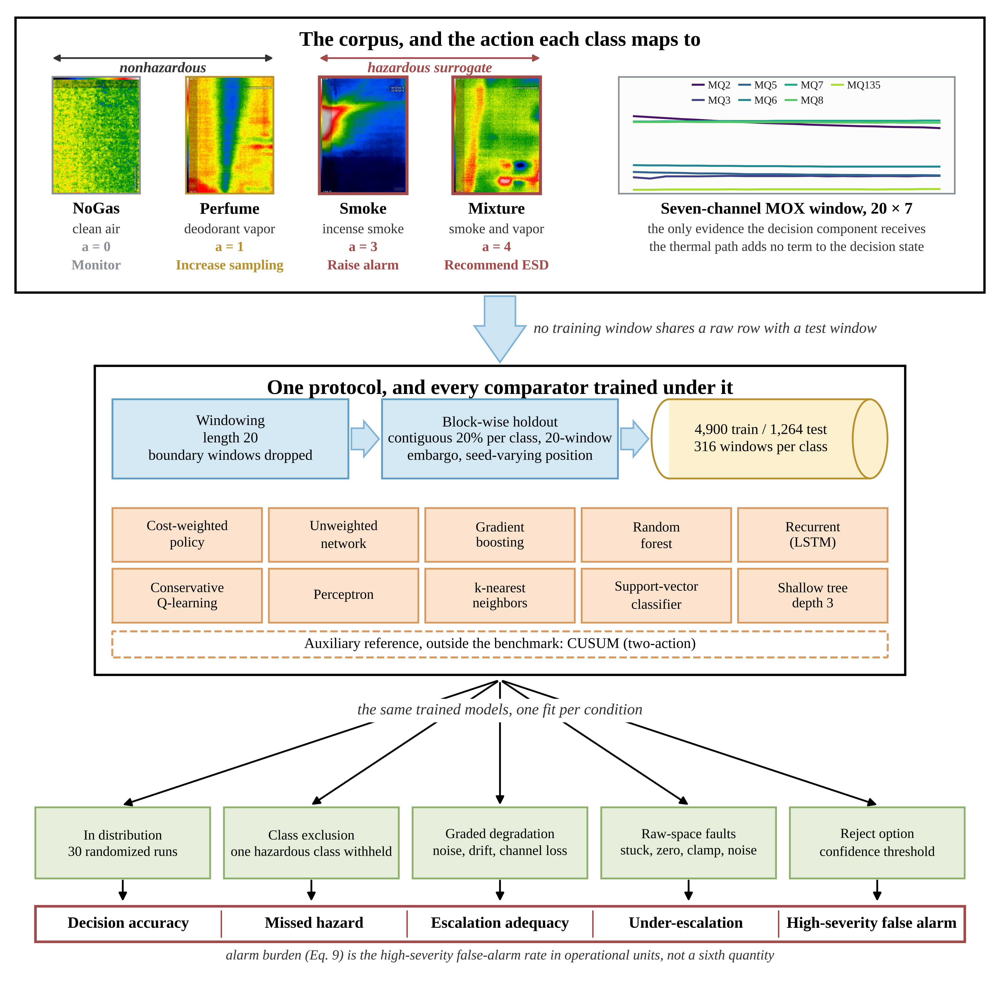
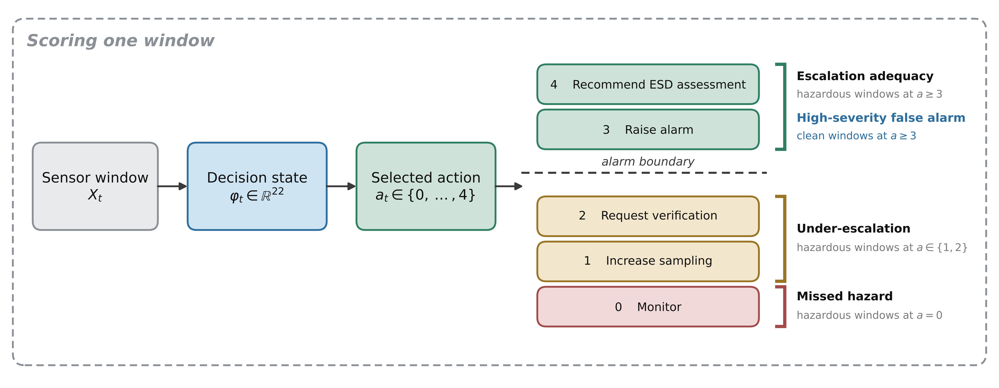
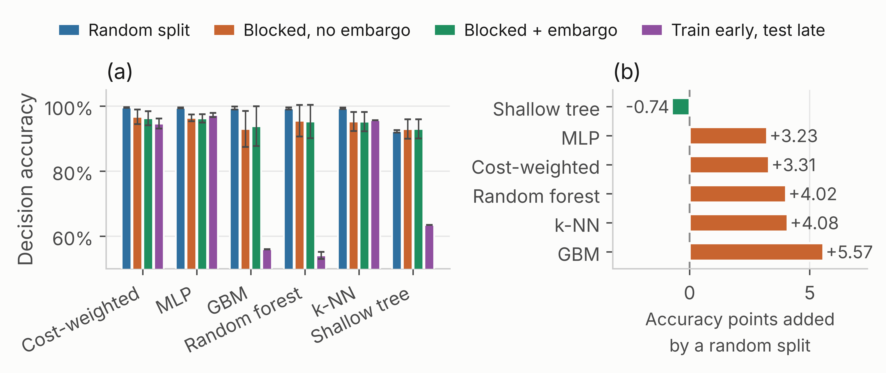
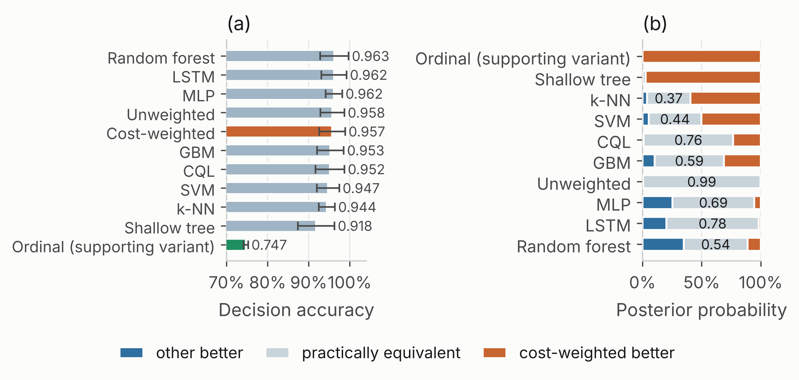
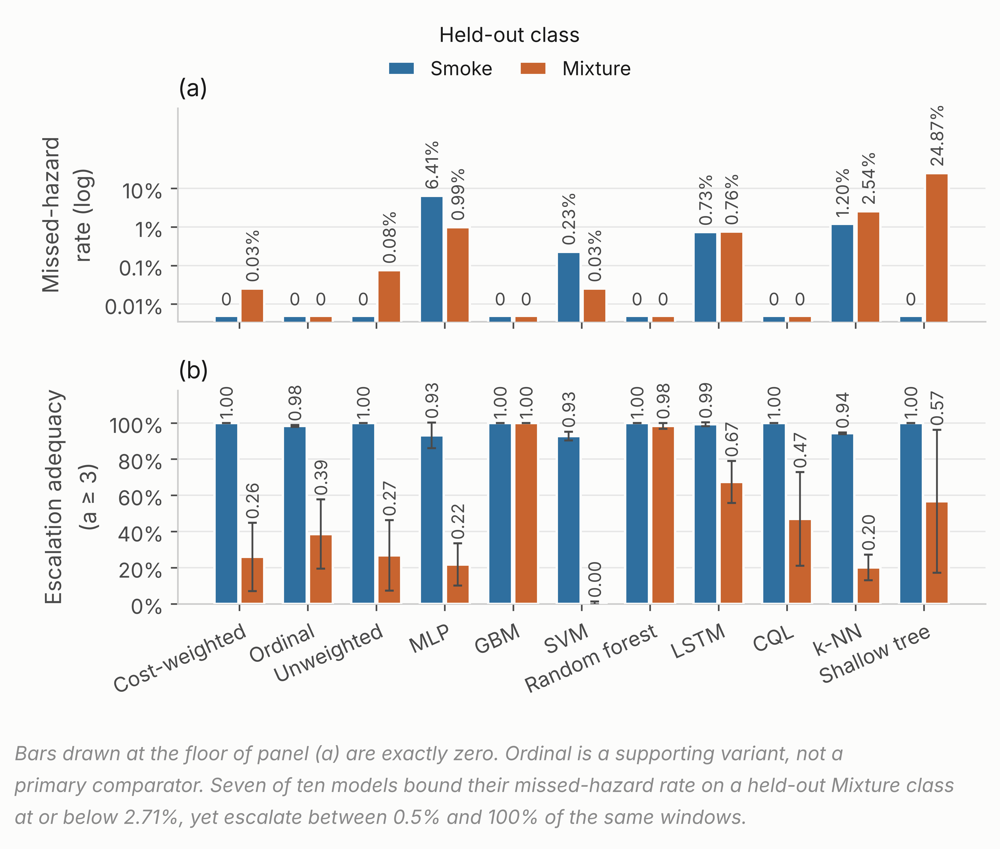
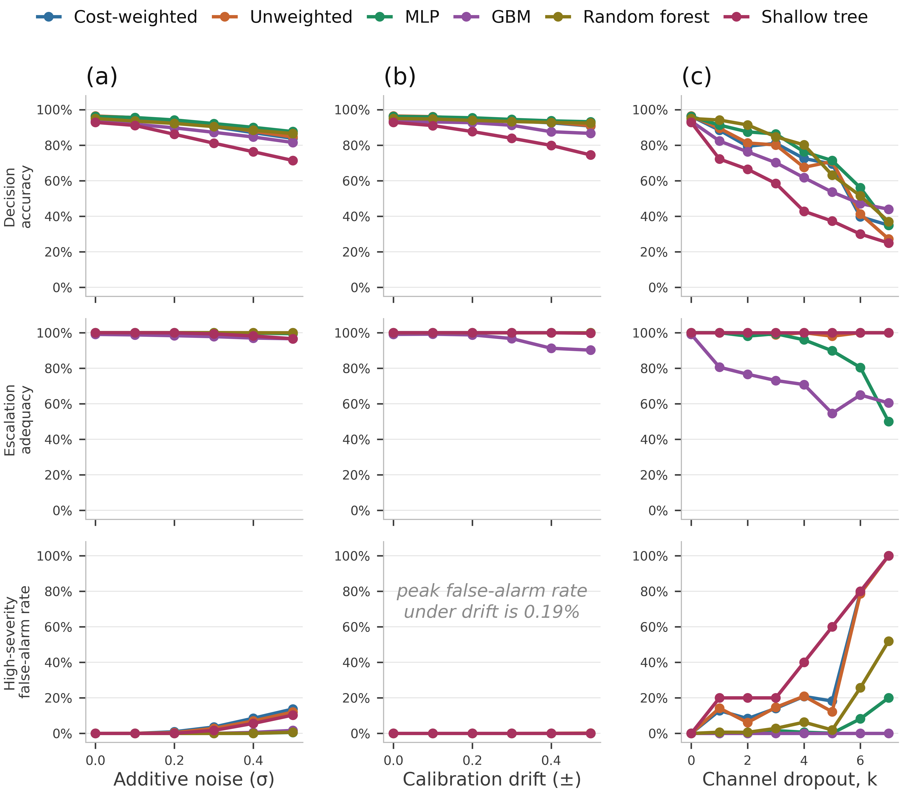

# A Safety-Oriented Benchmark for Learned Gas-Monitoring Models Under Class Exclusion and Sensor Degradation

Benjamin C. Nweke^1,2,\*^, Gholamreza Ramezan^2^, Soheil Saraji^1^

^1^ Subsurface Energy and Digital Innovation Center, University of Wyoming\
^2^ Fides Innova Labs

^\*^ Corresponding author; email: bnweke@uwyo.edu

Keywords: benchmarking; MOX gas sensors; safety-oriented evaluation; temporal data leakage; class-disjoint evaluation

Supplementary Material is available in support of this paper.

---

## Summary

Fixed gas detectors add to operator alarm burden, yet learned gas-monitoring models are ranked almost entirely by classification accuracy, which says nothing about how often a hazard draws no response or clean air draws a high-severity one. This paper is a benchmark study of learned gas-monitoring decision models. It scores ten comparators on a five-quantity evaluation set, decision accuracy beside four safety-relevant rates, under leakage-controlled partitioning, class exclusion and graded sensor degradation, with cumulative-sum (CUSUM) as an auxiliary reference. Three findings are emphasized. Random splitting over overlapping windows raises accuracy by 3.23 to 5.57 points for every temporal model. Ten comparators sit within 4.43 accuracy points in distribution, yet withholding one hazardous class separates them: in the worst partition the poorest model misses 234 of 1,581 Smoke windows and 988 of 1,581 Mixture windows. Seven of ten comparators with miss bounds at or below 3.3% span an escalation spread of about 200, so miss rate alone cannot be the criterion. Raw-space faults expose a clamped array routing every hazardous window below alarm grade. Results concern surrogate analytes, a constructed action ladder and synthetic perturbation, not hydrocarbons, facility alarm philosophy or physical sensor failure. Report miss rate with an honest bound, escalation adequacy and alarm burden together.

---

## Introduction

Many process-safety incidents involve warning indications that do not lead to timely intervention. In the eleven minutes before the Milford Haven refinery explosion the control-room operator received 275 alarms (Goel et al. 2017). Sensing was not the failure; turning what was sensed into a decision was.

The same question arises at upstream and midstream facilities, where fixed point-gas detectors feed alarm systems that already run at or above the rates industry guidance treats as manageable for one operator (Engineering Equipment and Materials Users’ Association [EEMUA] 2024; International Society of Automation [ISA] 2016). Machine learning has been applied far more heavily to detection than to disposition. Published gas-detection models are ranked by classification accuracy, yet their results are high, closely spaced and not directly comparable (Table S17). Accuracy also treats errors symmetrically. A hazard that draws no response forfeits the whole intervention window, a sub-alarm response notifies nobody, and a clean condition that draws a high-severity response degrades the alarm system that later hazards depend on (Laberge et al. 2014).

Reconstruction-based anomaly detectors, embedded vision models, gas-detection networks optimized for the same constraint and cost-sensitive learning are all established (Malhotra et al. 2016; Korjani et al. 2024; Dehnaw et al. 2024; Elkan 2001). Less developed is the downstream disposition of a hazardous observation, and whether that disposition holds when the hazard is unfamiliar and the sensing is degraded. Six research questions (RQ) follow.

i. RQ0. Does the choice of partitioning protocol change what a comparison reports?
ii. RQ1. Does accuracy-ranked model selection survive a missed-hazard criterion?
iii. RQ2. Do models that agree in distribution still agree when the hazard is one they were never trained on?
iv. RQ3. Is missed-hazard rate sufficient, or can it be satisfied by under-response that a miss count never registers?
v. RQ4. Do these behaviors survive sensor-fault perturbation, applied to the standardized decision state and to the raw signal? Both are synthetic: no hardware was faulted.
vi. RQ5. If a model may decline rather than act, does that repair the inadequate responses of RQ3, and at what cost?

The first contribution is an evaluation protocol: a leakage-controlled block-wise holdout with a two-sided embargo, a graded action target that keeps missed hazard, under-escalation and high-severity false alarm apart, and class-disjoint evaluation against a held-out hazardous class. Every zero count carries both an independence-reference binomial bound and a disjoint-support bound about twenty times wider. We did not find a prior study combining these on a MOX gas-detection benchmark.

The second contribution is what that protocol measures. Ten models lie within 4.43 accuracy points in distribution and are nearly indistinguishable on every safety metric. Withholding a hazardous class separates them: on Smoke, six record no missed hazard in any partition and the worst partition misses 234 of 1,581 held-out windows, while on Mixture the worst partition, for a shallow decision tree, misses 988 of 1,581. Missed-hazard rate is necessary but not sufficient, because seven comparators with worst-partition miss bounds at or below 3.3% span the full range of escalation adequacy. Cost-ratio sweeps and a deterministic label-function reference return negative results, reported as such.

Three further components are released with the protocol: a reject-option baseline, raw-space fault injection, and interpretable comparators (a shallow decision tree and CUSUM) run under the same protocol. Raw-space injection shows that an array clamped at the high end of its trained range fails silently, so a one-sided abnormality threshold is blind to the mode carrying the highest missed-hazard rate tested.

This study does not aim to advance classification accuracy on this benchmark. It asks what a model does when the accuracy column cannot distinguish candidates, which on this corpus is most of the time.

---

## Related Work and Positioning

*Detection Stops Short of a Decision.* Gas-hazard detection rests on a well-developed base of hardware and software methods, from distributed acoustic and fiber-optic sensing to mass balance and model-based diagnostics (Murvay and Silea 2012; Adegboye et al. 2019; Zhang et al. 2013; Rousselet et al. 2011), including deep-learning electronic-nose classification (Faleh and Kachouri 2023), whose performance is uneven under real operating conditions (Han and Kim 2014). All of them stop at an indication, a location or a concentration, and the literature evaluating them does not ask whether the downstream response would have been adequate. Reconstruction-based sequence models trained on normal operation are the standard unsupervised route to sensor anomaly detection (Malhotra et al. 2016; Liang et al. 2023; Lima et al. 2026). An anomaly score is still intermediate, since nothing in training calibrates it to hazard severity, so a safety path using one must show that it ranks hazard monotonically. We test that below.

*A Saturated Benchmark.* MultimodalGasData pairs thermal frames with a seven-channel MOX array, and the original work showed fusion beats either modality alone: 96% fused against 82% for MOX and 93% for thermal (Narkhede et al. 2021, 2022). Later results are high but not comparable across tasks and test sets: Sharma et al. (2024) report 99.7% validation accuracy for a federated multimodal model; El El Barkani et al. (2024) report 91.7% on thermal images alone on embedded hardware; and Zhang and Zhang (2025) report 98.9% for a binary leak task on a simulated test set of their own collection, and 95.4% on field data from a methane emissions test facility. These figures appear to be computed on randomized splits over temporally adjacent observations from the same acquisition campaign, the confound Dennler et al. (2022) demonstrated in a widely used MOX benchmark, and they report classification rather than action-level quantities. The same thermal classifier, retrained under the block-wise holdout the sensor path uses, averages 85.0% over five seeds (Supplementary Section S1), so its randomized figures are not evidence about deployment performance.

*Unknown Gases Are Not a New Problem.* Open-set recognition is established. Qu et al. (2022) showed closed-set classifiers assign unknown analytes to known classes with high confidence; Ma et al. (2024) pursued it with a multi-scale temporal convolutional network; Yao et al. (2024) and Vergara et al. (2012) treat the unknown class jointly with drift, and Lin and Zhan (2026) compensate drift by knowledge distillation. Gas-leakage detection work is often scored on recognition (Kumar et al. 2024). Among the studies reviewed here we did not find one mapping an unfamiliar hazardous class onto a graded response ladder and separating passive silence, sub-alarm routing and alarm-grade notification. The experiment occupies that gap, and it is not an open-set method: it withholds a class, lets ordinary closed-set models do what they do, and records the action.

*Alarm Analytics, Cost Sensitivity and Coordination.* Industrial alarm systems have their own analytics literature: Wang, J. et al. (2016) survey alarm overloading, and EEMUA (2024) and ISA (2016) codify the performance envelopes it targets. That work improves an existing alarm system; the question here is the prior one, what to measure before a learned model becomes a source of alarms. That error costs are unequal has had a clean treatment since Elkan (2001), but whether an asymmetry moved the error it was introduced to suppress is reported far less often, and we run that test. Coordinated multi-model systems have been applied in the energy sector (Sabbagh et al. 2024; Santiago et al. 2025; Jessen and Roshchin 2025). Explanation matters because trust and post-incident accountability depend on it, and a fluent explanation that does not match its decision is worse in a control room than none.

*Where This Study Sits.* Table S17 lists representative prior work with the evaluation gap each leaves open, and states our own limitation in the same column. The contribution is a pre-deployment evaluation protocol for learned gas-monitoring components that separates recognition correctness, passive hazard miss, operator-notification adequacy and alarm burden, and measures all four under controlled class exclusion and perturbation. No new architecture is proposed; the protocol is a benchmarked template a facility could adapt once it has substituted its own hazard definitions, alarm philosophy, response thresholds and fault models.

---

## Methodology

The pipeline combines established components; the contribution is the evaluation protocol and metric set. **Fig. 1** gives the workflow, from corpus and action map through a single protocol to the five conditions every trained model is put through, all read with the same five-quantity set.

{width=6.50in}

Fig. 1—Workflow of the study: one corpus, one protocol, five conditions and the evaluation set they are read with.

*Corpus and Preprocessing.* The public MultimodalGasData corpus (Narkhede et al. 2022; Mendeley Data, CC BY 4.0) pairs a seven-channel MQ-series metal-oxide (MOX) array with thermal frames from a Seek Compact camera, at 2 s intervals. MOX elements respond broadly and cross-sensitively, so the array is informative because its seven responses differ in relative magnitude rather than because any channel is selective. There are 6,400 labeled samples in four classes of 1,600: clean air (NoGas), incense smoke (Smoke), alcohol-based deodorant vapor (Perfume), and a mixture of the two (Mixture), one frame of each in **Fig. 1**. Smoke and Mixture are hazardous surrogate conditions throughout, not facility hazards. Table S18 lists the array and the gases each element is marketed to sense.

Two properties shaped what follows. The analytes are surrogates: they exercise the MOX transduction mechanism, the array's cross-sensitivity and its baseline drift, but establish nothing about methane or anything heavier. And the four classes were recorded as four contiguous blocks. The serial-number column restarts three times across the 6,400 readings, so the corpus is four acquisition runs of 1,600 readings spanning about 213 minutes. Baseline drift within a run is therefore confounded with class identity, which motivates the leakage-controlled evaluation set out next.

*Leakage-Controlled Partitioning.* Seven-channel readings form sliding windows of length 20, each labeled by its final reading, with windows spanning a class boundary discarded so that no window mixes two classes. That leaves 6,324 windows, 1,581 per class. Consecutive windows share 19 of 20 raw rows, so a random split drops near-duplicates into both partitions, and a sequential split is no better because the corpus is block-ordered by class. The protocol is a block-wise holdout: inside each class block a contiguous 20% forms the test partition, separated from training by an embargo of *G* = 20 windows on each side, so no training window shares a raw row with a test window. The held-out block's position moves with the run seed, so the reported dispersion includes partition variance (Bouthillier et al. 2021). The result is 4,900 training and 1,264 test windows, 316 per class, with feature scaling and anomaly normalization fitted on the training partition. The layout is drawn in Fig. S12.

*What Is Evaluated, and What Is Not.* Each cycle the system takes a thermal image *I*ₜ and a sensor window Xₜ ∈ ℝ^(20×7)^ and returns a safety action *a*ₜ ∈ {0, …, 4} with an explanation *E*ₜ. It runs through five parts: perception, anomaly scoring by reconstruction error against a normal-only model, coordination into a decision state, decision, and reasoning. Every number in this paper is produced by the sensor-policy core, which takes the 22-dimensional sensor state of Eq. 1 and emits an action; the thermal branch contributes no term to that state. The running implementation also wraps the policy in deterministic guardrails, an anomaly-threshold override and a promotion rule driven by the thermal classifier. These are not benchmarked, because a guardrail that raises actions would lift every comparator toward saturation, which is what this evaluation exists to break out of. No result below describes end-to-end behavior of the deployed system.

The pipeline is advisory and actuates nothing: *Recommend ESD assessment* (ESD, emergency shutdown) refers a condition under the facility procedure and does not command a trip. The International Electrotechnical Commission standard IEC 61511 (IEC 2016) sets lifecycle and independence expectations for safety instrumented systems, and this component sits in the operator-support layer outside any safety instrumented function. The separation is kept because one learned component selecting across both the alarm and the shutdown layer would make those layers share a dependency.

*Component Models.* The evaluated core is assembled from a thermal classifier (YOLOv8n-cls; Jocher et al. 2023), a long short-term memory (LSTM) autoencoder supplying a scalar anomaly score, a coordination step that forms the state, and a feedforward decision network with a dueling value and advantage head (Wang, Z. et al. 2016) trained by cost-weighted cross-entropy on the target action rather than by reinforcement learning. Architectures, layer sizes and training settings are in Supplementary Section S17, with the three component diagrams as Figs. S7 to S9.

*Coordination.* The 22-dimensional decision state is

&nbsp;&nbsp;&nbsp;&nbsp;φₜ = [ ρ̃ₜ , Xₜ[−1,:] , δₜ , σₜ ] ∈ ℝ²²  ............ (1)

with ρ̃ₜ the normalized anomaly score, Xₜ[−1,:] the current seven-channel reading, δₜ the per-sensor change across the window, and σₜ the per-sensor standard deviation. There is no visual term in the state.

*Decision.* Training targets come from the single-valued map *y*(·) of Eq. 2a; evaluation scores against the acceptable set *A*(·) of Eq. 2b (Fig. S9).

> The action labels in Eq. 2a and Eq. 2b are constructed evaluation targets. They are not facility alarm requirements, not a safety instrumented function specification, and not derived from any concentration, release rate, lower-explosive-limit fraction, toxic-exposure limit or consequence model. No such quantity exists in this corpus. Every metric defined on this ladder measures agreement with the constructed target, not consequence avoided.

Two distinct objects are needed, so they are given separate names. The training target *y*(*g*) is single-valued, one action per class, and is what the loss is computed against. The acceptable set *A*(*g*) is what evaluation scores against, and for one class it holds two actions:

&nbsp;&nbsp;&nbsp;&nbsp;*y*(NoGas) = 0, *y*(Smoke) = 3, *y*(Mixture) = 4, *y*(Perfume) = 1;  ............ (2a)

&nbsp;&nbsp;&nbsp;&nbsp;*A*(NoGas) = {0}, *A*(Smoke) = {3}, *A*(Mixture) = {4}, *A*(Perfume) = {1, 2}.  ............ (2b)

Perfume is the only class where the two differ. It is a nuisance odorant for which raising the sampling rate or requesting verification are both defensible, so both count as acceptable while training picks the lower. Action 2 is therefore never a positive training target: it is an admissible evaluation response and a rung a model can reach only by accident.

Each sample carries a loss weight *w*(*g*ₜ) equal to *c*~miss~ for hazardous classes and *c*~false~ otherwise, with *C* = *c*~miss~ / *c*~false~. The objective is

&nbsp;&nbsp;&nbsp;&nbsp;*L*(θ) = − (1/*N*) Σₜ *w*(*g*ₜ) · log *p*~θ~( *y*(*g*ₜ) | φₜ )  ............ (3)

where *p*~θ~ is the softmax over the five action scores and *p*~θ~(*y* | φ) is the probability it assigns to the single target action. *C* = 8:1 is retained as the reference configuration from the original experiment design and the rest are swept below. It is a reference and not a deployed setting because, as Experiment 4 shows, it was not selected by a defensible validation procedure.

Two consequences bound what can be claimed. Because *y*(·) is a deterministic function of the class label, decision accuracy is four-class classification accuracy composed with a fixed map, so the two framings differ in error metric, not in task. And a rule applying *y*(·) to the true label hits 100% by construction, consuming the label it is meant to infer, so it appears below as a label-function reference and never as a baseline.

*Comparators.* Ten primary comparators run under one protocol: the cost-weighted policy of Eq. 3 and an unweighted network of identical topology, a multilayer perceptron, clean-air-weighted gradient boosting, a random forest, a radial-basis-function (RBF) support-vector classifier, k-nearest neighbors, a recurrent network, conservative Q-learning and a shallow decision tree on the seven raw channels. CUSUM (Page 1954) is an auxiliary two-action process-monitoring reference, evaluated separately for the in-distribution safety metrics and outside the cross-model benchmark. Specifications are given in Supplementary Section S5. Twelve models appear in total, since the ordinal cost objective of Experiment 4 is a variant of the decision component rather than an independent method. Because it never emits the Monitor action its safety zeros are structural, so it is reported under Experiment 4 and excluded from every count of comparators. Table S19 states which model appears in which experiment.

*The Evaluation Metric Set.* Five quantities rather than one, and this set is the proposal: decision accuracy beside four safety-relevant rates. Alarm burden is the false-alarm rate in operational units (Eq. 9), not a sixth quantity. **Table 1** gives the action space and **Fig. 2** shows where each quantity reads it.

| Action | Label | Operational response |
|---|---|---|
| 0 | Monitor | Routine monitoring, no operator notification |
| 1 | Increase sampling | Elevated scan frequency and event logging |
| 2 | Request verification | Secondary sensor check and event logging; no alarm is raised |
| 3 | Raise alarm | Automated alarm, incident logging, field dispatch |
| 4 | Recommend ESD assessment | Refer the condition for emergency-shutdown assessment under the facility procedure |

Table 1—Safety-action space and its alarm boundary.

The ladder is a constructed instrument. *Smoke* maps to *Raise alarm* and *Mixture* to *Recommend ESD assessment* because the two have to be separable for the metrics to measure anything, not because a consequence model put them there. What the argument needs is only a graded response space with an alarm boundary inside it, so that a response can be inadequate without being absent. Actions 3 and 4 are alarm-grade, and actions 1 and 2 place nothing in front of an operator. Because *y*(·) in Eq. 2a never assigns action 2, the empirical decision space is a four-action one, and every metric below counts escalation as *a* ≥ 3 and under-escalation as *a* ∈ {1, 2}. Experiment 3 measures what moving that boundary would do. The boundary sits at action 3 by definition of this protocol: *Request verification* runs a secondary sensor check and logs the event, but it notifies no operator, so the metrics count it as sub-alarm.

{width=6.50in}

Fig. 2—One window, one action, and the boundary each metric reads.

Let the test partition be windows *t* = 1 … *N*~test~ with true classes *g*ₜ and selected actions *a*ₜ, let *H* = {*t* : *g*ₜ ∈ {Smoke, Mixture}} be the hazardous-surrogate windows and *Z* = {*t* : *g*ₜ = NoGas} the clean ones, and let 1[·] be the indicator function.

*Decision accuracy* is the share of test windows assigned an action in the acceptable set,

&nbsp;&nbsp;&nbsp;&nbsp;Acc = (1/*N*~test~) Σₜ 1[ *a*ₜ ∈ *A*(*g*ₜ) ].  ............ (4)

Decision accuracy is reported for continuity with prior work. It is not a safety metric, nor treated as one here.

*Missed-hazard rate* is the share of hazardous windows assigned the passive *Monitor* action,

&nbsp;&nbsp;&nbsp;&nbsp;*R*~miss~ = (1/|*H*|) Σ~t∈H~ 1[ *a*ₜ = 0 ].  ............ (5)

Only *a* = 0 counts, so assigning a hazardous window to *Raise alarm* when *Recommend ESD assessment* was the target is not a miss: an operator is still notified. Its limitation is that *Increase sampling* and *Request verification* are also not misses, though neither places anything in front of an operator, which is why the next two quantities exist.

*Escalation adequacy* is the share of hazardous windows assigned an alarm-grade action, and *under-escalation* the share receiving a sub-alarm one,

&nbsp;&nbsp;&nbsp;&nbsp;*R*~esc~ = (1/|*H*|) Σ~t∈H~ 1[ *a*ₜ ≥ 3 ],  ............ (6)

&nbsp;&nbsp;&nbsp;&nbsp;*R*~under~ = (1/|*H*|) Σ~t∈H~ 1[ *a*ₜ ∈ {1, 2} ].  ............ (7)

By construction *R*~miss~ + *R*~under~ + *R*~esc~ = 1, so the three partition the hazardous windows and no response is counted twice or left out. It is precisely this partition that a miss metric alone collapses.

*High-severity false-alarm rate* is the share of clean windows assigned an alarm-grade action, and the corresponding alarm burden is that rate expressed per 1,000 clean windows,

&nbsp;&nbsp;&nbsp;&nbsp;*R*~fa~ = (1/|*Z*|) Σ~t∈Z~ 1[ *a*ₜ ≥ 3 ],  ............ (8)

&nbsp;&nbsp;&nbsp;&nbsp;*B* = 1000 · *R*~fa~.  ............ (9)

Eq. 9 makes the quantity comparable with an alarm budget; dividing instead by the number of alerts raised gives a number that cannot be. The set *Z* is the clean-air (NoGas) windows, a deliberately narrow denominator. Perfume windows are also nonhazardous under Eq. 2b, so an alarm-grade action on one is an unnecessary alarm by the same map; every value of Eq. 8 therefore carries a companion rate over all nonhazardous windows, and Experiment 3 shows the two can disagree. 

*Three levels, announced in advance.* Alarm-grade indication density is *B* itself. Eventized alarm rate collapses contiguous alarm-grade windows into annunciated episodes under a stated persistence rule. Operator burden would compare that episode rate against a facility's own alarm philosophy, which this study does not attempt. The first two differ by between 5 and 316 times here and order the models differently, so any statement about operator load rests on the second.

*Bounds on every zero.* An observed zero is not a demonstrated zero. All zero-count claims carry a one-sided 95% upper bound from the Clopper-Pearson construction (Clopper and Pearson 1934), called here an independence-reference binomial upper bound. Clopper-Pearson is exact only under the binomial model, which requires *N*~opp~ independent Bernoulli trials, and this corpus is one continuous recording decomposed into windows overlapping by 19 of 20 raw rows. The bound fixes a reference point any reader can recompute and compare across models; it is not a confidence statement about an operational failure rate, and every number it produces is optimistic. For *k* observed failures in *N*~opp~ opportunities at confidence *c*,

&nbsp;&nbsp;&nbsp;&nbsp;*U*(*k*, *N*~opp~) = BetaInv( *c*; *k* + 1, *N*~opp~ − *k* ),  ............ (10)

For *k* = 0 this reduces to *U* = 1 − (1 − *c*)^(1/*N*~opp~)^. Two conventions are reported throughout: an independence-reference Clopper-Pearson bound of Eq. 10 with the partition as the unit, and a conservative disjoint-support bound counting only non-overlapping windows. Bounds are computed from the counts, never from the averaged rate. About a factor of twenty separates them on a zero count, which is why no ratio of bounds is quoted as a finding in this paper. Supplementary Section S18 derives both, and reports the moving-block bootstrap beside them.

**Table 2** states the metric set in the form proposed for adoption, including what each quantity does not catch, since a reporting standard that omits its own blind spots is the problem this paper is about. Entries given as mean ± standard deviation (SD) are taken over runs.

| Quantity | Symbol | Reads | Catches | Does not catch | Report with |
|---|---|---|---|---|---|
| Decision accuracy | Acc, Eq. 4 | all windows | overall correctness | any asymmetry between error types | SD across seed-varying partitions |
| Missed-hazard rate | *R*~miss~, Eq. 5 | hazardous windows at *a* = 0 | the fully passive response to a hazard | sub-alarm responses that notify nobody | independence-reference upper bound and disjoint-support reference bound, Eq. 10 |
| Escalation adequacy | *R*~esc~, Eq. 6 | hazardous windows at *a* ≥ 3 | whether an operator is notified | which alarm-grade action was chosen | SD across partitions, and the boundary assumed |
| Under-escalation | *R*~under~, Eq. 7 | hazardous windows at *a* ∈ {1, 2} | the gap a miss metric hides | how severe the under-served hazard was | beside *R*~esc~, since the two sum with *R*~miss~ to 1 |
| High-severity false-alarm rate | *R*~fa~, Eq. 8 | clean windows at *a* ≥ 3 | operator attention spent on clean air | nuisance actions below the alarm boundary | burden per 1,000 windows, Eq. 9, and a bound on a zero |

Table 2—The proposed evaluation set, with the blind spot of each quantity.

*Protocol and Statistics.* Two protocols are used. The five-seed protocol (42, 1337, 7, 2024, 99), each seed carrying its own block position, covers experiments that vary something other than the model. It is a descriptive robustness check, not a basis for ranking models. Five paired observations cannot support a ranking: the two-sided Wilcoxon signed-rank test has a minimum attainable *p*-value of 2^(1−*N*~run~)^ = 0.0625 at *N*~run~ = 5, so no five-seed comparison reaches α = 0.05 at any effect size.

The model comparison itself is run 30 times, with seed, held-out block position and a hyperparameter draw all varying per run (Bouthillier et al. 2021), none of it tuned against the test partition. With 30 runs we use the Bayesian correlated *t*-test of Benavoli et al. (2017) at a correlation ρ = *n*~test~/(*n*~train~ + *n*~test~) = 1,264/(4,900 + 1,264) = 0.2051, computed from the partition the pipeline builds. Integrating the posterior over a region of practical equivalence of ± 1 accuracy point returns the probability that one model is practically better, that the other is, or that the two are equivalent; that third probability is a positive statement a null hypothesis test cannot give. Benavoli et al. derive the correlation term for *k*-fold cross-validation, so ρ is carried across from a design that is not quite this one, and the comparison is reported over ranges of ρ and of equivalence width (Supplementary Section S6). The full derivation is in Supplementary Section S28. Runs are seeded and execution is limited to two threads; no global determinism flag is set in the drivers that produced these results.

---

## Results

This section reports eight experiments. Component behavior comes first, then the evaluation protocol itself as the subject of Experiment 1, because every number after it depends on that protocol being defensible, then the six experiments that answer a research question; the two carrying none are grouped as supporting evidence. **Table 3** maps the questions onto the experiments that answer them.

| Question | Answered by | Answer |
|---|---|---|
| RQ0. Does the partitioning protocol matter? | Experiment 1 | Yes, and among temporal models by more than the model choice does |
| RQ1. Does accuracy-ranked selection survive a missed-hazard criterion? | Experiments 2 and 3 | In distribution the question is moot, since no metric discriminates; under the class-disjoint shift, no |
| RQ2. Do models that agree in distribution agree on a held-out hazardous class? | Experiment 3 | No: on Smoke six models record no missed hazard in any partition and the worst partition misses 234 of 1,581 windows, while on Mixture the worst partition misses 988 of 1,581 and escalation adequacy spans a factor of about 200 among seven comparators |
| RQ3. Is missed-hazard rate sufficient on its own? | Experiment 3 | No, under-escalation satisfies it while notifying nobody |
| RQ4. Do these behaviors survive perturbation of the decision state, and of the raw signal? | Experiments 6 and 8 | No. Three failure modes appear in standardized space, and in raw space a clamped array is silent while the normalized anomaly feature falls below its clean value |
| RQ5. Does a reject option repair the under-escalation of RQ3? | Experiment 7 | Partly. The strictest threshold raises escalation for the models that gain most, but only by declining 36% to 80% of clean windows, and the repair is as model-dependent as the failure |
| Supporting evidence, no question | Experiments 4 and 5 | Cost asymmetry and decision-state contribution; reported together below and in full in the supporting information |

Table 3—Research questions and the experiments that address them.

*Component Behavior.* The thermal classifier's 98.8% top-1 accuracy on 1,280 held-out images comes from the original checkpoint, trained under a randomized split. Retraining that protocol with the same settings gives 98.0 to 98.3% over three seeds, comparable to published randomized figures and comparably optimistic. Under the block-wise holdout the sensor path uses, the same classifier reaches 79.2 to 92.1% over five seeds, a mean of 85.0%, and calls between 0 and 65 of the 640 hazardous frames non-hazardous in each run (Supplementary Section S1, Table S1c). The anomaly score separates clean air from hazard in the mean but overlaps on the NoGas and Perfume boundary, and refitting it inside each training partition lowers its held-out area under the receiver operating characteristic curve (ROC-AUC) substantially (Supplementary Section S21, Fig. S10).

*Experiment 1: Sensitivity of Reported Accuracy to the Partitioning Protocol.* Random splitting over overlapping sliding windows is standard in this literature and places near-duplicates in both partitions (Dennler et al. 2022), but that was shown on a different MOX benchmark, so it is measured here. Six models were trained under four protocols (**Table 4**, **Fig. 3**): a uniformly random 80/20 split; a contiguous per-class block with no separation band; that block with the 20-window embargo used everywhere else here; and training on the first 60% of each class block, testing on the last 20%, discarding the middle 20%.

| Model | Random split | Blocked, no embargo | Blocked + embargo | Train early, test late |
|---|---|---|---|---|
| Cost-weighted policy | 0.9956 ± 0.0009 | 0.9669 ± 0.0224 | 0.9625 ± 0.0215 | 0.9462 ± 0.0155 |
| Multilayer perceptron | 0.9945 ± 0.0015 | 0.9638 ± 0.0103 | 0.9622 ± 0.0129 | 0.9724 ± 0.0064 |
| Gradient boosting | 0.9940 ± 0.0044 | 0.9296 ± 0.0553 | 0.9383 ± 0.0611 | 0.5598 ± 0.0004 |
| Random forest | 0.9927 ± 0.0031 | 0.9549 ± 0.0485 | 0.9525 ± 0.0512 | 0.5409 ± 0.0108 |
| k-nearest neighbors | 0.9929 ± 0.0024 | 0.9525 ± 0.0291 | 0.9521 ± 0.0295 | 0.9566 ± 0.0000 |
| Shallow decision tree | 0.9223 ± 0.0037 | 0.9294 ± 0.0298 | 0.9297 ± 0.0295 | 0.6349 ± 0.0000 |
| Mean | 0.9820 | 0.9495 | 0.9496 | 0.7685 |

Table 4—Decision accuracy under four partitioning protocols, mean ± SD over five runs, each with its own seed-varying partition and model initialization.

Randomized splitting increased reported decision accuracy by 3.23 to 5.57 percentage points for every model reading temporal features, 4.04 points on average across those five, while those same five span 2.42 points between them under the blocked protocol. The choice of partitioning therefore moves the reported number by about 1.7 times more than the choice of model. Adding the shallow decision tree, which the protocol barely touches, brings the two quantities to 3.24 against 3.28 points, so the claim is stated for temporal models. On a benchmark reported at four significant figures this is the difference between 0.99 and 0.95, wider than the spread separating published results on this corpus.

Two factors are confounded in that contrast: near-duplicate windows can land on both sides of a random split, and a random split draws training data from the whole recording. A stride-20 control at a matched 256-window training budget returns a null result rather than a decomposition, because both arms sit well below the operating point of every other table here (Supplementary Section S10), so the contrast should not be attributed to overlap alone. Training early and testing late is harsher: it costs the random forest 41.2 points, gradient boosting 37.9 and the shallow decision tree 29.5, while the perceptron and k-nearest neighbors barely move.

{width=6.50in}

Fig. 3—Protocol sensitivity. (a) Decision accuracy under four partitioning protocols. (b) Accuracy points added by a random split.

*Experiment 2: In-Distribution Model Comparison.* Every comparator was trained 30 times under the protocol above and evaluated on the corresponding held-out partition (**Table 5**, **Fig. 4**). This addresses RQ1. FA denotes the high-severity false-alarm rate. Entries are mean ± SD across runs varying block position, initialization and a hyperparameter draw. Study-defined expected cost is the mean of the hand-designed, untuned ordinal matrix of Supplementary Section S3, a study-internal quantity and not a deployment-derived cost. The final column is the posterior probability of practical equivalence to the cost-weighted policy under Eq. S2 at a region of practical equivalence of ± 1 accuracy point.

| Model | Decision accuracy | SD | Missed-hazard | Escalation | High-severity FA | Study-defined expected cost | P(equivalent) |
|---|---|---|---|---|---|---|---|
| Random forest | 0.9625 | 0.0346 | 0.0000 | 1.000 | 0.0000 | 0.0510 | 0.539 |
| Recurrent (LSTM) | 0.9618 | 0.0308 | 0.0000 | 0.999 | 0.0000 | 0.0680 | 0.779 |
| Multilayer perceptron | 0.9615 | 0.0202 | 0.0002 | 1.000 | 0.0000 | 0.0637 | 0.691 |
| Unweighted network | 0.9578 | 0.0293 | 0.0000 | 1.000 | 0.0000 | 0.0670 | 0.992 |
| Cost-weighted policy | 0.9573 | 0.0318 | 0.0000 | 1.000 | 0.0000 | 0.0690 | reference |
| Gradient boosting | 0.9529 | 0.0325 | 0.0033 | 0.993 | 0.0000 | 0.0903 | 0.586 |
| Conservative Q-learning | 0.9519 | 0.0354 | 0.0000 | 1.000 | 0.0000 | 0.0857 | 0.756 |
| Support-vector classifier | 0.9472 | 0.0274 | 0.0000 | 1.000 | 0.0000 | 0.0946 | 0.445 |
| k-nearest neighbors | 0.9443 | 0.0196 | 0.0000 | 1.000 | 0.0000 | 0.0939 | 0.367 |
| Shallow decision tree | 0.9183 | 0.0445 | 0.0000 | 1.000 | 0.0000 | 0.1233 | 0.027 |

Table 5—Model comparison over 30 randomized runs.

Measured by Eq. 4, the ten comparators span 4.43 accuracy points, from 0.9183 to 0.9625. The random forest has the highest accuracy and lowest expected cost, and the shallow decision tree on seven raw sensor values sits 4.4 points behind the best learned model. The safety metrics are weakly discriminative here, because almost every model produces the same safety outcome under the nominal distribution. Eight of ten comparators record no observed missed hazard, and escalation adequacy lies between 0.993 and 1.000 for all ten; the two that miss, gradient boosting and the perceptron, miss at most 0.33% of hazardous windows. No comparator in **Table 5** produces an observed high-severity false alarm across 30 runs, but CUSUM, run over five seeds and outside **Table 5**, does, at 0.1861. Its decision accuracy of 0.4535 ± 0.1010 is not comparable, since a two-state output is scored against a four-class target map. Full escalation costs alarming on roughly one clean window in five, and the observed zeros bound the worst-partition rates at 0.47% and 0.94%.

The cost-weighted policy is practically equivalent to the unweighted network with posterior probability 0.992, the only comparison that stays equivalent across the whole evaluated ρ and equivalence-width ranges, so removing the cost weighting very likely makes no difference that matters on this corpus. Equivalence to the recurrent network (0.779), conservative Q-learning (0.756), the multilayer perceptron (0.691), gradient boosting (0.586) and the random forest (0.539) is the most probable outcome in each case but does not survive a narrower equivalence region (Table S5). Against the shallow decision tree the posterior splits 0.973 practically better against 0.026 equivalent. The ordinal objective resolves at 1.000 against the reference for the structural reason given under Limitations.

{width=6.50in}

Fig. 4—Model comparison over 30 randomized runs. (a) Decision accuracy. (b) Posterior probabilities from the Bayesian correlated *t*-test against the cost-weighted policy. The ordinal objective is a supporting variant, not a primary comparator.

Two sensitivity analyses bound how much of that reading depends on analysis choices rather than on the models (Supplementary Section S6). The run correlation ρ matters less than the width of the equivalence region: seven of the nine comparisons keep their most probable outcome from ρ = 0 to ρ = 0.5, and seven of the nine changing outcome between ±0.5 and ±2 accuracy points. Most equivalence statements therefore hold at a stated threshold rather than as properties of the models. Only two survive the whole sweep: the unweighted network is equivalent at every width and the decision tree is worse at every width. A paired bootstrap agrees with the correlated *t*-test on the most probable outcome in 24 of the 27 model-by-width comparisons, which is robustness to the analysis choice and not independent confirmation.

Where the actions land makes the saturation concrete (Fig. S11): every comparator sends essentially all Smoke windows to *Raise alarm* and all Mixture windows to *Recommend ESD assessment*, and the only visible spread is on the NoGas and Perfume boundary. Action 2, *Request verification*, is never selected by any of the seven comparators on any run, because the target map sends Perfume to action 1 and action 2 is never a positive training target. Nothing here therefore measures how a model would use an intermediate verification step, which is an unresolved question in the action design.

Resolving decision accuracy by class locates the whole between-model spread on NoGas and Perfume, which span 10.3 and 9.1 points across the seven models, while every model assigns the correct action to every Mixture window and to at least 98.0% of Smoke windows. The ordering on clean air reverses the aggregate: gradient boosting, sixth by decision accuracy in **Table 5**, is last here, assigning Monitor to 84.0% of clean windows against 94.2% for the support-vector classifier, the in-distribution face of the weighting defect reported under Experiment 8.

*Experiment 3: Class-Disjoint Hazard Evaluation.* Each hazardous surrogate class was withheld in turn, models were retrained on the remaining three, and every window of the withheld class was evaluated, with scaling and anomaly normalization fitted on the three training classes only (**Fig. 5**). This is class exclusion within one acquisition campaign on one device, not demonstrated domain shift: the withheld analyte shares the device and ambient conditions, so what is withheld is the label and the feature region it occupies. Held-out decision accuracy is zero by construction, since the withheld class's target action is absent from training, so what the model does instead is the question (RQ2 and RQ3; **Table 6**, **Fig. 5**). **Table 6** reports the integer miss count in each of five partitions, in ascending order, with the 95% independence-reference binomial upper bound at the largest count. Bounds are computed from counts, not averaged rates, and remain optimistic because overlapping windows are treated as independent.

One structural property governs how every number here should be read. No comparator has a reject option: each is an ordinary closed-set classifier over the three retained labels and must emit one of the actions its training vocabulary contains. The experiment therefore measures how a closed-set policy *routes* an unfamiliar hazardous condition, not whether a detector can *recognize* it as unfamiliar, and it is neither an open-set method nor a scoring of one. A comparator scoring well here might do so by mapping the unknown analyte onto a conveniently alarming neighbor rather than through competence worth buying. Experiment 7 adds the reject option this design lacks.

| Held out | Model | Miss rate | Misses per partition | 95% bound | Escalation | Under-escalation |
|---|---|---|---|---|---|---|
| Smoke | Cost-weighted policy, Unweighted network, Conservative Q-learning, Gradient boosting, Random forest, Shallow decision tree | 0.0000 | 0 in all five | ≤0.19% | 1.000 ± 0.000 | 0.000 |
| Smoke | Support-vector classifier | 0.0023 | 0, 2, 4, 5, 7 | ≤0.83% | 0.928 ± 0.024 | 0.070 |
| Smoke | Recurrent (LSTM) | 0.0073 | 0, 0, 0, 27, 31 | ≤2.64% | 0.992 ± 0.011 | 0.000 |
| Smoke | k-nearest neighbors | 0.0120 | 8, 12, 15, 17, 43 | ≤3.49% | 0.943 ± 0.005 | 0.045 |
| Smoke | Multilayer perceptron | 0.0641 | 4, 23, 30, 216, 234 | ≤16.35% | 0.932 ± 0.071 | 0.004 |
| Mixture | Conservative Q-learning | 0.0000 | 0 in all five | ≤0.19% | 0.469 ± 0.259 | 0.531 |
| Mixture | Gradient boosting | 0.0000 | 0 in all five | ≤0.19% | 1.000 ± 0.000 | 0.000 |
| Mixture | Random forest | 0.0000 | 0 in all five | ≤0.19% | 0.983 ± 0.016 | 0.017 |
| Mixture | Support-vector classifier | 0.0003 | 0, 0, 0, 1, 1 | ≤0.30% | 0.0049 ± 0.0080 | 0.995 |
| Mixture | Cost-weighted policy | 0.0003 | 0, 0, 0, 0, 2 | ≤0.40% | 0.259 ± 0.188 | 0.740 |
| Mixture | Unweighted network | 0.0008 | 0, 0, 0, 0, 6 | ≤0.75% | 0.268 ± 0.195 | 0.731 |
| Mixture | Recurrent (LSTM) | 0.0076 | 0, 0, 11, 17, 32 | ≤2.71% | 0.674 ± 0.116 | 0.318 |
| Mixture | Multilayer perceptron | 0.0099 | 0, 0, 0, 24, 54 | ≤4.27% | 0.217 ± 0.117 | 0.773 |
| Mixture | k-nearest neighbors | 0.0254 | 24, 28, 31, 38, 80 | ≤6.06% | 0.202 ± 0.071 | 0.773 |
| Mixture | Shallow decision tree | 0.2487 | 0, 0, 489, 489, 988 | ≤64.51% | 0.567 ± 0.395 | 0.184 |

Table 6—Class-disjoint hazard evaluation, ordered by the worst-partition bound. Miss rate is *R*~miss~ of Eq. 5; the bound is the 95% independence-reference binomial upper bound at the worst partition; escalation counts *a* ≥ 3 and under-escalation *a* ∈ {1, 2}. Six models share the first row, identical to four decimal places on every column.

{width=6.50in}

Fig. 5—Behavior on a hazardous class withheld from training. (a) Missed-hazard rate, logarithmic axis. (b) Escalation adequacy.

*What the held-out class separates.* In-distribution accuracy does not order held-out-class missed-hazard rate. On the held-out Smoke class the multilayer perceptron, third of ten by point accuracy in **Table 5**, misses 6.41% of hazardous windows, its five partitions producing 4, 23, 30, 216 and 234 misses, while six models record no miss on any partition. The alarm denominator hides a nuisance: two comparators that alarm on no clean window do send alarm-grade actions to Perfume, so the narrow denominator of Eq. 8 and a companion rate over all nonhazardous windows can disagree. On the held-out Mixture class seven of ten comparators have worst-partition bounds at or below 3.3% on missed hazards while their escalation adequacy runs from 0.0049 to 1.000, a factor of about 200. Moving the alarm boundary down one rung collapses that spread to 0.751 to 1.000, which locates the separation in the sub-alarm band.

*Supporting Experiments 4 and 5.* Two experiments support the main sequence without carrying a research question. Each is reported in full in the supporting information and returns one result the rest of the paper uses.

*Cost asymmetry returns a clean negative* (Supplementary Section S3). Sweeping the loss-weight ratio *C* across nine values leaves missed-hazard rate at zero and escalation adequacy at 1.000 at every ratio, while accuracy falls from 0.9646 at 1:1 to 0.9090 at 20:1. The target action is a deterministic function of a well-separated class label, so the miss rate is on the floor before any weighting. That is evidence about this benchmark, not against cost-sensitive learning (Elkan 2001). The reference *C* = 8:1 was chosen on test-partition dispersion, which is not defensible; re-selecting it on an embargoed validation band gives 6:1. An ordinal objective that prices distance along the ladder does move escalation on the held-out Mixture class, from 0.259 ± 0.188 to 0.386 ± 0.192 at a cost of 21 accuracy points, but its zero missed hazards carry no information, because it never emits Monitor.

*One upstream input is load-bearing for one model* (Supplementary Section S7). Ablating the decision state by feature group shows the 22-dimensional state is not minimal, but no group changes the in-distribution safety metrics. Sweeping the anomaly input with the other twenty-one features held at their observed values is the consequential test: dependence runs from 0.00% of windows for the decision tree to 64.22 ± 7.65% for gradient boosting. Forcing that input to zero, as a failed autoencoder would, leaves every other comparator's missed-hazard rate at zero while gradient boosting moves from 0.0092 to 0.4203 and its escalation adequacy falls from 0.992 to 0.497.

*That dependence is partly, not wholly, a weighting defect* (`v3_weighting_probe.csv`). The gradient-boosted comparator was labelled cost-sensitive in earlier versions, but the released code weights by the target action (action 0 at 3.0, actions 3 and 4 at 1.2). A clean-air window carries the up-weighted target and a hazardous window does not, so the model is weighted 2.5 to 1 toward clean air, and we call it clean-air-weighted gradient boosting. Keying the weight on the gas instead moves its in-distribution missed-hazard rate from 0.0092 to 0.0000 at 0.3 accuracy points, and its forced-zero missed-hazard rate from 0.4203 to 0.3307, so the anomaly dependence falls without going away. Under the high-end clamp the corrected model is worse, missing 9.9% of hazardous windows at one clamped channel and 16.5% at four, where the shipped weighting missed none and under-escalated instead. The probe isolates the sign of the weighting, not the 8:1 ratio of Eq. 3.

*Experiment 6: Graded Sensor Degradation.* Six models were put through additive noise, calibration drift and channel dropout at graded severities, with the anomaly feature recomputed at each level (**Fig. 6**, selected values in Table S21). Degradation is graceful then brittle: accuracy falls slowly under noise and drift and collapses under dropout, and no clean-condition metric predicts which model collapses first. A single lost channel of seven is the consequential fault. It moves alarm-grade indication density from zero to between 128 and 200 per 1,000 clean windows for three of the six models and to 7 per 1,000 for a fourth, while every model is identical on clean data. The three safety metrics also select different models under loss. At *k* = 7 the cost-weighted policy and the decision tree reach zero missed hazard by alarming on every window, while gradient boosting records no false alarm at any severity and misses every hazardous window in one partition of five. The full sweep is in Supplementary Sections S13 and S29.

{width=6.50in}

Fig. 6—Graded perturbation suite, with *k* the number of the seven sensor channels removed.

*Experiments 7 and 8.* A confidence-threshold reject option and faults injected in raw sensor space are both reported in Supplementary Section S16. Under an alarm-mapped convention, at the strictest threshold tested, the reject option raises escalation adequacy on the held-out Mixture class from 0.0030 to 0.7111 for the support-vector classifier and from 0.3750 to 0.9256 for the cost-weighted policy. Each gain is paid for on clean air: the support-vector classifier declines 41.2% of clean windows and the cost-weighted policy 52.9%. The confidence the threshold reads is calibrated in Supplementary Section S4. Raw-space faults expose the silent mode quoted in the Summary: a clamped array routes every hazardous window below alarm grade while its anomaly feature falls below the clean value.

---

## Engineering Implications

The results above are measurements. This section states what follows from them for model selection and for how a facility would adapt the framework. No deployment was carried out and nothing here has been through an acceptance process, so what follows is a proposal rather than a recommendation.

*Selecting a Model When the Metrics Disagree.* Fig. S16 collapses every experiment into one view: for each condition, which model each metric crowns, and whether it can choose at all.

Two patterns matter for procurement. In distribution, accuracy names a winner in every row while the three safety metrics tie between seven and ten of the ten, so a selection made on in-distribution evidence is a selection made on accuracy. Under the conditions that do separate models the columns stop agreeing: escalation adequacy on the held-out Mixture class crowns gradient boosting, which accuracy ranks sixth, while at total sensor loss the false-alarm column crowns that same model for the opposite reason.

*A Proposed Evaluation Screen for Sensor Loss.* Single-channel loss is a plausible fault mode for a fixed array, and Experiment 6 shows it separates models identical on every clean-condition metric; an acceptance test built only on clean data would pass all of them. **Table 7** sets out the screen we would propose, each criterion stated beside the measurement that motivates it. It is illustrative, derived from the failure modes observed here, and is not a substitute for site-specific functional-safety or alarm-management requirements.

| Screen | Criterion | Motivating measurement |
|---|---|---|
| Clean-condition indication burden | Report the upper bound a single evaluation partition supports, not the observed zero, and refer the bound to site-specific alarm-management review rather than to any universal threshold | A zero over one partition's 316 clean windows bounds the burden only at 9.4 per 1,000 windows |
| Single-channel loss | Re-measure all three safety metrics with *k* = 1 of 7 channels zeroed | One lost channel moved alarm burden from 0 to between 128 and 200 per 1,000 windows for three of six models and to 7 per 1,000 for a fourth |
| Failure-mode declaration | Require the supplier to state whether the model is alarm-biased or silent under total sensor loss, shown by partition | At *k* = 7 the cost-weighted policy and the decision tree reach zero missed hazard by alarming on every window, a mode a mean hides |
| Held-out-class response | Evaluate on a hazardous class withheld from training, reporting escalation adequacy beside missed-hazard rate | Seven of ten models hold worst-partition miss bounds at or below 3.3% on the held-out Mixture class while escalation adequacy across them runs from 0.0049 to 1.000 |
| Upstream-input failure | Force each upstream input to a failure value and re-measure | One model's missed-hazard rate moved from 0.0092 to 0.4203 when a single input read zero, and to 0.3307 after its training weights were corrected |

Table 7—A proposed evaluation screen for a learned gas-monitoring component.

The screen is deliberately inexpensive. Every row but the fourth re-evaluates an already-trained model on already-collected data, and the held-out-class row costs one retrain per withheld class.

*Expressing False Alarms in Reviewable Units.* A fraction cannot be placed against the envelopes an operator works inside. Two steps are needed: a rate per clean window becomes a count per 1,000 clean windows, a property of the model, and then a count per hour under an assumed duty cycle, a property of the deployment. Only the first leaves no assumption hidden. The comparison with EEMUA (2024) and ISA (2016) is contextual, not a compliance test, since those standards describe what a whole operator position can absorb whereas *B* is a property of one detector. A single lost channel producing roughly 231 indications per hour is an order-of-magnitude screen, not a prediction of operator load, and it belongs in the alarm-management review.

The most transferable point is not specific to gas monitoring. Wherever a graded response hierarchy is learned, a metric defined on the most extreme failure can be satisfied by systematic under-response one rung above it, which Eqs. 6 and 7 make visible and a miss metric alone collapses. The fix is to define the metric at the operationally meaningful threshold, here whether an operator is notified. Under complete sensor loss the same metrics reward opposite behaviors: escalating everything, or going silent, each reaching 0.0000 on one metric while failing another.

The learned policy contributes something narrow. In nominal conditions it matches the safety behavior of a shallow decision tree scoring 3.90 accuracy points lower. Its advantages are specific: it escalates fully on the held-out Smoke class where the perceptron misses 6.41%, and records no observed missed hazard under 50% calibration drift where gradient boosting misses 1.11%. Each is bought with a false-alarm cost under sensor loss that the tree ensembles do not pay.

On standing relative to prior work, published classification accuracies on this corpus run from 91.7% to 99.7%, and the decision accuracies here sit below most of them. Those comparisons appear to use randomized splits over overlapping windows; this evaluation uses a block-wise holdout with an explicit embargo, and Experiment 1 quantifies what that difference is worth. No accuracy advantage is claimed, and nothing in the sensor-policy contribution rests on either number.

---

*Future Work.* Cross-session and cross-device validation comes first, since everything here comes from one device in one acquisition campaign. A controlled hydrocarbon release would replace the surrogate analytes and is the most direct route to hydrocarbon-specific validity. A tuned ordinal cost matrix follows from Experiment 4. Class-conditional conformal prediction (Angelopoulos and Bates 2023) could give distribution-free coverage on the hazardous class, under exchangeability assumptions the dependence structure documented above puts in question. Upstream-component failure also needs systematic treatment, since only one such input was tested.

## Limitations and Threats to Validity

*Analyte and Acquisition Validity.* Incense smoke, alcohol-based vapor and a mixture of the two are surrogates, so nothing here establishes detection performance for methane or heavier hydrocarbons; external validity to petroleum facility monitoring is argued from the shared MOX transduction mechanism rather than shown. All 6,400 samples come from one device, in four class-specific acquisition runs within one campaign, so sensor ageing, device-to-device variability, seasonal ambient swings and long-term drift are absent.

*Dependence Between Repeated Partitions.* Consecutive windows overlap by 19 of 20 raw rows, and because the held-out block position moves with the seed, the same window can be evaluated in more than one partition. Windows are therefore not pooled across partitions, the worst partition is reported, and every binomial figure is an independence-reference bound. The partition is the right unit for this analysis, not for a physical inference about a detector in service.

*Statistical Power and the Correlation Assumption.* Every experiment other than the 30-run comparison runs on five seeds, where a Wilcoxon signed-rank test cannot reach α = 0.05 at any effect size, so no ranking should be read into the five-seed tables. Because ρ in Eq. S2 is imported from a cross-validation setting, every equivalence claim is conditional on it and on the width of the equivalence region (Tables S4 and S5). The correlated *t*-test is therefore a sensitivity analysis rather than a calibrated posterior, and its agreement with the paired bootstrap shows robustness to the analysis, not independent confirmation, since both share every observation. The run-level standard deviations quantify computational variability, not sampling uncertainty, because there is one device and one campaign.

*No Latency Evidence.* Each class was recorded as one continuous steady-state run, so a hazardous episode has no onset transient. Nothing here establishes how quickly any of these models would respond to a developing release, and a corpus with instrumented onsets is needed before any time-to-alarm claim can be made.

*Metric Scope and the Alarm Boundary.* Missed-hazard rate counts only the fully passive action, which is why escalation adequacy is reported beside it. Escalation adequacy depends on the alarm boundary at *a* ≥ 3. Experiment 3 shows the spread on the held-out Mixture class collapses from a factor of about 200 to 1.3 at *a* ≥ 1, a boundary defensible only where actions 1 and 2 place nothing in front of an operator.

*The Persistence Rule and the Action Ladder Are Conventions.* Eventized alarm burden uses an on-delay of three windows and an off-delay of fifteen, chosen by the authors rather than from a facility's alarm specification; re-eventizing across twenty-five settings preserves the channel-loss ordering but not the compliance reading (Supplementary Section S9). The class-to-action map of Eqs. 2a and 2b was likewise imposed, since no concentration, release rate, lower-explosive-limit fraction, toxic-exposure limit or consequence model is available in this corpus. Every quantity built on that ladder measures agreement with a constructed target, not consequence avoided, and a facility adopting the screen would build its own ladder.

*The Ordinal Objective Never Selects Monitor, and Its Zero-Miss Result Is Structural.* The expected-cost formulation of Eq. S1 uses hand-chosen matrix entries that were never optimized, and it is reported under Experiment 4 rather than among the comparators. Accuracy is 0.7500 in 23 of the 30 runs. Over five partitions it assigns action 0 to no window, 0 of 6,320 (`v3_ordinal_actions.csv`), so a missed hazard, which requires action 0 under Eq. 5, cannot occur. It sends every clean-air window to action 1 or 2 and 19 of 1,580 Perfume windows to action 4, and on the held-out Mixture class its escalation rises from 0.259 ± 0.188 to 0.386 ± 0.192 relative to the cost-weighted policy. Its zeros are properties of its output vocabulary, not evidence about hazard sensitivity.

*Perception Split, Perturbation Realism, and an Unevaluated Component.* The perception path was evaluated under two protocols: 98.0 to 98.3% top-1 on retraining under the randomized split, against 98.8% for the original checkpoint, and 79.2 to 92.1% over five seeds under the block-wise holdout. Between 0 and 10.2% of hazardous frames are called non-hazardous, depending on the run. No safety result here depends on the perception output, since the decision state carries no visual term. The running system's promotion rule is driven by the thermal classifier, however, and it is not benchmarked; any end-to-end claim would need it evaluated under the block-wise protocol. The degradation models are defined in Supplementary Section S29. Experiment 8 uses four synthetic stand-ins for hardware faults in raw sensor space: stuck-at-last-value, a forced raw zero, a high-end clamp at the training maximum, and raw additive noise. None is a measured device failure, and fixed bias, missing values and long-term drift remain uncovered. The explanation component, a local Gemma 3 1B model (Gemma Team 2025), is described but never evaluated and supports no result. Nothing here establishes that the pipeline meets any latency, memory or power budget.

---

## Conclusions

This study evaluated a gas-monitoring pipeline against a broader metric set than accuracy, on a public MOX benchmark of surrogate analytes, under a leakage-controlled block-wise holdout. Five findings follow.

First, the partitioning protocol materially changes reported accuracy. A random split over overlapping sliding windows raised decision accuracy by 3.23 to 5.57 percentage points for every model that reads temporal features, more than the 2.42-point spread separating those models. A stricter early-train, late-test protocol cost three of six models between 29.5 and 41.2 points, the tree ensembles worst. Comparisons across studies using different protocols therefore carry little information about relative merit.

Second, in-distribution accuracy does not reliably predict safety behavior under a class-disjoint shift. Across 30 randomized runs ten comparators lie within 4.43 accuracy points, so the safety metrics barely discriminate under the nominal distribution. Withholding a hazardous surrogate class separates those models by their counts. On Smoke, six record no missed hazard in any partition, and in the worst partition the perceptron misses 234 of 1,581 held-out windows while ranking third of ten by accuracy; on Mixture the worst partition, for a decision tree, misses 988 of 1,581. Removing the cost weighting is practically equivalent to keeping it at every equivalence width tested.

Third, missed-hazard rate alone can reward under-escalation. On a second held-out hazardous class, seven of ten comparators hold worst-partition bounds at or below 3.3% on missed hazards while escalation adequacy across them runs from 0.0049 to 1.000, a factor of about 200. The spread lives in the sub-alarm band: moving the boundary down one rung lifts escalation to between 0.751 and 1.000. The disagreement concerns how a facility implements a sub-alarm response, which a miss metric cannot address.

Fourth, imposed sensor degradation produces distinct failure modes invisible in nominal accuracy. Alarm-biased models raise an alarm-grade indication on every clean window while recording no observed missed hazard; silent-failure models record no false alarm while missing a large share of hazardous windows; and a third pattern degrades gracefully to a threshold and then abruptly. Losing one channel of seven moved the cost-weighted policy from zero to 128 alarm-grade indications per 1,000 clean windows, and the random forest only to 7.

Fifth, neither intervention tested is free. A reject option raises escalation on the held-out class at the strictest threshold, but only by declining 36% to 80% of clean windows for the models that gain most. Raw-space faults reorder the failure modes: a clamped array is silent, sending every hazardous window to a sub-alarm action.

Safety-relevant evaluation should therefore report accuracy together with missed-hazard rate and its independence-reference bound, escalation adequacy, false-alarm burden in alarm-management units, and the degradation of all three under sensor loss and drift. Accuracy alone says nothing about any of these behaviors, and each safety metric taken on its own selects a different model.

One scope statement belongs at the end, where over-reading is likeliest. This is a controlled methodological benchmark, not a field validation or safety qualification. The bounds are independence-reference quantities because the windows are dependent, the run-level spreads are computational rather than physical replication, and the degradation regimes are synthetic. The held-out-class tests are class exclusion, and the confidence threshold of Experiment 7 is the only open-set element attempted. The results establish a difference in learned action behavior on this corpus.

---

## Acknowledgments

This work was supported by the Subsurface Energy and Digital Innovation Center at the University of Wyoming. The MultimodalGasData corpus is used under CC BY 4.0, and we thank Narkhede et al. for placing it in the public domain.

*Use of artificial intelligence.* A generative artificial intelligence (AI) assistant (Anthropic Claude) was used in preparing this work: to draft and edit manuscript text, to write the figure-drawing and verification scripts released with it, and to review the manuscript against its own result files. It was not used to generate data, results or references. Every number reported here is produced by the released code from the released result files, and `verify_v15.py` checks the manuscript tables and headline claims against those files. Bibliographic details were checked against publisher and digital object identifier (DOI) records where those could be accessed. The authors directed the work, verified the output and take full responsibility for the content.

## Author Contributions

B. C. Nweke: conceptualization, methodology, software, investigation, formal analysis, data curation, visualization, writing of the original draft. G. Ramezan: conceptualization, methodology, writing, review and editing. S. Saraji: conceptualization, supervision, project administration, resources, writing, review and editing.

## Declaration of Competing Interest

The authors declare no known competing financial interests or personal relationships that could have appeared to influence the work reported here.

## Data and Code Availability

The MultimodalGasData corpus is publicly available (Narkhede et al. 2022) under CC BY 4.0. The code, configurations, stored result files and verification scripts required to reproduce the sensor-side benchmark results are released with the submission artifact: the experiment drivers, the pipeline and safety-metric modules, the additional baselines, and the result files behind the tables and figures of the manuscript and supporting information. The release also carries a `Makefile`, a run manifest, and `verify_v15.py`, which checks the manuscript tables, the principal supporting-information tables and the headline numerical claims against the stored result files. Every model reported in the paper is refitted inside each run under the seeds listed in Supplementary Section S19. The repository archives the LSTM autoencoder weights used by the runtime anomaly tool and the gradient-boosting model and feature scaler written by earlier, deprecated drivers, but no reported number depends on either. The thermal classifier's per-run results, split tables, training curves, drivers and checkpoint hashes for both protocols are in `retrain/results_thermal`, and `retrain/summarize_thermal.py` checks them against one another and writes the summary from which the perception numbers are taken. The thermal checkpoints themselves are not in the repository, nor is the original checkpoint behind the 98.8% figure; their secure hash (SHA-256) values are recorded in `checkpoints.json`. The runtime decision-agent checkpoint named in the application code is not included, because the only code that writes it is an earlier, deprecated driver and the file does not reproduce from the release code (README, Runtime checkpoints not included). The repository is at https://github.com/CryptoGuy1/ARXIS. The state that produced the numbers reported here is the tag `v18.2-submission`, and that tag, rather than the tip of the default branch, reproduces the paper. An archival deposit of that tag is pending, and its DOI will be supplied to the journal before publication. Until the deposit is made, the tagged commit is the citable snapshot. Supplementary Section S19 gives the file-by-file listing.

---

## References

Adegboye, M. A., Fung, W. K., and Karnik, A. 2019. Recent Advances in Pipeline Monitoring and Oil Leakage Detection Technologies: Principles and Approaches. *Sensors* 19 (11): 2548. https://doi.org/10.3390/s19112548.

Angelopoulos, A. N. and Bates, S. 2023. Conformal Prediction: A Gentle Introduction. *Foundations and Trends in Machine Learning* 16 (4): 494–591. https://doi.org/10.1561/2200000101.

Benavoli, A., Corani, G., Demšar, J. et al. 2017. Time for a Change: A Tutorial for Comparing Multiple Classifiers Through Bayesian Analysis. *Journal of Machine Learning Research* 18 (77): 1–36.

Bouthillier, X., Delaunay, P., Bronzi, M. et al. 2021. Accounting for Variance in Machine Learning Benchmarks. *Proc., Machine Learning and Systems (MLSys)* 3: 747–769.

Clopper, C. J. and Pearson, E. S. 1934. The Use of Confidence or Fiducial Limits Illustrated in the Case of the Binomial. *Biometrika* 26 (4): 404–413. https://doi.org/10.1093/biomet/26.4.404.

Dehnaw, A. M., Lu, Y.-J., Shih, J.-H. et al. 2024. Deep Neural Network Optimization for Efficient Gas Detection Systems in Edge Intelligence Environments. *Processes* 12 (12): 2638. https://doi.org/10.3390/pr12122638.

Dennler, N., Rastogi, S., Fonollosa, J. et al. 2022. Drift in a Popular Metal Oxide Sensor Dataset Reveals Limitations for Gas Classification Benchmarks. *Sensors and Actuators B: Chemical* 361: 131668. https://doi.org/10.1016/j.snb.2022.131668.

EEMUA. 2024. *Alarm Systems: A Guide to Design, Management and Procurement*, revised fourth edition. EEMUA Publication 191. London: Engineering Equipment and Materials Users Association.

El Barkani, M., Benamar, N., Talei, H. et al. 2024. Gas Leakage Detection Using Tiny Machine Learning. *Electronics* 13 (23): 4768. https://doi.org/10.3390/electronics13234768.

Elkan, C. 2001. The Foundations of Cost-Sensitive Learning. *Proc., 17th International Joint Conference on Artificial Intelligence (IJCAI)*, Seattle, Washington, 4–10 August, 973–978.

Faleh, R. and Kachouri, A. 2023. A Hybrid Deep Convolutional Neural Network-Based Electronic Nose for Pollution Detection Purposes. *Chemometrics and Intelligent Laboratory Systems* 237: 104825. https://doi.org/10.1016/j.chemolab.2023.104825.

Gemma Team, Google DeepMind. 2025. Gemma 3 Technical Report. arXiv:2503.19786 (preprint, submitted 25 March 2025).

Goel, P., Datta, A., and Mannan, M. S. 2017. Industrial Alarm Systems: Challenges and Opportunities. *Journal of Loss Prevention in the Process Industries* 50: 23–36. https://doi.org/10.1016/j.jlp.2017.09.001.

Han, P. and Kim, M. 2014. Optimizing Leak Detection Performance by Combining Statistical and Pressure Wave Leak Detection Technologies. Paper presented at the PSIG Annual Meeting, Baltimore, Maryland.

IEC. 2016. *Functional Safety: Safety Instrumented Systems for the Process Industry Sector, Part 1: Framework, Definitions, System, Hardware and Application Programming Requirements*, IEC 61511-1:2016 with Amendment 1:2017. Geneva: International Electrotechnical Commission.

ISA. 2016. *Management of Alarm Systems for the Process Industries*, ANSI/ISA-18.2-2016. Research Triangle Park, North Carolina: International Society of Automation.

Jessen, H. and Roshchin, M. 2025. Agentic AI Revolution Across O&G Value Streams: New Strategy Through ENERGYai Examples. Paper SPE-229240-MS presented at the Abu Dhabi International Petroleum Exhibition and Conference, Abu Dhabi, UAE, 3–6 November.

Jocher, G., Qiu, J., and Chaurasia, A. 2023. Ultralytics YOLO. https://github.com/ultralytics/ultralytics.

Korjani, M., Conley, D., and Smith, M. 2024. Temporal Deep Learning Image Processing Model for Natural Gas Leak Detection Using OGI Camera. Paper OTC-34756-MS presented at the Offshore Technology Conference Asia, Kuala Lumpur, Malaysia, 27 February–1 March. https://doi.org/10.4043/34756-MS.

Kumar, G., Singh, V. P., and Pandey, S. K. 2024. Assessing Gas Leakage Detection Performance Using Machine Learning with Different Modalities. *Transactions on Electrical and Electronic Materials* 25 (5): 653–664. https://doi.org/10.1007/s42341-024-00545-0.

Laberge, J. C., Bullemer, P., Tolsma, M., and Reising, D. V. C. 2014. Addressing Alarm Flood Situations in the Process Industries Through Alarm Summary Display Design and Alarm Response Strategy. *International Journal of Industrial Ergonomics* 44 (3): 395–406. https://doi.org/10.1016/j.ergon.2013.11.008.

Liang, J., Liang, S., Zhang, H. et al. 2023. Leak Detection in Natural Gas Pipelines Based on Unsupervised Reconstruction of Healthy Flow Data. *SPE Prod & Oper* 38 (3): 513–526. SPE-214686-PA. https://doi.org/10.2118/214686-PA.

Lima, F. de A., Copetti, A., Bertini, L. et al. 2026. Autoencoders for Early Kick Detection: Improving Safety in Offshore Oilwell Drilling. *SPE J.* 31 (06): 3545–3563. SPE-231854-PA. https://doi.org/10.2118/231854-PA.

Lin, J. and Zhan, X. 2026. Sensor-Drift Compensation in Electronic-Nose-Based Gas Recognition Using Knowledge Distillation. *Informatics* 13 (1): 15. https://doi.org/10.3390/informatics13010015.

Ma, X., Wu, F., Yue, J. et al. 2024. MSE-TCN: Multi-Scale Temporal Convolutional Network with Channel Attention for Open-Set Gas Classification. *Microchemical Journal* 207: 111814. https://doi.org/10.1016/j.microc.2024.111814.

Malhotra, P., Ramakrishnan, A., Anand, G. et al. 2016. LSTM-Based Encoder-Decoder for Multi-Sensor Anomaly Detection. arXiv:1607.00148 (preprint, submitted 1 July 2016).

Murvay, P.-S. and Silea, I. 2012. A Survey on Gas Leak Detection and Localization Techniques. *Journal of Loss Prevention in the Process Industries* 25 (6): 966–973. https://doi.org/10.1016/j.jlp.2012.05.010.

Narkhede, P., Walambe, R., Mandaokar, S. et al. 2021. Gas Detection and Identification Using Multimodal Artificial Intelligence Based Sensor Fusion. *Applied System Innovation* 4 (1): 3. https://doi.org/10.3390/asi4010003.

Narkhede, P., Walambe, R., Chandel, P. et al. 2022. MultimodalGasData: Multimodal Dataset for Gas Detection and Classification. *Data* 7 (8): 112. https://doi.org/10.3390/data7080112.

Page, E. S. 1954. Continuous Inspection Schemes. *Biometrika* 41 (1/2): 100–115. https://doi.org/10.1093/biomet/41.1-2.100.

Qu, C., Liu, C., Gu, Y. et al. 2022. Open-Set Gas Recognition: A Case-Study Based on an Electronic Nose Dataset. *Sensors and Actuators B: Chemical* 360: 131652. https://doi.org/10.1016/j.snb.2022.131652.

Rousselet, M., Berland, S., and Bustnes, T. E. 2011. Leak Detection Performance of a Commercial Real Time Transient Model for Troll Oil Pipeline. Paper presented at the PSIG Annual Meeting, Napa Valley, California, 24–27 May. PSIG-1114.

Sabbagh, V. B., Lima, C. B. C., and Xexéo, G. 2024. Comparative Analysis of Single and Multiagent Large Language Model Architectures for Domain-Specific Tasks in Well Construction. *SPE J.* 29 (12): 6869–6882. SPE-223612-PA. https://doi.org/10.2118/223612-PA.

Santiago, C. J. S., Shumaker, N., and Weir, A. 2025. Integrating Data-Driven Insights with Domain Expertise Using Agentic Conversational Analytics for Well Completions Optimization. Paper SPE-228143-MS presented at the SPE Annual Technical Conference and Exhibition, Houston, Texas, 20–22 October. https://doi.org/10.2118/228143-MS.

Sharma, A., Khullar, V., Kansal, I. et al. 2024. Gas Detection and Classification Using Multimodal Data Based on Federated Learning. *Sensors* 24 (18): 5904. https://doi.org/10.3390/s24185904.

Vergara, A., Vembu, S., Ayhan, T. et al. 2012. Chemical Gas Sensor Drift Compensation Using Classifier Ensembles. *Sensors and Actuators B: Chemical* 166–167: 320–329. https://doi.org/10.1016/j.snb.2012.01.074.

Wang, J., Yang, F., Chen, T. et al. 2016. An Overview of Industrial Alarm Systems: Main Causes for Alarm Overloading, Research Status, and Open Problems. *IEEE Transactions on Automation Science and Engineering* 13 (2): 1045–1061. https://doi.org/10.1109/TASE.2015.2464234.

Wang, Z., Schaul, T., Hessel, M. et al. 2016. Dueling Network Architectures for Deep Reinforcement Learning. *Proc., 33rd International Conference on Machine Learning (ICML)*, New York City, New York, 19–24 June 2016, 1995–2003.

Yao, Y., Chen, B., Liu, C. et al. 2024. Open-Set Adversarial Domain Match for Electronic Nose Drift Compensation and Unknown Gas Recognition. *Expert Systems with Applications* 250: article 123757. https://doi.org/10.1016/j.eswa.2024.123757.

Zhang, Eddie and Zhang, Evan. 2025. Gas Pipeline Leakage Detection Based on Multiple Multimodal Deep Feature Selections and Optimized Deep Forest Classifier. *Frontiers in Environmental Science* 13: 1569621. https://doi.org/10.3389/fenvs.2025.1569621.

Zhang, J., Hoffman, A., Murphy, K. et al. 2013. Review of Pipeline Leak Detection Technologies. Paper presented at the PSIG Annual Meeting, Prague, Czech Republic, 16–19 April. PSIG-1303.

---

