# Supplementary Material

A Process-Safety Benchmark for Learned Gas-Monitoring Models Under Class Exclusion and Sensor Degradation

Benjamin C. Nweke, Gholamreza Ramezan, Soheil Saraji

This file carries the material referenced from the manuscript body. Nothing here
is a separate result: every number is produced by the same drivers, from the same
result files, under the same protocol, and is checked by the same verification
script. It is here because the components and experiments below do not determine
the paper's safety findings and their full treatment would crowd out the ones
that do.

This is the supplementary material file for the manuscript. Every object the body cites is S-numbered, and objects are numbered S1, S2, S3 and are cited from the body by those labels.

## Contents

| Section | Subject | Tables and figures |
|---|---|---|
| S1 | Perception Component | Tables S1, S1b, S1c; Fig. S1 |
| S2 | Explanation Component | none |
| S3 | Cost Asymmetry and the Ordinal Objective | Table S2; Fig. S2 |
| S4 | Confidence Calibration | Table S3; Fig. S3 |
| S5 | Comparator Specifications | none |
| S6 | Sensitivity of the Equivalence Conclusions | Tables S4, S5 |
| S7 | Decision-State Ablation and Upstream-Input Sensitivity | Table S6; Figs. S4, S5 |
| S8 | What the Protocol Costs to Adopt | none |
| S9 | Sensitivity of the Eventized Alarm Result to the Persistence Rule | Table S7 |
| S10 | Isolating Overlap Contamination from Temporal Position | Table S8 |
| S11 | The Reject Option in Full | Table S9 |
| S12 | Raw-Space Faults, Per Model | Table S10 |
| S13 | Eventized Alarm and Hazard Episodes, Per Model | Tables S11, S12 |
| S14 | Reproducing These Results | none |
| S15 | Anomaly Detector in Detail | Fig. S6 |
| S16 | Reject Option and Raw-Space Faults | Tables S13, S14, S15, S16 |
| S17 | Component Architectures | Figs. S7, S8, S9 |
| S18 | Bounds on Observed Zeros | none |
| S19 | Reproducibility | none |
| S20 | Nomenclature | none |
| S21 | Component Behavior in Detail | Fig. S10 |
| S22 | Representative Prior Work | Table S17 |
| S23 | Composition of the MOX Array | Table S18 |
| S24 | Which Model Appears in Which Experiment | Table S19 |
| S25 | Per-Class Action Shares in Distribution | Table S20; Fig. S11 |
| S26 | Corpus Layout and the Split | Fig. S12 |
| S27 | Class-Disjoint Evaluation in Detail | Figs. S13, S14 |
| S28 | The Correlated t-Test and the Hyperparameter Grids | none |
| S29 | Graded Sensor Degradation in Full | Table S21; Fig. S15 |
| S30 | Which Metric Selects Which Model | Fig. S16 |

Section S19 is the reproducibility appendix, and S20 is the nomenclature.

---

## S1 Perception Component

The thermal path is described here in full. The decision state of Eq. 1 carries no visual term, so no safety result in the manuscript depends on any number in this section. The component was nonetheless evaluated under both protocols the sensor path uses, and the block-wise results are reported in full, including where they are poor.

*Training.* Thermal images are classified with YOLOv8n-cls (Jocher et al. 2023), the smallest classification variant in the family. The original classifier was trained with Ultralytics 8.4.14 on Python 3.12.12 and one Tesla T4 GPU; the PyTorch version of that run was not recorded. The run used 50 epochs, batch size 32, image size 224, initialization from pretrained weights, seed 0 and deterministic operations. The optimizer was left at automatic selection. Ultralytics 8.4.14 chooses the optimizer from the number of training iterations, counted at its nominal batch of 64: for the 5,120 randomized training frames that is 80 per epoch, or 4,000 in total, and for the 4,960 block-wise training frames it is 78 per epoch, or 3,900 in total. Below 10,000 iterations it selects AdamW, with a learning rate of 0.00125, which is 0.002 × 5 / (4 + nc) for four classes, and momentum 0.9. Weight decay of 5×10⁻⁴ is applied to weight tensors only, not to biases or normalization parameters. Training used three warm-up epochs and linear learning-rate decay. The augmentations were a horizontal flip with probability 0.5, no rotation, hue, saturation and value jitter, RandAugment, and random erasing with probability 0.4. The original training and validation sets were made by shuffling each class's 1,600 frames into an 80/20 split without a fixed seed, giving 1,280 training and 320 validation images per class, 5,120 and 1,280 in total. The original checkpoint's stored arguments list a learning rate of 10⁻² and momentum 0.937; automatic selection overrides both, and they are not the values used. The original weights are not in the repository, so the original figures can be checked against the training record but not rerun. The retrained runs use the same settings under each protocol. They were run on PyTorch 2.11.0 with CUDA 12.8, on Ultralytics 8.4.14 and one Tesla T4 GPU, as each run's JSON records. The PyTorch build comes from the Kaggle image and is not pinned, so a re-run on another day may differ slightly. Their checkpoints are not in the repository either, but their SHA-256 hashes are recorded alongside their results, split tables and training curves (Section S19).

*The split, and what it costs.* The sensor side uses a block-wise holdout with an embargo. The original perception split did not. It was randomized over frames captured consecutively within one acquisition campaign, so adjacent thermal frames, which are close to duplicates, fall on both sides of it, and its figure is an optimistic upper bound. To measure what that costs, the classifier was retrained under two protocols with the settings above. The randomized protocol holds out a stratified 20% of each class, 320 frames per class and 1,280 in total, with no embargo, so 5,120 frames train the model. The block-wise protocol follows the rule of the sensor pipeline: one contiguous 320-frame block per class, at a position drawn from the seed, with 20 frames discarded on each side of it, so 4,960 frames train the model and 160 are discarded. Each run reports its final-epoch weights on its held-out frames. Each run also records a best-checkpoint figure for reference only, because Ultralytics selects that checkpoint on the same frames.

*Results.* The original checkpoint reached 98.8% top-1 accuracy on 1,280 held-out validation images, with 15 misclassifications (Table S1). Twelve of the 15 fell on the NoGas and Perfume boundary, and the other three were NoGas frames called Smoke, a false alarm rather than a miss. No hazardous frame was called non-hazardous, which is what matters once the class label is mapped to an action (Fig. S1). These are the figures recorded for that checkpoint. They are not a rerun, and they are not a leakage-controlled result.

| Gas class | Precision | Recall | F1 | Accuracy (%) |
|---|---|---|---|---|
| Mixture | 1.000 | 1.000 | 1.000 | 100.0 |
| NoGas | 0.990 | 0.963 | 0.976 | 96.3 |
| Perfume | 0.972 | 0.991 | 0.981 | 99.1 |
| Smoke | 0.991 | 1.000 | 0.995 | 100.0 |
| Overall | 0.988 | 0.988 | 0.988 | 98.8 |

Table S1—Perception component, original checkpoint, 1,280 held-out validation images from the randomized split, as recorded at training. These figures are not a rerun. The retrained results are in Tables S1b and S1c.

*Retraining under both protocols.* Table S1b gives the three randomized runs, with seeds 42, 1234 and 2024, and Table S1c the five block-wise runs, with seeds 42, 1337, 7, 2024 and 99. On the randomized split the three runs give 98.0 to 98.3% (mean 98.2%), with 22 to 25 errors each, and between 0 and 2 hazardous frames called non-hazardous. The original 98.8% therefore sits about 0.5 to 0.8 points above every retrained run. That gap is larger than the spread among the retrained runs, so the original result does not reproduce exactly under this code, and its cause is not identified here. On the block-wise split the five runs give 79.2 to 92.1% (mean 85.0%, standard deviation 4.9 points), which is 13.2 points below the randomized mean. That gap is consistent with the leakage mechanism described above, but this study does not isolate it, because the two protocols also differ in which frames they train on and which they test on. Recall for NoGas ranges from 49 to 92% and for Perfume from 53 to 99% across seeds, while Mixture stays between 99 and 100%. Between 0 and 65 of the 640 hazardous frames in each run (0.0 to 10.2%) are called non-hazardous, so under the protocol the sensor path uses, the hazard-miss rate is not zero.

| Run | Seed | Top-1 (%) | Errors | NoGas (%) | Smoke (%) | Mixture (%) | Perfume (%) | Hazardous called non-hazardous (of 640) |
|---|---|---|---|---|---|---|---|---|
| Randomized | 42 | 98.13 | 24 | 95.0 | 99.4 | 100.0 | 98.1 | 2 |
| Randomized | 1234 | 98.28 | 22 | 95.6 | 100.0 | 100.0 | 97.5 | 0 |
| Randomized | 2024 | 98.05 | 25 | 95.9 | 99.4 | 99.7 | 97.2 | 2 |
| Mean | | 98.15 | 23.7 | 95.5 | 99.6 | 99.9 | 97.6 | 1.3 |

Table S1b—Perception component retrained under the randomized split, 1,280 held-out frames per run, final-epoch weights. The mean row is the arithmetic mean of the three runs.

| Run | Seed | Top-1 (%) | Errors | NoGas (%) | Smoke (%) | Mixture (%) | Perfume (%) | Hazardous called non-hazardous (of 640) |
|---|---|---|---|---|---|---|---|---|
| Block-wise | 42 | 81.88 | 232 | 49.1 | 79.7 | 100.0 | 98.8 | 65 |
| Block-wise | 1337 | 79.22 | 266 | 65.3 | 98.4 | 100.0 | 53.1 | 5 |
| Block-wise | 7 | 84.92 | 193 | 91.6 | 82.8 | 99.4 | 65.9 | 55 |
| Block-wise | 2024 | 86.88 | 168 | 79.4 | 84.4 | 100.0 | 83.8 | 50 |
| Block-wise | 99 | 92.11 | 101 | 90.3 | 100.0 | 99.4 | 78.8 | 0 |
| Mean | | 85.00 | 192.0 | 75.1 | 89.1 | 99.8 | 76.1 | 35.0 |

Table S1c—Perception component retrained under the block-wise holdout used for the sensor path, 1,280 held-out frames per run (one contiguous block per class, 20-frame embargo), final-epoch weights. Hazardous classes are Smoke and Mixture. The mean row is the arithmetic mean of the five runs. The seed-42 row is recomputed from the frame-level outputs (81.88%); the checkpoint records 82.03% as stored, a two-frame difference that the verification run reports.

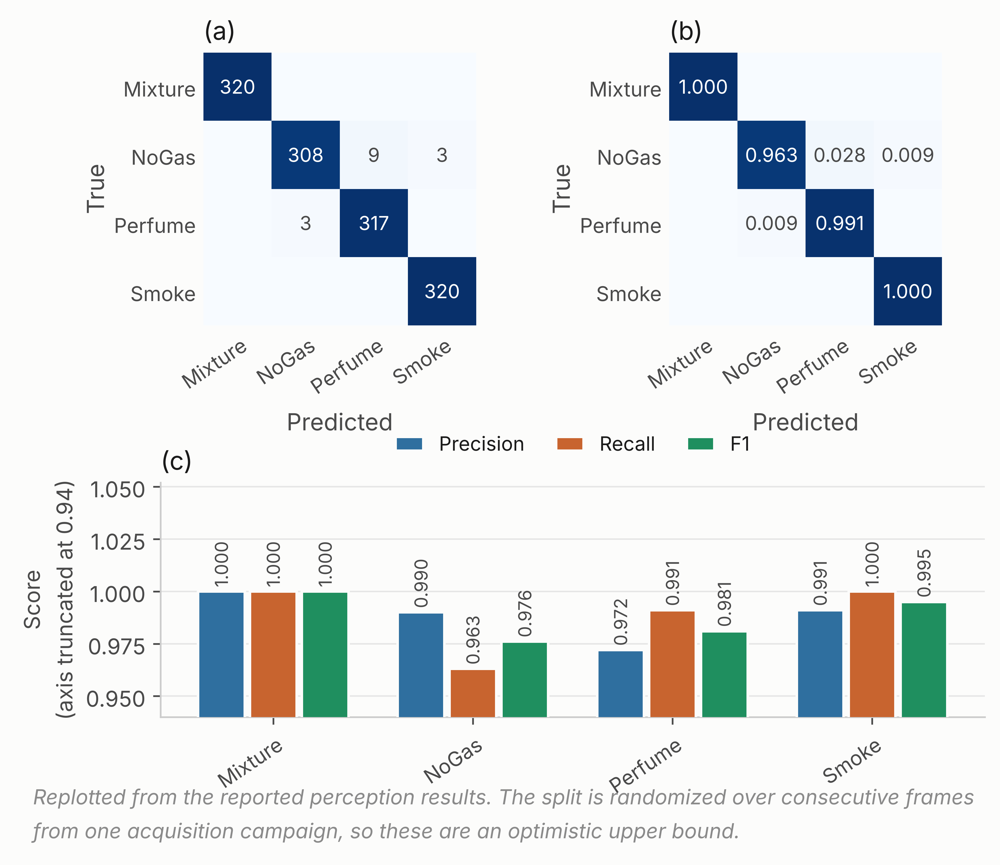{width=6.50in}

Fig. S1—Thermal classifier behavior, original checkpoint, 1,280 randomized-split held-out images. (a) Counts, (b) row-normalized, (c) per-class scores. The retrained confusion matrices are in the repository under retrain/results_thermal/runs.

## S2 Explanation Component

Explanations are generated locally with Gemma 3 1B served through Ollama (Gemma
Team 2025), prompted with the gas class, classification confidence, normalized
anomaly score and threshold, and the selected action, capped at 150 tokens.
Nothing leaves the device.

The component sits off the safety-critical path by construction. The action is
fixed by the decision component before any text is generated, and the generated
text cannot alter it. That separation was deliberate: a fluent explanation
inconsistent with the decision it claims to explain is a hazard in a control room
rather than an aid, and the only structural defense against it is to deny the
generator any influence over the action.

The component is described as part of the system and is evaluated nowhere in this
work. It is not timed, not inspected and not assessed for faithfulness. No result
in the manuscript depends on it, and it should be read as apparatus rather than as
a contribution.

---

## S3 Cost Asymmetry and the Ordinal Objective

The manuscript reports this experiment's conclusions. The sweep, the objective,
the cost matrix and the action-distribution analysis are here.

The loss-weight ratio *C* from Eq. 3 was swept across nine values with everything else fixed (Table S2, Fig. S2).

| Cost ratio *C* | Decision accuracy | SD | Missed-hazard | Escalation | High-severity FA |
|---|---|---|---|---|---|
| 1:1 (symmetric) | 0.9646 | 0.0252 | 0.0000 | 1.000 | 0.0000 |
| 2:1 | 0.9584 | 0.0317 | 0.0000 | 1.000 | 0.0000 |
| 4:1 | 0.9620 | 0.0292 | 0.0000 | 1.000 | 0.0000 |
| 6:1 | 0.9593 | 0.0310 | 0.0000 | 1.000 | 0.0000 |
| 8:1 (reference) | 0.9630 | 0.0270 | 0.0000 | 1.000 | 0.0000 |
| 10:1 | 0.9631 | 0.0251 | 0.0000 | 1.000 | 0.0000 |
| 12:1 | 0.9573 | 0.0338 | 0.0000 | 1.000 | 0.0000 |
| 16:1 | 0.9241 | 0.0979 | 0.0000 | 1.000 | 0.0000 |
| 20:1 | 0.9090 | 0.0962 | 0.0000 | 1.000 | 0.0000 |
| *Label function* | *1.0000* | *0.0000* | *0.0000* | *1.000* | *0.0000* |

Table S2—Cost-asymmetry sweep, mean ± SD across five runs per configuration varying partition and initialization. The label-function row applies *y*(·) of Eq. 2a to the true class label. It reaches the ceiling by construction, consumes the label it is meant to infer, and is not a deployable baseline.

Missed-hazard rate is zero and escalation adequacy is 1.000 at every ratio, the symmetric 1:1 configuration included. Accuracy is highest at 1:1 (0.9646), sits at 0.9630 at the reference 8:1 across five seeds (the 30-run comparison in Table 5 gives 0.9573 for the same policy), and falls away past 12:1 to 0.9090 at 20:1, with variance up roughly fourfold. The asymmetry produced no measurable safety benefit at any setting and cost accuracy at the extremes.

The reason looks structural. The target action is a deterministic function of a well-separated class label, and a miss under this definition requires assigning a hazardous window to the class furthest from it in feature space. The miss rate is therefore already on the floor before any weighting is applied. There is nothing for the asymmetry to reshape. That is not evidence against cost-sensitive learning in general, since the literature is clear it works where the error surface is non-trivial (Elkan 2001). What this benchmark shows is narrower: it does not present a sufficiently difficult error surface for a measurable safety benefit from scalar class-level cost weighting to appear.

The reference configuration deserves one more note. *C* = 8:1 is not the accuracy optimum and was originally chosen on test-partition dispersion, which is not a defensible criterion. Re-selecting it needs a validation partition, and the obvious construction fails instructively: a uniformly random validation subset carved from training cannot discriminate between ratios at all, because it inherits exactly the window overlap Experiment 1 measures. Carving the validation band contiguously from the end of each class block instead, with the same embargo, restores discrimination and selects *C* = 6:1 (validation 0.9584, test 0.9397), with 1:1 second at 0.9580 and the reference 8:1 fifth at 0.9551. The reference is not selected under either criterion.

*An ordinal objective, since the evidence points at one.* Eq. 3 prices all wrong actions alike, so under-escalating a hazardous window and over-escalating it cost the same. That is a testable claim, so we tested it. We replaced the sample-weighted cross-entropy with direct minimization of expected cost,

&nbsp;&nbsp;&nbsp;&nbsp;*L*~ord~(θ) = (1/*N*) Σₜ Σ_a *p*~θ~(*a* | φₜ) · *M*[*g*ₜ, *a*],  ............ (S1)

under a matrix *M* that prices distance and direction along the action ladder. For a hazardous class, silence costs 10, a sub-alarm response 5, and notifying at the wrong tier 1. For clean air, a high-severity alarm costs 4 against 1 for a nuisance action. For the Perfume class, a nuisance odorant, silence costs 2 and a high-severity alarm 3. The structure, not the exact values, is what the experiment tests. This is a single untuned matrix, chosen by hand for its shape and run once, offered as a test of a mechanism rather than as a model we are proposing.

It works on the quantity it targets. On the held-out Mixture class the ordinal objective escalates 0.386 ± 0.192 of hazardous windows against 0.259 ± 0.188 for the cost-weighted policy, a relative improvement of about 49% (Experiment 4 of the manuscript). It records no missed hazard, but that zero is structural rather than earned: the objective never emits the Monitor action, and a missed hazard is a hazardous window assigned that action. It is the only change to the objective anywhere in this study that moved escalation adequacy at all. It also costs more than it returns as specified: in-distribution accuracy falls to 0.7470 ± 0.0057, some 21 points below the cost-weighted policy, and expected cost under the matrix the objective itself minimizes rises from 0.0690 to 0.2590. The mechanism is visible in the action distribution, where the model stops emitting *Monitor* for clean air and sends it to *Increase sampling* instead. The matrix prices that error at 1 against 10 for a missed hazard, and the NoGas and Perfume classes overlap precisely where that trade is decided. The result is a system in a permanent state of mildly elevated sampling.

What has been demonstrated is narrow. The mechanism is confirmed: pricing direction along the action ladder moves escalation, where scalar reweighting did not. What has not been demonstrated is a cost matrix worth deploying. A matrix that buys about 13 points of escalation on a held-out hazardous class by paying 21 points of accuracy on clean air is not one we would put in front of an operator. A single untuned draw cannot locate the optimum over the space of such matrices. The experiment demonstrates that a directional cost structure can alter escalation behavior. It does not establish an optimal cost matrix. It is evidence about this particular matrix under this training procedure, not about ordinal objectives in general. The ordinal objective, a supporting mechanism experiment, is a mechanism result rather than a deployable policy.

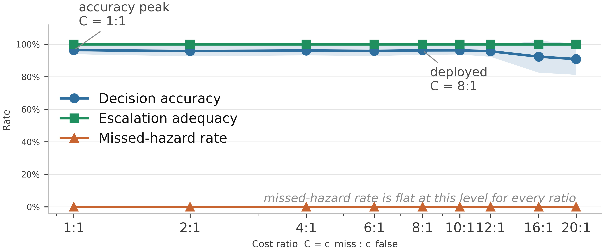{width=6.50in}

Fig. S2—Cost-asymmetry sweep. Shading is ± 1 SD across five seed-varying partitions.

---

## S4 Confidence Calibration

Confidence matters here because any escalation threshold, and any deferral rule, would be set against it. Four estimators were compared: the raw softmax, MC dropout with 20 passes, temperature scaling, and a five-member deep ensemble built from the same model class and objective as the single model. Temperature is fitted on a calibration split carved out of training, never on the training logits themselves. Expected calibration error uses equal-mass bins because confidence on this corpus piles up near 1 and equal-width bins leave most of the range empty (Table S3, Fig. S3).

| Estimator | ECE | SD | Block-bootstrap 95% CI | ECE on hazardous windows | Brier | NLL | Accuracy |
|---|---|---|---|---|---|---|---|
| MC dropout (20) | 0.0275 | 0.0109 | 0.0102 to 0.0569 | 0.0003 | 0.0903 | 0.1644 | 0.9386 |
| Temperature scaling | 0.0358 | 0.0110 | 0.0182 to 0.0662 | 0.0043 | 0.0935 | 0.1786 | 0.9392 |
| Deep ensemble (5) | 0.0363 | 0.0116 | 0.0134 to 0.0665 | 0.0002 | 0.0928 | 0.1864 | 0.9413 |
| Raw softmax | 0.0431 | 0.0124 | 0.0171 to 0.0755 | 0.0002 | 0.1000 | 0.2089 | 0.9392 |

Table S3—Calibration, mean ± SD across five runs varying partition and initialization. ECE with 15 equal-mass bins; intervals from 400 moving-block bootstrap resamples per run, blocks of 20 windows, so the resampling does not assume independent windows.

MC dropout has the lowest point estimate of ECE, but every bootstrap interval overlaps every other, so the four estimators are not separated in this experiment. The lowest point estimate has changed hands twice across the corrections applied to this study, which is a further reason not to read an ordering into it. Two observations are more useful than the ordering. First, overall ECE is driven entirely by the non-hazardous classes: restricted to Smoke and Mixture windows the deep ensemble, the raw softmax and MC dropout are calibrated to within 0.03%, while temperature scaling is an order of magnitude worse at 0.43%. The miscalibration lives on the NoGas and Perfume boundary, the same place the perception errors and the anomaly-score overlap live. For a system whose escalation threshold would be set on hazardous-class confidence that is reassuring, and it is invisible in a single pooled ECE number.

Second, the temperature itself carries a methodological lesson about this study rather than about temperature scaling. Under an earlier implementation the calibration split was a uniformly random subset of the training partition, over windows overlapping by 19 of 20 raw rows, so the temperature was effectively fitted against near-copies of the data it was fitted on. It came out consistently below 1, and the previous version of this work concluded that the network was under-confident. Carving the calibration band contiguously from the end of each class block, with the same 20-window embargo used for the outer holdout, reverses that: the fitted temperature is 1.423 ± 0.202 across runs and never below 1.20, so the network is over-confident, which is the ordinary finding. The earlier conclusion was an artifact of a leaky calibration split, and it is reported here because it is a clean illustration of the paper's own argument turning up inside the paper's own analysis. The bin sweep in Fig. S3c shows the ordering across estimators is stable from 5 to 30 bins.

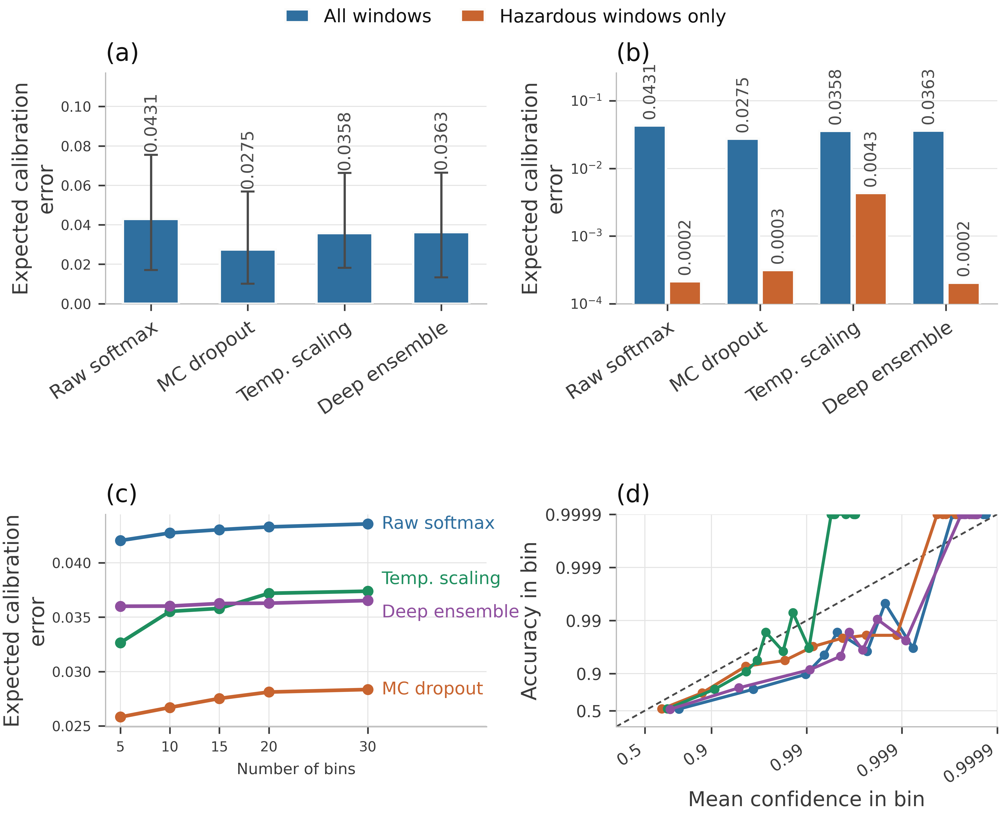{width=6.50in}

Fig. S3—Calibration. (a) ECE with bootstrap intervals. (b) The same on a logarithmic axis, split into all windows against hazardous windows only. (c) Sensitivity to the number of bins. (d) Reliability diagram: mean confidence against accuracy in each of the 15 equal-mass bins, averaged by bin index across the five runs. Both axes are plotted as −log10(1 − p), so the dashed diagonal is perfect calibration and each decade of residual error takes equal length; bins with no errors sit at the top of the axis. Colours as in (c). MC dropout uses 20 passes and the deep ensemble five members.

---

## S5 Comparator Specifications

The full comparator list is reproduced here.

Ten primary comparators run under one protocol:

- the cost-weighted policy of Eq. 3, and an unweighted network of identical topology;
- a multilayer perceptron (256-256-128);
- clean-air-weighted gradient boosting (300 trees) and a random forest (300 trees);
- an RBF support-vector classifier and k-nearest neighbors with *k* = 5;
- a recurrent network over *K* = 10 consecutive states;
- conservative Q-learning with a TD(0) bootstrap and a conservative penalty on non-behavior actions;
- a shallow decision tree of depth 3 on the seven raw current-sensor channels, interpretable and auditable in a way the learned networks are not;
- CUSUM (Page 1954), a one-sided cumulative-sum detector on the anomaly score, with μ₀ and σ estimated from NoGas training windows and the threshold set on the training partition.

Two are not plain supervised classifiers. Conservative Q-learning is offline and single-step, which over a one-step bootstrap makes it close to a myopic cost minimizer, not a sequential-decision method. CUSUM's statistic resets at every change of class block, so it never crosses a block boundary, the embargo band or a partition. Hyperparameters, reward definition, coverage, episode construction, slack and threshold selection and the reset semantics for both are in Supplementary Section S5.

The list above is not enough to reimplement or to judge these two. Their full construction follows.

*Hyperparameter draws in the 30-run comparison.* One draw per run per comparator, from a fixed grid of the same size for every family, so no comparator receives a larger search than another. The grid varies hidden width, learning rate and dropout for the two neural policies and the perceptron; depth and the number of estimators for gradient boosting and the random forest; the kernel scale for the support-vector classifier and *k* for *k*-nearest neighbors; hidden size and sequence stride for the recurrent network; the conservative weight α for conservative Q-learning; the depth limit for the shallow tree; and the slack *k* for CUSUM. None of these was selected against the test partition: the draw is made from the run seed before the partition is read.

*Conservative Q-learning.* The setting is offline and single-step. The behavior policy is the deterministic target map *y*(·) of Eq. 2a, so the behavior action for a window is *y*(*g*ₜ) and the offline dataset is exactly the supervised training partition re-read as (*s*, *a*_data, *r*, *s*′) tuples. Coverage is therefore complete over the state space and empty over every non-behavior action, which is the regime the conservative penalty exists for. The reward is asymmetric in the direction of Eq. 3, with a missed hazard priced at 10 against 1 for a false alarm, and it is a function of (class, action) alone. The discount is γ = 0.99 and the target is a TD(0) bootstrap *r* + γ max\_*a*′ *Q*(*s*′, *a*′), fitted with a smooth L1 loss. The conservative term is the standard CQL(H) penalty, α (logsumexp\_*a* *Q*(*s*, *a*) − *Q*(*s*, *a*_data)) with α = 1.0, which pushes down the value of actions the behavior policy never took. Successor states are the next row in acquisition order within the training partition, and the final row of the partition is masked out because it has no successor. There are no episodes and no terminal states in any meaningful sense: monitoring is a continuing task, each window is one step, and the 0.99 discount over a one-step bootstrap makes the agent close to a myopic cost minimizer. That is what the comparator is, and it is why it tests whether an offline value-based objective beats a cost-weighted supervised one rather than whether reinforcement learning solves monitoring.

*CUSUM.* The statistic is one-sided on the anomaly score, *S*ₜ = max(0, *S*ₜ₋₁ + *x*ₜ − μ₀ − *k*), with μ₀ and σ estimated from the training partition's NoGas windows, a slack of *k* = 0.5σ, and the alarm threshold *h* set at the 99th percentile of the statistic's own path over those training windows. Reset semantics matter for a sequential detector and are stated here rather than left to the code: *S*ₜ is zero at the first window of every evaluation set and is reset to zero at every change of class block, so it is never carried across a block boundary, across the embargo band, or between partitions. Within a block it accumulates normally. An earlier implementation reset only at the start of an evaluation set, which let the block following a hazardous one inherit an already-elevated statistic; the results reported here use the per-block reset.

---

## S6 Sensitivity of the Equivalence Conclusions

The manuscript reports the conclusions of these two sweeps. The tables and the
full reading are here.

| Comparison | ρ = 0 | ρ = 0.05 | ρ = 0.1 | ρ = 0.2051 | ρ = 0.3 | ρ = 0.4 | ρ = 0.5 |
|---|---|---|---|---|---|---|---|
| Unweighted network | 1.000 | 1.000 | 1.000 | 0.992 | 0.969 | 0.925 | 0.861 |
| Recurrent (LSTM) | 0.991 | 0.934 | 0.878 | 0.779 | 0.700 | 0.622 | 0.545 |
| Conservative Q-learning | 0.981 | 0.907 | 0.847 | 0.756 | 0.688 | 0.619 | 0.550 |
| Multilayer perceptron | 0.971 | 0.884 | 0.812 | 0.691 | 0.600 | 0.517 | 0.443 |
| Gradient boosting | 0.924 | 0.805 | 0.719 | 0.586 | 0.496 | 0.419 | 0.354 |
| Random forest | 0.871 | 0.747 | 0.665 | 0.539 | 0.456 | 0.385 | 0.325 |
| Support-vector classifier | 0.493 | 0.493 | 0.484 | 0.445 | 0.401 | 0.353 | 0.307 |
| k-nearest neighbors | 0.240 | 0.329 | 0.360 | 0.367 | 0.347 | 0.316 | 0.281 |
| Shallow decision tree | 0.000 | 0.000 | 0.004 | 0.027 | 0.056 | 0.085 | 0.107 |

Table S4—Sensitivity of the Bayesian equivalence probability to the assumed run correlation ρ. The deployed value is 1,264/(4,900 + 1,264) = 0.2051, read from the partition rather than fixed by hand, and that column is identical to the final column of Table 5 of the manuscript. Raising ρ widens the posterior and moves mass out of the region of practical equivalence, so the probabilities fall monotonically. Two comparisons change their most probable outcome across the range, and both are named below.

| Comparison | ±0.5 pt | ±1 pt | ±2 pt | Most probable outcome, ±0.5 → ±1 → ±2 |
|---|---|---|---|---|
| Unweighted network | 0.835 | 0.992 | 1.000 | equivalent → equivalent → equivalent |
| Recurrent (LSTM) | 0.452 | 0.779 | 0.987 | other better → equivalent → equivalent |
| Conservative Q-learning | 0.421 | 0.756 | 0.987 | reference better → equivalent → equivalent |
| Multilayer perceptron | 0.389 | 0.691 | 0.957 | other better → equivalent → equivalent |
| Gradient boosting | 0.317 | 0.586 | 0.894 | reference better → equivalent → equivalent |
| Random forest | 0.288 | 0.539 | 0.858 | other better → equivalent → equivalent |
| Support-vector classifier | 0.228 | 0.445 | 0.783 | reference better → reference better → equivalent |
| k-nearest neighbors | 0.183 | 0.367 | 0.702 | reference better → reference better → equivalent |
| Shallow decision tree | 0.011 | 0.027 | 0.101 | reference better → reference better → reference better |

Table S5—Sensitivity of the equivalence conclusion to the width of the region of practical equivalence. Columns give the posterior probability of practical equivalence to the cost-weighted policy under Eq. S2 at the deployed ρ. The final column gives the most probable of the three outcomes at each width; rows in bold change their answer across the sweep, and 7 of 9 do. The paired bootstrap reaches the same most probable outcome in 24 of the 27 model-by-width comparisons, differing only at ± 0.5 points for the multilayer perceptron, gradient boosting and the recurrent network.

Seven of the nine comparisons keep their most probable outcome across the whole range. The decision tree remains the more probable loser at every ρ, and the unweighted network stays practically equivalent to the reference even at ρ = 0.5, where the posterior is far wider than this design warrants, though its strength falls from 1.000 to 0.861. Two comparisons change. The random forest is the most probable equivalent up to ρ = 0.3 and the more probable winner at 0.4 and 0.5, and gradient boosting is equivalent up to ρ = 0.4 and the more probable loser at 0.5. Both flips occur only at correlation values above anything this design gives reason to assume, but they are the honest measure of how much the assumption is carrying.

The ROPE width carries considerably more than ρ does, and Table S5 is the more informative of the two sweeps. Seven of the nine comparisons change their most probable outcome between ±0.5 and ±2 accuracy points. At the tightest width the reference is most probably better than five comparators and worse than three, and only the unweighted network is equivalent; at the widest, eight of nine are equivalent and only the decision tree is separated. The equivalence claims made in this paper are therefore claims made at a stated threshold, not properties of the models. Two survive the full sweep: the unweighted network is equivalent at every width, and the decision tree is worse at every width. Everything between those is width-dependent and should be read as such.

*A comparison that assumes no correlation at all.* Because ρ has to be assumed rather than estimated, we also ran a paired bootstrap in which the run is the resampling unit and nothing is assumed about structure inside a run. The 30 paired differences are resampled with replacement 20,000 times, and the same one-point region of practical equivalence is applied to the replicate means. This asks the same question under a weaker assumption. It agrees with the correlated *t*-test on the most probable outcome in 24 of the 27 model-by-width comparisons. The three disagreements are all at the narrowest width of ± 0.5 accuracy points, for the multilayer perceptron, gradient boosting and the recurrent network. Under the bootstrap the unweighted network is practically equivalent to the reference in every replicate, interval [−0.003, +0.002] on the paired difference. The recurrent network is equivalent in 99.3% of replicates and the perceptron in 96.5%. The random forest is equivalent in 88.4% and better in the remaining 11.6%, interval [−0.013, +0.003]. The decision tree is worse in every replicate, by 3.9 accuracy points. We therefore treat the ρ sweep as a sensitivity analysis rather than as the primary evidence, and rest the ranking claim on the agreement between the two.

The two analyses share every observation. The 30 runs differ in seed, block position, initialization and hyperparameter draw, but they are 30 passes over one acquisition campaign on one device, so they are not 30 independent physical experiments and the bootstrap does not replicate anything. What the agreement establishes is that the conclusion is not an artifact of the correlated *t*-test's assumed ρ, which is a real and useful robustness property and nothing more. Independent replication would require a second acquisition, and this study does not have one.

---

*How much of that depends on the correlation term.* The deployed ρ = 0.2051 is borrowed from a cross-validation setting rather than derived for this one. So we swept it from 0, which treats the runs as independent, to 0.5, which assumes far more correlation than 30 randomized partitions plausibly carry (Table S4).

*The sweep as the manuscript reported it.*

Two sensitivity analyses bound how much of that reading depends on analysis choices rather than on the models, and both are reported in full in Supplementary Section S6. The assumed run correlation ρ matters less than it might: seven of the nine comparisons keep their most probable outcome from ρ = 0 to ρ = 0.5. The width of the equivalence region matters considerably more, with seven of the nine changing outcome between ±0.5 and ±2 accuracy points, so most equivalence statements here hold at a stated threshold rather than as properties of the models. Only two survive the whole sweep: the unweighted network is equivalent at every width, and the decision tree is worse at every width. A paired bootstrap agrees with the correlated *t*-test on the most probable outcome in 24 of the 27 model-by-width comparisons. The three disagreements are all at the narrowest width of ± 0.5 accuracy points, for the multilayer perceptron, gradient boosting and the recurrent network, where the bootstrap reads equivalence and the *t*-test does not. Agreement elsewhere is robustness to the analysis choice and not independent confirmation, since the two analyses share every observation they are computed from.

## S7 Decision-State Ablation and Upstream-Input Sensitivity

The manuscript reports the two conclusions of this experiment. The tables, the
figures and the full reading are here.

The decision state was ablated by feature group with the architecture and protocol held fixed (Table S6, Fig. S4).

| Decision state | *d* | Decision accuracy | SD | Δ vs. full | Missed-hazard | Escalation |
|---|---|---|---|---|---|---|
| Without per-sensor σ | 15 | 0.9653 | 0.0147 | +0.40 pp | 0.0000 | 1.000 |
| Full state | 22 | 0.9614 | 0.0139 | reference | 0.0000 | 1.000 |
| Without anomaly score | 21 | 0.9571 | 0.0215 | −0.43 pp | 0.0000 | 1.000 |
| Without per-sensor δ | 15 | 0.9465 | 0.0260 | −1.49 pp | 0.0000 | 1.000 |
| Without δ and σ | 8 | 0.8854 | 0.0798 | −7.59 pp | 0.0000 | 1.000 |
| Current readings only | 7 | 0.8804 | 0.0813 | −8.10 pp | 0.0000 | 1.000 |
| Anomaly score only | 1 | 0.6581 | 0.1009 | −30.33 pp | 0.0000 | 1.000 |

Table S6—Decision-state ablation, mean ± SD across five runs varying partition and initialization, with the architecture held fixed.

Temporal features carry the accuracy: dropping both δ and σ costs 7.59 points, and a single anomaly score on its own manages 65.8%. Two feature groups are not carrying their weight at all. Removing the anomaly score costs 0.43 points, and removing the per-sensor standard deviations *improves* accuracy by 0.40 points, both well inside the seed-to-seed spread, so the 22-dimensional state is not minimal. But missed-hazard rate stays at zero and escalation adequacy at 1.000 in every condition, including the one-dimensional state. No feature group changes the in-distribution safety metrics at all, which is another instance of the same trap: an ablation reported on accuracy alone would appear to identify which features drive safety behavior, when it is measuring which features drive the in-distribution decision metrics.

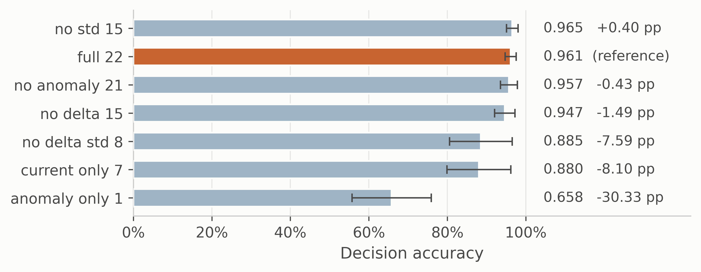{width=6.50in}

Fig. S4—Decision-state ablation. Bars are mean ± SD decision accuracy. Missed-hazard rate and escalation adequacy are constant across every condition.

Retraining without a feature answers whether the feature is necessary. The sharper question, if an upstream component can fail in service, is what a trained model does when that input goes wrong while everything else stays correct. The anomaly score was swept across its full range on every test window with the other twenty-one features held fixed, and the share of windows whose action moved was recorded (Fig. S5). This is a synthetic sensitivity probe, not a physical failure model.

The models divide sharply. For the decision tree the answer is zero by construction, since it reads only the raw channels. For k-nearest neighbors, the support-vector classifier and the perceptron the action moves on under 3% of windows. For the cost-weighted policy it moves on 6.65 ± 3.83% of windows and for the random forest on 23.59 ± 8.81%. Gradient boosting is the outlier at 64.22 ± 7.65%, so for that model the anomaly channel is load-bearing where for the others it is close to inert at inference time. The consequence shows up in the safety metrics, and only for that model: forcing the anomaly score to zero, which is what a failed or unconnected autoencoder would supply, leaves every other comparator's missed-hazard rate at zero and moves gradient boosting from 0.0092 to 0.4203. Escalation adequacy for that model falls from 0.991 to 0.497, so a model that answers essentially every hazardous window with an alarm-grade action answers half of them with silence once one upstream input fails. The measured safety behavior of this model on this benchmark is therefore highly sensitive to the anomaly-score input, and nothing in the accuracy column or the ablation table shows it.

A single conditional probe supports a narrow reading: the override is synthetic and the other features are held at values that in reality would co-vary with the anomaly score. It is consistent with two results already in hand, since gradient boosting is both the model that fails silently under sensor loss and the one that escalates the held-out Mixture class perfectly. Dependence on upstream components deserves to be measured rather than assumed.

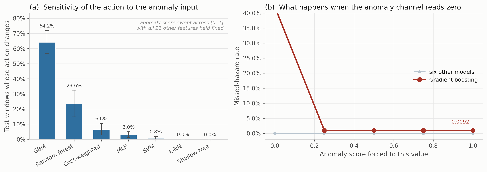{width=6.50in}

Fig. S5—Dependence of the selected action on the anomaly input, five seed-varying partitions. (a) Share of test windows whose action changes at any point as the anomaly score is swept across [0, 1] with all twenty-one other features held fixed at their observed values, mean ± 1 SD. (b) Missed-hazard rate against the forced anomaly value. Six comparators are flat; gradient boosting moves from 0.0092 to 0.4203 when the channel reads zero.

---

*That dependence is partly, not wholly, a weighting defect* (`v3_weighting_probe.csv`). The gradient-boosted comparator was labelled cost-sensitive in earlier versions of this work and is called clean-air-weighted gradient boosting here, because the released code weights by the target action: action 0 at 3.0, actions 3 and 4 at 1.2. A clean-air window's target is 0 and a hazardous window's is 3 or 4, so no hazardous row carries the up-weighted target and the model is weighted 2.5 to 1 toward clean air, the opposite of what its name asserted. Refitting with the weight keyed on the gas instead moves its in-distribution missed-hazard rate from 0.0092 to 0.0000 and escalation adequacy from 0.9905 to 1.0000, at 0.3 accuracy points, and the anomaly dependence falls without going away: forced to zero, the missed-hazard rate is 0.3307 rather than 0.4203. Under the high-end clamp the corrected model is worse, missing 9.9% of hazardous windows at one clamped channel and 16.5% at four where the shipped weighting missed none and under-escalated instead. The sign accounts for the in-distribution misses and part of the anomaly dependence, and trades one degradation failure for another. This paper reports the code as released; both are given so the reader can tell which is which. The probe mirrors the shipped magnitude of 2.5 to 1 rather than the 8:1 of Eq. 3, so it isolates the sign and not the ratio, and it does not cover the seven-channel clamp on which the silent-failure result rests. No comparator in this study is weighted at the 8:1 of Eq. 3, so the benchmark contains no cost-sensitive gradient-boosted model in that sense.

## S8 What the Protocol Costs to Adopt

The metric set is inexpensive to adopt, and that cost is measured rather than asserted. Computing the five quantities of Table 2 over the real 1,264-window test partition takes 0.455 ms against 0.290 ms for accuracy alone, a ratio of 1.57×, which is arithmetic over predicted actions the evaluation already has; the episode-level quantities are the same kind of pass over the same predictions (`retrain/run_metric_cost.py`, `v3_metric_cost.json`). Both figures are means over 200 timed repetitions after warm-up and are machine-dependent, so the ratio rather than either absolute figure is the transferable quantity. The cost that is not negligible is retraining, and it falls unevenly. Reporting the metric set on an existing evaluation needs none, and neither do the perturbation suite or the upstream-input probe, since both re-evaluate an already-trained model under modified inputs. Leave-one-class-out needs one retrain per withheld hazardous class, so two here. The 30-run comparison with the equivalence test is the only element that costs a multiple of the original training budget, and it is needed only when the question is model selection rather than model characterization. A facility qualifying a single candidate model therefore pays almost nothing for the screen in Table 7 of the manuscript. A study ranking candidates pays for the run count, and Table 5 of the manuscript shows what that buys. These times are machine-dependent. The reported figures are the ones in the stored result file, `v3_metric_cost.json`, produced by `make metriccost` on the authors' machine with a fixed seed and 200 repeats. A second measurement on different hardware during this revision gave 0.990 ms for the metric set, 0.407 ms for accuracy alone and a ratio of 2.43. That run is not archived in the repository. The conclusion that the metric set costs a small multiple of accuracy alone, and well under a millisecond per 1,264 windows on either machine, holds in both.

---

## S9 Sensitivity of the Eventized Alarm Result to the Persistence Rule

Table S15 collapses alarm-grade windows into annunciated episodes under one rule: an on-delay of three windows and an off-delay of fifteen. That rule is a stated convention, not an industrially validated persistence specification, and the manuscript uses the eventized view to reorder the models relative to the raw indication view. If the ordering is a property of the convention rather than of the models, the reordering claim has to be weakened. The question is therefore checked directly.

Models are fitted once per seed, the alarm-grade flag sequence is computed once per model, seed and condition, and the same flag sequences are then eventized at every point of a grid of on-delays {1, 2, 3, 5, 10} against off-delays {5, 10, 15, 30, 60}, twenty-five settings in all. Nothing is refitted between grid points, so every difference below is caused by the persistence rule alone. Rank agreement with the deployed setting is measured per condition by Kendall's τ over the six comparators, and every pairwise reversal is recorded; with fifteen model pairs and twenty-four comparison settings there are 360 opportunities for a reversal in each condition (`v3_persistence_sweep.csv`, `v3_persistence_rank.json`).

| Condition | Models annunciating at 3/15 | Highest episode rate at 3/15 | Highest over the grid | Kendall τ, min | Reversals |
|---|---|---|---|---|---|
| Clean | 0 of 6 | 0.00 | 0.00 | — | n/a |
| One channel lost | 4 of 6 | 5.70 | 10.25 | 0.56 | 14 |
| Four channels lost | 5 of 6 | 10.25 | 19.37 | 0.74 | 2 |
| Total sensor loss | 5 of 6 | 7.97 | 10.25 | 0.50 | 9 |
| Drift ±30% | 0 of 6 | 0.00 | 0.00 | — | n/a |
| Drift ±50% | 0 of 6 | 0.00 | 2.28 | — | n/a |
| Noise σ = 0.3 | 0 of 6 | 0.00 | 50.13 | — | n/a |
| Noise σ = 0.5 | 3 of 6 | 5.70 | 109.37 | −0.78 | 22 |

Table S7—Sensitivity of the eventized alarm result to the persistence rule, over twenty-five on-delay and off-delay settings applied to the same alarm-grade flag sequences. Episode rates are per hour under the illustrative duty cycle of Eq. S3. Kendall's τ compares the ordering of the six comparators at each setting against the ordering at the deployed 3/15 rule; "reversals" counts pairwise order changes out of 360 model-pair by setting comparisons. A dash marks a condition where no ordering exists at the deployed rule because no model annunciates there.

Three findings follow, and two of them weaken claims made in the manuscript.

The channel-loss conditions are reasonably stable. Mean τ against the deployed rule is 0.84, 0.93 and 0.93 at one, four and seven lost channels, and reversals occur in 14, 2 and 9 of 360 comparisons. The specific reordering the manuscript relies on survives the entire grid: at single-channel loss the shallow tree annunciates no more often than the cost-weighted policy at every one of the twenty-five settings, strictly less at twenty of them and equal at the remaining five, with no setting reversing it. The secondary observation, that the cost-weighted policy annunciates more at four lost channels than at seven, holds at twenty-one settings, ties at two and reverses at two, both of which have an off-delay of sixty windows, two minutes of required quiet. It is reported in the manuscript with that qualification.

The noise conditions are not stable, and this is the finding that matters. At σ = 0.5 the minimum τ is −0.78, an ordering close to the reverse of the deployed one, with 22 reversals. The magnitudes move further than the ranks: the highest episode rate at any comparator runs from 0 to 109.37 per hour across the grid, and which models annunciate at all changes with the rule. At σ = 0.3 the effect is starker still, because the deployed rule reports zero annunciated episodes from every comparator while a shorter on-delay reports up to 50.13 per hour. A conclusion drawn at 3/15 alone would have recorded that condition as producing no operator-facing alarms whatsoever.

The consequence for the manuscript is specific. The compression result and the channel-loss reordering stand. The statement that every condition falls within or near the EEMUA reference once eventized does not generalize: it holds at the deployed rule and fails under shorter on-delays, so it is a property of the persistence convention, and the manuscript states it that way. The general lesson is the one the persistence rule was introduced to make, turned on the rule itself. Eventization is the right level at which to discuss operator load, and the level at which a facility's own persistence specification, rather than a convention chosen by an evaluator, has to supply the numbers.

---

## S10 Isolating Overlap Contamination from Temporal Position

Experiment 1 reports that a random split raises accuracy relative to the blocked protocol. A random split changes two things at once, so the contrast is a sum: near-duplicate windows can land on both sides of it, and the training data is drawn from the whole recording rather than a contiguous early band. This section separates them.

A stride-20 window set shares no raw reading between any two windows, so contamination is impossible in it by construction. Four arms hold everything else fixed, and every arm is subsampled to the same 256-window training budget, the most the stride-20 set can afford, so sample size is not a confound (`v3_overlap_isolation.csv`).

| Model | a: overlap, random | b: disjoint, random | c: overlap, blocked | d: disjoint, blocked | Overlap effect (a − b) | Position effect (b − d) |
|---|---|---|---|---|---|---|
| Cost-weighted policy | 0.5755 | 0.5406 | 0.5345 | 0.5469 | +3.49 | −0.62 |
| Unweighted network | 0.8710 | 0.8125 | 0.8956 | 0.8812 | +5.85 | −6.87 |
| Multilayer perceptron | 0.8802 | 0.9000 | 0.9063 | 0.8719 | −1.98 | +2.81 |
| Gradient boosting | 0.9393 | 0.9250 | 0.9198 | 0.9281 | +1.43 | −0.31 |
| Random forest | 0.9617 | 0.9500 | 0.9601 | 0.9563 | +1.17 | −0.63 |
| Shallow decision tree | 0.9064 | 0.9125 | 0.9223 | 0.9344 | −0.61 | −2.19 |
| Mean | 0.8557 | 0.8401 | 0.8564 | 0.8531 | +1.56 | −1.30 |

Table S8—Overlap contamination against temporal position at a matched training budget, mean decision accuracy over five seed-varying partitions, effects in percentage points. Arms b and d use a stride-20 window set in which no two windows share a raw reading. All four arms train on 256 windows.

The decomposition does not resolve. Averaged over six models the overlap effect is +1.56 points and the position effect −1.30, and neither keeps its sign: overlap runs from −1.98 to +5.85 and position from −6.87 to +2.81. Three models are more accurate under the blocked protocol than under the random one at this budget, which should not happen if contamination were the whole story.

Two readings are available and we take the conservative one. The generous reading is that overlap is the larger term on average. The conservative reading is that a 256-window budget puts every model far below the operating point of the rest of this paper, so an effect estimated there may not transfer to a 4,900-window one. We report the null: the two factors are not separable on this corpus at a training size both arms can share. Experiment 1's claim stays at the level the experiment supports, which is that the protocol moves the number.

---

*The two-by-two in full.*

*Which of the two factors does the work.* A random split changes two things at once: near-duplicate windows can land on both sides of it, and it draws training data from the whole recording rather than a contiguous early band. A stride-20 window set, in which no two windows share a raw reading, allows a two-by-two separating them at a matched 256-window training budget (Supplementary Section S10, Table S8). Removing overlap costs 1.56 accuracy points on average and moving from random to blocked a further 1.30, but neither effect is consistent in sign, running from −1.98 to +5.85 and from −6.87 to +2.81 across six models.

The control returns a null result rather than a decomposition. At a 256-window budget the models sit well below the operating point of every other table here, so the two factors are not separable on this corpus at a training size both arms can share, which is not the same as either being negligible. The claim therefore stays where it was: the partitioning protocol moves the reported number, and the contrast should not be attributed to overlap alone.

*The embargo, the decision tree and the train-early protocol.*

The embargo contributes almost nothing on its own, 0.9495 without it against 0.9496 with it, so the block structure does the work. It is nonetheless what makes the claim of no shared readings true and costs 0.01 accuracy points to honor; the measurement shows only that the near-duplication a random split exploits is not concentrated at the block edges. The shallow decision tree is the one model a random split does not help, losing 0.74 points because it reads only the seven current sensor values. The last column is a harsher test: training early and testing late costs the random forest 41.2 points, gradient boosting 37.9 and the shallow decision tree 29.5, while the perceptron and k-nearest neighbors barely move and the cost-weighted policy loses 1.6. Within-session drift is confounded with position in each class block, so this protocol asks a question closer to deployment than anything else here, and the models disagree about it sharply.

## S11 The Reject Option in Full

Experiment 7 reports the alarm-mapped case on the held-out Mixture class. Both rejection policies on both held-out classes are here (Table S9, `v3_reject_option.csv`), because the choice between them is the result. All rows are fitted on the reduced partition that remains once the calibration band is carved out, so the closed-set values they reduce to at *q* = 0 are the within-experiment reference rather than the Table 6 entries.

| Model | Held-out class | Escalation, reject → *Monitor* | Missed hazard | Rejected, held-out | Rejected, clean | Separation |
|---|---|---|---|---|---|---|
| Multilayer perceptron | Smoke | 0.2421 | 0.7579 | 75.7% | 46.7% | +29.0 pp |
| Unweighted network | Smoke | 0.2320 | 0.7680 | 76.8% | 55.1% | +21.7 pp |
| Support-vector classifier | Smoke | 0.1785 | 0.8215 | 82.2% | 61.6% | +20.6 pp |
| Random forest | Smoke | 0.0000 | 1.0000 | 100.0% | 99.1% | +0.9 pp |
| k-nearest neighbors | Smoke | 0.9276 | 0.0429 | 3.7% | 14.9% | −11.2 pp |
| Cost-weighted policy | Smoke | 0.9947 | 0.0053 | 0.5% | 55.9% | −55.4 pp |
| Gradient boosting | Smoke | 1.0000 | 0.0000 | 0.0% | 91.6% | −91.6 pp |
| Unweighted network | Mixture | 0.0010 | 0.7795 | 78.0% | 35.6% | +42.4 pp |
| Cost-weighted policy | Mixture | 0.0643 | 0.8614 | 86.1% | 52.9% | +33.2 pp |
| Support-vector classifier | Mixture | 0.0000 | 0.7111 | 71.1% | 41.2% | +29.9 pp |
| Random forest | Mixture | 0.0476 | 0.9408 | 94.1% | 80.0% | +14.1 pp |
| Multilayer perceptron | Mixture | 0.0464 | 0.4806 | 48.0% | 42.2% | +5.8 pp |
| k-nearest neighbors | Mixture | 0.1680 | 0.1746 | 16.3% | 16.5% | −0.3 pp |
| Gradient boosting | Mixture | 0.7814 | 0.0719 | 7.1% | 89.5% | −82.4 pp |

Table S9—Reject option with rejections mapped to *Monitor*, at a threshold rejecting 30% of the embargoed calibration band, mean over five seed-varying partitions. Separation is the held-out-class rejection rate minus the clean-window rate. Rows are grouped by held-out class and ordered by separation.

The *Monitor* mapping makes the symmetry plain: under it, every rejection is a missed hazard by definition, so the random forest's 100% rejection rate on held-out Smoke becomes a 1.0000 missed-hazard rate. Between the two policies there is nothing but a trade, and the same threshold that repairs escalation adequacy to 0.7111 under the alarm mapping produces a 0.7111 missed-hazard rate under the monitor mapping. A facility cannot avoid choosing, and no choice is free.

Separation is the quantity that would make a reject option useful, and it is not reliably positive. Five of the fourteen model-by-class cells are negative. Gradient boosting is the extreme case in both directions: on held-out Smoke it declines none of the unfamiliar hazardous class and 91.6% of the clean air it was trained on. The *k*-nearest-neighbor rejection rate is flat across the upper thresholds because five neighbors give only six distinct confidence values, which is a property of the comparator rather than of the data and is the reason it barely moves.

One further observation belongs here rather than in the body. At a threshold set to reject 30% of the *calibration* band, all but one comparator reject more than 30% of held-out clean windows, several of them far more, with the *k*-nearest-neighbor classifier the exception for the granularity reason just given. The calibration band sits at the end of the training block, still on the near side of the embargo, and the confidence distribution moves again between there and the held-out partition. That is the same temporal nonstationarity Experiment 1 measures, arriving through a different instrument: even a threshold set off-sample, but nearby in time, transfers imperfectly to the partition it was meant for.

---

## S12 Raw-Space Faults, Per Model

Experiment 8 reports the worst value across comparators. The per-model breakdown is here (Table S10, `v3_raw_faults.csv`), as missed-hazard rate followed by escalation adequacy.

| Model | Clean | Stuck *k* = 7 | Forced raw zero *k* = 1 | High-end clamp *k* = 4 | High-end clamp *k* = 7 | Raw noise 2 SD |
|---|---|---|---|---|---|---|
| Cost-weighted policy | 0.0000 / 1.0000 | 0.0000 / 0.9997 | 0.0000 / 0.9959 | 0.1057 / 0.6848 | 0.0000 / 0.0000 | 0.0000 / 0.9994 |
| Unweighted network | 0.0000 / 1.0000 | 0.0000 / 1.0000 | 0.1000 / 0.9000 | 0.2759 / 0.4525 | 0.0000 / 0.0000 | 0.0000 / 0.9997 |
| Multilayer perceptron | 0.0000 / 1.0000 | 0.0000 / 0.9791 | 0.0237 / 0.9763 | 0.3930 / 0.0196 | 0.0000 / 0.0000 | 0.0000 / 0.9212 |
| Gradient boosting | 0.0092 / 0.9905 | 0.0035 / 0.9902 | 0.0073 / 0.9915 | 0.0000 / 0.8301 | 0.0000 / 0.0000 | 0.0000 / 0.9994 |
| Random forest | 0.0000 / 1.0000 | 0.0000 / 1.0000 | 0.0000 / 1.0000 | 0.0035 / 0.6193 | 0.0000 / 0.0000 | 0.0000 / 0.9627 |
| Shallow decision tree | 0.0000 / 1.0000 | 0.0000 / 1.0000 | 0.0000 / 1.0000 | 0.2415 / 0.6000 | 0.0000 / 0.0000 | 0.1354 / 0.7231 |
| *Normalized anomaly feature, ρ̃* | *0.245* | *0.248* | *0.467* | *0.168* | *0.011* | *0.806* |

Table S10—Raw-space faults per model, missed-hazard rate / escalation adequacy, mean over five seed-varying partitions. The final row is the normalized anomaly feature ρ̃ of Eq. 1, averaged across models: the reconstruction error the deployed anomaly path produces from the faulted window, min-max scaled to [0, 1] against the 1st and 99th training percentiles. It is not on the scale of the raw reconstruction errors reported in Fig. S10.

The high-end clamp at four channels is where the models separate, and they separate widely: the multilayer perceptron escalates 2.0% of hazardous windows while gradient boosting escalates 83.0%, under an identical fault. At seven channels the separation vanishes. All six comparators read 0.0000 / 0.0000 in that column, so the claim in the body that every comparator routes every hazardous window below alarm grade is a statement about all six individually and not an artifact of taking a worst case.

The ρ̃ row is the point of the section. The normalized anomaly feature rises under a forced raw zero and under raw noise, both of which make a trace harder for this fitted autoencoder to rebuild, and falls under the high-end clamp, which leaves it close to constant. A detector thresholded above its nominal value sees three of the four modes and is blind to the fourth, which is the one carrying a 39.3% missed-hazard rate. Nothing in the standardized-feature experiment can show this, because there a dropped channel is set to the training mean and the anomaly feature is not perturbed at all.

---

## S13 Eventized Alarm and Hazard Episodes, Per Model

The manuscript reports selected rows of both eventization analyses. The complete
tables are here, produced by the same drivers from the same result files.

| Condition | Model | Indications per hour | Episodes per hour | Compression |
|---|---|---|---|---|
| Clean | Cost-weighted | 0.0 | 0.00 | n/a |
| Clean | Unweighted | 0.0 | 0.00 | n/a |
| Clean | MLP | 0.0 | 0.00 | n/a |
| Clean | GBM | 0.0 | 0.00 | n/a |
| Clean | Random forest | 0.0 | 0.00 | n/a |
| Clean | Shallow tree | 0.0 | 0.00 | n/a |
| One channel lost | Shallow tree | 360.0 | 1.14 | 316× |
| One channel lost | Unweighted | 256.3 | 3.42 | 75× |
| One channel lost | Cost-weighted | 231.3 | 5.70 | 41× |
| One channel lost | Random forest | 12.5 | 2.28 | 6× |
| One channel lost | GBM | 0.0 | 0.00 | n/a |
| One channel lost | MLP | 0.0 | 0.00 | n/a |
| Four channels lost | Shallow tree | 720.0 | 2.28 | 316× |
| Four channels lost | Unweighted | 377.1 | 6.84 | 55× |
| Four channels lost | Cost-weighted | 374.8 | 10.25 | 37× |
| Four channels lost | Random forest | 113.9 | 6.84 | 17× |
| Four channels lost | MLP | 12.5 | 1.14 | 11× |
| Four channels lost | GBM | 0.0 | 0.00 | n/a |
| Total sensor loss | Cost-weighted | 1800.0 | 5.70 | 316× |
| Total sensor loss | Unweighted | 1800.0 | 5.70 | 316× |
| Total sensor loss | Shallow tree | 1800.0 | 5.70 | 316× |
| Total sensor loss | Random forest | 934.2 | 7.97 | 117× |
| Total sensor loss | MLP | 360.0 | 1.14 | 316× |
| Total sensor loss | GBM | 0.0 | 0.00 | n/a |
| Noise σ = 0.5 | Cost-weighted | 247.2 | 4.56 | 54× |
| Noise σ = 0.5 | Unweighted | 216.5 | 5.70 | 38× |
| Noise σ = 0.5 | Shallow tree | 185.7 | 3.42 | 54× |
| Noise σ = 0.5 | GBM | 30.8 | 0.00 | n/a |
| Noise σ = 0.5 | Random forest | 12.5 | 0.00 | n/a |
| Noise σ = 0.5 | MLP | 10.3 | 0.00 | n/a |

Table S11—Alarm-grade indication density against eventized alarm rate on clean windows, every comparator, at an on-delay of 3 windows and an off-delay of 15 (`v3_alarm_episodes.csv`). Rows are grouped by condition and ordered by indication rate. Compression is indications divided by episodes; "n/a" marks a condition producing indications but no episode that survives the persistence rule, or none at all. Both rate columns are normalizations of counts observed on a 316-window clean segment, so the hourly figures are illustrative conversions.

| Condition | Model | Hazard episodes detected | Sustained |
|---|---|---|---|
| Clean | Cost-weighted | 10/10 | 10/10 |
| Clean | Unweighted | 10/10 | 10/10 |
| Clean | MLP | 10/10 | 10/10 |
| Clean | GBM | 10/10 | 10/10 |
| Clean | Random forest | 10/10 | 10/10 |
| Clean | Shallow tree | 10/10 | 10/10 |
| One channel lost | Cost-weighted | 10/10 | 10/10 |
| One channel lost | Unweighted | 10/10 | 10/10 |
| One channel lost | MLP | 10/10 | 10/10 |
| One channel lost | GBM | 9/10 | 9/10 |
| One channel lost | Random forest | 10/10 | 10/10 |
| One channel lost | Shallow tree | 10/10 | 10/10 |
| Four channels lost | Cost-weighted | 10/10 | 10/10 |
| Four channels lost | Unweighted | 10/10 | 10/10 |
| Four channels lost | MLP | 10/10 | 10/10 |
| Four channels lost | GBM | 10/10 | 9/10 |
| Four channels lost | Random forest | 10/10 | 10/10 |
| Four channels lost | Shallow tree | 10/10 | 10/10 |
| Total sensor loss | Cost-weighted | 10/10 | 10/10 |
| Total sensor loss | Unweighted | 10/10 | 10/10 |
| Total sensor loss | MLP | 5/10 | 5/10 |
| Total sensor loss | GBM | 7/10 | 7/10 |
| Total sensor loss | Random forest | 10/10 | 10/10 |
| Total sensor loss | Shallow tree | 10/10 | 10/10 |

Table S12—Hazard episodes detected and sustained, every comparator (`v3_episode_metrics.csv`), five runs times two hazardous classes. An episode is detected if any window in it draws an alarm-grade action and sustained if three consecutive windows do. Counts are descriptive: ten is five runs times two classes, not ten physical episodes, and no detection probability is inferred from them.

Two features of these tables carry the argument made in the body. Compression is not a constant, so the two rate columns order the models differently: at one lost channel the shallow tree produces the most indications of any comparator and the fewest annunciations. And episode detection is saturated everywhere except under channel loss, where gradient boosting and the perceptron lose whole episodes at rates their window-level figures understate.

---

## S14 Reproducing These Results

`make comparison` produces Table S2 and Fig. S2. `make calibration` produces
Table S3 and Fig. S3 together with the perception figures. The verification
script checks the principal supplementary tables and headline numerical claims against
the same stored result files used for the manuscript.

## S15 Anomaly Detector in Detail

The operating point quoted in the main text is one summary of the detector. The curves behind it are here: one ROC per seed, and the score distributions the threshold is drawn on. Both are computed under the partition-local fit that every number in the paper uses.

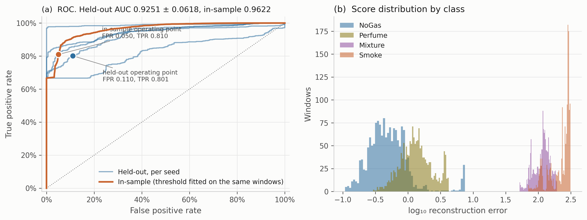{width=6.50in}

Fig. S6—Anomaly detector in detail, partition-local fit. (a) ROC curves, one per seed. (b) Score distributions by class.

## S16 Reject Option and Raw-Space Faults

The main text reports Experiments 7 and 8. This section gives the full reject-option results.

*Experiment 7: Does a Reject Option Repair Under-Escalation?* Every comparator in Experiment 3 is a closed-set classifier with no way to decline, which is why a withheld hazardous class is routed through actions the model already knows. The obvious question is what changes if it may decline. We take the simplest construction that answers it, not a good open-set method: confidence is the maximum predicted class probability, and the threshold is the *q*-th percentile of confidence on a calibration band rather than on the fitting windows. A paper whose central finding is that in-sample thresholds mislead cannot set its own threshold in sample, so the band is a contiguous 20% tail of each class block, separated from the fitting windows by the same 20-window embargo the outer holdout uses. The sweep runs *q* from 0, which recovers the closed-set comparator on this reduced fit partition, to 30. A rejection is not an action, so the facility must decide what one means; the two defensible extremes are reported, mapping a rejection either to *Monitor* or to *Raise alarm*. Table S13 gives the alarm-mapped case on the held-out Mixture class, the worst under-escalation result in the paper, with rejections mapped to *Raise alarm*, rows ordered by closed-set escalation and the final two columns measured at *q* = 30. Its *q* = 0 column is the within-experiment reference and not a copy of Table 6: carving the calibration band out of each class block leaves a fit partition about a fifth smaller, so these models train on less data and their closed-set values differ accordingly. The gap is itself informative, being largest for the two tree ensembles, whose Table 6 escalation of 0.983 and 1.000 falls to 0.7746 and 0.7857 on the reduced partition.

| Model | Escalation, no reject | *q* = 10 | *q* = 30 | Rejected, held-out class | Rejected, clean windows |
|---|---|---|---|---|---|
| Support-vector classifier | 0.0030 | 0.1742 | 0.7111 | 71.1% | 41.2% |
| k-nearest neighbors | 0.2242 | 0.3307 | 0.3307 | 16.3% | 16.5% |
| Multilayer perceptron | 0.2521 | 0.3661 | 0.5265 | 48.0% | 42.2% |
| Unweighted network | 0.2767 | 0.5064 | 0.7805 | 78.0% | 35.6% |
| Cost-weighted policy | 0.3750 | 0.5971 | 0.9256 | 86.1% | 52.9% |
| Random forest | 0.7746 | 0.9841 | 0.9884 | 94.1% | 80.0% |
| Gradient boosting | 0.7857 | 0.8003 | 0.8526 | 7.1% | 89.5% |

Table S13—Escalation adequacy on the held-out Mixture class with a confidence-threshold reject option.

The repair is large. The support-vector classifier, which under-escalates 99.7% of the held-out class as a closed-set model, reaches 0.7111 escalation once it may decline, and the cost-weighted policy moves from 0.3750 to 0.9256. On the metric the paper spends Experiment 3 on, a reject option is the most effective intervention tested anywhere in this study.

The price is steep and it is paid on clean air. At *q* = 30 the same support-vector classifier rejects 41.2% of the held-out clean windows and the cost-weighted policy 52.9%. Under the alarm-mapped convention those rejections are alarm-grade indications, which at either rate would impose a substantial nuisance-alarm burden and require site-specific review. The intervention does not remove the trade-off the paper documents; it moves along it.

And rejection behavior dissociates across models exactly as action behavior does. Separation between the held-out-class and clean-window rejection rates runs from +42.4 points for the unweighted network on held-out Mixture to −91.6 points for gradient boosting on held-out Smoke, which declines none of the unfamiliar hazardous class while declining 91.6% of the clean air it was trained on. The random forest rejects nearly everything at *q* = 30, hazardous and clean alike. A confidence score is therefore no more reliable a guide to what a model will do with an unfamiliar hazard than an accuracy figure is. Supplementary Section S11 carries the *Monitor*-mapped case and the held-out Smoke arm.

*Experiment 8: Faults Injected in Raw Sensor Space.* Experiment 6 perturbs the standardized decision state, and says so. The stronger experiment is available on the same data: fault the raw 20-by-7 window, then recompute the current readings, the per-channel deltas, the per-channel standard deviations and the autoencoder reconstruction error from the faulted window, so that nothing is patched downstream. Four modes are tested, each a synthetic stand-in for a class of hardware fault rather than a measured instance of one. A channel *stuck* at its first reading, a frozen sample-and-hold. A channel *forced to raw zero*, a low-rail proxy for the open-circuit case Experiment 6 states it does not cover. A channel *clamped at the high end*, fixed at the largest value seen in training, which stands in for a rail-limited or out-of-range reading without reproducing any specific device's saturation behavior. And additive noise in raw units at a fraction of each channel's own training standard deviation (Table S14). Features and the autoencoder reconstruction error are recomputed from the faulted raw window, so Table S14's final column is the score the deployed anomaly path would produce. That column is the *normalized* anomaly feature ρ̃ of Eq. 1, min-max scaled to [0, 1] against the 1st and 99th training percentiles, and it is not on the scale of the raw reconstruction errors of Fig. S10.

| Fault mode | Severity | Worst missed hazard | Worst under-escalation | Worst alarm-grade FA | Normalized anomaly feature, ρ̃ |
|---|---|---|---|---|---|
| None | clean | 0.0092 | 0.0003 | 0.0000 | 0.245 |
| Stuck at last value | *k* = 1 | 0.0070 | 0.0016 | 0.0000 | 0.246 |
| Stuck at last value | *k* = 4 | 0.0016 | 0.0104 | 0.0449 | 0.247 |
| Stuck at last value | *k* = 7 | 0.0035 | 0.0209 | 0.0000 | 0.248 |
| Forced raw zero | *k* = 1 | 0.1000 | 0.0041 | 0.7747 | 0.467 |
| Forced raw zero | *k* = 4 | 0.0000 | 0.0000 | 1.0000 | 0.717 |
| Forced raw zero | *k* = 7 | 0.0000 | 0.0000 | 1.0000 | 1.000 |
| High-end clamp | *k* = 1 | 0.1984 | 0.1155 | 0.0051 | 0.198 |
| High-end clamp | *k* = 4 | 0.3930 | 0.5873 | 0.1646 | 0.168 |
| High-end clamp | *k* = 7 | 0.0000 | 1.0000 | 0.0000 | 0.011 |
| Raw additive noise | σ = 0.5 SD | 0.0142 | 0.0130 | 0.9899 | 0.285 |
| Raw additive noise | σ = 1 SD | 0.0627 | 0.0680 | 0.9968 | 0.409 |
| Raw additive noise | σ = 2 SD | 0.1354 | 0.1415 | 0.9981 | 0.806 |

Table S14—Faults injected in raw sensor space, worst value across the six comparators.

The fault modes are not interchangeable, and the ordering is not the one the standardized experiment implies. Stuck-at is almost benign here: seven frozen channels cost 2.1 points of under-escalation and leave ρ̃ at 0.248 against a clean 0.245. Forced raw zero is loud, driving ρ̃ to its ceiling and the false-alarm rate to 1.000, which is a failure a facility would notice within minutes.

The high-end clamp is the one that matters, and it matters because it is quiet. At four clamped channels the worst comparator misses 39.3% of hazardous windows and 58.7% are under-escalated, while ρ̃ falls to 0.168, below its clean-condition value. At seven, every one of the six comparators sends every hazardous window to a sub-alarm action, without exception. The cost-weighted policy, the unweighted network, the perceptron, gradient boosting, the random forest and the shallow tree each record missed-hazard rate 0.0000 and escalation adequacy 0.0000 in that column of Table S10. The alarm-grade false-alarm rate is 0.0000 for all six. ρ̃ reads 0.011, the lowest figure anywhere in this study. Three of the four reported metrics read as perfect while nothing whatsoever reaches an operator.

The mechanism follows from how the detector is fitted. This autoencoder scores a window by how hard it is to rebuild, and it was fitted on clean-air windows only, so a near-constant trace is well inside what it reconstructs easily. Pinning a channel at the top of its observed range therefore makes the reading look *more* normal to the component whose job is to notice abnormality. Whether a differently trained or differently regularized detector would behave the same way is untested here. On this one, a one-sided upper threshold on reconstruction error catches the forced zero and the noise, and is actively misled by the fault mode with the highest missed-hazard rate in the table. That is an argument for a two-sided abnormality test, and it is not visible at all in standardized feature space, where a dropped channel is placed at the training mean and the anomaly feature is left untouched. Supplementary Section S12 gives the per-model breakdown.

*Alarm Indications Are Not Alarm Events.* Every false-alarm number above is a rate per clean *window*, and windows advance every 2 s, so one sustained condition produces hundreds of consecutive positive windows. Real alarm systems interpose persistence, deadband, latching, suppression and shelving before a condition is annunciated, and an operator does not receive a new alarm every 2 s. Reading Fig. S15 as a plant alarm rate therefore overstates operator load, and by a factor that is neither small nor constant.

Contiguous runs of alarm-grade windows on clean test windows were therefore collapsed into annunciated episodes under an explicit rule: an episode begins after an on-delay of three consecutive windows, 6 s of persistence, and ends after an off-delay of fifteen, 30 s of quiet (Table S15). Table S15 gives selected rows, with the full set of twenty-one as Table S11. Both of its rate columns are normalizations of counts observed on a 316-window clean segment, about 10.5 minutes at the 2 s cadence, so the hourly figures are illustrative conversions rather than rates measured over hours. The counts are averaged across the five seed-varying partitions and then converted, not pooled into one long record: pooling would divide by five times the clean windows and report the same rate while implying five times the observation it rests on. Compression is indications divided by episodes, and "n/a" marks a condition that produces indications but no episode surviving the persistence rule. The delays are stated rather than tuned and match no facility's practice, being chosen only so that a single flickering window cannot annunciate. Because the rule is a convention, the same flag sequences were re-eventized at twenty-five on-delay and off-delay settings with nothing refitted (Supplementary Section S9), and each claim below is qualified against it.

| Condition | Model | Indications per hour | Episodes per hour | Compression |
|---|---|---|---|---|
| Clean | all six | 0.0 | 0.00 | n/a |
| One channel lost | Cost-weighted | 231.3 | 5.70 | 41× |
| One channel lost | Shallow tree | 360.0 | 1.14 | 316× |
| One channel lost | Random forest | 12.5 | 2.28 | 6× |
| Four channels lost | Cost-weighted | 374.8 | 10.25 | 37× |
| Four channels lost | Shallow tree | 720.0 | 2.28 | 316× |
| Total sensor loss | Cost-weighted | 1800.0 | 5.70 | 316× |
| Total sensor loss | Random forest | 934.2 | 7.97 | 117× |
| Noise σ = 0.5 | Unweighted | 216.5 | 5.70 | 38× |
| Noise σ = 0.5 | Random forest | 12.5 | 0.00 | n/a |

Table S15—Alarm-grade indication density against eventized alarm rate on clean windows.

Two of the three consequences weaken claims made earlier in this paper. Compression is large, between 5 and 316 indications per episode, so on the indication measure several conditions sit far above the EEMUA (2024) reference. Under this persistence rule every condition tested falls within or near that reference on episodes. Fig. S15 is an indication-pressure screen and should be read as one.

That second statement is a property of the rule as much as of the models, and it does not survive the rule being varied. Across the twenty-five persistence settings (Table S7) the EEMUA comparison holds only at the longer on-delays: at the shortest, the noise conditions reach 109 annunciated episodes per hour, and at σ = 0.3 the deployed rule reports none at all while a shorter on-delay reports up to 50 per hour. An evaluator's convention decided whether that condition looked benign or looked like an alarm flood, so the compliance reading is not a property of the models and should not be quoted as one.

The third consequence survives the sweep. Compression is not a constant, so the eventized view reorders the models. At single-channel loss the shallow tree produces 360 indications per hour against the cost-weighted policy's 231, worse by half again on that metric, while on episodes the ordering reverses to 1.14 annunciations per hour against 5.70. That reversal is not an artifact of the chosen delays: across all twenty-five settings the tree annunciates no more often than the policy, strictly less at twenty of them, and never more. The tree fails into one standing alarm that an operator acknowledges once; the policy chatters. No other metric in this paper distinguishes a standing alarm from a chattering one, and for alarm management that is the distinction that matters.

*Hazards Are Events, Not Windows.* The treatment above leaves an asymmetry in the metric set: false alarms are eventized and hazards are not. A single physical hazardous episode in this corpus produces hundreds of overlapping windows, and the missed-hazard rate counts each as a separate opportunity, when operationally there is one event that either reaches an operator or does not. Treating the numerator that way while eventizing the denominator elsewhere is not defensible, so the same treatment is applied to both.

Each contiguous run of same-class windows in a test partition is one hazard episode (Table S16). An episode is *detected* if any window in it draws an alarm-grade action, and *sustained* if three consecutive windows do, so that a single flickering window does not count. The first-response offset is the number of windows from episode onset to the first alarm-grade action. In Table S16 a row naming a count of models covers exactly the comparators not named separately for that condition, all of which share the values shown, with the per-model table as Table S12; the window-level column carries the corresponding entries from the perturbation sweep.

The denominator is smaller than it looks. Ten is five runs times two hazardous classes, not ten physical hazard episodes: each class was acquired once, so repeating the partition with a new seed re-evaluates the same recording rather than sampling a new event. No binomial interval is attached to these counts and no episode-detection probability is inferred, because there is no population of episodes to infer one about. What the table is good for is the disagreement it exposes with the window-level column, which needs no fine resolution of the counts.

| Condition | Model | Hazard episodes detected | Sustained | Window-level missed-hazard rate |
|---|---|---|---|---|
| Clean | five of six | 10/10 | 10/10 | 0.0000 |
| Clean | GBM | 10/10 | 10/10 | 0.0092 |
| One channel lost | five of six | 10/10 | 10/10 | 0.0000 |
| One channel lost | GBM | 9/10 | 9/10 | 0.0516 |
| Four channels lost | four of six | 10/10 | 10/10 | 0.0000 |
| Four channels lost | MLP | 10/10 | 10/10 | 0.0320 |
| Four channels lost | GBM | 10/10 | 9/10 | 0.1047 |
| Total sensor loss | four of six | 10/10 | 10/10 | 0.0000 |
| Total sensor loss | GBM | 7/10 | 7/10 | 0.1953 |
| Total sensor loss | MLP | 5/10 | 5/10 | 0.5000 |

Table S16—Hazard episodes detected against window-level missed-hazard rate.

The first result is a null one. In distribution, and under drift and noise at every severity tested, every model detects every hazard episode, and the median first-response offset is zero for every model at every severity. The maxima are not zero: gradient boosting is late by up to 197 windows under drift at 0.5 and by up to 186 under dropout at seven channels, the only model and the only perturbations for which any episode is detected late. The episode-level metric cannot discriminate at all there. That is a property of the corpus rather than of the models: each class was recorded as one continuous steady-state run with no onset transient, so the first window of an episode already carries the full hazardous signature and there is nothing to be late for. No claim about first-response timing can be made from this corpus, and none is made. A dataset with instrumented release onsets is required, and that is a substantive gap rather than a formality.

Under channel loss the metric discriminates, and it disagrees with the window-level column. At total sensor loss the perceptron's window-level missed-hazard rate of 0.5000 reads as half the hazardous windows going unanswered; at the episode level it is five of ten hazard episodes never drawing any response. Gradient boosting is the sharper case: a window-level rate of 0.1953 sounds like partial degradation, but three of ten hazard episodes go entirely undetected, and it already loses one episode at a single lost channel where its window-level rate of 0.0516 would not obviously fail a review.

A rate computed over oversampled windows and a count of events that drew a response are not interchangeable, and where they disagree the event count is the operationally meaningful one. Reporting both costs nothing, since both come from the same predictions.

## S17 Component Architectures

These specifications and their diagrams are given here.

*Component Models.* *Perception.* Thermal images are classified with YOLOv8n-cls (Jocher et al. 2023). The original checkpoint was trained on a randomized 80/20 stratified split over the 6,400 frames and reports 98.8%. Retrained under that protocol it gives 98.0 to 98.3%, and under the block-wise holdout the sensor path uses it gives 79.2 to 92.1% over five seeds, with a mean of 85.0% (Supplementary Section S1). The randomized figures are an optimistic upper bound, and the block-wise figures are the ones that apply to a leakage-controlled comparison. No claim here rests on the perception numbers, but the multimodal system as a whole has not been validated to the standard applied to the sensor path (Fig. S7).

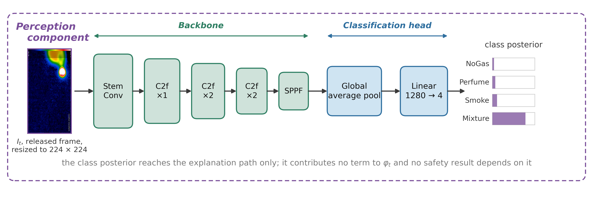{width=6.50in}

Fig. S7—Architecture of the perception component. C2f = cross-stage partial bottleneck with two convolutions; SPPF = spatial pyramid pooling, fast.

*Anomaly Detection.* An LSTM autoencoder with a single-layer encoder and decoder at hidden dimension 32, trained on NoGas windows only, following Malhotra et al. (2016). The anomaly score is the mean reconstruction error over the window; the threshold τ is the 95th percentile of that error on NoGas *training* windows (Fig. S8).

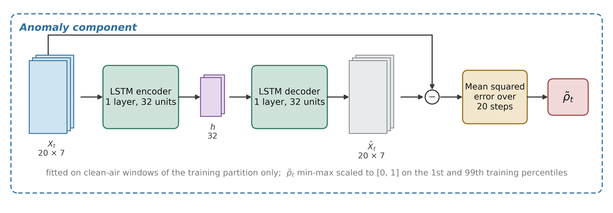{width=6.50in}

Fig. S8—Architecture of the anomaly component.

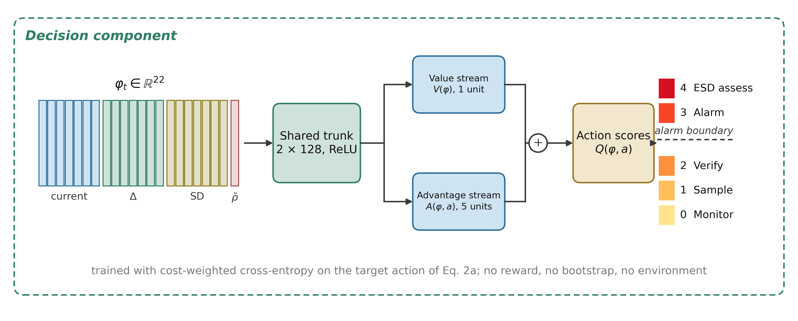{width=6.50in}

Fig. S9—Architecture of the decision component. *V* = value stream; *A* = advantage stream.

*Reasoning.* Explanations are generated locally with Gemma 3 1B (Gemma Team 2025) and sit off the safety-critical path: the action is fixed by the decision component and the generated text cannot change it, because a fluent explanation inconsistent with the decision it claims to explain is a hazard in a control room. It is evaluated nowhere in this paper. Prompt and serving detail are in Supplementary Section S2.

## S18 Bounds on Observed Zeros

The unit that goes into *N*~opp~ matters more than the formula. Pooling every test window across seeds would give 3,160 hazardous and 1,580 clean windows and a bound of 0.095% on a zero. But consecutive windows share 19 of 20 raw rows and the moving block position re-evaluates the same window in more than one partition, so pooling would claim more independent information than the experiment produced.

Eq. 10 is therefore evaluated with the partition as the unit and the worst case reported across partitions. A single test partition carries 632 hazardous and 316 clean windows, so an observed zero supports at most 0.47% and 0.94% respectively, roughly five times the pooled figure. Reaching below 10⁻³ on a zero count needs about 2,995 independent observations.

*How much that optimism is worth.* Two treatments are reported beside the binomial reference.

The first is a moving-block bootstrap inside each test partition, resampling contiguous runs of windows at block lengths of 20, 100 and 316, the last a single contiguous block per class. A block bootstrap over *episodes* would be the textbook choice, but each class was acquired in one continuous run, so there is one episode per class and nothing to resample at that level, which bounds what any reanalysis can establish.

The second is more useful for the zero counts that dominate these tables, where a bootstrap interval is degenerate. Windows overlap by 19 of 20 raw rows, so a set with pairwise-disjoint raw support is every twentieth window, counted as floor(*N*/20): 31 of the 632 hazardous and 15 of the 316 clean windows. The convention is conservative: a maximal nonoverlapping selection from 316 consecutive windows holds 16 rather than 15, and we take the smaller figure. Evaluating Eq. 10 on those counts moves the bound on an observed zero from 0.47% to 9.21% on hazardous windows and from 0.94% to 18.10% on clean windows, the alarm burden a clean-condition zero supports from 9.4 to 181 per 1,000 clean windows, and the class-disjoint bound from 0.19% to 3.72%.

About a factor of twenty separates the binomial reference from the disjoint-support figure, and the second is still optimistic: 31 windows from one acquisition episode on one device are not 31 independent trials in any physical sense. Every bound here is labelled an independence-reference quantity for that reason, and the disjoint-support counts are conservative reference counts rather than an effective sample size. On this corpus an observed zero missed-hazard rate does not exclude a true rate of roughly 9%, so no experiment here separates a genuinely safe model from a lucky one at the resolution the nominal window counts suggest. That is what the data fail to exclude under a conservative counting rule, not an estimate: nothing here puts the missed-hazard rate at 9.21%. It is a limit of the data, and the strongest argument in this paper for collecting more sessions.

## S19 Reproducibility

*Pipeline.* Windows of length 20 formed over the raw corpus, with windows spanning a class boundary discarded, giving 6,324 windows at 1,581 per class. The anomaly feature is the mean reconstruction error of the full 20-step window under a NoGas autoencoder fitted inside each training partition (Section S21). The pretrained NoGas autoencoder shipped in `models/` is used only to fill an initial feature cache that is overwritten before any model is trained. The block-wise holdout reserves a contiguous 20% of each class block for test, separated from both training segments by a 20-window embargo, with the held-out block's position drawn from the run seed. Feature standardization and anomaly-percentile normalization are fitted on the training partition only. In the leave-one-class-out experiment they are fitted on the three training classes only, so no statistic of the withheld class enters training.

*Protocol.* Two protocols, as set out under Methodology. The model comparison uses 30 randomized runs (seeds 1000 to 1029) varying block position, initialization and a hyperparameter draw. Everything else uses five seeds (42, 1337, 7, 2024, 99), each with its own partition. Fixed seeds as listed, with PyTorch limited to two threads. No global determinism flag is set in the live drivers. The reported runs used Python 3.11.17, PyTorch 2.14.0, scikit-learn 1.8.0, NumPy 2.4.4, SciPy 1.17.1 and pandas 3.0.2 on CPU. The thermal classifier was trained separately with Ultralytics YOLOv8n-cls, version 8.4.14 as recorded in its checkpoint, which is the version pinned for it in the repository's `requirements.txt`; Ultralytics is absent from `requirements.lock`, which records only the interpreter that produced the sensor-side results. The stored result files were regenerated under the locked environment described above, and the regenerated files were compared with the released ones. The leave-one-class-out driver, `retrain/run_loco_v3.py`, was rerun to completion in a single process, and its output is byte-identical to the stored `v2_loco.csv`. The deprecated Experiment 3 driver is not used for any reported number. Timing values depend on the machine that produced them.

*Provenance.* Every reported object is traceable to the script that produced it, the stored result file it was read from, and the protocol it was run under. The table below is that map; nothing in this paper is quoted from a source not listed in it.

| Reported object | Driver | Result file | Protocol | Make target |
|---|---|---|---|---|
| Table 4, Fig. 3 | `retrain/run_leakage.py` | `v3_leakage.csv`, `v3_cost_blocked_validation.csv` | five seeds | `leakage` |
| Table 5, Fig. 4 | `retrain/run_final.py`, `retrain/run_bayes_recompute.py` | `v3_powered.csv`, `v3_powered_bayes.json` | 30 runs | `final`, `bayes` |
| In-distribution comparator set, five seeds, and the CUSUM comparison in Section S5 | `retrain/run_all_v2.py` | `v2_zoo.csv`, `v2_zoo_sig.json` | five seeds | `comparison` |
| Table 6, Fig. 5 | `retrain/run_loco_v3.py`, `retrain/run_final.py` | `v2_loco.csv`, `v3_loco_all.csv`, `v3_loco_perseed.csv` | five seeds; 30 runs | `classdisjoint`, `final` |
| Section S27, escalation at *a* ≥ 3, 2 and 1 on held-out Mixture | `retrain/run_rung_check.py` | `v3_rung_check.csv`, `v3_rung_check_summary.csv` | five seeds | `rungcheck` |
| Fig. 6, Table S21 | `retrain/run_all_v2.py` | `v2_perturb.csv` | five seeds | `comparison` |
| Table 7 and Experiment 6, per-partition counts | `retrain/run_perturb_perseed.py` | `v2_perturb_perseed.csv` | five seeds | `perseed` |
| Correlation term of Eq. S2 | `retrain/run_split_counts.py` | `v3_split_counts.json` | both protocols | `splitcounts` |
| Table S2, Fig. S2 | `retrain/run_all_v2.py`, `retrain/run_final.py` | `v2_costsweep.csv`, `v3_cost_validation.csv` | five seeds | `comparison`, `final` |
| Table S3, Fig. S3 | `retrain/run_calib_actions_v2.py` | `v2_calibration.csv`, `v2_calibration_perseed.csv`, `v2_calibration_binsweep.csv`, `v2_calibration_reliability.csv` | five seeds | `calibration` |
| Table S4 | `retrain/run_rho_sensitivity.py` | `v3_rho_sensitivity.json` | 30 runs | `rho` |
| Table S5 | `retrain/run_rope_sensitivity.py` | `v3_rope_sensitivity.json` | 30 runs | `rope` |
| Table S6, Fig. S4 | `retrain/run_all_v2.py` | `v2_ablation.csv` | five seeds | `comparison` |
| Fig. S5 | `retrain/run_anomaly_influence.py` | `v2_anomaly_influence.csv` | five seeds | `anomaly` |
| Section S8 | `retrain/run_metric_cost.py` | `v3_metric_cost.json` | seed 42 | `metriccost` |
| Table S7 | `retrain/run_persistence_sweep.py` | `v3_persistence_sweep.csv`, `v3_persistence_rank.json` | five seeds | `persistence` |
| Table S8 | `retrain/run_overlap_isolation.py` | `v3_overlap_isolation.csv` | five seeds | `overlap` |
| Tables S9, S13 | `retrain/run_reject_option.py` | `v3_reject_option.csv` | five seeds | `reject` |
| Tables S10, S14 | `retrain/run_raw_faults.py` | `v3_raw_faults.csv` | five seeds | `rawfaults` |
| Tables S11, S15 | `retrain/run_alarm_episodes.py` | `v3_alarm_episodes.csv` | five seeds | `episodes` |
| Tables S12, S16 | `retrain/run_episode_metrics.py` | `v3_episode_metrics.csv` | five seeds | `hazardepisodes` |
| Nonhazardous alarm rate, Section S27 | `retrain/run_nonhazard_alarm.py` | `v3_nonhazard_alarm.csv` | five seeds | `nonhazard` |
| Table S20, Fig. S11 | `retrain/run_calib_actions_v2.py` | `v2_action_matrix.csv` | five seeds | `calibration` |
| ROC curves, Fig. S6 | `retrain/run_calib_actions_v2.py` | `v2_roc.json` | five seeds | `calibration` |
| Anomaly component, Fig. S10 | `retrain/run_anomaly_by_class.py`, `retrain/run_all_v2.py` | `v2_anomaly.json` | five seeds | `anomalyclass`, `comparison` |
| Every independence-reference bound | `retrain/run_block_bootstrap.py`, `retrain/run_partition_bounds.py` | `v3_block_bootstrap.json`, `v3_partition_bounds.json`, `v3_loco_perseed.csv` | five seeds | `blockboot`, `bounds` |
| Paired bootstrap over runs | `retrain/run_paired_bootstrap.py` | `v3_paired_bootstrap.json` | 30 runs | `bootstrap` |
| Tables S1, S1b, S1c | `retrain/summarize_thermal.py`, over the Kaggle drivers in `retrain/results_thermal/scripts/` | `results_thermal/summary.json`, `runs/*.json`, `split_tables/`, `curves/`, `checkpoints.json` | block-wise five seeds; randomized three seeds | `thermal` |
| Tables 1, 2, 3 and 7 | definitions, research questions and the evaluation screen, synthesized from the rows above | none | n/a | n/a |
| Figs. 1 and 2 | `retrain/make_figs_v2.py` | the sensor-policy definitions and the metric boundaries | n/a | `figures` |
| Figs. 3 to 6, and the remaining figures of the supporting information | `retrain/make_figs_v2.py` | the result files named above | as above | `figures` |
| Figs. S7 to S9 | `retrain/make_figs_arch.py` | component shapes from the modules below | n/a | `figures` |
| Fig. S1 | `retrain/make_figs_v2.py` (`fig_perception`) | none: the confusion matrices and per-class scores are typed into the script from the reported perception results and are not regenerated from a result file | original checkpoint, randomized split | `figures` |
| Fig. S12 | `retrain/make_figs_v2.py` (`fig_protocol`) | none: a schematic of the window counts (1,581 per class) and the block-wise layout | n/a | `figures` |
| Figs. S13 and S14 | `retrain/make_figs_v2.py` (`fig_dissociation`, `fig_disposition`) | `v3_powered.csv`, `v3_loco_all.csv` | 30 runs; five seeds | `figures` |
| Fig. S15 | `retrain/make_figs_v2.py` (`fig_alarmburden`) | `v2_perturb.csv` | five seeds | `figures` |
| Fig. S16 | `retrain/make_figs_v2.py` (`fig_metricdisagreement`) | `v3_powered.csv`, `v3_loco_all.csv`, `v2_perturb.csv` | 30 runs; five seeds | `figures` |
| Table S17 | none: a literature compilation, not a computed result | none | n/a | n/a |
| Table S18 | none: a compilation of published sensor characterisation, not a computed result | none | n/a | n/a |
| Table S19 | none: a synthesis of the drivers in the rows above | none | n/a | n/a |

Table A-1—Provenance of every reported object. Result files sit in `retrain/results_v2/`. Protocol is the seed set given under Protocol above: five seeds means 42, 1337, 7, 2024 and 99, each with its own partition; 30 runs means seeds 1000 to 1029 with block position, initialization and a hyperparameter draw all varying. The commit and package versions that produced each file are recorded in `RUN_MANIFEST.json`, which `make_manifest.py` writes from the live interpreter rather than from this table, so a disagreement between the two is a real disagreement.

*Supporting modules.* `retrain/raw_pipeline.py` (windowing, the two-sided embargo, the partition-local anomaly path, scaling); `retrain/safety_metrics.py` (metric set and the independence-reference bounds); `retrain/new_baselines.py` (k-NN, decision tree, CUSUM); `retrain/rewards.py`, `retrain/metrics.py`, `retrain/calibration.py`, `retrain/comparators.py`, `retrain/zoo.py`, `retrain/agent_rl.py`; `retrain/spe_style.py` and `retrain/spe_flow.py` carry the drawing primitives the block diagrams and Fig. 1 are built from.

*Checks.* Six scripts, answering six different questions, and `make check` runs all of them. `verify_v15.py` parses the tables in this manuscript and in the supporting information and checks the quoted values in the tables against the result files above. `self_audit.py` checks the document against itself: that no value a previous revision replaced survives anywhere, that every figure quoted in the Summary, the research-question table or the Conclusion is checkable elsewhere, that cross-references and notation resolve in both directions, and that the vocabulary is consistent. `test_safety_metrics.py` tests the metric module the tables run through, including the identity that missed-hazard, under-escalation and escalation rates sum to one on the hazardous windows, that the false-alarm denominator admits no Perfume window, and that the embargo is two-sided on every seed and class. `audit_release.py` then checks the release in both directions: that every file this appendix names exists, and that every result file the drivers produce is named here. `check_figure_text.py` renders each figure and tests every pair of text elements in it for overlap, on the true rotated box of each rather than its axis-aligned extent, so a label that lands on its neighbour is a reported failure rather than something a reader finds. `check_page_proof.py` covers what appears only once the sources have become a paginated document. It builds both documents with `build_docx.py` and renders them. It then checks that no word is broken across a line inside a table column, that every figure reaches the page at the width it was authored for, and that no table row breaks across a page. Captions must appear once each and in order. A `Makefile` provides one target per row of Table A-1.

*Runtime checkpoints.* The live pipeline in `main.py` and `app.py` loads two files that the release does not contain. The Decision Agent checkpoint, a file under the `exp1_pareto` folder of `models/retrained/`, is written only by the deprecated driver `retrain/run_exp1_real.py`, and its feature scaler differs from the release's by up to 0.36 in the means and 0.24 in the scales, so it cannot be used as a held-out model. The thermal classifier weights are kept outside the repository. `DecisionTool` now raises a clear error when its checkpoint is missing. None of these files feeds a number reported in the paper.

*Deprecated paths.* Five earlier drivers and one earlier plotting script remain in the repository for provenance and produce no number in this paper: `retrain/run_exp1_real.py`, `retrain/run_exp2_real.py`, `retrain/run_exp3_loco.py`, `retrain/run_exp4_calibration.py`, `retrain/run_expzoo.py` and `retrain/make_plots.py`. They are superseded by the drivers in Table A-1 and differ from them in ways that matter to anyone who runs them by mistake. Their headers describe the decision network in reinforcement-learning terms, as a Dueling DQN, although it is trained by cost-weighted cross-entropy and always was; that is the wording corrected under Methodology. One of them fixes the anomaly-refit seed at zero rather than varying it with the run seed. None writes a result file listed in Table A-1. Each now carries a deprecation notice in its header saying so, and no number in this paper or in the supporting information can be traced to any of them.

*Corrections made during verification.* Two defects surfaced while the results were being audited against the stored files, and both were corrected before the runs reported here. One was a false-alarm denominator dividing by the number of alerts rather than by the number of clean windows. The other was a leave-one-class-out scaler fitted on all four classes rather than on the three training classes. Both are fixed in the released code, and every number in this manuscript comes from the corrected runs.

*Figure palette.* Categorical colors were checked against colorblind-separation, chroma, lightness and contrast criteria. The green and orange pair sits in the marginal separation band, so every categorical mark also carries a direct value label as a second channel of encoding.

## S20 Nomenclature

| Symbol | Definition |
|---|---|
| *Q* | indication rate per hour under an assumed duty cycle, Eq. S3 |
| Acc | decision accuracy, Eq. 4 |
| *a* | safety action, *a* ∈ {0, 1, 2, 3, 4} |
| *y*(·) | single-valued training-target map from gas class to action, Eq. 2a |
| *A*(·) | acceptable-action set per gas class, used for scoring, Eq. 2b |
| *B* | alarm burden, high-severity false alarm-grade indications per 1,000 clean windows, Eq. 9 |
| *C* | cost ratio, *C* = *c*~miss~ / *c*~false~ |
| *c* | confidence level in the independence-reference binomial bound, Eq. 10 |
| *c*~miss~, *c*~false~ | loss weights for hazardous and non-hazardous training samples |
| *d* | dimension of the decision state in the ablation |
| *E*ₜ | operator-facing explanation at cycle *t* |
| *f* | windows per hour under the assumed duty cycle, Eq. S3 |
| *G* | embargo length between training and test partitions, in windows |
| *g*ₜ | ground-truth gas class for window *t* |
| *H* | index set of hazardous test windows, Smoke and Mixture |
| *I*ₜ | thermal image at cycle *t* |
| *k* | sensor channels removed in the dropout sweep, or observed failures in Eq. 10 |
| *L*(θ) | cost-weighted cross-entropy objective, Eq. 3 |
| *L*~ord~(θ) | expected-cost objective under the ordinal matrix, Eq. S1 |
| *M* | ordinal cost matrix over (class, action) pairs |
| *N* | number of training samples |
| *N*~test~ | number of test windows, Eqs. 4 to 9 |
| *N*~opp~ | binomial opportunities, Eq. 10; *N*~opp~ is the nominal window count, and the disjoint-support reference count floor(*N*~opp~/20) is reported beside it |
| *N*~run~ | paired runs, Eq. S2 |
| *p*~θ~ | action probability distribution under parameters θ |
| *R*~esc~ | escalation adequacy, hazardous windows at *a* ≥ 3, Eq. 6 |
| *R*~fa~ | high-severity false-alarm rate, clean windows at *a* ≥ 3, Eq. 8 |
| *R*~miss~ | missed-hazard rate, hazardous windows at *a* = 0, Eq. 5 |
| *R*~under~ | under-escalation, hazardous windows at *a* ∈ {1, 2}, Eq. 7 |
| *s*~post~ | posterior scale in the correlated *t*-test, Eq. S2 |
| *U* | one-sided independence-reference binomial upper bound on a rate, Eq. 10 |
| Xₜ | seven-channel sensor window, Xₜ ∈ ℝ^(20×7)^ |
| *Z* | index set of clean test windows, NoGas |
| δₜ | per-sensor change across the window |
| θ | model parameters |
| ρ | assumed correlation between runs in the Bayesian *t*-test |
| ρ̃ₜ | normalized reconstruction-error anomaly score |
| σₜ | per-sensor standard deviation across the window |
| σₙ | additive-noise standard deviation in the perturbation suite |
| τ | anomaly detection threshold |
| φₜ | 22-dimensional decision state, Eq. 1 |

*Subscript.* *t*, inference cycle or window index.

*Abbreviations.* CP, Clopper-Pearson (construction used for the independence-reference bound); ECE, expected calibration error; FA, false alarm; MOX, metal-oxide semiconductor; ROC-AUC, area under the receiver operating characteristic curve; SD, standard deviation.

## S21 Component Behavior in Detail

*Component Behavior.* The original checkpoint reached 98.8% top-1 accuracy on 1,280 randomized-split held-out images. Retrained under the same protocol it reaches 98.0 to 98.3%, which makes it comparable to the published randomized accuracies on this corpus and comparably optimistic. Under the block-wise holdout the sensor path uses, the same classifier reaches 79.2 to 92.1% over five seeds, with a mean of 85.0%, and between 0 and 65 hazardous frames per run are called non-hazardous. Supplementary Section S1 gives the per-class scores and the seed-by-seed tables.

The anomaly component raises two questions (Fig. S10). On whether the score tracks hazard, mean reconstruction error on held-out windows is 0.023 for clean air and 0.107 for the vapor class against 164.7 for smoke and 80.6 for the mixture (Fig. S10(a)), three orders of magnitude apart. It is not monotone in target severity, since Mixture carries the higher target action yet scores below Smoke, so it is evidence of abnormality and not a severity estimate.

On whether the partition used to fit it matters, it matters considerably. Fitting the autoencoder and its input scaler on the whole corpus, as an earlier implementation did, yields ROC-AUC 0.9622 at a false-positive rate of 5.0%. Fitting both inside the training partition, which every number in this paper now uses, yields ROC-AUC 0.9251 ± 0.0618, TPR 0.8015 ± 0.1205 and FPR 0.1101 ± 0.0992 across five seeds (Fig. S10(b), and Fig. S6), with a seed-to-seed spread from 0.8228 to 0.9898 that the pooled figure concealed. Just under four points of discrimination were an artifact of the anomaly model having seen the nominal windows it was later scored on, and the false-positive rate more than doubles once the fit is confined to the training partition. The correction matters beyond this component, because the anomaly score is one of the twenty-two inputs to every learned comparator: the leakage was upstream of the classifier, and no accuracy table would have shown it.

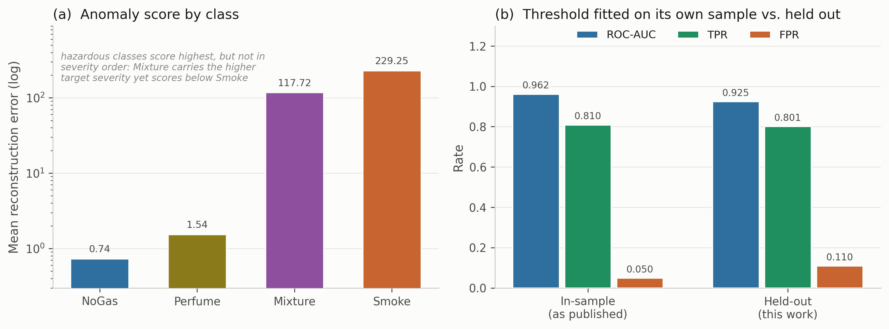{width=6.50in}

Fig. S10—Anomaly component. (a) Mean reconstruction error by class. (b) Operating point under an in-sample threshold against a training-fitted one.

## S22 Representative Prior Work

| Study | Dataset | Task | Protocol | Result | Evaluation gap |
|---|---|---|---|---|---|
| Narkhede et al. (2021, 2022) | MGD | MOX + thermal, 4-class | single-session test split | 96 / 82 / 93% | accuracy only; random split over overlapping windows |
| Sharma et al. (2024) | MGD | MOX + thermal, 4-class, federated | validation split | 99.7% | no safety or degradation metric |
| El Barkani et al. (2024) | MGD thermal | thermal, 4-class, embedded | test split | 91.7% | single modality; no action-level metric |
| Zhang and Zhang (2025) | own simulated; MGD for pretraining | MOX + thermal, binary leak | simulated and field sets | 98.9 / 95.4% | different task and test set |
| Dennler et al. (2022) | other MOX benchmark | drift analysis | re-partitioned | n/a | leakage mechanism only; no safety metric |
| Liang et al. (2023) | pipeline flow | normal-only anomaly detection | field validated | n/a | stops at detection |
| Korjani et al. (2024) | optical gas imaging | vision detection | field imagery | n/a | degraded sensing not a safety metric |
| Elkan (2001) | n/a | cost-sensitive learning theory | n/a | n/a | untested on a saturated benchmark |
| This study | MGD | action from MOX and anomaly state | block-wise holdout, 20-window embargo, seed-varying block | Tables 5–7 and Supplementary results | surrogate analytes; one device and campaign; perception path evaluated under both protocols (Table S1c) |

Table S17—Representative prior work with dataset, task and validation protocol. MGD = MultimodalGasData.

## S23 Composition of the MOX Array

| Sensor | Commonly associated target gases (nominal sensitivity) |
|---|---|
| MQ-2 | LPG, butane, methane, smoke |
| MQ-3 | Alcohol, ethanol, organic vapors |
| MQ-5 | LPG, natural gas |
| MQ-6 | LPG, butane, iso-butane |
| MQ-7 | Carbon monoxide |
| MQ-8 | Hydrogen |
| MQ-135 | Air-quality indicators including NH₃, benzene, NOₓ and CO₂ |

Table S18—Composition of the MOX array, with the gases each element is nominally marketed as sensitive to.

## S24 Which Model Appears in Which Experiment

| Model | In distribution (Exp. 2) | Leave-one-class-out (Exp. 3) | Degradation (Exps. 6, 8) | Reject option (Exp. 7) | Action matrix and input probe (Exps. 2, 5) |
|---|---|---|---|---|---|
| Cost-weighted policy | ✓ | ✓ | ✓ | ✓ | ✓ |
| Unweighted network | ✓ | ✓ | ✓ | ✓ | |
| Multilayer perceptron | ✓ | ✓ | ✓ | ✓ | ✓ |
| Gradient boosting | ✓ | ✓ | ✓ | ✓ | ✓ |
| Random forest | ✓ | ✓ | ✓ | ✓ | ✓ |
| Support-vector classifier | ✓ | ✓ | | ✓ | ✓ |
| Recurrent (LSTM) | ✓ | ✓ | | | |
| Conservative Q-learning | ✓ | ✓ | | | |
| k-nearest neighbors | ✓ | ✓ | | ✓ | ✓ |
| Shallow decision tree | ✓ | ✓ | ✓ | | ✓ |
| CUSUM | | | | | |
| Ordinal cost objective | | | | | |
| Total | 10 | 10 | 6 | 7 | 7 |

Table S19—Which model appears in which experiment. The ordinal cost objective carries no mark: it is a variant of the decision component, it never emits the Monitor action, and it is reported under Experiment 4 rather than among the comparators. CUSUM likewise carries no mark, being reported in the text of Experiment 2 rather than in any comparator table.

## S25 Per-Class Action Shares in Distribution

Decision accuracy pools the four classes, which makes the spread in Table 5's first column hard to place. Resolving it by class shows where the disagreement lives (Table S20). The inventory is the seven models of Fig. S11 over five seed-varying partitions rather than the ten primary comparators of Table 5 over 30 runs, so the two are not directly comparable row by row. The pattern, however, is not subtle.

| Model | NoGas | Smoke | Mixture | Perfume |
|---|---|---|---|---|
| Support-vector classifier | 0.9424 | 1.0000 | 1.0000 | 0.8449 |
| Cost-weighted policy | 0.9418 | 1.0000 | 1.0000 | 0.9101 |
| Multilayer perceptron | 0.9386 | 1.0000 | 1.0000 | 0.9070 |
| k-nearest neighbors | 0.9323 | 1.0000 | 1.0000 | 0.8620 |
| Shallow decision tree | 0.8658 | 0.9994 | 1.0000 | 0.8494 |
| Random forest | 0.8646 | 1.0000 | 1.0000 | 0.9361 |
| Gradient boosting | 0.8399 | 0.9804 | 1.0000 | 0.9184 |
| Range | 0.840 to 0.942 | 0.980 to 1.000 | 1.000 | 0.845 to 0.936 |

Table S20—Per-class share of windows assigned an acceptable action, in distribution, averaged over five seed-varying partitions.

Every model assigns the correct action to every Mixture window and to at least 98.0% of Smoke windows. The whole of the between-model spread sits on NoGas and Perfume, which span 10.3 and 9.1 points across the seven models. Aggregate accuracy on this corpus therefore reflects how a model resolves the boundary between clean air and a nuisance odorant (alcohol-based deodorant vapor), not its performance on the hazardous classes. The ordering on clean air is also the reverse of what the aggregate suggests: gradient boosting, sixth by decision accuracy in Table 5, is last here, assigning Monitor to 84.0% of clean windows against 94.2% for the support-vector classifier. That is the in-distribution face of the weighting defect reported under Experiment 8. Table S20 gives the per-class shares and Fig. S11 the action-selection matrices.

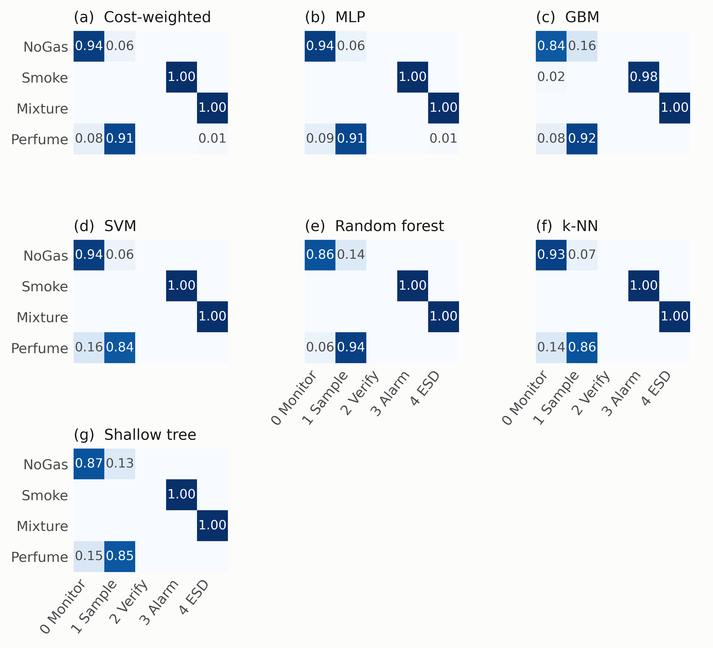{width=6.50in}

Fig. S11—Action-selection matrices in distribution.

*The intermediate verification rung.*

Where the actions land makes the saturation concrete (Fig. S11): every comparator sends essentially all Smoke windows to *Raise alarm* and all Mixture windows to *Recommend ESD assessment*, and the only visible spread is on the NoGas and Perfume boundary. One detail there belongs to the action space and not to any model. Action 2, *Request verification*, is never selected by any of the seven comparators on any run, for a structural reason: the target map sends Perfume to action 1, so action 2 is never a positive training target and cannot be scored correct under any model trained against that map. Nothing here therefore measures how a model would use an intermediate verification step, which is an unresolved question in the action design and a candidate for an action triggered by predictive uncertainty rather than class identity.

## S26 Corpus Layout and the Split

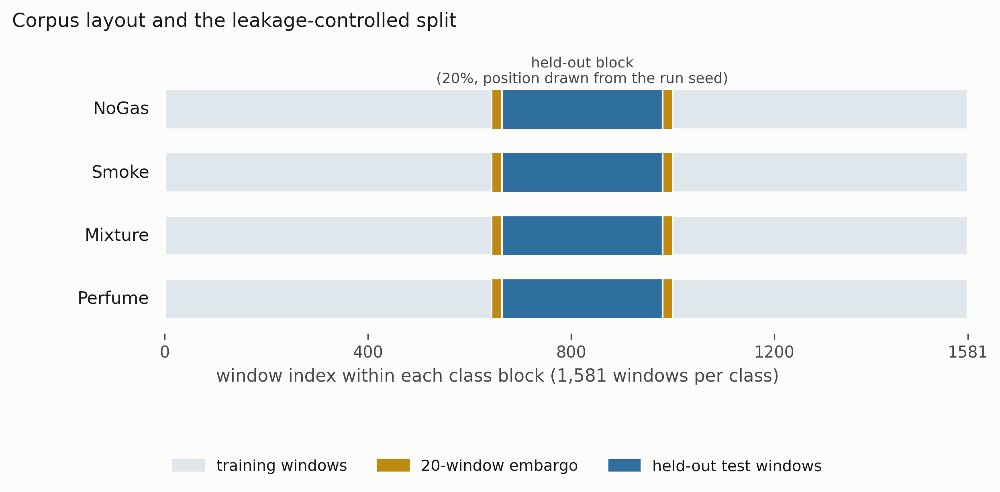{width=6.50in}

Fig. S12—Corpus layout and the leakage-controlled split.

## S27 Class-Disjoint Evaluation in Detail

*In-distribution accuracy does not order held-out-class missed-hazard rate.* On the held-out Smoke class the multilayer perceptron, third of ten by point accuracy in Table 5 and practically equivalent to the reference there with posterior probability 0.691, misses 6.41% of held-out-class hazardous windows on average. Its five partitions produce 4, 23, 30, 216 and 234 misses, two of them an order of magnitude worse than the rest, and the worst supports a 95% independence-reference upper bound of 16.35%. On Smoke, six models record no miss on any partition, 0 of 1,581 windows in each of five, against 234 of 1,581 in its worst partition for the perceptron. Those two are separated by the counts rather than by any ratio of bounds. Dividing the worst-partition independence-reference bound of the worst by that of the best gives 86; dividing the disjoint-support bounds for the same two partitions, 21.99% against 3.72%, gives 5.9 under the conservative disjoint-support convention of Eq. 10. A bound on an observed zero is almost entirely a property of the convention that produced it, 0.19% or 3.72% for the same zero, so the ratio moves by a factor of fifteen without any model changing. Both are reported here so that neither can be quoted alone, and the counts are what the comparison rests on. A model in the upper third of the accuracy table is therefore the worst on the Smoke class of those evaluated on the quantity that matters, and no accuracy-based selection would have steered a team away from it. That answers RQ2 in the negative.

The result is not converted into a correlation coefficient. Over the ten comparators the Pearson correlation between in-distribution accuracy and held-out-class missed-hazard rate is *r* = +0.26, and for escalation on the held-out Mixture class *r* = +0.10 (Fig. S13), with Fisher-transform widths of [−0.44, +0.76] and [−0.56, +0.69]. Those are reported as exploratory reference intervals rather than confidence intervals: the comparators were chosen to span inductive biases, share one corpus and one protocol, and are not a sample from any population of models. Both widths contain a strong positive association, so at ten comparators the correlation is unresolved rather than absent. The ordering claim above needs no coefficient.

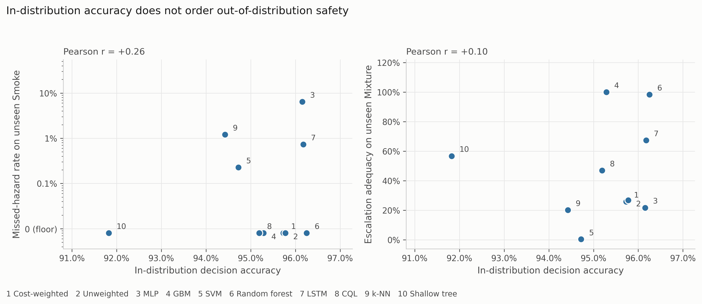{width=6.50in}

Fig. S13—In-distribution accuracy against held-out-class safety behavior.

*The alarm denominator hides a nuisance.* High-severity false-alarm rate is defined on NoGas windows, and on those windows no comparator produces an alarm-grade action in distribution. Perfume is also nonhazardous under Eq. 2b, where its acceptable set is {1, 2} and neither member is alarm-grade, so an alarm-grade action on a Perfume window is an unnecessary alarm by the paper's own definition. Counting those as well, two of the seven comparators have a nonzero nonhazardous alarm-grade rate while holding a clean-air rate of exactly zero: the cost-weighted policy alarms on 1.14% of Perfume windows and the multilayer perceptron on 0.57%, giving nonhazardous rates of 0.57% and 0.28% against 0.0000 on clean air (`v3_nonhazard_alarm.csv`). The figures are small, but a metric reported as an exact zero across every comparator turns out to depend on which windows the denominator admits. The all-nonhazardous rate is therefore reported as a sensitivity alongside the primary clean-air rate where it bears on a claim; Eq. 8 itself stays NoGas-only, and that quantity keeps the name clean-air alarm rate.

*Missed-hazard rate is not enough on its own.* On the held-out Mixture class, seven of ten comparators have worst-partition bounds at or below 3.3% on missed hazards, a threshold picked only to have something to sort on. Their escalation adequacy runs from 0.0049 to 1.000, a factor of about 200, so a review conducted on the miss column alone would treat those seven as interchangeable. The support-vector classifier misses 0.03% of held-out-class hazardous windows while escalating 0.5% of them, answering roughly 99.5% of the class carrying the highest target action with *Increase sampling*, which the miss metric records as a clean sheet. The cost-weighted policy escalates 25.9% and under-escalates 74.0% by Eq. 7, while gradient boosting escalates all of them. On missed-hazard rate gradient boosting records none and the support-vector classifier 0.0003, so a screen conducted on that column alone would clear both and separate neither; on escalation adequacy they sit at opposite ends of the table. That answers RQ3.

Withholding Mixture removes action 4 from the training label set, so escalation adequacy on that class is arithmetically a question about which of the three remaining classes a model assigns those windows to: route them to Smoke and it escalates, route them to Perfume and it under-escalates. The metric re-expresses a classification decision rather than measuring something independent of it. That re-expression is what makes it useful here, because held-out decision accuracy is zero for every model by construction and so cannot distinguish a model routing a held-out hazardous class to *Raise alarm* from one routing it to *Increase sampling*. Cross-sensitivity to interferents outside the training set is routine for MOX arrays in service (Vergara et al. 2012).

*How much of that depends on where the alarm boundary sits.* Table 1 places the boundary at *a* ≥ 3 because actions 1 and 2 place nothing in front of an operator, and the 200-fold spread depends on that choice. Because *R*~miss~, *R*~under~ and *R*~esc~ partition the hazardous windows, escalation under a boundary at *a* ≥ 1 is exactly 1 − *R*~miss~. The sensitivity was also checked by re-running the held-out Mixture protocol and keeping the per-window actions (retrain/run_rung_check.py, results_v2/v3_rung_check.csv); the *a* ≥ 3 column reproduces the stored values in `v3_loco_all.csv` exactly. Lowering the boundary from alarm grade to any action above Monitor is two rungs, not one, because no comparator sends a held-out Mixture window to *Request verification*, so *a* ≥ 2 equals *a* ≥ 3 for every model. For the seven comparators with worst-partition bounds at or below 3.3%, escalation then runs from 0.992 to 1.000 against 0.0049 to 1.000 at *a* ≥ 3, a spread of about 1.01 against about 200. Across all ten comparators the same boundary gives 0.751 to 1.000, the low end being the shallow decision tree, which rises from 0.567. On the held-out Smoke class the two boundaries agree, 0.928 to 1.000 against 0.936 to 1.000, because almost nothing lands in the sub-alarm band there.

The whole disagreement on the held-out Mixture class lives in the sub-alarm band, so a facility implementing action 1 differently would report different numbers. What does not move with the boundary is that most of these models route most of a held-out hazardous class to actions 1 or 2, and that a miss metric scores every one of those routings as a success. Whether that is acceptable depends on how the facility implements *Increase sampling*, which a miss metric cannot express.

Among the evaluated models the strongest escalators across both held-out classes are the two tree ensembles, at 1.000 and 0.983 on the held-out Mixture class, but the ordering in between is not a simple split between trees and networks. The recurrent network reaches 0.674 and conservative Q-learning 0.469, both well above the cost-weighted policy at 0.259 and the perceptron at 0.217. The shallow decision tree escalates fully on the held-out Smoke class while failing on the held-out Mixture class: 24.87% missed on average, but the per-partition counts are 0, 0, 489, 489 and 988, flawless on two partitions and catastrophic on three, with a worst-partition bound of 64.51%. An average summarizes such a model poorly, which is why the counts are printed. No comparator is uniformly best. Fig. 5 uses a logarithmic axis because the three-decade spread requires one, and Fig. S14 decomposes the same responses into alarm-grade, sub-alarm and passive shares, where almost the whole support-vector bar is sub-alarm.

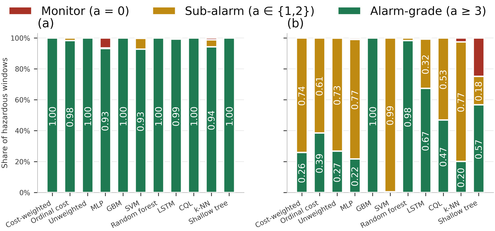{width=6.50in}

Fig. S14—Disposition of hazardous windows from a held-out class.

One structural property governs how every number here should be read. No comparator has a reject option: each is an ordinary closed-set classifier over the three retained labels and must emit one of the actions its training vocabulary contains. The experiment therefore measures how a closed-set policy *routes* an unfamiliar hazardous condition through its decision space, a different question from whether a detector can *recognize* it as unfamiliar, and it is neither an open-set method nor a scoring of one. A comparator scoring well here might do so by mapping the unknown analyte onto a conveniently alarming neighbor rather than through competence worth buying. Experiment 7 adds the reject option this design lacks.

## S28 The Correlated t-Test and the Hyperparameter Grids

The model comparison itself is run 30 times, with seed, held-out block position and a hyperparameter draw all varying per run (Bouthillier et al. 2021). What the draw ranges over differs by family, but the budget is equal: one draw per run for every comparator, from a fixed grid of the same size, none of it tuned against the test partition. Supplementary Section S5 lists the grid for each family. Five paired observations cannot support a ranking: the two-sided Wilcoxon signed-rank test has a minimum attainable *p*-value of 2^(1−*N*~run~)^ = 0.0625 at *N*~run~ = 5, so no comparison reaches α = 0.05 at any effect size. With 30 runs we use the Bayesian correlated *t*-test of Benavoli et al. (2017). For a vector of paired differences *d* with mean *d̄* and sample variance *s*², the posterior is a Student *t* with *N*~run~ − 1 degrees of freedom, mean *d̄*, and scale

&nbsp;&nbsp;&nbsp;&nbsp;*s*~post~ = sqrt( *s*² · ( 1/*N*~run~ + ρ/(1 − ρ) ) ),  ............ (S2)

with the correlation ρ = *n*~test~/(*n*~train~ + *n*~test~) = 1,264/(4,900 + 1,264) = 0.2051, computed from the partition the pipeline builds rather than fixed by hand. Integrating that posterior over a region of practical equivalence of ± 1 accuracy point returns three probabilities per comparison: that one model is practically better, that the other is, and that the two are equivalent. The one-point region is a study-specific choice, no economic model or site requirement having been analyzed to produce it, and Table S5 shows how much any conclusion depends on it. The third probability is a positive statement a null hypothesis test cannot give.

Benavoli et al. (2017) derive this correlation term for *k*-fold cross-validation, and the present design is not *k*-fold: seed, block position and a hyperparameter draw all vary per run, following Bouthillier et al. (2021). Training partitions still overlap by roughly 80% of their windows, so treating runs as independent would be anti-conservative, but ρ is carried across from a design that is not quite this one. The comparison is therefore reported over ranges of ρ and of equivalence width (Supplementary Section S6) and reads as a sensitivity analysis over an assumed dependence structure, not a calibrated posterior. Runs are seeded and execution is limited to two threads; no global determinism flag is set in the drivers that produced these results.

## S29 Graded Sensor Degradation in Full

*Experiment 6: Graded Sensor Degradation.* Six models were put through synthetically imposed degradation designed to probe robustness: additive noise (σₙ = 0.1 to 0.5), calibration drift (gain and baseline shift of ±10% to ±50%) and channel dropout (*k* = 1 to 7 of 7 sensors) at graded severity. All three safety metrics are reported. Selected results are summarized in Experiment 6 of the manuscript, with the full sweep in Fig. 6 and Table S21. Alarm burden there is the high-severity false-alarm rate per 1,000 clean windows per detector, which keeps it independent of any particular duty cycle, and the starred clean-condition entry is the independence-reference binomial upper bound a single partition supports on an observed zero rather than a point estimate. This addresses RQ4.

All three families act on the *standardized* decision state of Eq. 1, downstream of the training-partition scaler, not on raw readings. So σₙ = 0.5 is half a training standard deviation on every channel, and channel dropout places the dropped channel at its *training-set mean* rather than at an electrical zero. That makes it the milder of the two channel-loss faults: Experiment 8 tests the electrical-zero case in raw sensor space and finds it behaves nothing like this one. The anomaly feature is not perturbed in any condition; Experiment 5 probes it separately.

Three failure modes separate cleanly and no single metric tells them apart. They are study-specific behavioral patterns, not functional-safety categories, and none of these labels carries IEC 61511 meaning. *Alarm-biased failure:* the cost-weighted policy, the unweighted network and the decision tree record no observed missed hazards and full escalation right through complete sensor loss, achieved by escalating everything, so false-alarm rate reaches 1.000 while the missed-hazard metric alone reads as a perfect score. *Silent failure:* gradient boosting records no false alarm under Eq. 8 at any severity and at *k* = 7 goes silent, missing 617 of 632 hazardous windows (97.6%) in one partition of five and none in the other four, escalation falling to 0.605, which the false-alarm metric alone also scores as perfect. *Graceful, then brittle:* the random forest holds zero observed misses and a false-alarm rate at or below 6.3% out to *k* = 5, then rises to 25.7% at *k* = 6 and 51.9% at *k* = 7. The perceptron does both at once at total sensor loss: half the hazardous windows missed and 20% of clean windows alarmed.

Drift is the mildest family on the false-alarm side: its peak high-severity false-alarm rate across every model and severity is 0.19%, so drift damage shows up as missed hazards rather than indication load. Noise and channel loss behave in the opposite direction.

The first onset matters operationally more than the endpoint. Losing one sensor of seven takes the cost-weighted policy from zero to 128 alarm-grade indications per 1,000 clean windows and the decision tree to 200, pooled over five partitions with all of it in one partition of five in each case, while the random forest moves only to 7.0. Converting those per-detector rates to the same time basis puts several models above the long-term average indication rate EEMUA (2024) treats as manageable for a whole operator position, and gradient boosting below it because it fails in the other direction. Fig. S15 carries no reference line, because that figure is a budget for an entire position and this axis is one detector: the comparison is contextual and not a compliance test.

Converting a rate into a burden needs a duty cycle. The corpus carries no timestamp column, but the acquisition protocol is documented at 2 s intervals (Narkhede et al. 2022), putting a detector at *f* = 1,800 windows per hour, so the hourly indication rate is

&nbsp;&nbsp;&nbsp;&nbsp;*Q* = *B* · *f* / 1000.  ............ (S3)

*B* from Eq. 9 is the primary quantity, because it is a property of the model while the hourly figure is a property of the deployment. One caveat applies to every hourly figure here: each clean test segment holds 316 windows, about 10.5 minutes at 2 s, so a per-hour number is that segment scaled up roughly sixfold rather than a rate observed over an hour. On that basis Eq. S3 puts the single-sensor-loss figure at about 231 alarm-grade indications per hour from one instrument, against the EEMUA (2024) treatment of roughly six alarms per hour as the limit of what an entire operator position can absorb. Indications are not annunciated alarms, and the eventized treatment below reduces this condition to under six annunciations per hour. What survives the conversion is the ordering and the magnitude: neither an accuracy table nor a missed-hazard table would have predicted that one lost channel separates these models by two orders of magnitude in indication production.

The arithmetic cuts the other way on the clean-condition rows. A zero across the 316 clean windows of one partition bounds the burden at 9.4 alarm-grade indications per 1,000 clean windows, roughly 17 per hour under the same duty cycle, which is several times the EEMUA figure for a whole operator position rather than a fraction of it. An observed zero false-alarm rate is therefore not yet evidence of an acceptable indication load. Below roughly 60% accuracy none of these models is behaving usefully here either: zero missed hazards at 35.0% accuracy describes a failure mode, not fitness. Fitness for service is a process-safety qualification decision made against a facility's own criteria, which no benchmark result of this kind settles.

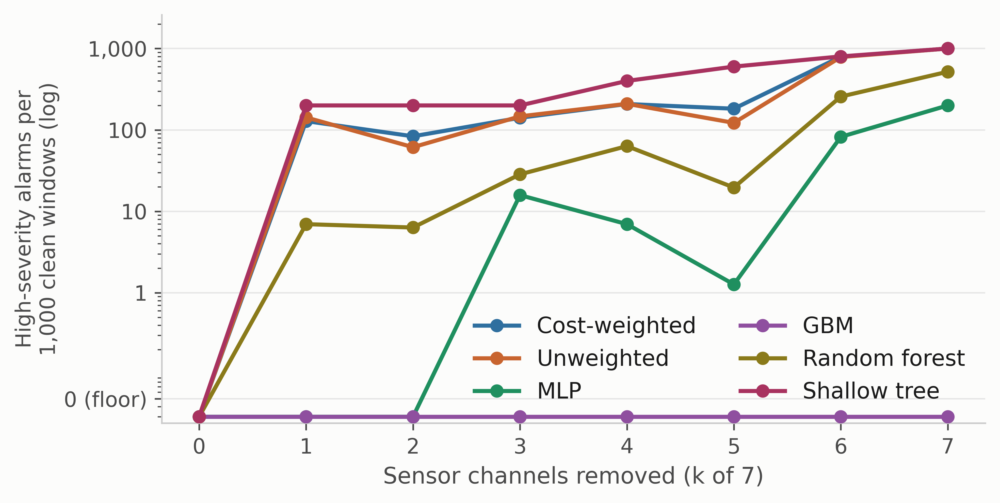{width=6.50in}

Fig. S15—False-alarm rate expressed as indication burden, against the number of sensor channels removed.

*Selected values, as the manuscript reported them.*

| Condition | Model | Decision acc. | Missed-hazard | Escalation | High-severity FA | Indications per 1,000 windows |
|---|---|---|---|---|---|---|
| Clean | Cost-weighted | 0.963 | 0.0000 | 1.000 | 0.0000 | ≤ 9.4\* |
| Clean | Random forest | 0.950 | 0.0000 | 1.000 | 0.0000 | ≤ 9.4\* |
| Clean | Shallow decision tree | 0.929 | 0.0000 | 1.000 | 0.0000 | ≤ 9.4\* |
| Drift ±50% | Cost-weighted | 0.908 | 0.0000 | 1.000 | 0.0006 | 0.6 |
| Drift ±50% | Multilayer perceptron | 0.932 | 0.0006 | 0.999 | 0.0000 | 0 |
| Drift ±50% | Gradient boosting | 0.866 | 0.0111 | 0.902 | 0.0000 | 0 |
| Noise σₙ = 0.5 | Cost-weighted | 0.839 | 0.0000 | 1.000 | 0.1373 | 137 |
| Noise σₙ = 0.5 | Random forest | 0.866 | 0.0000 | 1.000 | 0.0070 | 7.0 |
| Dropout *k* = 1 | Cost-weighted | 0.885 | 0.0000 | 1.000 | 0.1285 | 128 |
| Dropout *k* = 1 | Shallow decision tree | 0.722 | 0.0000 | 1.000 | 0.2000 | 200 |
| Dropout *k* = 1 | Random forest | 0.942 | 0.0000 | 1.000 | 0.0070 | 7.0 |
| Dropout *k* = 3 | Cost-weighted | 0.811 | 0.0000 | 0.992 | 0.1411 | 141 |
| Dropout *k* = 3 | Multilayer perceptron | 0.863 | 0.0047 | 0.994 | 0.0158 | 16 |
| Dropout *k* = 7 | Cost-weighted | 0.350 | 0.0000 | 1.000 | 1.0000 | 1,000 |
| Dropout *k* = 7 | Shallow decision tree | 0.250 | 0.0000 | 1.000 | 1.0000 | 1,000 |
| Dropout *k* = 7 | Gradient boosting | 0.440 | 0.1953 | 0.605 | 0.0000 | 0 |

Table S21—Selected perturbation results, with the full sweep in Fig. 6 of the manuscript.

## S30 Which Metric Selects Which Model

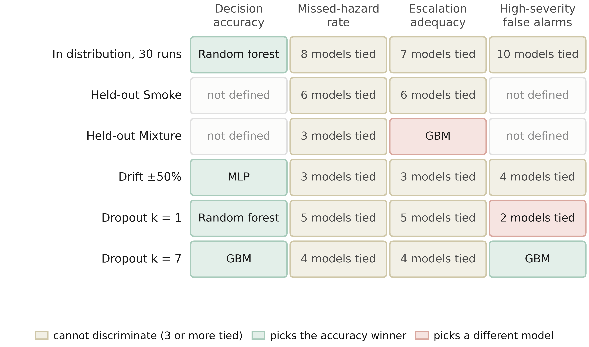{width=6.50in}

Fig. S16—Which model each metric selects, condition by condition.
