# Supplementary Material

A Process-Safety Benchmark for Learned Gas-Monitoring Models Under Class Exclusion and Sensor Degradation

Benjamin C. Nweke, Gholamreza Ramezan, Soheil Saraji

This file provides the supporting analyses, full tables, sensitivity checks, component details and reproducibility information referenced from the manuscript. Study-generated results come from the released drivers and stored result files under the protocols described below; literature summaries and the recorded original thermal-checkpoint results are identified separately. Supplementary sections, tables and figures cited from the manuscript use S-numbering.

All values in this file come from the single rerun of November 2026, in one environment, after the code corrections described in the manuscript; gradient boosting is the hazard-weighted configuration (Section S7). Where an earlier clean-air-weighted gradient-boosting value is quoted for comparison, it is labelled as such.

## Contents

| Section | Subject | Tables and figures |
|---|---|---|
| S1 | Perception Component | Tables S1, S1b, S1c; Fig. S1 |
| S2 | Explanation Component | none |
| S3 | Cost Asymmetry and the Ordinal Objective | Tables S2, S24, S25; Fig. S2 |
| S4 | Confidence Calibration | Table S3; Fig. S3 |
| S5 | Comparator Specifications | Table S26 |
| S6 | Sensitivity of the Equivalence Conclusions | Tables S4, S5 |
| S7 | Decision-State Ablation and Upstream-Input Sensitivity | Table S6; Figs. S4, S5 |
| S8 | What the Protocol Costs to Adopt | none |
| S9 | Sensitivity of the Eventized Alarm Result to the Persistence Rule | Table S7 |
| S10 | Isolating Overlap Contamination from Temporal Position | Table S8 |
| S11 | The Reject Option in Full | Table S9 |
| S12 | Raw-Space Faults, Per Model | Table S10 |
| S13 | Eventized Alarm and Hazard Episodes, Per Model | Tables S11, S12 |
| S14 | Reproducing These Results (see S19) | none |
| S15 | Anomaly Detector in Detail | Fig. S6 |
| S16 | Reject Option and Raw-Space Faults | Tables S13, S14, S15, S16 |
| S17 | Component Architectures | Figs. S7, S8, S9 |
| S18 | Bounds on Observed Zeros | none |
| S19 | Reproducibility | Table S22 |
| S20 | Nomenclature | none |
| S21 | Component Behavior in Detail | Fig. S10 |
| S22 | Representative Prior Work | Table S17 |
| S23 | Composition of the MOX Array | Table S18 |
| S24 | Which Model Appears in Which Experiment | Table S19 |
| S25 | Per-Class Action Shares in Distribution | Table S20; Fig. S11 |
| S26 | Corpus Layout and the Split | Fig. S12 |
| S27 | Class-Exclusion Evaluation in Detail | Table S23; Figs. S13, S14 |
| S28 | The Correlated t-Test and Run-Level Variation | none |
| S29 | Graded Sensor Degradation in Full | Table S21; Fig. S15 |
| S30 | Which Metric Selects Which Model | Fig. S16 |

Section S19 is the reproducibility appendix, and S20 is the nomenclature.

---

## S1 Perception Component

The thermal path is described here in full. The decision state of Eq. 1 carries no visual term, so no safety result in the manuscript depends on any number in this section. The component was nonetheless evaluated under both protocols the sensor path uses, and the block-wise results are reported in full, including where they are poor.

*Training.* Thermal images are classified with YOLOv8n-cls (Jocher et al. 2023), the smallest classification variant in the family. The original classifier was trained with Ultralytics 8.4.14 on Python 3.12.12 and one Tesla T4 GPU; the PyTorch version of that run was not recorded. The run used 50 epochs, batch size 32, image size 224, initialization from pretrained weights, seed 0 and deterministic operations. The optimizer was left at automatic selection. Ultralytics 8.4.14 chooses the optimizer from the number of training iterations, counted at its nominal batch of 64: for the 5,120 randomized training frames that is 80 per epoch, or 4,000 in total, and for the 4,960 block-wise training frames it is 78 per epoch, or 3,900 in total. Below 10,000 iterations it selects AdamW, with a learning rate of 0.00125, which is 0.002 × 5 / (4 + nc) for four classes, and momentum 0.9. Weight decay of 5×10^−4^ is applied to weight tensors only, not to biases or normalization parameters. Training used three warm-up epochs and linear learning-rate decay. The augmentations were a horizontal flip with probability 0.5, no rotation, hue, saturation and value jitter, RandAugment, and random erasing with probability 0.4. The original training and validation sets were made by shuffling each class's 1,600 frames into an 80/20 split without a fixed seed, giving 1,280 training and 320 validation images per class, 5,120 and 1,280 in total. The original checkpoint's stored arguments list a learning rate of 10^−^^2^ and momentum 0.937; automatic selection overrides both, and they are not the values used. The original weights are not in the repository, so the original figures can be checked against the training record but not rerun. The retrained runs use the same settings under each protocol. They were run on PyTorch 2.11.0 with CUDA 12.8, on Ultralytics 8.4.14 and one Tesla T4 GPU, as each run's JSON records. The PyTorch build comes from the Kaggle image and is not pinned, so a re-run on another day may differ slightly. Their checkpoints are not in the repository either, but their SHA-256 hashes are recorded alongside their results, split tables and training curves (Section S19).

*The split, and what it costs.* The sensor side uses a block-wise holdout with an embargo. The original perception split did not. It was randomized over frames captured consecutively within one acquisition campaign, so adjacent thermal frames, which are close to duplicates, fall on both sides of it, and its figure is an optimistic upper bound. To measure what that costs, the classifier was retrained under two protocols with the settings above. The randomized protocol holds out a stratified 20% of each class, 320 frames per class and 1,280 in total, with no embargo, so 5,120 frames train the model. The block-wise protocol follows the rule of the sensor pipeline: one contiguous 320-frame block per class, at a position drawn from the seed, with 20 frames discarded on each side of it, so 4,960 frames train the model and 160 are discarded. Each run reports its final-epoch weights on its held-out frames. Each run also records a best-checkpoint figure for reference only, because Ultralytics selects that checkpoint on the same frames.

*Results.* The original checkpoint reached 98.8% top-1 accuracy on 1,280 held-out validation images, with 15 misclassifications (Table S1). Twelve of the 15 fell on the NoGas and Perfume boundary, and the other three were NoGas frames called Smoke, a false alarm rather than a miss. No hazardous frame was called non-hazardous, which is what matters once the class label is mapped to an action (Fig. S1). These are the figures recorded for that checkpoint. They are not a rerun, and they are not a leakage-controlled result.

| Gas class | Precision | Recall | F1 | Accuracy (%) |
|---|---|---|---|---|
| Mixture | 1.000 | 1.000 | 1.000 | 100.0 |
| NoGas | 0.990 | 0.963 | 0.976 | 96.3 |
| Perfume | 0.972 | 0.991 | 0.981 | 99.1 |
| Smoke | 0.991 | 1.000 | 0.995 | 100.0 |
| Overall | 0.988 | 0.988 | 0.988 | 98.8 |

Table S1—Perception component, original checkpoint, 1,280 held-out validation images from the randomized split, as recorded at training. These figures are not a rerun. The retrained results are in Tables S1b and S1c.

*Retraining under both protocols.* Table S1b gives the three randomized runs, with seeds 42, 1234 and 2024, and Table S1c the five block-wise runs, with seeds 42, 1337, 7, 2024 and 99. On the randomized split the three runs give 98.0 to 98.3% (mean 98.2%), with 22 to 25 errors each, and between 0 and 2 hazardous frames called non-hazardous. The original 98.8% therefore sits about 0.5 to 0.8 points above every retrained run. That gap is larger than the spread among the retrained runs, so the original result does not reproduce exactly under this code, and its cause is not identified here. On the block-wise split the five runs give 79.2 to 92.1% (mean 85.0%, standard deviation 4.9 points), which is 13.2 points below the randomized mean. That gap is consistent with the leakage mechanism described above, but this study does not isolate it, because the two protocols also differ in which frames they train on and which they test on. Recall for NoGas ranges from 49 to 92% and for Perfume from 53 to 99% across seeds, while Mixture stays between 99 and 100%. Between 0 and 65 of the 640 hazardous frames in each run (0.0 to 10.2%) are called non-hazardous, so under the protocol the sensor path uses, the hazard-miss rate is not zero.

| Run | Seed | Top-1 (%) | Errors | NoGas (%) | Smoke (%) | Mixture (%) | Perfume (%) | Hazardous called non-hazardous (of 640) |
|---|---|---|---|---|---|---|---|---|
| Randomized | 42 | 98.13 | 24 | 95.0 | 99.4 | 100.0 | 98.1 | 2 |
| Randomized | 1234 | 98.28 | 22 | 95.6 | 100.0 | 100.0 | 97.5 | 0 |
| Randomized | 2024 | 98.05 | 25 | 95.9 | 99.4 | 99.7 | 97.2 | 2 |
| Mean | | 98.15 | 23.7 | 95.5 | 99.6 | 99.9 | 97.6 | 1.3 |

Table S1b—Perception component retrained under the randomized split, 1,280 held-out frames per run, final-epoch weights. The four class columns are per-class recall (sensitivity), the share of that class's 320 held-out frames classified correctly. The mean row is the arithmetic mean of the three runs.

| Run | Seed | Top-1 (%) | Errors | NoGas (%) | Smoke (%) | Mixture (%) | Perfume (%) | Hazardous called non-hazardous (of 640) |
|---|---|---|---|---|---|---|---|---|
| Block-wise | 42 | 81.88 | 232 | 49.1 | 79.7 | 100.0 | 98.8 | 65 |
| Block-wise | 1337 | 79.22 | 266 | 65.3 | 98.4 | 100.0 | 53.1 | 5 |
| Block-wise | 7 | 84.92 | 193 | 91.6 | 82.8 | 99.4 | 65.9 | 55 |
| Block-wise | 2024 | 86.88 | 168 | 79.4 | 84.4 | 100.0 | 83.8 | 50 |
| Block-wise | 99 | 92.11 | 101 | 90.3 | 100.0 | 99.4 | 78.8 | 0 |
| Mean | | 85.00 | 192.0 | 75.1 | 89.1 | 99.8 | 76.1 | 35.0 |

Table S1c—Perception component retrained under the block-wise holdout used for the sensor path, 1,280 held-out frames per run (one contiguous block per class, 20-frame embargo), final-epoch weights. The four class columns are per-class recall (sensitivity). Hazardous classes are Smoke and Mixture. The mean row is the arithmetic mean of the five runs. The seed-42 row is recomputed from the frame-level outputs (81.88%); the checkpoint records 82.03% as stored, a two-frame difference that the verification run reports.

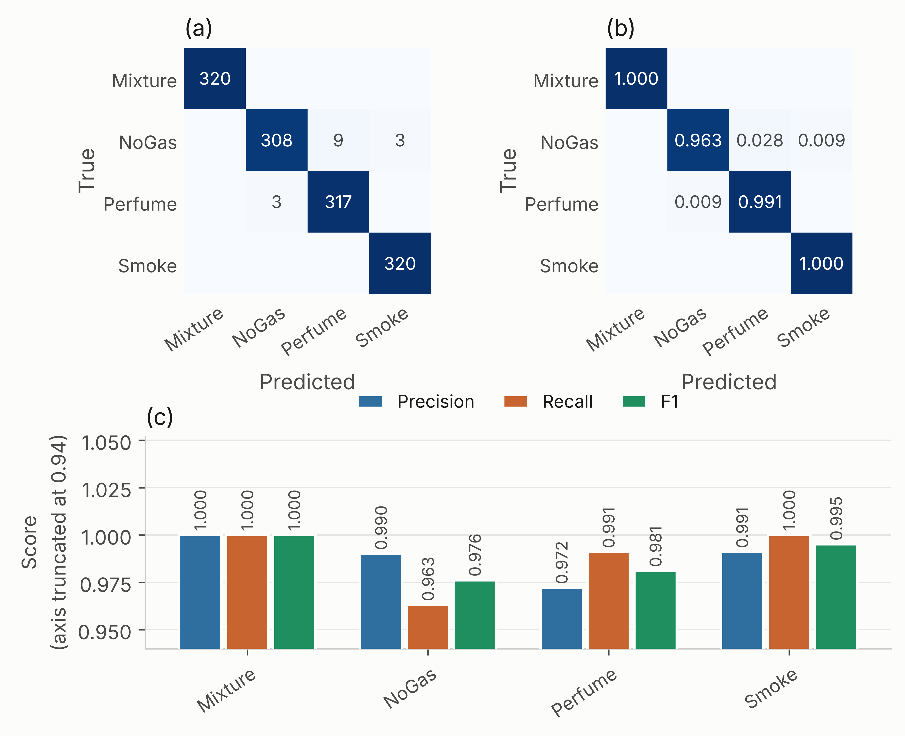{width=6.50in}

Fig. S1—Thermal classifier behavior, original checkpoint, 1,280 randomized-split held-out images. (a) Counts, (b) row-normalized, (c) per-class scores. The retrained confusion matrices are in the repository under retrain/results_thermal/runs.

## S2 Explanation Component

Explanations are generated locally with Gemma 3 1B served through Ollama (Gemma
Team 2025), prompted with the gas class, classification confidence, normalized
anomaly score and threshold, and the selected action, capped at 150 tokens.
Nothing leaves the device.

In the computational architecture, the generated text cannot alter the selected action: the action is fixed by the decision component before any text is generated. That is the only claim made about it. Operator-facing explanations could still influence how an operator interprets and responds to an action, and that influence has not been evaluated.

The component is described as part of the system and is evaluated nowhere in this
work. It is not timed, not inspected and not assessed for faithfulness. No result
in the manuscript depends on it, and it should be read as apparatus rather than as
a contribution.

---

## S3 Cost Asymmetry and the Ordinal Objective

The manuscript reports this experiment's conclusions. The sweep, the objective,
the cost matrix and the action-distribution analysis are here.

The loss-weight ratio *C* from Eq. 3 was swept across nine values with everything else fixed (Table S2, Fig. S2).

| Cost ratio *C* | Decision accuracy | SD | Passive-miss rate | Notification rate | Clean-air alarm rate |
|---|---|---|---|---|---|
| 1:1 (symmetric) | 0.9646 | 0.0252 | 0.0000 | 1.000 | 0.0000 |
| 2:1 | 0.9584 | 0.0317 | 0.0000 | 1.000 | 0.0000 |
| 4:1 | 0.9620 | 0.0292 | 0.0000 | 1.000 | 0.0000 |
| 6:1 | 0.9593 | 0.0310 | 0.0000 | 1.000 | 0.0000 |
| 8:1 (reference) | 0.9630 | 0.0270 | 0.0000 | 1.000 | 0.0000 |
| 10:1 | 0.9631 | 0.0251 | 0.0000 | 1.000 | 0.0000 |
| 12:1 | 0.9573 | 0.0338 | 0.0000 | 1.000 | 0.0000 |
| 16:1 | 0.9241 | 0.0979 | 0.0000 | 1.000 | 0.0000 |
| 20:1 | 0.9090 | 0.0962 | 0.0000 | 1.000 | 0.0000 |
| *Label function* | *1.0000* | *0.0000* | *0.0000* | *1.000* | *0.0000* |

Table S2—Cost-asymmetry sweep, mean ± SD across five runs per configuration varying partition and initialization. The label-function row applies *y*(·) of Eq. 2a to the true class label. It reaches the ceiling by construction, consumes the label it is meant to infer, and is not a deployable baseline.

The passive-miss rate is zero and the notification rate 1.000 at every ratio, the symmetric 1:1 configuration included. Accuracy is highest at 1:1 (0.9646), is 0.9630 at the reference 8:1 across five seeds (the 30-run comparison in Table 6 of the manuscript gives 0.9573 for the same policy), and falls past 12:1 to 0.9090 at 20:1. The SD rises from 0.0252 at 1:1 to 0.0962 at 20:1, about 3.8-fold, which corresponds to a variance increase of about 14.6-fold. Scalar weighting produced no observed change in the nominal safety metrics at any setting and reduced accuracy at the extremes.

The unweighted configuration (1:1) already had no observed passive miss in this nominal evaluation, so there was no measured passive-miss reduction for weighting to show. A deterministic class-to-action map does not by itself make classification easy, and whether the absence of misses reflects the separation of the classes in feature space was not analyzed directly. This is an observation about this benchmark, not evidence against cost-sensitive learning (Elkan 2001).

*Selection of the reference ratio.* *C* = 8:1 is not the accuracy optimum; it was chosen in the original design from dispersion on test partitions, so it is not independent of the test data. A uniformly random validation subset carved from training could not discriminate between ratios, because it shares readings with the training windows (the overlap Experiment 1 measures). Carving the validation band contiguously from the end of each class block, with the same embargo, selects *C* = 6:1 by mean validation accuracy (validation 0.9584, test 0.9397), with 1:1 second at 0.9580 and 8:1 fifth at 0.9551; ratios from 1:1 to 10:1 lie within 0.35 validation points of one another. This is a selection, not a robust optimum, and it does not make the original choice independent of the test results. The cost-weighted policy was therefore refitted at 6:1 and 8:1, with the same seeds and code, for class exclusion, feature-space perturbation and raw-signal faults (`retrain/run_ratio_check.py`; Table S24).

| Condition | Ratio | Passive-miss rate | Sub-alarm rate | Notification rate | Clean-air alarm rate |
|---|---|---|---|---|---|
| Smoke withheld | 8:1 | 0.0000 ± 0.0000 | 0.0000 ± 0.0000 | 1.0000 ± 0.0000 | —\* |
| Smoke withheld | 6:1 | 0.0000 ± 0.0000 | 0.0000 ± 0.0000 | 1.0000 ± 0.0000 | —\* |
| Mixture withheld | 8:1 | 0.0003 ± 0.0006 | 0.7404 ± 0.1883 | 0.2593 ± 0.1884 | —\* |
| Mixture withheld | 6:1 | 0.0000 ± 0.0000 | 0.7179 ± 0.1712 | 0.2821 ± 0.1712 | —\* |
| Clean | 8:1 | 0.0000 ± 0.0000 | 0.0000 ± 0.0000 | 1.0000 ± 0.0000 | 0.0000 ± 0.0000 |
| Clean | 6:1 | 0.0000 ± 0.0000 | 0.0000 ± 0.0000 | 1.0000 ± 0.0000 | 0.0000 ± 0.0000 |
| Noise σ~n~ = 0.5 | 8:1 | 0.0000 ± 0.0000 | 0.0000 ± 0.0000 | 1.0000 ± 0.0000 | 0.1373 ± 0.0472 |
| Noise σ~n~ = 0.5 | 6:1 | 0.0000 ± 0.0000 | 0.0000 ± 0.0000 | 1.0000 ± 0.0000 | 0.1411 ± 0.0392 |
| Drift ±50% | 8:1 | 0.0000 ± 0.0000 | 0.0000 ± 0.0000 | 1.0000 ± 0.0000 | 0.0006 ± 0.0014 |
| Drift ±50% | 6:1 | 0.0000 ± 0.0000 | 0.0000 ± 0.0000 | 1.0000 ± 0.0000 | 0.0006 ± 0.0014 |
| Dropout *k* = 1 | 8:1 | 0.0000 ± 0.0000 | 0.0000 ± 0.0000 | 1.0000 ± 0.0000 | 0.1285 ± 0.2873 |
| Dropout *k* = 1 | 6:1 | 0.0000 ± 0.0000 | 0.0000 ± 0.0000 | 1.0000 ± 0.0000 | 0.1373 ± 0.2983 |
| Dropout *k* = 4 | 8:1 | 0.0000 ± 0.0000 | 0.0000 ± 0.0000 | 1.0000 ± 0.0000 | 0.2082 ± 0.3341 |
| Dropout *k* = 4 | 6:1 | 0.0000 ± 0.0000 | 0.0000 ± 0.0000 | 1.0000 ± 0.0000 | 0.2247 ± 0.3758 |
| Dropout *k* = 7 | 8:1 | 0.0000 ± 0.0000 | 0.0000 ± 0.0000 | 1.0000 ± 0.0000 | 1.0000 ± 0.0000 |
| Dropout *k* = 7 | 6:1 | 0.0000 ± 0.0000 | 0.0000 ± 0.0000 | 1.0000 ± 0.0000 | 1.0000 ± 0.0000 |
| Stuck, 4 channels | 8:1 | 0.0000 ± 0.0000 | 0.0009 ± 0.0021 | 0.9991 ± 0.0021 | 0.0449 ± 0.0824 |
| Stuck, 4 channels | 6:1 | 0.0000 ± 0.0000 | 0.0009 ± 0.0021 | 0.9991 ± 0.0021 | 0.0323 ± 0.0687 |
| Zeroed, 1 channel | 8:1 | 0.0000 ± 0.0000 | 0.0041 ± 0.0092 | 0.9959 ± 0.0092 | 0.6000 ± 0.5477 |
| Zeroed, 1 channel | 6:1 | 0.0000 ± 0.0000 | 0.0000 ± 0.0000 | 1.0000 ± 0.0000 | 0.6146 ± 0.5279 |
| Saturated, 4 channels | 8:1 | 0.1057 ± 0.2208 | 0.2095 ± 0.3659 | 0.6848 ± 0.3567 | 0.1646 ± 0.3680 |
| Saturated, 4 channels | 6:1 | 0.1019 ± 0.2226 | 0.2044 ± 0.3750 | 0.6937 ± 0.3716 | 0.1044 ± 0.2335 |
| Saturated, 7 channels | 8:1 | 0.0000 ± 0.0000 | 1.0000 ± 0.0000 | 0.0000 ± 0.0000 | 0.0000 ± 0.0000 |
| Saturated, 7 channels | 6:1 | 0.0000 ± 0.0000 | 1.0000 ± 0.0000 | 0.0000 ± 0.0000 | 0.0000 ± 0.0000 |
| Raw noise 0.5 | 8:1 | 0.0000 ± 0.0000 | 0.0000 ± 0.0000 | 1.0000 ± 0.0000 | 0.9867 ± 0.0170 |
| Raw noise 0.5 | 6:1 | 0.0000 ± 0.0000 | 0.0000 ± 0.0000 | 1.0000 ± 0.0000 | 0.9551 ± 0.0721 |

Table S24—Cost-weighted policy at the validation-selected ratio 6:1 and the reference ratio 8:1, under class exclusion, feature-space perturbation and raw-signal faults, mean ± SD over five fits; selected conditions from `v3_ratio_check.csv`. \*No clean-air test windows are scored in the class-exclusion fits of this table; the clean-air alarm rate of those fits is in Table S23 (here 0 of 1,580 at both ratios with either class withheld).

*An ordinal objective, since the evidence points at one.* Eq. 3 prices all wrong actions alike, so sending a hazardous window to a sub-alarm action and sending it to the wrong alarm-grade action cost the same. That is a testable claim, so we tested it. We replaced the sample-weighted cross-entropy with direct minimization of expected cost,

&nbsp;&nbsp;&nbsp;&nbsp;*L*~ord~(θ) = (1/*N*) Σ~t~ Σ~a~ *p*~θ~(*a* | φ~t~) · *M*[*g*~t~, *a*],  ............ (S1)

under the matrix *M* of Table S25, chosen by hand and not optimized. Only this one numerical matrix was evaluated, in five class-exclusion fits per withheld class and in the 30-run nominal comparison, so the experiment cannot separate the effect of the matrix's structure from that of its values.

| Class | *a* = 0 Monitor | *a* = 1 Increase sampling | *a* = 2 Request verification | *a* = 3 Raise alarm | *a* = 4 Recommend ESD assessment |
|---|---|---|---|---|---|
| NoGas | 0 | 1 | 1 | 4 | 4 |
| Smoke | 10 | 5 | 5 | 0 | 1 |
| Mixture | 10 | 5 | 5 | 1 | 0 |
| Perfume | 2 | 0 | 0 | 3 | 3 |

Table S25—Class-by-action cost matrix *M* of Eq. S1. Correct actions cost 0, including both acceptable Perfume actions. The same matrix is used for training the ordinal variant and for the study-defined cost reported for every configuration in Table 6 of the manuscript.

Two separate evaluations follow. With Mixture withheld, the ordinal variant's mean alarm-grade notification rate was 38.6% ± 19.2 against 25.9% ± 18.8 for the cost-weighted policy, a descriptive difference of 12.6 percentage points over five fits each. In the 30-run nominal comparison its accuracy was 0.7470 ± 0.0057, about 21 points below the cost-weighted policy. This is the pooled four-class accuracy, not a clean-air-only measure; the action counts below show that nearly all of the loss is on clean-air windows (1,580 of the 1,599 errors in the five fits described there).

The study-defined cost is evaluated on the selected action, not on the predicted probabilities: it is the mean of *M*[*g*~t~, *a*~t~] over test windows, with the same matrix and no further normalization for every configuration. On that measure the ordinal variant scored 0.2590 against 0.0690 for the cost-weighted policy, so the objective did not achieve its intended cost reduction. The action counts show why. In the five fits whose action counts were recorded (the five-seed nominal partitions, with 6,320 test windows pooled, 1,580 per class, 5 × 1,264 and not the 6,324 windows of the corpus), every NoGas window was sent to action 1 (948 of 1,580) or action 2 (632), each costing 1, and 19 of 1,580 Perfume windows were sent to action 4, costing 3; (1,580 × 1 + 19 × 3)/6,320 = 0.259. No Monitor action was selected for any window. Eq. S1 is linear in the predicted action probabilities, so its minimizer for a window is a point mass on the action with the lowest expected cost under the class posterior, which is not the same object as the network's output. If *p* is the posterior probability of NoGas for a window that is NoGas or Perfume, Monitor has expected cost 2(1 − *p*) and a sub-alarm action has expected cost *p*, so a sub-alarm action is preferred whenever *p* is below two-thirds, since Monitor costs 2 for a Perfume window and 0 for a NoGas window. That would explain the hedge if the network were uncertain about clean air. For a window the network places confidently in NoGas, however, the minimizer of a loss linear in the probabilities is Monitor, and the unweighted network of the same architecture separates the classes well (Table 6 of the manuscript), so slow or saturating optimization on a linear loss is an alternative explanation that these fits do not exclude. One mechanism that could contribute is the gradient of Eq. S1 with respect to the logit of action *a*, which equals *p*~θ~(*a* | φ~t~) times the difference between the cost of that action and the expected cost under the current output, divided by *N*. Once the output puts little probability on Monitor, that gradient on the Monitor logit is small, whereas cross-entropy keeps a gradient of order one on a wrongly predicted class. We did not test whether this plateau explains the result. Convergence of the training loss was not examined. Whether longer training, another optimizer, a different initialization, or applying the expected-cost decision rule after training to the unweighted network's probabilities would reach the lower-cost solution was not tested, and the change in notification on withheld Mixture is not evidence of successful cost optimization.

The experiment shows that this matrix, under this training procedure, changed notification on a withheld class while raising the study-defined cost. It does not establish a useful cost matrix or say anything about ordinal objectives in general.

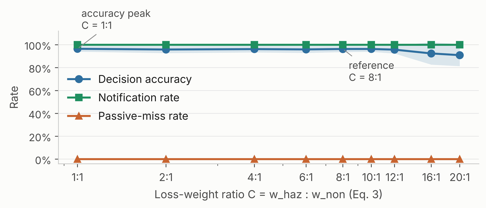{width=6.50in}

Fig. S2—Cost-asymmetry sweep over the loss-weight ratio C = w_haz : w_non of Eq. 3; the 8:1 point is the reference ratio of the study. Shading is ± 1 SD of decision accuracy across five seed-varying partitions.

---

## S4 Confidence Calibration

Confidence matters here because any escalation threshold, and any deferral rule, would be set against it. Four estimators were compared: the raw softmax, MC dropout with 20 passes, temperature scaling, and a five-member deep ensemble built from the same model class and objective as the single model. Temperature is fitted on a calibration split carved out of training, never on the training logits themselves. Expected calibration error uses equal-mass bins because confidence on this corpus piles up near 1 and equal-width bins leave most of the range empty (Table S3, Fig. S3).

| Estimator | ECE | SD | Block-bootstrap 95% CI | ECE on hazardous windows | Brier | NLL | Accuracy |
|---|---|---|---|---|---|---|---|
| MC dropout (20) | 0.0275 | 0.0109 | 0.0102 to 0.0569 | 0.0003 | 0.0903 | 0.1644 | 0.9386 |
| Temperature scaling | 0.0358 | 0.0110 | 0.0182 to 0.0662 | 0.0043 | 0.0935 | 0.1786 | 0.9392 |
| Deep ensemble (5) | 0.0363 | 0.0116 | 0.0134 to 0.0665 | 0.0002 | 0.0928 | 0.1864 | 0.9413 |
| Raw softmax | 0.0431 | 0.0124 | 0.0171 to 0.0755 | 0.0002 | 0.1000 | 0.2089 | 0.9392 |

Table S3—Calibration, mean ± SD across five runs varying partition and initialization. ECE with 15 equal-mass bins; intervals from 400 moving-block bootstrap resamples per run, blocks of 20 windows, so the resampling does not assume independent windows.

MC dropout has the lowest point estimate of ECE, but every bootstrap interval overlaps every other, so the four estimators are not separated in this experiment. The lowest point estimate has changed hands twice across the corrections applied to this study, which is a further reason not to read an ordering into it. Two observations are more useful than the ordering. First, overall ECE is driven entirely by the non-hazardous classes: restricted to Smoke and Mixture windows the deep ensemble, the raw softmax and MC dropout are calibrated to within 0.03%, while temperature scaling is an order of magnitude worse at 0.43%. The miscalibration lives on the NoGas and Perfume boundary, the same place the perception errors and the anomaly-score overlap live. A single pooled ECE value does not show this. Low ECE on the hazardous classes present in training is not evidence of calibration on a withheld class.

Second, the temperature itself carries a methodological lesson about this study rather than about temperature scaling. Under an earlier implementation the calibration split was a uniformly random subset of the training partition, over windows overlapping by 19 of 20 raw rows, so the temperature was effectively fitted against near-copies of the data it was fitted on. It came out consistently below 1, and the previous version of this work concluded that the network was under-confident. Carving the calibration band contiguously from the end of each class block, with the same 20-window embargo used for the outer holdout, reverses that: the fitted temperature is 1.475 ± 0.242 across runs and never below 1.26, so the network is over-confident, which is the ordinary finding. The earlier conclusion was an artifact of a leaky calibration split, and it is reported here because it is a clean illustration of the paper's own argument turning up inside the paper's own analysis. In the bin sweep of Fig. S3c, MC dropout has the lowest ECE and the raw softmax the highest at every bin count from 5 to 30, but temperature scaling and the deep ensemble change order as the number of bins increases, so the complete ordering is not stable. All four estimators were evaluated for the cost-weighted policy on classes present in training; none of this establishes calibration for the other comparators, for the three-class fits of the reject-option experiment, or on a withheld class. The band is carved first, and the input scaler, the autoencoder and the anomaly normalization are fitted on the fitting windows alone.

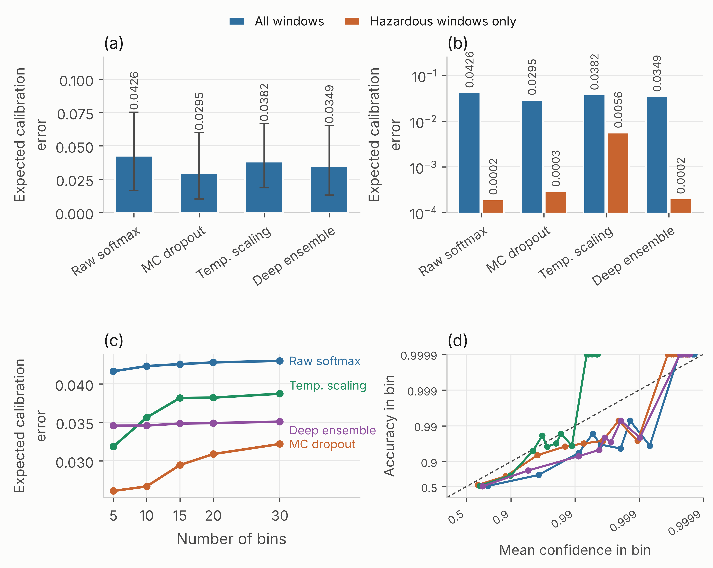{width=6.50in}

Fig. S3—Calibration. (a) ECE with bootstrap intervals. (b) The same on a logarithmic axis, split into all windows against hazardous windows only. (c) Sensitivity to the number of bins. (d) Reliability diagram: mean confidence against accuracy in each of the 15 equal-mass bins, averaged by bin index across the five runs. Both axes are plotted as −log10(1 − p), so the dashed diagonal is perfect calibration and each decade of residual error takes equal length; bins with no errors sit at the top of the axis. Colours as in (c). MC dropout uses 20 passes and the deep ensemble five members.

---

## S5 Comparator Specifications

Table S26 gives the configuration of every comparator. All settings are fixed; none was tuned on test data, and no equal-size search grid across model families was run.

| Configuration | Input | Architecture and estimator settings | Optimizer and training | Regularization | Class weighting |
|---|---|---|---|---|---|
| Cost-weighted policy | 22-feature state | Feedforward 22-256-256-128 with layer normalization and ReLU, two-stream output head over 5 actions (Section S17) | Adam, learning rate 2 × 10^−4^, batch 256; 80 epochs in the five-seed experiments, drawn from 60 to 100 per run in the 30-run comparison | Dropout 0.15 | Eq. 3, *C* = 8:1 |
| Unweighted network | 22-feature state | Same as the cost-weighted policy | Same | Dropout 0.15 | None |
| Multilayer perceptron | 22-feature state | scikit-learn MLPClassifier, hidden layers 256-256-128, ReLU | Adam (library default), up to 400 iterations, early stopping on a 10% internal validation split | L2 penalty 10^−4^ (library default) | None |
| Gradient boosting | 22-feature state | scikit-learn GradientBoostingClassifier, 300 trees, depth 3 | Learning rate 0.1 | Library defaults | Sample weights: Smoke and Mixture 2.5, NoGas and Perfume 1.0 (hazard-weighted; Section S7) |
| Random forest | 22-feature state | scikit-learn RandomForestClassifier, 300 trees | Library defaults | Library defaults | None |
| Support-vector classifier | 22-feature state | RBF kernel, *C* = 1, γ = scale, probability outputs by Platt scaling | Library defaults | — | None |
| k-nearest neighbors | 22-feature state | *k* = 5, uniform weights, Euclidean distance | — | — | None |
| Recurrent (LSTM) | Ten consecutive states | One LSTM layer of 64 units, then a 64-unit ReLU layer and a 5-action output | Adam, learning rate 2 × 10^−4^, batch 256, 40 epochs | Dropout 0.2 on the final hidden state and in the head | None |
| Conservative Q-learning | 22-feature state | Same network as the cost-weighted policy | Adam, learning rate 2 × 10^−4^, batch 256, 80 epochs; γ = 0.99, α = 1.0 | Dropout 0.15 | Reward depends on class and action |
| Shallow decision tree | Seven current readings | scikit-learn DecisionTreeClassifier, depth 3 | — | Depth limit | None |
| CUSUM (auxiliary) | Anomaly score | One-sided statistic, slack 0.5σ, threshold at the 99th percentile of its path on NoGas training windows | — | — | — |

Table S26—Comparator configurations. The scikit-learn multilayer perceptron stops early on a random 10% internal validation split of the training windows it is given; because consecutive training windows share 19 of 20 raw readings, that split shares readings with the other 90% of the training windows, as in the ratio selection of Section S3 and the temperature scaling of Section S4, although it is separated from the embargoed test block. "Library defaults" refers to scikit-learn 1.9.1, the version of the rerun.

*Training variation in the 30-run comparison.* The released driver draws an integer epoch count from 60 through 100 for each run of the cost-weighted policy, the unweighted network and the ordinal variant; the draw is determined by the run seed before test evaluation. All other settings are fixed, including the 80 epochs of conservative Q-learning and the 40 of the recurrent model. The 30 runs vary partition position and initialization, with the additional epoch variation limited to those three configurations. The two neural comparators that keep a fixed budget therefore have run-to-run variance that is not directly comparable with that of the three configurations whose epochs are drawn, which matters for the paired differences of Section S28; we did not align the sampling rule and give no further rationale for the exemption.

*Recurrent model.* The input for window *t* is the decision states of windows *t* − 9 to *t*. Sequences are assembled within one contiguous stretch of windows only: in training, a stretch ends at a class boundary and at the edge of the removed test block and embargo, so no training sequence joins the leading and trailing training segments; at test time, sequences use test windows only. At the start of a stretch, in training and in testing alike, the first state is repeated to fill the history, so the first nine windows of each stretch have partly repeated histories and no training window is dropped. Because a test sequence contains only test windows, the full raw support of its input (the 29 readings behind ten consecutive 20-reading windows) lies inside the test block, and no raw reading is shared with any training sequence.

*Conservative Q-learning.* The comparator is an adaptation of conservative Q-learning (Kumar, A. et al., 2020) to a fixed offline dataset. The behavior action for each training window is its target action *y*(*g*~t~) of Eq. 2a, so the offline dataset is the supervised training partition read as (*s*, *a*~data~, *r*, *s*′) tuples. Coverage extends over the observed training states and is empty for every non-behavior action, which is the situation the conservative penalty addresses. The reward depends on class and action only; because every behavior action is the target action, only the rewards of correct actions occur in the data (+2 for a hazardous class, +1 otherwise), and the penalties the reward function assigns to wrong actions never enter training. For completeness, with the miss cost of 10 and false-alarm cost of 1 used here, those unused values are −11.5 for a hazardous window sent to Monitor, −1.5 for one sent to a sub-alarm action, −1 for the wrong alarm-grade action, −1 for a sub-alarm action on clean air, −2 for an alarm-grade action on clean air, and −1 for any wrong action on a Perfume window (`retrain/rewards.py`). The target is a one-step temporal-difference bootstrap *r* + γ max~*a*′~ *Q*(*s*′, *a*′) with γ = 0.99, fitted with a smooth L1 loss, plus the penalty α (logsumexp~*a*~ *Q*(*s*, *a*) − *Q*(*s*, *a*~data~)) with α = 1.0. With α = 1 the penalty equals the cross-entropy of a softmax over the five action values at the behavior action, so it is the term that separates the behavior action from the others, while the temporal-difference term fits the value of the behavior action only. The successor of a window is the next window in time within the same contiguous stretch; the last window of every stretch, at a class boundary or at the edge of the removed test block or embargo, is terminal and contributes its reward only, so no successor link crosses a removed block, an embargo gap or a recording boundary (`test_rerun_fixes.py` checks this). A one-step update with γ = 0.99 is not a one-step decision horizon: the target carries future value through the successor state. But because the selected action does not change the next observation, the value of an action differs from its immediate reward only by a term that is the same for every action, so the ordering of actions is determined by the immediate reward of the behavior action in this setting. Because rewards of other actions are never observed, the separation between the behavior action and the others is produced by the conservative penalty, which for a single behavior action per state has the same form as a multiclass cross-entropy on the vector of action values, together with a class-dependent shift in the target for the behavior action. Action 2 never occurs as a behavior action for any class, so its value is only ever pushed down. The comparator therefore tests whether this value-based offline objective behaves differently from supervised training on the same windows, not sequential control. Within a stretch every transition has the same class and reward, so the fitted value of the behavior action also depends on how many windows remain before the stretch ends, which is set by where the test block fell and by the terminal rule; no separate target network is used, the bootstrap value comes from the network being fitted under no gradient, and the batch is 256. We did not test how much this boundary dependence affects the selected actions.

*CUSUM.* The statistic is one-sided on the anomaly score, *S*~t~ = max(0, *S*~t−1~ + *x*~t~ − μ~0~ − *k*), with μ~0~ and σ estimated from the training partition's NoGas windows, a slack of *k* = 0.5σ, and the alarm threshold *h* set at the 99th percentile of the statistic's own path over those training windows. Reset semantics matter for a sequential detector and are stated here rather than left to the code: *S*~t~ is zero at the first window of every evaluation set and is reset to zero at every change of class block, so it is never carried across a block boundary, across the embargo band, or between partitions. Within a block it accumulates normally. An earlier implementation reset only at the start of an evaluation set, which let the block following a hazardous one inherit an already-elevated statistic; the results reported here use the per-block reset.

---

## S6 Sensitivity of the Equivalence Conclusions

The manuscript reports the conclusions of these two sweeps. The tables and the
full reading are here.

| Comparison | ρ = 0 | ρ = 0.05 | ρ = 0.1 | ρ = 0.2051 | ρ = 0.3 | ρ = 0.4 | ρ = 0.5 |
|---|---|---|---|---|---|---|---|
| Unweighted network | 1.000 | 1.000 | 1.000 | 0.992 | 0.969 | 0.925 | 0.861 |
| Recurrent (LSTM) | 0.993 | 0.940 | 0.881 | 0.767 | 0.675 | 0.588 | 0.507 |
| Conservative Q-learning | 0.972 | 0.887 | 0.825 | 0.738 | 0.674 | 0.610 | 0.544 |
| Multilayer perceptron | 0.971 | 0.884 | 0.812 | 0.691 | 0.600 | 0.517 | 0.443 |
| Random forest | 0.871 | 0.747 | 0.665 | 0.539 | 0.456 | 0.385 | 0.325 |
| Support-vector classifier | 0.493 | 0.493 | 0.484 | 0.445 | 0.401 | 0.353 | 0.307 |
| Gradient boosting | 0.487 | 0.487 | 0.473 | 0.423 | 0.375 | 0.327 | 0.282 |
| k-nearest neighbors | 0.240 | 0.329 | 0.360 | 0.367 | 0.347 | 0.316 | 0.281 |
| Shallow decision tree | 0.000 | 0.000 | 0.004 | 0.027 | 0.056 | 0.085 | 0.107 |

Table S4—Sensitivity of the Bayesian equivalence probability to the assumed run correlation ρ. The value used is 1,264/(4,900 + 1,264) = 0.2051, read from the partition rather than fixed by hand, and that column is identical to the final column of Table 6 of the manuscript. Raising ρ widens the posterior. For most comparisons the probability of equivalence falls as ρ rises, but not for all: for k-nearest neighbors it rises from 0.240 at ρ = 0 to 0.367 at ρ = 0.2051 before falling, because its posterior is centered outside the region of practical equivalence, and widening it first moves mass into that region. One comparison changes its most probable outcome across the range, and it is named below.

| Comparison | ±0.5 pt | ±1 pt | ±2 pt | Most probable outcome, ±0.5 → ±1 → ±2 |
|---|---|---|---|---|
| Unweighted network | 0.835 | 0.992 | 1.000 | equivalent → equivalent → equivalent |
| Recurrent (LSTM) | 0.449 | 0.767 | 0.981 | equivalent → equivalent → equivalent |
| Conservative Q-learning† | 0.401 | 0.738 | 0.985 | reference better → equivalent → equivalent |
| Multilayer perceptron† | 0.389 | 0.691 | 0.957 | other better → equivalent → equivalent |
| Random forest† | 0.288 | 0.539 | 0.858 | other better → equivalent → equivalent |
| Support-vector classifier† | 0.228 | 0.445 | 0.783 | reference better → reference better → equivalent |
| Gradient boosting† | 0.218 | 0.423 | 0.749 | reference better → reference better → equivalent |
| k-nearest neighbors† | 0.183 | 0.367 | 0.702 | reference better → reference better → equivalent |
| Shallow decision tree | 0.011 | 0.027 | 0.101 | reference better → reference better → reference better |

Table S5—Sensitivity of the equivalence conclusion to the width of the region of practical equivalence. Columns give the posterior probability of practical equivalence to the cost-weighted policy under Eq. S2 at ρ = 0.2051. The final column gives the most probable of the three outcomes at each width; rows marked † change their answer across the sweep, and 6 of 9 do. The paired bootstrap reaches the same most probable outcome in 26 of the 27 model-by-width comparisons, differing only at ± 0.5 points for the multilayer perceptron.

Eight of the nine comparisons keep their most probable outcome across the whole range. The decision tree remains the more probable loser at every ρ, and the unweighted network stays practically equivalent to the reference even at ρ = 0.5, where the posterior is far wider than this design warrants, though its strength falls from 1.000 to 0.861. One comparison changes. The random forest is the most probable equivalent up to ρ = 0.3 and the more probable winner at 0.4 and 0.5. The change occurs only at correlation values above what this design suggests, and it shows how much the conclusion depends on the assumed correlation.

The ROPE width carries considerably more than ρ does, and Table S5 is the more informative of the two sweeps. Six of the nine comparisons change their most probable outcome between ±0.5 and ±2 accuracy points. At the tightest width the reference is most probably better than five comparators and worse than two, and only the unweighted network and the recurrent network are equivalent; at the widest, eight of nine are equivalent and only the decision tree is separated. The equivalence claims made in this paper are therefore claims made at a stated threshold, not properties of the models. Two survive the full sweep: the unweighted network is equivalent at every width, and the decision tree is worse at every width. Everything between those is width-dependent and should be read as such.

*A comparison that assumes no correlation at all.* Because ρ has to be assumed rather than estimated, we also ran a paired bootstrap in which the run is the resampling unit and nothing is assumed about structure inside a run. The 30 paired differences are resampled with replacement 20,000 times, and the same one-point region of practical equivalence is applied to the replicate means. This asks the same question under a weaker assumption. It agrees with the correlated *t*-test on the most probable outcome in 26 of the 27 model-by-width comparisons. The one disagreement is at the narrowest width of ± 0.5 accuracy points, for the multilayer perceptron. Under the bootstrap the unweighted network is practically equivalent to the reference in every replicate, interval [−0.003, +0.002] on the paired difference. The recurrent network is equivalent in 99.5% of replicates and the perceptron in 96.5%. The random forest is equivalent in 88.4% and better in the remaining 11.6%, interval [−0.013, +0.003]. The decision tree is worse in every replicate, by 3.9 accuracy points. We therefore treat the ρ sweep as a sensitivity analysis rather than as the primary evidence, and rest the ranking claim on the agreement between the two.

The two analyses share every observation. The 30 runs differ in seed, block position and initialization, with an additional epoch draw only for the two neural policies and ordinal variant, but they are 30 passes over one acquisition campaign on one device, so they are not 30 independent physical experiments and the bootstrap does not replicate anything. What the agreement establishes is that the conclusion is not an artifact of the correlated *t*-test's assumed ρ, which is a real and useful robustness property and nothing more. Independent replication would require a second acquisition, and this study does not have one.

---

## S7 Decision-State Ablation and Upstream-Input Sensitivity

The manuscript reports the two conclusions of this experiment. The tables, the
figures and the full reading are here.

The decision state was ablated by feature group with the architecture and protocol held fixed (Table S6, Fig. S4).

| Decision state | *d* | Decision accuracy | SD | Δ vs. full | Passive-miss rate | Notification rate |
|---|---|---|---|---|---|---|
| Without per-sensor σ | 15 | 0.9653 | 0.0147 | +0.40 pp | 0.0000 | 1.000 |
| Full state | 22 | 0.9614 | 0.0139 | reference | 0.0000 | 1.000 |
| Without anomaly score | 21 | 0.9571 | 0.0215 | −0.43 pp | 0.0000 | 1.000 |
| Without per-sensor δ | 15 | 0.9465 | 0.0260 | −1.49 pp | 0.0000 | 1.000 |
| Without δ and σ | 8 | 0.8854 | 0.0798 | −7.59 pp | 0.0000 | 1.000 |
| Current readings only | 7 | 0.8804 | 0.0813 | −8.10 pp | 0.0000 | 1.000 |
| Anomaly score only | 1 | 0.6581 | 0.1009 | −30.33 pp | 0.0000 | 1.000 |

Table S6—Decision-state ablation, mean ± SD across five runs varying partition and initialization, with the architecture held fixed.

Temporal features carry the accuracy: dropping both δ and σ costs 7.59 points, and a single anomaly score on its own manages 65.8%. Removing the anomaly score changes mean accuracy by −0.43 points and removing the per-sensor standard deviations by +0.40 points, both well inside the seed-to-seed spread. This suggests possible feature redundancy under nominal conditions; it does not establish equivalence or identify a minimal state, and it says nothing about the removed features under class exclusion or degradation. In every ablation the passive-miss rate stayed at zero, the notification rate at 1.000 and the clean-air alarm rate at zero (`v2_ablation.csv`); the nonhazardous (Perfume) alarm rate was not computed for the ablations.

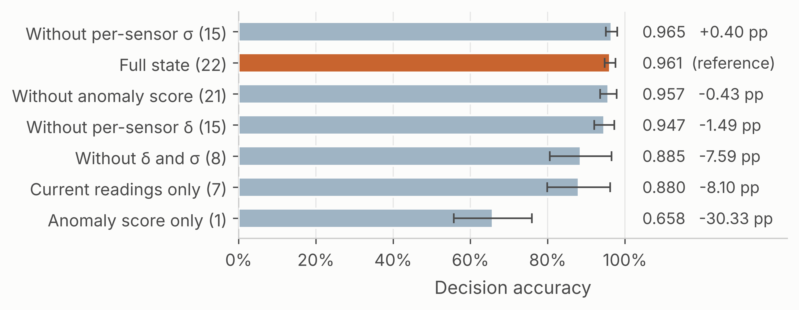{width=6.50in}

Fig. S4—Decision-state ablation. Bars are mean ± SD decision accuracy. Passive-miss rate and notification rate are constant across every condition.

Retraining without a feature asks whether the feature is needed. A different question is what a fitted model does when one input changes while the others stay as observed. For each test window, the normalized anomaly input was replaced in turn by 0, 0.25, 0.5, 0.75 and 1 with the other twenty-one features unchanged, and a window counts as sensitive if its selected action changes at least once over these five values (Fig. S5). The denominator is all 1,264 test windows of a fit, and ± is the SD over five fits. No model is refitted. This is a synthetic sensitivity probe, not a probability of component failure or a passive-miss rate.

For the decision tree the share is zero, since it does not read the input. For k-nearest neighbors, the support-vector classifier and the perceptron it is below 3%; for the cost-weighted policy 6.65% ± 3.83 and for the random forest 23.59% ± 8.81. The hazard-weighted gradient boosting has the highest share, 53.39% ± 12.53, and the clean-air-weighted configuration of the earlier version had 64.22% ± 7.65. Several configurations therefore depend on this input to some degree.

A synthetic zero-score override sets the input to 0 for every window. Zero is also a valid low score, and the implementation has no fallback that substitutes zero when the autoencoder fails, so this is a conditional probe with the other features held at values that in reality would co-vary with the anomaly score, not a model of a physical failure. Under the override, every configuration except gradient boosting left no hazardous window at Monitor. The clean-air-weighted gradient boosting left 42.03% at Monitor, sent 8.23% to sub-alarm actions and notified 49.75%, against 0.92%, 0.03% and 99.05% without the override; the hazard-weighted configuration left 32.66% at Monitor, sent 0.19% to sub-alarm actions and notified 67.15%.

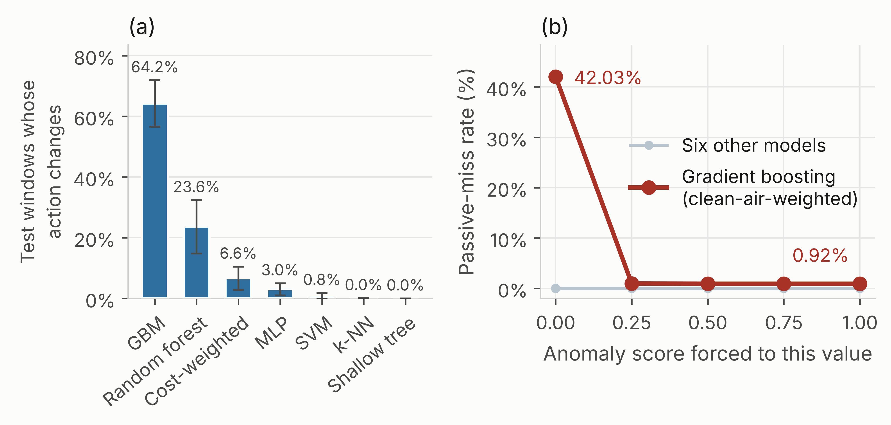{width=6.50in}

Fig. S5—Dependence of the selected action on the anomaly input, five seed-varying partitions. (a) Share of test windows whose action changes at any point as the anomaly score is swept across [0, 1] with all twenty-one other features held fixed at their observed values, mean ± 1 SD. (b) Passive-miss rate against the forced anomaly value, shown for the hazard-weighted gradient boosting and, in grey, the six other models, all at or near zero.

---

*Gradient-boosting weighting.* The gradient-boosting comparator of the earlier version was described as cost-sensitive, but its code assigned sample weights by target action (action 0 at 3.0, actions 3 and 4 at 1.2, action 1 at 1.0), so clean air carried the largest weight and the model was weighted 2.5 to 1 toward clean air. This was an implementation error relative to the intended configuration. The corrected, hazard-weighted configuration (Smoke and Mixture 2.5, NoGas and Perfume 1.0; Table 8 of the manuscript) is the primary comparator in every experiment, and the earlier configuration is kept as a supporting variant for provenance. The two use the same partitions, preprocessing, seeds and settings, and the weights are passed to the fitting routine without normalization. Like the earlier configuration, the corrected one uses a 2.5:1 ratio rather than the 8:1 of Eq. 3.

| Condition | Earlier (clean-air-weighted): passive / sub-alarm / notified | Corrected (hazard-weighted): passive / sub-alarm / notified |
|---|---|---|
| Nominal, five seeds | 0.92% / 0.03% / 99.05% | 0% / 0% / 100% |
| Nominal, 30 runs (counts of 18,960) | 62 / 73 / 18,825 | 1 / 8 / 18,951 |
| Zero-score override | 42.03% / 8.23% / 49.75% | 32.66% / 0.19% / 67.15% |
| Raw clamp, one channel | 0% / 10.85% / 89.15% | 9.65% / 18.01% / 72.34% |
| Raw clamp, four channels | 0% / 16.99% / 83.01% | 16.36% / 44.11% / 39.53% |
| Raw clamp, seven channels | 0% / 100% / 0% | 0% / 100% / 0% |
| Smoke or Mixture withheld | identical counts in every fit | identical counts in every fit |

In the 30-run comparison the corrected configuration had mean accuracy 0.9472 against 0.9529 and study-defined cost 0.0721 against 0.0903; against the cost-weighted policy, the posterior probabilities on nominal accuracy are 0.505 that the reference is practically better and 0.423 that the two are equivalent. Under the clamp the corrected configuration had the higher passive-miss rate and also sent more hazardous windows to sub-alarm actions, while the earlier one notified more (89.15% against 72.34% with one channel clamped, 83.01% against 39.53% with four); under the zero-score override the corrected configuration notified more, so neither notified more under every condition. Under class exclusion the two gave identical passive-miss, sub-alarm and notification counts in every fit (compared as integers). The nominal values are those of the primary result files. The clamp values for the earlier weighting come from the supporting weighting probe.

## S8 What the Protocol Costs to Adopt

Computing the five quantities of Table 3 of the manuscript over the real 1,264-window test partition takes 0.455 ms against 0.290 ms for accuracy alone, a ratio of 1.57×, which is arithmetic over predicted actions the evaluation already has; the episode-level quantities are the same kind of pass over the same predictions (`retrain/run_metric_cost.py`, `v3_metric_cost.json`). Both figures are means over 200 timed repetitions after warm-up. The cost that is not negligible is retraining, and it falls unevenly. Reporting the metric set on an existing evaluation needs none, and neither do the perturbation suite or the upstream-input probe, since both re-evaluate an already-trained model under modified inputs. Leave-one-class-out needs one retrain per withheld hazardous class, so two here. The 30-run comparison with the equivalence test is the only element that costs a multiple of the original training budget, and it is needed only when the question is model selection rather than model characterization. These times cover only the incremental computation of metrics on predictions that already exist. They exclude acquiring representative data, setting response targets, validating fault models, reviewing alarms and qualifying a component, and both the absolute times and their ratio depend on hardware and implementation. The reported figures are those in `v3_metric_cost.json`, produced by `make metriccost` on the authors' machine with a fixed seed and 200 repeats; no other timing is reported.

---

## S9 Sensitivity of the Eventized Alarm Result to the Persistence Rule

Table S15 collapses alarm-grade windows into annunciated episodes under one rule: an on-delay of three windows and an off-delay of fifteen. That rule is a stated convention, not an industrially validated persistence specification, and the manuscript uses the eventized view to reorder the models relative to the raw indication view. If the ordering is a property of the convention rather than of the models, the reordering claim has to be weakened. The question is therefore checked directly.

Models are fitted once per seed, the alarm-grade flag sequence is computed once per model, seed and condition, and the same flag sequences are then eventized at every point of a grid of on-delays {1, 2, 3, 5, 10} against off-delays {5, 10, 15, 30, 60}, twenty-five settings in all. Nothing is refitted between grid points, so every difference below is caused by the persistence rule alone. Rank agreement with the stated 3/15 setting is measured per condition by Kendall's τ over the six comparators, and every pairwise reversal is recorded; with fifteen model pairs and twenty-four comparison settings there are 360 opportunities for a reversal in each condition (`v3_persistence_sweep.csv`, `v3_persistence_rank.json`).

| Condition | Models annunciating at 3/15 | Highest episode rate at 3/15 | Highest over the grid | Kendall τ, min | Reversals |
|---|---|---|---|---|---|
| Clean | 0 of 6 | 0.00 | 0.00 | — | n/a |
| One channel lost | 4 of 6 | 5.70 | 10.25 | 0.56 | 14 |
| Four channels lost | 5 of 6 | 10.25 | 19.37 | 0.74 | 2 |
| Total sensor loss | 5 of 6 | 7.97 | 10.25 | 0.50 | 9 |
| Drift ±30% | 0 of 6 | 0.00 | 0.00 | — | n/a |
| Drift ±50% | 0 of 6 | 0.00 | 2.28 | — | n/a |
| Noise σ = 0.3 | 0 of 6 | 0.00 | 50.13 | — | n/a |
| Noise σ = 0.5 | 3 of 6 | 5.70 | 109.37 | −0.78 | 22 |

Table S7—Sensitivity of the eventized alarm result to the persistence rule, over twenty-five on-delay and off-delay settings applied to the same alarm-grade flag sequences. Episode rates are per hour under the illustrative duty cycle of Eq. S3, extrapolated from 316 clean-air windows per partition. Kendall's τ compares the ordering of the six comparators at each setting against the ordering at the stated 3/15 rule; "reversals" counts pairwise order changes out of 360 model-pair by setting comparisons. A dash marks a condition where no ordering exists at the stated rule because no model annunciates there.

Three findings follow.

The channel-loss conditions are reasonably stable. Mean τ against the stated rule is 0.84, 0.93 and 0.93 at one, four and seven lost channels, and reversals occur in 14, 2 and 9 of 360 comparisons. The specific reordering the manuscript relies on survives the entire grid: at single-channel loss the shallow tree annunciates no more often than the cost-weighted policy at every one of the twenty-five settings, strictly less at twenty of them and equal at the remaining five, with no setting reversing it. The secondary observation, that the cost-weighted policy annunciates more at four lost channels than at seven, holds at twenty-one settings, ties at two and reverses at two, both of which have an off-delay of sixty windows, two minutes of required quiet. It is not used in the manuscript.

The noise conditions are not stable. At σ = 0.5 the minimum τ is −0.78, an ordering close to the reverse of the stated one, with 22 reversals. The magnitudes move further than the ranks: the highest episode rate at any comparator runs from 0 to 109.37 per hour across the grid, and which models annunciate at all changes with the rule. At σ = 0.3 the effect is starker still, because the stated rule reports zero annunciated episodes from every comparator while a shorter on-delay reports up to 50.13 per hour. A conclusion drawn at 3/15 alone would have recorded that condition as producing no operator-facing alarms whatsoever.

The channel-loss reordering survives the grid; the complete ordering does not, and no comparison with operator-level guidance is made from these rates, since compliance was not assessed under any setting. Operator load would have to be assessed with a facility's own persistence specification rather than a convention chosen by the evaluator.

---

## S10 Isolating Overlap Contamination from Temporal Position

Experiment 1 reports that a random split raises accuracy relative to the blocked protocol. A random split changes two things at once, so the contrast is a sum: near-duplicate windows can land on both sides of it, and the training data is drawn from the whole recording rather than a contiguous early band. This section separates them.

A stride-20 window set shares no raw reading between any two windows, so contamination is impossible in it by construction. Four arms hold everything else fixed, and every arm is subsampled to the same 256-window training budget, the most the stride-20 set can afford, so sample size is not a confound (`v3_overlap_isolation.csv`).

| Model | a: overlap, random | b: disjoint, random | c: overlap, blocked | d: disjoint, blocked | Overlap effect (a − b) | Position effect (b − d) |
|---|---|---|---|---|---|---|
| Cost-weighted policy | 0.5755 | 0.5406 | 0.5345 | 0.5469 | +3.49 | −0.62 |
| Unweighted network | 0.8710 | 0.8125 | 0.8956 | 0.8812 | +5.85 | −6.87 |
| Multilayer perceptron | 0.8802 | 0.9000 | 0.9063 | 0.8719 | −1.98 | +2.81 |
| Gradient boosting | 0.9560 | 0.9500 | 0.9166 | 0.9406 | +0.60 | +0.94 |
| Random forest | 0.9617 | 0.9500 | 0.9601 | 0.9563 | +1.17 | −0.63 |
| Shallow decision tree | 0.9064 | 0.9125 | 0.9223 | 0.9344 | −0.61 | −2.19 |
| Mean | 0.8585 | 0.8443 | 0.8559 | 0.8552 | +1.42 | −1.09 |

Table S8—Overlap contamination against temporal position at a matched training budget, mean decision accuracy over five seed-varying partitions, effects in percentage points. Arms b and d use a stride-20 window set in which no two windows share a raw reading. All four arms train on 256 windows.

The decomposition is inconclusive. Averaged over six models the overlap effect (a − b) is +1.42 points and the position effect (b − d) is −1.09 points, meaning that, among disjoint windows, moving from a random to a blocked split increased mean accuracy by 1.09 points (0.8443 to 0.8552). Neither effect keeps its sign across models: overlap runs from −1.98 to +5.85 and position from −6.87 to +2.81. Several comparators remain near their full-budget accuracy at 256 windows (the random forest at 0.95 to 0.96, gradient boosting at 0.92 to 0.96), while others, notably the cost-weighted policy at 0.53 to 0.58, are far below it, so an effect estimated at this budget may not transfer to the 4,900-window protocol. The neural cost-weighted policy is probably limited by optimization here: with a batch of 256 each epoch is a single update at 256 training windows, and the budget was not tuned for it, so its mean in the six-model averages mixes that limit with the split contrasts. The control does not reliably isolate the contribution of overlap, and it does not show that either effect is zero.

---

*The embargo, the decision tree and the train-early protocol.*

Mean accuracy is close without and with the embargo, 0.9511 against 0.9485. The embargo is kept because it prevents training and test windows from sharing raw readings; the small average change is not evidence that it is unnecessary. The shallow decision tree is the one model a random split does not help, losing 0.74 points because it reads only the seven current sensor values. The last column of Table 5 of the manuscript (`v3_leakage.csv`, not Table S8) is a harsher test: training early and testing late costs the random forest 41.2 points, gradient boosting 40.2 and the shallow decision tree 29.5, while the perceptron and k-nearest neighbors barely move and the cost-weighted policy loses 1.6. This protocol tests later observations and also trains on fewer windows (3,792 rather than 4,900), so the protocol does not separate temporal change from training size. Table S8 suggests that size alone is unlikely to account for a loss of this order for the tree-based models, which stay within about three points of their full-budget accuracy when trained on 256 windows, but that is an inference from a different protocol, and baseline drift was not quantified independently.

## S11 The Reject Option in Full

Experiment 7 reports the alarm-mapped case on withheld Mixture. Both rejection policies on both withheld classes are here (Table S9, `v3_reject_option.csv`), because the choice between them is the result. All rows are fitted on the reduced partition that remains once the calibration band is carved out, so the closed-set values they reduce to at *q* = 0 are the within-experiment reference rather than the Table 6 entries. The input scaler, the autoencoder and the anomaly normalization are fitted on those fitting windows alone, and the band, the withheld class and the held-out retained-class windows are scored through that one fitted pipeline.

| Model | Withheld class | Notification, reject → *Monitor* | Passive-miss rate | Rejected, withheld | Rejected, clean | Separation |
|---|---|---|---|---|---|---|
| Random forest | Smoke | 0.0020 | 0.9980 | 99.80% | 58.92% | +40.9 pp |
| Support-vector classifier | Smoke | 0.1192 | 0.8808 | 88.08% | 61.33% | +26.8 pp |
| Multilayer perceptron | Smoke | 0.2808 | 0.7192 | 71.76% | 48.54% | +23.2 pp |
| Unweighted network | Smoke | 0.2559 | 0.7441 | 74.41% | 51.84% | +22.6 pp |
| k-nearest neighbors | Smoke | 0.9275 | 0.0430 | 3.67% | 14.49% | −10.8 pp |
| Cost-weighted policy | Smoke | 0.9927 | 0.0073 | 0.73% | 55.95% | −55.2 pp |
| Gradient boosting | Smoke | 1.0000 | 0.0000 | 0.00% | 57.41% | −57.4 pp |
| Unweighted network | Mixture | 0.0008 | 0.7405 | 74.05% | 35.44% | +38.6 pp |
| Support-vector classifier | Mixture | 0.0000 | 0.7717 | 77.17% | 40.95% | +36.2 pp |
| Random forest | Mixture | 0.1128 | 0.8754 | 87.54% | 56.77% | +30.8 pp |
| Cost-weighted policy | Mixture | 0.0357 | 0.8182 | 81.82% | 56.58% | +25.2 pp |
| Multilayer perceptron | Mixture | 0.0368 | 0.4892 | 48.92% | 42.22% | +6.7 pp |
| k-nearest neighbors | Mixture | 0.1738 | 0.1877 | 17.70% | 16.77% | +0.9 pp |
| Gradient boosting | Mixture | 0.6135 | 0.2492 | 24.63% | 55.06% | −30.4 pp |

Table S9—Reject option with rejections mapped to *Monitor*, at *q* = 30, the 30th percentile of confidence on the embargoed calibration band, mean over five seed-varying partitions. Separation is the withheld-class rejection rate minus the clean-window rate. Rows are grouped by withheld class and ordered by separation. Rejection rates are given to two decimals so that they can be compared with the four-decimal passive-miss rate, which under this mapping is at least as large as the rejection rate of the withheld class.

The *Monitor* mapping makes the symmetry plain: under it, every rejected hazardous window is a passive miss by definition, so the random forest's 99.8% rejection rate on withheld Smoke becomes a 0.9980 passive-miss rate. Between the two policies there is nothing but a trade, and the same threshold that raises notification to 0.7717 under the alarm mapping produces a 0.7717 passive-miss rate for the support-vector classifier on withheld Mixture under the monitor mapping. A facility cannot avoid choosing, and no choice is free.

Separation is the quantity that would make a reject option useful, and it is not reliably positive. Four of the fourteen model-by-class cells are negative. These are properties of thresholding the maximum class probability of a closed-set classifier, which can be confident far from its training data and less confident near the boundary between clean air and Perfume. They do not show that the sensor state lacks separability: the decision state already contains the autoencoder reconstruction error, which separates the hazardous classes from clean air by about three orders of magnitude (Section S21), and thresholding that score, or an open-set method, was not evaluated here. Gradient boosting is the extreme case on the negative side: on withheld Smoke it declines none of the unfamiliar hazardous class and 57.4% of the clean air it was trained on. The *k*-nearest-neighbor rejection rate is flat across the upper thresholds because, with uniform voting by five neighbors over three retained classes, the maximum class probability used for rejection can take only four values (0.4, 0.6, 0.8 and 1.0). A window is rejected when its confidence is strictly below the threshold, so windows tied at the threshold are kept, and the realized rejection rate can fall well short of *q*% of the calibration band.

At *q* = 30, all but one comparator reject more than 30% of held-out clean windows, several of them far more, with the *k*-nearest-neighbor classifier the exception for the granularity reason just given. The calibration band sits at the end of the training block, still on the near side of the embargo, and the confidence distribution moves again between there and the held-out partition. That is the same temporal nonstationarity Experiment 1 measures, arriving through a different instrument: even a threshold set off-sample, but nearby in time, transfers imperfectly to the partition it was meant for.

---

## S12 Raw-Space Faults, Per Model

The per-model breakdown of Experiment 8 is in Table S10 (`v3_raw_faults.csv`), as passive-miss rate followed by notification rate.

| Model | Clean | Stuck *k* = 7 | Forced raw zero *k* = 1 | High-end clamp *k* = 4 | High-end clamp *k* = 7 | Raw noise 2 SD, *k* = 7 |
|---|---|---|---|---|---|---|
| Cost-weighted policy | 0.0000 / 1.0000 | 0.0000 / 0.9997 | 0.0000 / 0.9959 | 0.1057 / 0.6848 | 0.0000 / 0.0000 | 0.0000 / 0.9994 |
| Unweighted network | 0.0000 / 1.0000 | 0.0000 / 1.0000 | 0.1000 / 0.9000 | 0.2759 / 0.4525 | 0.0000 / 0.0000 | 0.0000 / 0.9997 |
| Multilayer perceptron | 0.0000 / 1.0000 | 0.0000 / 0.9791 | 0.0237 / 0.9763 | 0.3930 / 0.0196 | 0.0000 / 0.0000 | 0.0000 / 0.9212 |
| Gradient boosting | 0.0000 / 1.0000 | 0.0000 / 0.9984 | 0.0003 / 0.9997 | 0.1636 / 0.3953 | 0.0000 / 0.0000 | 0.0022 / 0.9133 |
| Random forest | 0.0000 / 1.0000 | 0.0000 / 1.0000 | 0.0000 / 1.0000 | 0.0035 / 0.6193 | 0.0000 / 0.0000 | 0.0000 / 0.9627 |
| Shallow decision tree | 0.0000 / 1.0000 | 0.0000 / 1.0000 | 0.0000 / 1.0000 | 0.2415 / 0.6000 | 0.0000 / 0.0000 | 0.1354 / 0.7231 |
| *Normalized anomaly feature, $\tilde{\rho}$* | *0.245* | *0.248* | *0.467* | *0.168* | *0.011* | *0.806* |

Table S10—Raw-space faults per model, passive-miss rate / notification rate, mean over five seed-varying partitions. The final row is the normalized anomaly feature $\tilde{\rho}$ of Eq. 1, averaged across models: the reconstruction error the anomaly path produces from the faulted window, min-max scaled to [0, 1] against the 1st and 99th training percentiles. It is not on the scale of the raw reconstruction errors reported in Fig. S10.

The high-end clamp at four channels separates the configurations: the multilayer perceptron notified 2.0% of hazardous windows while the cost-weighted policy notified 68.5%, under an identical fault. At seven channels all six read 0.0000 / 0.0000, so every one of them sent every hazardous window to a sub-alarm action; the statement in the manuscript describes each configuration individually, not a worst case.

The mean normalized anomaly feature rises under a forced raw zero and under raw noise and falls under the high-end clamp. A change in the mean does not by itself show whether a thresholded detector would flag the faulted windows. The threshold evidence is the share of windows whose raw reconstruction error exceeds τ, the 95th percentile of reconstruction error on NoGas training windows: for the unperturbed windows it is 62.9% of all windows, 100% of hazardous windows and 11.0% of NoGas windows; under stuck values on seven channels 61.0%, 100% and 12.2%; and under a forced raw zero, the high-end clamp and raw noise it is 100% in all three groups at every level tested. No fault therefore pushed the raw reconstruction error below the threshold. The mean of the normalized feature falls under the clamp because the 1st and 99th percentile scale is set by the hazardous classes, whose reconstruction errors are far larger than those of clean air. The $\tilde{\rho}$ row is on the normalized scale of Eq. 1 (min-max scaled between the 1st and 99th training percentiles); Figs. S6 and S10 show raw reconstruction errors, which are on a different scale.

---

## S13 Eventized Alarm and Hazard Episodes, Per Model

The manuscript reports selected rows of both eventization analyses. The complete
tables are here, produced by the same drivers from the same result files.

| Condition | Model | Indications per hour | Episodes per hour | Compression |
|---|---|---|---|---|
| Clean | Cost-weighted | 0.0 | 0.00 | n/a |
| Clean | Unweighted | 0.0 | 0.00 | n/a |
| Clean | MLP | 0.0 | 0.00 | n/a |
| Clean | GBM | 0.0 | 0.00 | n/a |
| Clean | Random forest | 0.0 | 0.00 | n/a |
| Clean | Shallow tree | 0.0 | 0.00 | n/a |
| One channel lost | Shallow tree | 360.0 | 1.14 | 316× |
| One channel lost | Unweighted | 256.3 | 3.42 | 75× |
| One channel lost | Cost-weighted | 231.3 | 5.70 | 41× |
| One channel lost | Random forest | 12.5 | 2.28 | 6× |
| One channel lost | MLP | 0.0 | 0.00 | n/a |
| One channel lost | GBM | 0.0 | 0.00 | n/a |
| Four channels lost | Shallow tree | 720.0 | 2.28 | 316× |
| Four channels lost | Unweighted | 377.1 | 6.84 | 55× |
| Four channels lost | Cost-weighted | 374.8 | 10.25 | 37× |
| Four channels lost | Random forest | 113.9 | 6.84 | 17× |
| Four channels lost | MLP | 12.5 | 1.14 | 11× |
| Four channels lost | GBM | 1.1 | 0.00 | n/a |
| Total sensor loss | Cost-weighted | 1800.0 | 5.70 | 316× |
| Total sensor loss | Unweighted | 1800.0 | 5.70 | 316× |
| Total sensor loss | Shallow tree | 1800.0 | 5.70 | 316× |
| Total sensor loss | Random forest | 934.2 | 7.97 | 117× |
| Total sensor loss | MLP | 360.0 | 1.14 | 316× |
| Total sensor loss | GBM | 1.1 | 0.00 | n/a |
| Noise σ = 0.5 | Cost-weighted | 247.2 | 4.56 | 54× |
| Noise σ = 0.5 | Unweighted | 216.5 | 5.70 | 38× |
| Noise σ = 0.5 | Shallow tree | 185.7 | 3.42 | 54× |
| Noise σ = 0.5 | Random forest | 12.5 | 0.00 | n/a |
| Noise σ = 0.5 | MLP | 10.3 | 0.00 | n/a |
| Noise σ = 0.5 | GBM | 10.3 | 0.00 | n/a |

Table S11—Alarm-grade indication density against eventized alarm rate on clean windows, every comparator, at an on-delay of 3 windows and an off-delay of 15 (`v3_alarm_episodes.csv`). Rows are grouped by condition and ordered by indication rate. Compression is indications divided by episodes; "n/a" marks a condition producing indications but no episode that survives the persistence rule, or none at all. Both rate columns are normalizations of counts observed on a 316-window clean segment, so the hourly figures are illustrative conversions.

| Condition | Model | Hazard episodes detected | Sustained |
|---|---|---|---|
| Clean | Cost-weighted | 10/10 | 10/10 |
| Clean | Unweighted | 10/10 | 10/10 |
| Clean | MLP | 10/10 | 10/10 |
| Clean | GBM | 10/10 | 10/10 |
| Clean | Random forest | 10/10 | 10/10 |
| Clean | Shallow tree | 10/10 | 10/10 |
| One channel lost | Cost-weighted | 10/10 | 10/10 |
| One channel lost | Unweighted | 10/10 | 10/10 |
| One channel lost | MLP | 10/10 | 10/10 |
| One channel lost | GBM | 10/10 | 10/10 |
| One channel lost | Random forest | 10/10 | 10/10 |
| One channel lost | Shallow tree | 10/10 | 10/10 |
| Four channels lost | Cost-weighted | 10/10 | 10/10 |
| Four channels lost | Unweighted | 10/10 | 10/10 |
| Four channels lost | MLP | 10/10 | 10/10 |
| Four channels lost | GBM | 10/10 | 10/10 |
| Four channels lost | Random forest | 10/10 | 10/10 |
| Four channels lost | Shallow tree | 10/10 | 10/10 |
| Total sensor loss | Cost-weighted | 10/10 | 10/10 |
| Total sensor loss | Unweighted | 10/10 | 10/10 |
| Total sensor loss | MLP | 5/10 | 5/10 |
| Total sensor loss | GBM | 10/10 | 10/10 |
| Total sensor loss | Random forest | 10/10 | 10/10 |
| Total sensor loss | Shallow tree | 10/10 | 10/10 |

Table S12—Hazard episodes detected and sustained, every comparator (`v3_episode_metrics.csv`), five runs times two hazardous classes. An episode is detected if any window in it draws an alarm-grade action and sustained if three consecutive windows do. Counts are descriptive: ten is five runs times two classes, not ten physical episodes, and no detection probability is inferred from them.

Two features of these tables carry the argument made in the body. Compression is not a constant, so the two rate columns order the models differently: at one lost channel the shallow tree produces the most indications of any comparator and the fewest annunciations. And episode detection is saturated everywhere except under total channel loss, where the perceptron loses five of ten segments.

---

## S14 Reproducing These Results

Reproduction instructions and the provenance of every table and figure are in Section S19.

## S15 Anomaly Detector in Detail

The operating point quoted in the main text is one summary of the detector. The curves behind it are here: one ROC per seed, and the score distributions the threshold is drawn on. Both are computed under the partition-local fit that every number in the paper uses.

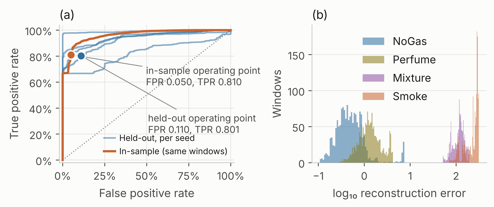{width=6.50in}

Fig. S6—Anomaly detector in detail, partition-local fit. (a) ROC curves, one per seed. (b) Score distributions by class.

## S16 Reject Option and Raw-Space Faults

The main text reports Experiments 7 and 8. This section gives the full reject-option results.

*Experiment 7: confidence-threshold rejection.* Every comparator in Experiment 3 is a closed-set classifier with no way to decline, which is why a withheld hazardous class is routed through actions the model already knows. The obvious question is what changes if it may decline. The simplest construction is used, not an open-set method: confidence is the maximum predicted class probability, and the threshold is the *q*-th percentile of confidence on a calibration band rather than on the fitting windows. The band is a contiguous 20% tail of each class block, separated from the fitting windows by the same 20-window embargo the outer holdout uses. The sweep runs *q* from 0, which recovers the closed-set comparator on this reduced fit partition, to 30. A rejection is not an action, so the facility must decide what one means; the two defensible extremes are reported, mapping a rejection either to *Monitor* or to *Raise alarm*. Table S13 gives the alarm-mapped case on withheld Mixture, the lowest notification result in the paper, with rejections mapped to *Raise alarm*, rows ordered by closed-set escalation and the final two columns measured at *q* = 30. Its *q* = 0 column is the within-experiment reference and not a copy of Table 7 of the manuscript: carving the calibration band out of each class block leaves a fit partition about a fifth smaller, so these models train on less data and their closed-set values differ accordingly. The gap is itself informative, being largest for the two tree ensembles, whose Table 7 notification rates of 98.3% and 100% fall to 77.6% and 79.1% on the reduced partition.

| Model | Notification, no reject | *q* = 10 | *q* = 30 | Rejected, withheld class | Rejected, clean windows | Final clean-air alarm rate | Final rate, all nonhazardous |
|---|---|---|---|---|---|---|---|
| Support-vector classifier | 0.0082 | 0.1813 | 0.7717 | 77.17% | 40.95% | 40.95% | 33.80% |
| Multilayer perceptron | 0.2162 | 0.3361 | 0.5260 | 48.92% | 42.22% | 42.22% | 38.45% |
| k-nearest neighbors | 0.2374 | 0.3397 | 0.3508 | 17.70% | 16.77% | 16.77% | 16.30% |
| Unweighted network | 0.2598 | 0.4786 | 0.7413 | 74.05% | 35.44% | 35.44% | 31.55% |
| Cost-weighted policy | 0.3311 | 0.5432 | 0.8539 | 81.82% | 56.58% | 56.58% | 47.37% |
| Random forest | 0.7760 | 0.9824 | 0.9882 | 87.54% | 56.77% | 56.77% | 43.35% |
| Gradient boosting | 0.7911 | 0.8014 | 0.8598 | 24.63% | 55.06% | 55.06% | 46.68% |

Table S13—Alarm-grade notification rate on withheld Mixture with confidence-threshold rejection, rejected windows mapped to *Raise alarm*, mean over five fits; the last two columns are rejection rates at *q* = 30. The final alarm rates combine the rejection with any alarm on an unrejected window, at *q* = 30. Rejection rates are given to two decimals. The *k*-nearest-neighbor entries rise little between *q* = 10 and *q* = 30 because its maximum class probability takes only four values and windows tied at the threshold are kept (Section S11).

With rejected windows mapped to *Raise alarm*, the support-vector classifier's notification rate on withheld Mixture rose from 0.82% to 77.2% and the cost-weighted policy's from 33.1% to 85.4%. The increase measures the effect of the fallback rule, not improved identification of the withheld gas.

At *q* = 30 the support-vector classifier rejected 40.9% of clean-air test windows and the cost-weighted policy 56.6%. These are rejection rates; under the alarm mapping, the final clean-air alarm rate combines them with any alarms on unrejected windows: at *q* = 0 no model raised a clean-air alarm, so the final clean-air alarm rate equals the rejection rate. With Mixture withheld, the final rate over all nonhazardous windows, which includes Perfume, was 33.8% for the support-vector classifier and 47.4% for the cost-weighted policy, against baselines of 0.16% and 0.54% at *q* = 0. With Smoke withheld the final clean-air alarm rates were 61.3% for the support-vector classifier and 55.9% for the cost-weighted policy.

Rejection behavior also differs across models. Separation between the withheld-class and clean-window rejection rates runs from +40.9 points for the random forest on withheld Smoke to −57.4 points for gradient boosting on withheld Smoke, which declines none of the unfamiliar hazardous class while declining 57.4% of the clean air it was trained on. As in Section S11, this describes maximum-class-probability thresholding of closed-set classifiers, not the separability of the sensor state; the simplest construction is used, not an open-set method, and thresholding the autoencoder reconstruction error was not tested. The random forest rejects almost all of withheld Smoke (99.8%) and 87.5% of withheld Mixture, and more than half of the clean air. Supplementary Section S11 carries the *Monitor*-mapped case and the withheld Smoke arm.

*Experiment 8: Faults Injected in Raw Sensor Space.* Experiment 6 perturbs the standardized decision state, and says so. The stronger experiment is available on the same data: fault the raw 20-by-7 window, then recompute the current readings, the per-channel deltas, the per-channel standard deviations and the autoencoder reconstruction error from the faulted window, so that nothing is patched downstream. Four modes are tested, each a synthetic stand-in for a class of hardware fault rather than a measured instance of one. A channel *stuck*: within each 20-reading window, the faulted channel is held at that window's own first reading. Each overlapping window is faulted independently, so this is a window-level perturbation and does not reproduce one continuously frozen sensor trace. A channel *forced to raw zero*, a low-rail proxy for the open-circuit case Experiment 6 states it does not cover. A channel *clamped at the high end*, fixed at the largest value seen in training, which stands in for a rail-limited or out-of-range reading without reproducing any specific device's saturation behavior. And additive noise in raw units at a fraction of each channel's own training standard deviation (Table S14). Features and the autoencoder reconstruction error are recomputed from the faulted raw window, so Table S14's final column is the score the anomaly path would produce. That column is the *normalized* anomaly feature $\tilde{\rho}$ of Eq. 1, min-max scaled to [0, 1] against the 1st and 99th training percentiles, and it is not on the scale of the raw reconstruction errors of Fig. S10.

| Fault mode | Severity | Worst passive-miss rate | Worst sub-alarm rate | Worst clean-air alarm rate | Normalized anomaly feature, $\tilde{\rho}$ |
|---|---|---|---|---|---|
| None | clean | 0.0000 | 0.0000 | 0.0000 | 0.245 |
| Stuck at window's first reading | *k* = 1 | 0.0000 | 0.0000 | 0.0000 | 0.246 |
| Stuck at window's first reading | *k* = 4 | 0.0000 | 0.0057 | 0.0449 | 0.247 |
| Stuck at window's first reading | *k* = 7 | 0.0000 | 0.0209 | 0.0000 | 0.248 |
| Forced raw zero | *k* = 1 | 0.1000 | 0.0041 | 0.6000 | 0.467 |
| Forced raw zero | *k* = 4 | 0.0000 | 0.0000 | 1.0000 | 0.717 |
| Forced raw zero | *k* = 7 | 0.0000 | 0.0000 | 1.0000 | 1.000 |
| High-end clamp | *k* = 1 | 0.1984 | 0.1801 | 0.0051 | 0.198 |
| High-end clamp | *k* = 4 | 0.3930 | 0.5873 | 0.1646 | 0.168 |
| High-end clamp | *k* = 7 | 0.0000 | 1.0000 | 0.0000 | 0.011 |
| Raw additive noise | σ = 0.5 SD, *k* = 7 | 0.0142 | 0.0130 | 0.9899 | 0.285 |
| Raw additive noise | σ = 1 SD, *k* = 7 | 0.0627 | 0.0680 | 0.9968 | 0.409 |
| Raw additive noise | σ = 2 SD, *k* = 7 | 0.1354 | 0.1415 | 0.9981 | 0.806 |

Table S14—Faults injected in raw sensor space, worst value across the six comparators, mean over five fits; $\tilde{\rho}$ is the mean over the six. Additive raw noise is applied to all seven channels.

The fault modes are not interchangeable, and the ordering is not the one the standardized experiment implies. The stuck fault had little effect here: seven stuck channels sent at most 2.1% of hazardous windows to sub-alarm actions and left $\tilde{\rho}$ at 0.248 against a clean 0.245. Forced raw zero drove $\tilde{\rho}$ to its ceiling and the clean-air alarm rate to 1.000.

Under the high-end clamp the mean $\tilde{\rho}$ falls. At four clamped channels the worst configuration left 39.3% of hazardous windows at Monitor and the worst sent 58.7% to sub-alarm actions, while the mean $\tilde{\rho}$ fell to 0.168, below its clean-condition value. At seven, every one of the six configurations sent every hazardous window to a sub-alarm action. The cost-weighted policy, the unweighted network, the perceptron, gradient boosting, the random forest and the shallow tree each record passive-miss rate 0.0000 and notification rate 0.0000 in that column of Table S10. The alarm-grade false-alarm rate is 0.0000 for all six. $\tilde{\rho}$ reads 0.011, the lowest figure anywhere in this study. The passive-miss and clean-air alarm rates are both zero while no hazardous window reaches an operator.

A possible explanation is that the autoencoder, fitted on clean-air windows only, reconstructs a near-constant trace easily, so a clamped window scores lower. This applies to the one fitted detector and the synthetic clamp tested here; whether the clamped windows fall below the detector's threshold is given by the threshold counts in Section S12, and whether a differently trained detector would behave the same way was not tested. Supplementary Section S12 gives the per-model breakdown.

*Alarm Indications Are Not Alarm Events.* Every clean-air alarm rate above is a rate per clean *window*, and windows advance every 2 s, so one sustained condition produces hundreds of consecutive alarm-grade windows. Alarm systems apply persistence, deadband, latching, suppression and shelving before a condition is annunciated, so Fig. S15 (Section S29) is not a plant alarm rate.

Contiguous runs of alarm-grade windows on clean test windows were therefore collapsed into annunciated episodes under an explicit rule: an episode begins after an on-delay of three consecutive windows, 6 s of persistence, and ends after an off-delay of fifteen, 30 s of quiet (Table S15). Table S15 gives selected rows; Table S11 gives all thirty rows. Both of its rate columns are normalizations of counts observed on a 316-window clean segment, about 10.5 minutes at the 2 s cadence, so the hourly figures are illustrative conversions rather than rates measured over hours. The counts are averaged across the five seed-varying partitions and then converted, not pooled into one long record: pooling would divide by five times the clean windows and report the same rate while implying five times the observation it rests on. Compression is indications divided by episodes, and "n/a" marks a condition that produces indications but no episode surviving the persistence rule. The delays are stated rather than tuned and match no facility's practice, being chosen only so that a single flickering window cannot annunciate. Because the rule is a convention, the same flag sequences were re-eventized at twenty-five on-delay and off-delay settings with nothing refitted (Supplementary Section S9), and each claim below is qualified against it.

| Condition | Model | Indications per hour | Episodes per hour | Compression |
|---|---|---|---|---|
| Clean | all six | 0.0 | 0.00 | n/a |
| One channel lost | Cost-weighted | 231.3 | 5.70 | 41× |
| One channel lost | Shallow tree | 360.0 | 1.14 | 316× |
| One channel lost | Random forest | 12.5 | 2.28 | 6× |
| Four channels lost | Cost-weighted | 374.8 | 10.25 | 37× |
| Four channels lost | Shallow tree | 720.0 | 2.28 | 316× |
| Total sensor loss | Cost-weighted | 1800.0 | 5.70 | 316× |
| Total sensor loss | Random forest | 934.2 | 7.97 | 117× |
| Noise σ = 0.5 | Unweighted | 216.5 | 5.70 | 38× |
| Noise σ = 0.5 | Random forest | 12.5 | 0.00 | n/a |

Table S15—Alarm-grade indication density against eventized alarm rate on clean windows.

Compression ranges from 5 to 316 indications per episode, so indication density and eventized rate can differ by two orders of magnitude. Indication density is a model-output measure; operator load concerns annunciated events under a facility's own persistence rules and operating assumptions, which were not assessed. The episode rates also depend on the persistence rule: across the twenty-five settings of Table S7, the noise conditions range from no episodes to 109 per hour.

Because compression varies, the eventized view reorders the configurations. With one channel masked, the shallow tree produced 360 indications per hour against 231 for the cost-weighted policy, but 1.14 episodes per hour against 5.70. Across all twenty-five persistence settings the tree produced no more episodes than the policy, and strictly fewer at twenty. The tree's indications came from one partition as one continuous alarm-grade sequence: it spent 20.0% of clean-air time in alarm against 12.8% for the policy. Fewer episodes therefore coexisted with a longer standing alarm. No operator acknowledgment or workload was studied, and fewer annunciations do not establish a less consequential failure.

*Hazardous test segments.* The treatment above eventizes clean-air alarms but not hazardous windows. Each hazardous class's test block is one contiguous labeled test segment of 316 overlapping windows, which the passive-miss rate counts as 316 opportunities. These segments cannot be linked to separately identified physical gas releases, so a segment is not a physical episode, and segment-level notification is not a measured probability of responding to a release from its onset. With that limitation, the same treatment is applied to the segments (Table S16). A segment is *detected* if any window in it draws an alarm-grade action, and *sustained* if three consecutive windows do, so that a single flickering window does not count. The first-response offset is the number of windows from the start of the segment to the first alarm-grade action. In Table S16 a row naming a count of models covers exactly the comparators not named separately for that condition, all of which share the values shown, with the per-model table as Table S12; the window-level column carries the corresponding entries from the perturbation sweep.

Ten is five runs times two hazardous classes: each class was recorded once, so repeating the partition re-evaluates the same recording. No interval is attached to these counts and no detection probability is inferred.

| Condition | Model | Hazardous segments detected | Sustained | Window-level passive-miss rate |
|---|---|---|---|---|
| Clean | six of six | 10/10 | 10/10 | 0.0000 |
| One channel lost | five of six | 10/10 | 10/10 | 0.0000 |
| One channel lost | GBM | 10/10 | 10/10 | 0.0019 |
| Four channels lost | five of six | 10/10 | 10/10 | 0.0000 |
| Four channels lost | MLP | 10/10 | 10/10 | 0.0320 |
| Total sensor loss | five of six | 10/10 | 10/10 | 0.0000 |
| Total sensor loss | MLP | 5/10 | 5/10 | 0.5000 |

Table S16—Hazardous test segments detected against the window-level passive-miss rate.

Under nominal conditions, and under drift and noise at every severity tested, every configuration detected every segment, and the median first-response offset was zero. The maxima were also zero for every configuration in the rerun, including the hazard-weighted gradient boosting; the earlier clean-air-weighted gradient boosting had maxima of up to 197 windows under drift at 0.5 and up to 186 under masking of seven channels, in the result files of the earlier version. The dataset provides no release-onset timestamps, and a test segment begins where the test block is placed rather than at a release onset, so no claim about response timing is made from these offsets.

Under masking the two views differ. With all seven channels masked, the perceptron's window-level passive-miss rate of 0.5000 corresponds to five of ten segments drawing no alarm-grade action; gradient boosting detected all ten segments at every condition, with a window-level passive-miss rate of at most 0.0019 (with one channel masked). The earlier clean-air-weighted gradient boosting had missed three of ten segments at seven masked channels and one of ten at one masked channel. Both views come from the same predictions and are reported together.

## S17 Component Architectures

These specifications and their diagrams are given here.

*Perception.* The thermal classifier is YOLOv8n-cls (Jocher et al. 2023); its training and results are in Section S1 (Fig. S7). Fig. S7 is drawn from the stock yolov8n-cls configuration shipped with Ultralytics 8.4.14 (`yolov8-cls.yaml`, scale n: depth multiple 0.33, width multiple 0.25), which has a Conv stem, four Conv and C2f stages and a Classify head, and no SPPF block; no custom modification is claimed. [The diagram has not been checked against the trained checkpoint, which is not part of the released files; the authors should compare it with the layer summary of that checkpoint before submission.]{.mark}

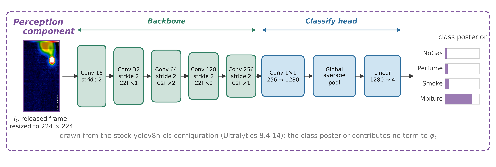{width=6.50in}

Fig. S7—Architecture of the perception component, drawn from the stock yolov8n-cls configuration (Ultralytics 8.4.14). Conv = convolution with batch normalization and SiLU activation; C2f = cross-stage partial bottleneck with two convolutions; the number after Conv is the output channel count. The class posterior shown is an illustrative shape, not a measured output.

*Anomaly Detection.* An LSTM autoencoder with a single-layer encoder and decoder at hidden dimension 32 and a linear output layer, trained on NoGas windows only, following Malhotra et al. (2016), on per-channel z-scored windows with mean squared error, Adam at a learning rate of 10^−^^3^, batch 64 and 30 epochs. The anomaly score is the mean reconstruction error over the window; the threshold τ is the 95th percentile of that error on NoGas *training* windows (Fig. S8). Both are refitted inside each training partition (Section S21).

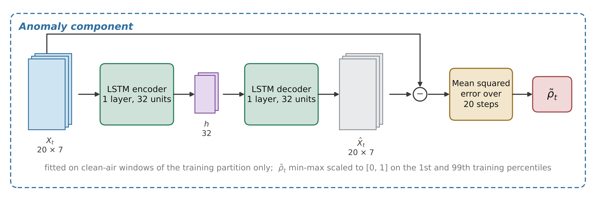{width=6.50in}

Fig. S8—Architecture of the anomaly component.

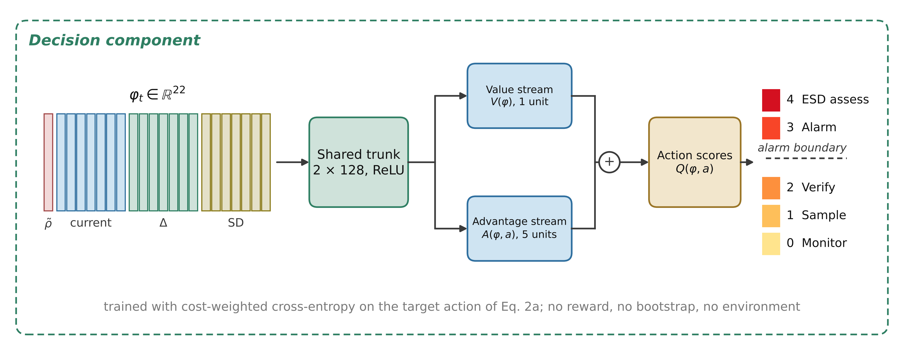{width=6.50in}

Fig. S9—Architecture of the decision component. The input order follows Eq. 1: the normalized anomaly score first, then the seven current readings, the seven changes and the seven SDs. The action scores are *Q*(φ, *a*) = *V*(φ) + *A*(φ, *a*) − mean~*a*′~ *A*(φ, *a*′), with φ the 22-dimensional decision state, *V* the value stream and *A* the advantage stream. The shared trunk has hidden widths 256, 256 and 128 with layer normalization and ReLU, and each stream has one 64-unit hidden layer. Under the cross-entropy objective the common term *V*(φ) cancels in the softmax and receives no gradient, so it plays no role in training or prediction and is not a learned state-value estimate.

*Explanation.* The explanation component is described in Section S2.

## S18 Bounds on Observed Zeros

The unit that goes into *N*~opp~ matters more than the formula. Pooling every test window across five seeds would give 3,160 hazardous and 1,580 clean windows, and Eq. 10 on a zero would give 0.0948% and 0.1894% respectively. But consecutive windows share 19 of 20 raw rows and the moving block position re-evaluates the same window in more than one partition, so pooling would treat repeated evaluations of overlapping recordings as independent information.

Eq. 10 is therefore evaluated for one partition at a time, and the worst partition is reported; no statement is made jointly across partitions. A single test partition carries 632 hazardous and 316 clean windows, so the independence-reference value on a zero is 0.47% and 0.94% respectively. Reaching below 10^−^^3^ on a zero count would need about 2,995 independent observations.

*How much that optimism is worth.* Two treatments are reported beside the binomial reference.

The first is a moving-block bootstrap inside each test partition, resampling contiguous runs of windows at block lengths of 20, 100 and 316, the last a single contiguous block per class. A block bootstrap over *episodes* would be the textbook choice, but each class was acquired in one continuous run, so there is one episode per class and nothing to resample at that level, which bounds what any reanalysis can establish.

The second is more useful for the zero counts that dominate these tables, where a bootstrap interval is degenerate. Windows overlap by 19 of 20 raw rows, so a set with pairwise-disjoint raw support is every twentieth window, counted as floor(*n*~win~/20) for *n*~win~ consecutive windows, applied to the pooled window count of the group being bounded (632 for the hazardous windows of a partition, although they come from two class blocks, and 316 for its clean-air windows). Applied within each of the two hazardous blocks it would give 30 rather than 31, and the bound on a zero would be 9.50% rather than 9.21%. This gives 31 of the 632 hazardous and 15 of the 316 clean-air windows of a partition, and 79 of the 1,581 windows of a withheld class. A maximal nonoverlapping selection from 316 consecutive windows holds 16 rather than 15; the smaller figure is used. The disjoint-support reference is applied to zero counts only: it does not define how a nonzero count of failures would be thinned, so for nonzero counts only the independence-reference value is reported. On a zero count, Eq. 10 gives 9.21% for the hazardous windows of a partition, 18.1% for its clean-air windows (181 per 1,000 clean windows) and 3.72% for a withheld class, against 0.47%, 0.94% and 0.19% under the independence reference.

About a factor of twenty separates the two conventions on a zero count. Selecting non-overlapping windows removes shared readings but does not establish independence: windows from one recording on one device remain dependent, so the disjoint-support count is a reference count, not an effective sample size, and neither value is a confidence bound on an operational failure rate. Both are conditional on assumptions the data do not satisfy. What they show is how much the apparent resolution of a zero depends on the counting convention, which is one reason more recording sessions are needed.

## S19 Reproducibility

*Pipeline.* Windows of length 20 formed over the raw corpus, with windows spanning a class boundary discarded, giving 6,324 windows at 1,581 per class. The anomaly feature is the mean reconstruction error of the full 20-step window under a NoGas autoencoder fitted inside each training partition (Section S21). The pretrained NoGas autoencoder shipped in `models/` is used only to fill an initial feature cache that is overwritten before any model is trained. The block-wise holdout reserves a contiguous 20% of each class block for test, separated from both training segments by a 20-window embargo, with the held-out block's position drawn from the run seed. The draw is restricted so that a full 20-window embargo fits on each side of the block, which keeps the partition size constant: every class block of 1,581 windows gives 316 test windows, 40 embargo windows and 1,225 training windows, so 4,900 training and 1,264 test windows at every seed, and no block starts within 20 windows of a class boundary. Feature standardization and anomaly-percentile normalization are fitted on the training partition only. In the leave-one-class-out experiment they are fitted on the three training classes only, so no statistic of the withheld class enters training.

*Protocol.* The model comparison uses 30 seed-varying runs (seeds 1000 to 1029), varying held-out block position and initialization, plus an epoch draw only for the cost-weighted policy, unweighted network and ordinal variant. Everything else uses five seeds (42, 1337, 7, 2024, 99), each with its own partition. Fixed seeds as listed, with PyTorch limited to two threads. No global determinism flag is set in the live drivers. All results come from one rerun in one environment, recorded by run_pipeline.py in run_records/pipeline_state.json and RUN_MANIFEST.json: Python 3.13.16 (CPython) on Linux x86-64, PyTorch 2.14.1 (run on the CPU), scikit-learn 1.9.1, NumPy 2.5.3, SciPy 1.18.1, pandas 3.0.5 and matplotlib 3.11.2, on two CPU cores. The full pipeline took about two and a half hours. The thermal classifier was trained separately with Ultralytics YOLOv8n-cls, version 8.4.14 as recorded in its checkpoint, which is the version pinned for it in the repository's `requirements.txt`; Ultralytics is absent from `requirements.lock`, which records only the interpreter that produced the sensor-side results. The result files of the earlier version are kept in `retrain/results_v2_prior_v18.1/` for provenance; the only numbers read from them are the clean-air-weighted gradient-boosting values quoted as an earlier-version comparison, which are labelled as such. Timing values depend on the machine that produced them.

*Levels of reproduction.* Three levels are supported: checking manuscript numbers against the stored result files (`verify_v15.py`), regenerating the figures from those files (`make figures`), and refitting every sensor-side model from the raw corpus (`python run_pipeline.py`, or `make all`). Reproducing the complete application is not supported, because the thermal classifier checkpoints and the runtime decision-agent checkpoint are not included; their recorded hashes identify the files but cannot replace them.

*Provenance.* Every reported object is traceable to the script that produced it, the stored result file it was read from, and the protocol it was run under. The table below is that map; nothing in this paper is quoted from a source not listed in it.

| Reported object | Driver | Result file | Protocol | Make target |
|---|---|---|---|---|
| Table 5, Fig. 3 | `retrain/run_leakage.py` | `v3_leakage.csv`, `v3_cost_blocked_validation.csv` | five seeds | `leakage` |
| Table 6, Fig. 4 | `retrain/run_final.py`, `retrain/run_bayes_recompute.py` | `v3_powered.csv`, `v3_powered_perrun.csv`, `v3_powered_bayes.json` | 30 runs | `final`, `bayes` |
| Table 6 and Table 7 rows for the clean-air-weighted gradient boosting | earlier release | `results_v2_prior_v18.1/v3_powered.csv`, `results_v2_prior_v18.1/v3_loco_all.csv` | 30 runs; five seeds | n/a |
| Table 8, Section S7 weighting comparison | `retrain/run_weighting_probe.py` | `v3_weighting_probe.csv` | five seeds | `weighting` |
| Table S24 | `retrain/run_ratio_check.py` | `v3_ratio_check.csv`, `v3_ratio_check_perseed.csv` | five seeds | `ratiocheck` |
| Table S23 | `retrain/run_final.py` | `v3_loco_specificity.csv` | five seeds | `final` |
| In-distribution comparator set, five seeds, and the CUSUM comparison in Section S5 | `retrain/run_all_v2.py` | `v2_zoo.csv`, `v2_zoo_sig.json` | five seeds | `comparison` |
| Table 7, Fig. 5 | `retrain/run_loco_v3.py`, `retrain/run_final.py` | `v2_loco.csv`, `v3_loco_all.csv`, `v3_loco_perseed.csv` | five seeds; 30 runs | `classdisjoint`, `final` |
| Section S27, notification at *a* ≥ 3, 2 and 1 on withheld Mixture | `retrain/run_rung_check.py` | `v3_rung_check.csv`, `v3_rung_check_summary.csv` | five seeds | `rungcheck` |
| Fig. 6, Table S21 | `retrain/run_all_v2.py` | `v2_perturb.csv` | five seeds | `comparison` |
| Experiment 6 per-partition counts and Table 9 (the evaluation screen, which is built from these counts) | `retrain/run_perturb_perseed.py` | `v2_perturb_perseed.csv` | five seeds | `perseed` |
| Correlation term of Eq. S2 | `retrain/run_split_counts.py` | `v3_split_counts.json` | both protocols | `splitcounts` |
| Table S2, Fig. S2 | `retrain/run_all_v2.py`, `retrain/run_final.py` | `v2_costsweep.csv`, `v3_cost_validation.csv` | five seeds | `comparison`, `final` |
| Table S3, Fig. S3 | `retrain/run_calib_actions_v2.py` | `v2_calibration.csv`, `v2_calibration_perseed.csv`, `v2_calibration_binsweep.csv`, `v2_calibration_reliability.csv` | five seeds | `calibration` |
| Table S4 | `retrain/run_rho_sensitivity.py` | `v3_rho_sensitivity.json` | 30 runs | `rho` |
| Table S5 | `retrain/run_rope_sensitivity.py` | `v3_rope_sensitivity.json` | 30 runs | `rope` |
| Table S6, Fig. S4 | `retrain/run_all_v2.py` | `v2_ablation.csv` | five seeds | `comparison` |
| Fig. S5 | `retrain/run_anomaly_influence.py` | `v2_anomaly_influence.csv` | five seeds | `anomaly` |
| Section S8 | `retrain/run_metric_cost.py` | `v3_metric_cost.json` | seed 42 | `metriccost` |
| Table S7 | `retrain/run_persistence_sweep.py` | `v3_persistence_sweep.csv`, `v3_persistence_rank.json` | five seeds | `persistence` |
| Table S8 | `retrain/run_overlap_isolation.py` | `v3_overlap_isolation.csv` | five seeds | `overlap` |
| Tables S9, S13 | `retrain/run_reject_option.py` | `v3_reject_option.csv` | five seeds | `reject` |
| Tables S10, S14 | `retrain/run_raw_faults.py` | `v3_raw_faults.csv` | five seeds | `rawfaults` |
| Tables S11, S15 | `retrain/run_alarm_episodes.py` | `v3_alarm_episodes.csv` | five seeds | `episodes` |
| Tables S12, S16 | `retrain/run_episode_metrics.py` | `v3_episode_metrics.csv` | five seeds | `hazardepisodes` |
| Nonhazardous alarm rate, Section S27 | `retrain/run_nonhazard_alarm.py` | `v3_nonhazard_alarm.csv` | five seeds | `nonhazard` |
| Table S20, Fig. S11 | `retrain/run_calib_actions_v2.py` | `v2_action_matrix.csv` | five seeds | `calibration` |
| ROC curves, Fig. S6 | `retrain/run_calib_actions_v2.py` | `v2_roc.json` | five seeds | `calibration` |
| Anomaly component, Fig. S10 | `retrain/run_anomaly_by_class.py`, `retrain/run_all_v2.py` | `v2_anomaly.json` | five seeds | `anomalyclass`, `comparison` |
| Every independence-reference bound | `retrain/run_block_bootstrap.py`, `retrain/run_partition_bounds.py` | `v3_block_bootstrap.json`, `v3_partition_bounds.json`, `v3_loco_perseed.csv` | five seeds | `blockboot`, `bounds` |
| Paired bootstrap over runs | `retrain/run_paired_bootstrap.py` | `v3_paired_bootstrap.json` | 30 runs | `bootstrap` |
| Tables S1, S1b, S1c | `retrain/summarize_thermal.py`, over the Kaggle drivers in `retrain/results_thermal/scripts/` | `results_thermal/summary.json`, `runs/*.json`, `split_tables/`, `curves/`, `checkpoints.json` | block-wise five seeds; randomized three seeds | `thermal` |
| Tables 1 to 4 | action ladder, comparator configurations, metric set and research questions, synthesized from the rows above | none | n/a | n/a |
| Tables S25, S26 | the cost matrix in `retrain/run_final.py` and the comparator settings in `retrain/comparators.py`, `retrain/zoo.py` and `retrain/new_baselines.py` | none | n/a | n/a |
| Figs. 1 and 2 | `retrain/make_figs_v2.py` | the sensor-policy definitions and the metric boundaries | n/a | `figures` |
| Figs. 3 to 6, and the remaining figures of the supporting information | `retrain/make_figs_v2.py` | the result files named above | as above | `figures` |
| Figs. S7 to S9 | `retrain/make_figs_arch.py` | component shapes from the modules below | n/a | `figures` |
| Fig. S1 | `retrain/make_figs_v2.py` (`fig_perception`) | none: the confusion matrices and per-class scores are typed into the script from the reported perception results and are not regenerated from a result file | original checkpoint, randomized split | `figures` |
| Fig. S12 | `retrain/make_figs_v2.py` (`fig_protocol`) | none: a schematic of the window counts (1,581 per class) and the block-wise layout | n/a | `figures` |
| Figs. S13 and S14 | `retrain/make_figs_v2.py` (`fig_dissociation`, `fig_disposition`) | `v3_powered.csv`, `v3_loco_all.csv` | 30 runs; five seeds | `figures` |
| Fig. S15 | `retrain/make_figs_v2.py` (`fig_alarmburden`) | `v2_perturb.csv` | five seeds | `figures` |
| Fig. S16 | `retrain/make_figs_v2.py` (`fig_metricdisagreement`) | `v3_powered.csv`, `v3_loco_all.csv`, `v2_perturb.csv` | 30 runs; five seeds | `figures` |
| Table S17 | none: a literature compilation, not a computed result | none | n/a | n/a |
| Table S18 | none: a compilation of published sensor characterisation, not a computed result | none | n/a | n/a |
| Table S19 | none: a synthesis of the drivers in the rows above | none | n/a | n/a |

Table S22—Provenance of every reported object. Result files sit in `retrain/results_v2/`. Protocol is the seed set given under Protocol above: five seeds means 42, 1337, 7, 2024 and 99, each with its own partition; 30 runs means seeds 1000 to 1029 with block position and initialization varying, plus an epoch draw only for the two neural policies and ordinal variant. The complete snapshot is the release tagged [TBD: tag of the rerun release]{.mark}. RUN_MANIFEST.json retains the recorded experimental environment and result fingerprints; the editorial-update record identifies this revision. Running make_manifest.py records the current checkout and interpreter, so a newly generated manifest describes that reproduction environment rather than proving the origin of earlier stored outputs.

*Supporting modules.* `retrain/raw_pipeline.py` (windowing, the two-sided embargo, the partition-local anomaly path, scaling); `retrain/safety_metrics.py` (metric set and the independence-reference bounds); `retrain/new_baselines.py` (k-NN, decision tree, CUSUM); `retrain/rewards.py`, `retrain/metrics.py`, `retrain/calibration.py`, `retrain/comparators.py`, `retrain/zoo.py`, `retrain/agent_rl.py`; `retrain/spe_style.py` and `retrain/spe_flow.py` carry the drawing primitives the block diagrams and Fig. 1 are built from.

*Checks.* Six scripts, answering six different questions, and `make check` runs all of them. `verify_v15.py` parses the tables in this manuscript and in the supporting information and checks the quoted values in the tables against the result files above. `self_audit.py` checks the document against itself: that no value a previous revision replaced survives anywhere, that every figure quoted in the Abstract, the research-question table or the Conclusion is checkable elsewhere, that cross-references and notation resolve in both directions, and that the vocabulary is consistent. `test_safety_metrics.py` tests the metric module the tables run through, including the identity that the passive-miss, sub-alarm and notification rates sum to one on the hazardous windows, that the false-alarm denominator admits no Perfume window, and that the embargo is two-sided on every seed and class. `audit_release.py` then checks the release in both directions: that every file this appendix names exists, and that every result file the drivers produce is named here. `check_figure_text.py` renders each figure and tests every pair of text elements in it for overlap, on the true rotated box of each rather than its axis-aligned extent, so a label that lands on its neighbour is a reported failure rather than something a reader finds. `check_page_proof.py` covers what appears only once the sources have become a paginated document. It builds both documents with `build_docx.py` and renders them. It then checks that no word is broken across a line inside a table column, that every figure reaches the page at the width it was authored for, and that no table row breaks across a page. Captions must appear once each and in order. A `Makefile` provides one target per row of Table S22. These scripts check internal consistency between the documents and the stored result files; they are not independent validation of the methods, and the values in Fig. S1 are typed into the plotting script from the reported perception results rather than read from a result file. [Of the six scripts, the unit tests of the safety metrics, the runtime anomaly tool and the rerun fixes and the figure-text check pass on the rerun; `verify_v15.py` and `self_audit.py` still look for table captions in the format of the previous manuscript and stop before comparing any value, so they need updating before the outputs of `make check` are archived for the release.]{.mark}

*Runtime checkpoints.* The live pipeline in `main.py` and `app.py` loads two files that the release does not contain. The Decision Agent checkpoint, a file under the `exp1_pareto` folder of `models/retrained/`, is written only by the deprecated driver `retrain/run_exp1_real.py`, and its feature scaler differs from the release's by up to 0.36 in the means and 0.24 in the scales, so it cannot be used as a held-out model. The thermal classifier weights are kept outside the repository. `DecisionTool` now raises a clear error when its checkpoint is missing. None of these files feeds a number reported in the paper.

*Deprecated paths.* Five earlier drivers and one earlier plotting script remain in the repository for provenance and produce no number in this paper: `retrain/run_exp1_real.py`, `retrain/run_exp2_real.py`, `retrain/run_exp3_loco.py`, `retrain/run_exp4_calibration.py`, `retrain/run_expzoo.py` and `retrain/make_plots.py`. They are superseded by the drivers in Table S22 and differ from them in ways that matter to anyone who runs them by mistake. Their headers describe the decision network in reinforcement-learning terms, as a Dueling DQN, although it is trained by cost-weighted cross-entropy and always was; that is the wording corrected under Methodology. One of them fixes the anomaly-refit seed at zero rather than varying it with the run seed. None writes a result file listed in Table S22. Each now carries a deprecation notice in its header saying so, and no number in this paper or in the supporting information can be traced to any of them.

*Corrections made during verification.* Five defects were found while the results were being audited, and all were corrected before the runs reported here: a false-alarm denominator that divided by the number of alerts rather than by the number of clean windows; a leave-one-class-out scaler fitted on all four classes rather than on the three training classes; gradient-boosting sample weights that favored clean air (Section S7); conservative Q-learning successor links that crossed class boundaries and the removed test block; and recurrent-model training histories that joined the leading and trailing training segments. `test_rerun_fixes.py` tests the last three corrections.

*Figure palette.* Categorical colors were checked against colorblind-separation, chroma, lightness and contrast criteria. The green and orange pair sits in the marginal separation band, so every categorical mark also carries a direct value label as a second channel of encoding.

## S20 Nomenclature

| Symbol | Definition |
|---|---|
| *Q* | indication rate per hour under an assumed duty cycle, Eq. S3 |
| Acc | decision accuracy, Eq. 4 |
| *a* | safety action, *a* ∈ {0, 1, 2, 3, 4} |
| *y*(·) | single-valued training-target map from gas class to action, Eq. 2a |
| *A*(·) | acceptable-action set per gas class, used for scoring, Eq. 2b |
| *B* | alarm-grade indications per 1,000 clean-air windows, Eq. 9 |
| *C* | class-weight ratio, *C* = *w*~haz~ / *w*~non~, Eq. 3 |
| *c* | confidence level in the independence-reference binomial bound, Eq. 10 |
| *w*~haz~, *w*~non~ | loss weights for hazardous and nonhazardous training samples, Eq. 3 |
| *d* | dimension of the decision state in the ablation |
| *E*~t~ | operator-facing explanation at cycle *t* |
| *f* | windows per hour under the assumed duty cycle, Eq. S3 |
| *G* | embargo length between training and test partitions, in windows |
| *g*~t~ | ground-truth gas class for window *t* |
| *H* | index set of hazardous test windows, Smoke and Mixture |
| *I*~t~ | thermal image at cycle *t* |
| *k* | channels masked or faulted in Experiments 6 and 8, or observed failures in Eq. 10 |
| *L*(θ) | cost-weighted cross-entropy objective, Eq. 3 |
| *L*~ord~(θ) | expected-cost objective under the ordinal matrix, Eq. S1 |
| *M* | ordinal cost matrix over (class, action) pairs |
| *N* | number of training samples |
| *N*~test~ | number of test windows, Eqs. 4 to 9 |
| *N*~opp~ | opportunities in Eq. 10: the window count of one partition for the independence reference, and floor(*n*~win~/20) for the disjoint-support reference, with *n*~win~ the number of consecutive evaluation windows in the group |
| *N*~run~ | paired runs, Eq. S2 |
| *p*~θ~ | action probability distribution under parameters θ |
| *R*~esc~ | alarm-grade notification rate, hazardous windows at *a* ≥ 3, Eq. 6 |
| *R*~fa~ | clean-air alarm rate, clean-air windows at *a* ≥ 3, Eq. 8 |
| *R*~miss~ | passive-miss rate, hazardous windows at *a* = 0, Eq. 5 |
| *R*~under~ | sub-alarm response rate, hazardous windows at *a* ∈ {1, 2}, Eq. 7 |
| *s*~post~ | posterior scale in the correlated *t*-test, Eq. S2 |
| *U* | one-sided Clopper-Pearson reference value for a rate, Eq. 10 |
| X~t~ | seven-channel sensor window, X~t~ ∈ ℝ^(20×7)^ |
| *Z* | index set of clean test windows, NoGas |
| δ~t~ | per-sensor change across the window |
| θ | model parameters |
| ρ | assumed correlation between runs in the Bayesian *t*-test |
| $\tilde{\rho}_t$ | normalized reconstruction-error anomaly score |
| σ~t~ | per-sensor standard deviation across the window |
| σ~n~ | additive-noise standard deviation in the perturbation suite |
| τ | anomaly detection threshold |
| φ~t~ | 22-dimensional decision state, Eq. 1 |

*Subscript.* *t*, inference cycle or window index.

*Abbreviations.* CP, Clopper-Pearson; ECE, expected calibration error; FA, false alarm; MOX, metal-oxide semiconductor; ROC-AUC, area under the receiver operating characteristic curve; SD, standard deviation.

## S21 Component Behavior in Detail

The thermal classifier's results are in Section S1; this section covers the anomaly component.

The anomaly component raises two questions (Fig. S10). On whether the score tracks hazard, mean reconstruction error on held-out windows is 0.023 for clean air and 0.107 for the vapor class against 164.7 for smoke and 80.6 for the mixture (Fig. S10(a)), three orders of magnitude apart. It does not follow the action ordering, since Mixture carries the higher target action yet scores below Smoke, so it is evidence of departure from learned normal behavior and not a severity estimate. NoGas and Perfume, both nonhazardous, overlap; that overlap is not an error in separating hazardous from nonhazardous windows.

Fitting the autoencoder and its input scaler on the whole corpus, as an earlier implementation did, gave ROC-AUC 0.9622 at a false-positive rate of 5.0%. Fitting both inside the training partition, as every result here does, gives ROC-AUC 0.9251 ± 0.0618 across five seeds (range 0.8228 to 0.9898). Here the negative class is NoGas and the positive class is every other class, and the operating point uses the threshold τ, the 95th percentile of reconstruction error on the NoGas training windows: TPR 0.8015 ± 0.1205 and FPR 0.1101 ± 0.0992 (Fig. S10(b), Fig. S6). The lower AUC reflects removal of evaluation windows from the fitting data, not damage to the detector. The anomaly score is one of the twenty-two inputs to every learned comparator except the shallow tree, so fitting it on the whole corpus had leaked evaluation information into those comparators.

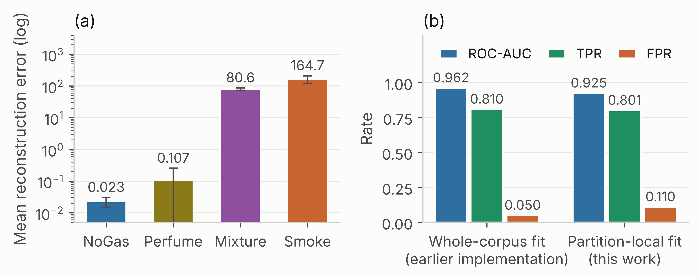{width=6.50in}

Fig. S10—Anomaly component. (a) Mean reconstruction error by class. (b) Operating point under an in-sample threshold against a training-fitted one.

## S22 Representative Prior Work

| Study | Prediction target | Partitioning | Withheld classes | Sensor degradation | Passive misses, notification, alarm burden |
|---|---|---|---|---|---|
| Narkhede et al. (2021, 2022a), MGD | 4-class gas identity, MOX and thermal fusion; 96 / 82 / 93% accuracy | randomized train/test split | none | none | not reported |
| Sharma et al. (2024), MGD | 4-class, federated multimodal; 99.7% validation accuracy | validation split | none | none | not reported |
| El Barkani et al. (2024), MGD thermal | 4-class, thermal on embedded hardware; 91.7% | test split | none | none | not reported |
| Wang, X. et al. (2025) | gas-leak identification, thermal-image and gas-sensor fusion (SCGA); 99.22% accuracy | [TBD]{.mark} | [TBD]{.mark} | [TBD]{.mark} | [TBD]{.mark} |
| Zhang and Zhang (2025) | binary leak, MOX and thermal; 98.9% simulated, 95.4% field | own simulated and field sets | none | none | not reported |
| Wang, Y. et al. (2026) | flammable-gas hazard assessment (HGD-Net), photoionization and airflow sensing | [TBD]{.mark} | [TBD]{.mark} | [TBD]{.mark} | [TBD]{.mark} |
| Qu et al. (2022) | open-set gas recognition, electronic nose | [TBD]{.mark} | unknown gases withheld | none | not reported |
| Yao et al. (2024) | drift compensation and unknown-gas recognition, electronic nose | [TBD]{.mark} | unknown gases withheld | drift | not reported |
| Dennler et al. (2022), another MOX dataset | drift analysis of a classification benchmark | re-partitioned by time | none | drift (observed) | not applicable |
| This study, MGD | five-level action from MOX and anomaly state | block-wise holdout, 20-window embargo, seed-varying block | Smoke or Mixture | feature-space perturbation; raw-signal faults | passive misses, sub-alarm responses, notification and clean-air alarms |

Table S17—Representative prior work compared on the same criteria. MGD = MultimodalGasData. Differences in scope are listed descriptively; a criterion a study did not address is not a shortcoming of that study. [TBD entries are to be completed after checking each paper.]{.mark}

## S23 Composition of the MOX Array

| Sensor | Commonly associated target gases (nominal sensitivity) |
|---|---|
| MQ-2 | LPG, butane, methane, smoke |
| MQ-3 | Alcohol, ethanol, organic vapors |
| MQ-5 | LPG, natural gas |
| MQ-6 | LPG, butane, iso-butane |
| MQ-7 | Carbon monoxide |
| MQ-8 | Hydrogen |
| MQ-135 | Air-quality indicators including NH~3~, benzene, NO~x~ and CO~2~ |

Table S18—Composition of the MOX array, with the gases each element is nominally marketed as sensitive to.

## S24 Which Model Appears in Which Experiment

| Model | In distribution (Exp. 2) | Leave-one-class-out (Exp. 3) | Degradation (Exps. 6, 8) | Reject option (Exp. 7) | Action matrix and input probe (Exps. 2, 5) |
|---|---|---|---|---|---|
| Cost-weighted policy | ✓ | ✓ | ✓ | ✓ | ✓ |
| Unweighted network | ✓ | ✓ | ✓ | ✓ | — |
| Multilayer perceptron | ✓ | ✓ | ✓ | ✓ | ✓ |
| Gradient boosting | ✓ | ✓ | ✓ | ✓ | ✓ |
| Random forest | ✓ | ✓ | ✓ | ✓ | ✓ |
| Support-vector classifier | ✓ | ✓ | — | ✓ | ✓ |
| Recurrent (LSTM) | ✓ | ✓ | — | — | — |
| Conservative Q-learning | ✓ | ✓ | — | — | — |
| k-nearest neighbors | ✓ | ✓ | — | ✓ | ✓ |
| Shallow decision tree | ✓ | ✓ | ✓ | — | ✓ |
| Clean-air-weighted gradient boosting (earlier variant) | ✓ | ✓ | partial: raw clamp *k* = 1, 4, 7 and raw zero only | — | partial: anomaly input probe only |
| CUSUM | — | — | — | — | — |
| Ordinal cost objective | — | — | — | — | — |
| Total | 10 | 10 | 6 | 7 | 7 |

Table S19—Which model appears in which experiment. The ordinal cost objective carries no mark: it is a variant of the decision component, it selected no Monitor action in the fits whose actions were recorded, and it is reported under Experiment 4 rather than among the comparators. Gradient boosting in the comparator rows is the hazard-weighted configuration. The clean-air-weighted configuration of the earlier version is a supporting variant, marked where it was evaluated, with partial evaluations identified; it is excluded from the Total row. CUSUM likewise carries no mark, being reported in the text of Experiment 2 rather than in any comparator table.

## S25 Per-Class Action Shares in Distribution

Decision accuracy pools the four classes. Resolving it by class shows where the disagreement lives (Table S20). The inventory is the seven models of Fig. S11 over five seed-varying partitions rather than the ten primary comparators of Table 6 of the manuscript over 30 runs, so the two are not directly comparable row by row. 

| Model | NoGas | Smoke | Mixture | Perfume |
|---|---|---|---|---|
| Support-vector classifier | 0.9424 | 1.0000 | 1.0000 | 0.8449 |
| Cost-weighted policy | 0.9418 | 1.0000 | 1.0000 | 0.9101 |
| Multilayer perceptron | 0.9386 | 1.0000 | 1.0000 | 0.9070 |
| k-nearest neighbors | 0.9323 | 1.0000 | 1.0000 | 0.8620 |
| Shallow decision tree | 0.8658 | 1.0000 | 1.0000 | 0.8494 |
| Random forest | 0.8646 | 1.0000 | 1.0000 | 0.9361 |
| Gradient boosting | 0.7924 | 1.0000 | 1.0000 | 0.9361 |
| Range | 0.792 to 0.942 | 1.000 | 1.000 | 0.845 to 0.936 |

Table S20—Per-class share of windows assigned an acceptable action, in distribution, averaged over five seed-varying partitions.

Every model assigns an acceptable action to every Smoke and Mixture window. The between-model spread lies on NoGas and Perfume, which span 15.0 and 9.1 points across the seven models, so aggregate accuracy here mostly reflects how a model resolves the boundary between clean air and a nuisance odorant. Gradient boosting, now the hazard-weighted configuration, was last on NoGas, assigning Monitor to 79.2% of clean-air windows against 94.2% for the support-vector classifier. The earlier, clean-air-weighted configuration assigned Monitor to 84.0% of clean-air windows and to an acceptable action on 98.0% of Smoke windows, so weighting the hazardous classes more heavily moved errors from Smoke to clean air. Because this analysis uses five partitions, its per-class ordering is not a decomposition of the 30-run ranking. Table S20 gives the per-class shares and Fig. S11 the action-selection matrices.

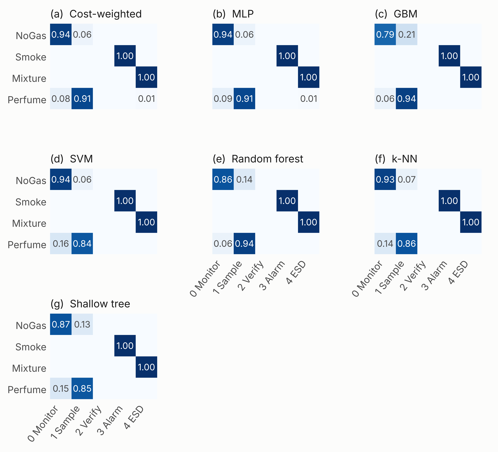{width=6.50in}

Fig. S11—Action-selection matrices in distribution, row-normalized. The column for action 2 (Verify) is empty in every panel, because no model selected it in distribution; the small entries in the fourth column belong to action 3 (Raise alarm).

*The intermediate verification action.*

In Fig. S11 the seven configurations send almost all Smoke windows to *Raise alarm* and all Mixture windows to *Recommend ESD assessment*; the visible spread is on the NoGas and Perfume boundary. None of the seven selected action 2, *Request verification*, in any run. The target map sends Perfume to action 1, so action 2 is never a positive training target; the scikit-learn models cannot predict it, while the neural models can but did not. The ordinal variant, outside this analysis, did select it (Section S3). It remains an acceptable evaluation response for Perfume under Eq. 2b of the manuscript. Nothing here therefore measures how a model would use an intermediate verification step, which is an unresolved question in the action design and a candidate for an action triggered by predictive uncertainty rather than class identity.

## S26 Corpus Layout and the Split

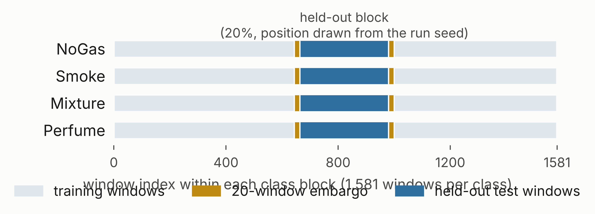{width=6.50in}

Fig. S12—Corpus layout and the leakage-controlled split.

## S27 Class-Exclusion Evaluation in Detail

*Setting.* Each fit scores the same 1,581 windows of the withheld class; the retained-class partition and the fitting vary across the five fits, so these are repeated fits, not five independent hazardous recordings. Per-fit counts are listed in seed order (42, 1337, 7, 2024, 99) in Table 7 of the manuscript and in `v3_loco_perseed.csv`, so failures can be compared fit by fit. No comparator has a reject option: the experiment measures how closed-set models route an unfamiliar hazardous class, not whether they recognize it as unfamiliar. The scikit-learn models can predict only the three retained target actions; the neural models keep five outputs, and none of their fits selected the withheld class's target action.

*Nominal rank and withheld-class behavior.* With Smoke withheld, the multilayer perceptron, third of ten by mean accuracy in Table 6 of the manuscript, left a mean of 6.41% of Smoke windows at Monitor; its five fits gave 30, 23, 216, 234 and 4 passive misses, and the worst (234 of 1,581, 14.80%) has an independence-reference value of 16.35% and a disjoint-support value of 21.99%. Six configurations left no Smoke window at Monitor in any fit; on a zero count the two conventions give 0.19% and 3.72%. The comparison rests on the counts, not on ratios of these reference values, which depend heavily on the counting convention. Over the ten comparators the Pearson correlation between nominal accuracy and withheld-Smoke passive-miss rate is *r* = +0.26, and between nominal accuracy and withheld-Mixture notification *r* = +0.10 (Fig. S13); the Fisher-transform ranges, [−0.44, +0.76] and [−0.56, +0.69], are exploratory, because the comparators are not a sample from a population of models. At ten comparators the correlation is unresolved, not absent.

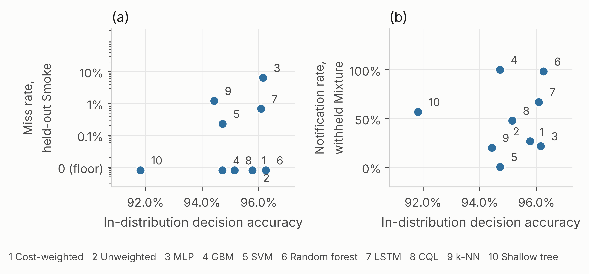{width=6.50in}

Fig. S13—Nominal accuracy (Table 6 of the manuscript) against withheld-class passive-miss and notification rates.

*Specificity of the same fits.* Favorable responses to the withheld class could come from alarming broadly, so the same fits were scored on the test windows of the three retained classes (Table S23).

| Withheld class | Configuration | Clean-air alarms | Perfume alarms | All nonhazardous windows |
|---|---|---|---|---|
| Smoke | Cost-weighted | 0 of 1,580 | 17 of 1,580 | 0.54% |
| Smoke | Ordinal cost | 0 of 1,580 | 17 of 1,580 | 0.54% |
| Smoke | Unweighted network | 0 of 1,580 | 17 of 1,580 | 0.54% |
| Smoke | Multilayer perceptron | 0 of 1,580 | 8 of 1,580 | 0.25% |
| Smoke | Gradient boosting | 0 of 1,580 | 0 of 1,580 | 0.00% |
| Smoke | Support vector machine | 0 of 1,580 | 0 of 1,580 | 0.00% |
| Smoke | Random forest | 0 of 1,580 | 0 of 1,580 | 0.00% |
| Smoke | Recurrent (LSTM) | 0 of 1,580 | 0 of 1,580 | 0.00% |
| Smoke | Conservative Q-learning | 0 of 1,580 | 17 of 1,580 | 0.54% |
| Smoke | k-nearest neighbors | 0 of 1,580 | 0 of 1,580 | 0.00% |
| Smoke | Shallow decision tree | 0 of 1,580 | 0 of 1,580 | 0.00% |
| Mixture | Cost-weighted | 0 of 1,580 | 12 of 1,580 | 0.38% |
| Mixture | Ordinal cost | 0 of 1,580 | 16 of 1,580 | 0.51% |
| Mixture | Unweighted network | 0 of 1,580 | 11 of 1,580 | 0.35% |
| Mixture | Multilayer perceptron | 0 of 1,580 | 0 of 1,580 | 0.00% |
| Mixture | Gradient boosting | 0 of 1,580 | 0 of 1,580 | 0.00% |
| Mixture | Support vector machine | 0 of 1,580 | 0 of 1,580 | 0.00% |
| Mixture | Random forest | 0 of 1,580 | 0 of 1,580 | 0.00% |
| Mixture | Recurrent (LSTM) | 0 of 1,580 | 19 of 1,580 | 0.60% |
| Mixture | Conservative Q-learning | 0 of 1,580 | 16 of 1,580 | 0.51% |
| Mixture | k-nearest neighbors | 0 of 1,580 | 2 of 1,580 | 0.06% |
| Mixture | Shallow decision tree | 0 of 1,580 | 0 of 1,580 | 0.00% |

Table S23—Alarm-grade rates on the retained-class test windows of the class-exclusion fits, pooled over five fits (1,580 windows per retained class). Every configuration raised an alarm-grade action on all 1,580 test windows of the retained hazardous class (Mixture when Smoke was withheld, Smoke when Mixture was withheld).

*Passive misses and notification.* With Mixture withheld, eight configurations had a mean passive-miss rate below 1%, and their mean notification rates ranged from 0.49% (support-vector classifier) to 100% (gradient boosting). The support-vector classifier left 0.03% of Mixture windows at Monitor and sent 99.5% to sub-alarm actions; the cost-weighted policy notified for 25.9% and sent 74.0% to sub-alarm actions. Notification here means that an operator is notified, not that the class-specific action was selected: withholding Mixture removes action 4 from the training targets, so a model that routes Mixture as Smoke selects action 3 and counts as notified, although Mixture's acceptable set is {4}. The recurrent model notified for 67.4% and conservative Q-learning for 46.9%, both above the cost-weighted policy and the perceptron (21.7%), so the ordering is not a simple split between tree ensembles and networks. The shallow tree left 24.87% of withheld Mixture windows at Monitor on average, with per-fit counts of 489, 988, 489, 0 and 0, and a worst-fit independence-reference value of 64.51%. No configuration was best under every condition. Fig. S14 decomposes the responses into alarm-grade, sub-alarm and passive shares.

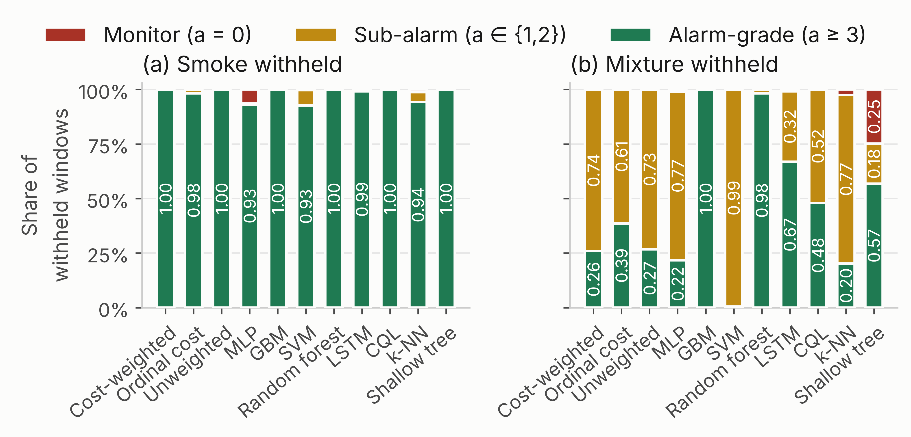{width=6.50in}

Fig. S14—Responses to a withheld hazardous class: shares of withheld windows sent to an alarm-grade action, a sub-alarm action or Monitor, mean over five fits. Panel (a) Smoke withheld; panel (b) Mixture withheld.

*Rescoring at a lower boundary.* Because *R*~miss~, *R*~under~ and *R*~esc~ partition the hazardous windows, rescoring the same predicted actions with the boundary at *a* ≥ 1 gives exactly 1 − *R*~miss~. The rescoring was also checked by re-running the withheld-Mixture protocol and keeping the per-window actions (`retrain/run_rung_check.py`); its *a* ≥ 3 column reproduces `v3_loco_all.csv`. No configuration sent a withheld Mixture window to action 2, so *a* ≥ 2 equals *a* ≥ 3. For the eight configurations with mean passive-miss rates below 1%, the rate at *a* ≥ 1 is at least 99.0%, against 0.49% to 100% at *a* ≥ 3; across all ten it is 75.1% to 100%, the low end being the shallow tree. With Smoke withheld the range is 92.8% to 100% at *a* ≥ 3 and 93.6% to 100% at *a* ≥ 1. The rescoring changes no selected action, does not improve recognition and causes no additional notification; it follows algebraically from counting every non-Monitor response, including responses that notify no one under this protocol. It shows that the escalation results depend on that response definition, which must be stated when the benchmark is interpreted.

*Nonhazardous alarms in the nominal analysis.* This paragraph concerns the five-seed, seven-model nominal analysis of Section S25, not the class-exclusion fits. The clean-air alarm rate of Eq. 8 counts NoGas windows only, and no configuration raised a clean-air alarm there. Perfume is also nonhazardous, and two configurations sent Perfume windows to alarm-grade actions: the cost-weighted policy 1.14% and the perceptron 0.57%, or 0.57% and 0.28% of all nonhazardous windows (`v3_nonhazard_alarm.csv`).

## S28 The Correlated t-Test and Run-Level Variation

The model comparison uses 30 runs with varying seed, held-out block position and initialization (Bouthillier et al. 2021). The released driver varies epochs from 60 through 100 only for the cost-weighted policy, unweighted network and supporting ordinal variant; other settings are fixed. Section S5 describes this limited training variation. No equal-size search grid across model families was run. For the five-seed experiments, the exact two-sided Wilcoxon signed-rank test with five nonzero paired differences has a minimum attainable *p*-value of 2 × 2^−5^ = 2^−4^ = 0.0625, so no five-seed comparison reaches *p* < 0.05 with that test; these experiments are reported descriptively. With 30 runs we use the Bayesian correlated *t*-test of Benavoli et al. (2017). For a vector of paired differences *d* with mean *d*~mean~ and sample variance *s*^2^, the posterior is a Student *t* with *N*~run~ − 1 degrees of freedom, mean *d*~mean~, and scale

&nbsp;&nbsp;&nbsp;&nbsp;*s*~post~ = sqrt( *s*^2^ · ( 1/*N*~run~ + ρ/(1 − ρ) ) ),  ............ (S2)

with the correlation ρ = *n*~test~/(*n*~train~ + *n*~test~) = 1,264/(4,900 + 1,264) = 0.2051, computed from the partition the pipeline builds rather than fixed by hand. Integrating that posterior over a region of practical equivalence of ± 1 accuracy point returns three probabilities per comparison: that one model is practically better, that the other is, and that the two are equivalent. The one-point region is a judgment, chosen as a difference too small to decide between models on its own; no economic model or site requirement was analyzed to produce it, and Table S5 shows how much any conclusion depends on it. Equivalence in accuracy does not imply equivalence in any safety response.

The correlation term is an assumed dependence correction, not a correlation measured from these runs. Benavoli et al. (2017) trace the heuristic to random train/test splits (Nadeau and Bengio 2003) and its later use in cross-validation, and the present design is neither: seed, block position and initialization vary per run, with epoch variation limited to the two neural policies and ordinal variant (Bouthillier et al. 2021). Training partitions still overlap by roughly 80% of their windows, so treating runs as independent would be anti-conservative, but ρ is carried across from a different design, and repeated blocked splits of one acquisition campaign are not independent acquisitions. The comparison is therefore reported over ranges of ρ and of equivalence width (Supplementary Section S6) and reads as a sensitivity analysis over an assumed dependence structure, not a calibrated posterior. Runs are seeded and execution is limited to two threads; no global determinism flag is set in the drivers that produced these results.

## S29 Graded Sensor Degradation in Full

*Experiment 6: feature-space perturbation.* Six configurations were scored under additive noise (σ~n~ = 0.1 to 0.5 training SDs on all 21 sensor features), drift (Eq. 12 of the manuscript: *d* = 0.1 to 0.5, a relative gain change of *d* with an offset of *d* training SDs on the seven current readings, signs drawn per channel) and channel masking (*k* = 1 to 7 of 7 channels, Eq. 13). Selected results are in Table S21 and the full sweep in Fig. 6 of the manuscript. Indication density is the clean-air alarm rate per 1,000 clean-air windows, and the starred clean-condition entries are independence-reference values for a zero count in one partition, not point estimates.

*Masked channels.* The masked channels are drawn without replacement once per seed and are the same for every model; they are not nested across *k*. For *k* = 1 they were MQ2 (seed 42), MQ6 (1337), MQ135 (7), MQ3 (2024) and MQ135 (99). For *k* = 2 the channels were MQ2 and MQ8 (42), MQ6 and MQ135 (1337), MQ8 and MQ7 (7), MQ7 and MQ3 (2024), and MQ8 and MQ6 (99). For *k* = 3 they were MQ135, MQ2 and MQ7 (42); MQ135, MQ8 and MQ5 (1337); MQ7, MQ6 and MQ135 (7); MQ7, MQ2 and MQ3 (2024); and MQ8, MQ7 and MQ6 (99). For *k* = 4 they were MQ135, MQ2, MQ8 and MQ6 (42); MQ7, MQ5, MQ3 and MQ8 (1337); MQ6, MQ7, MQ135 and MQ8 (7); MQ8, MQ3, MQ2 and MQ6 (2024); and MQ135, MQ7, MQ5 and MQ6 (99). For *k* = 5 the channels left unmasked were, by seed, MQ3 and MQ8 (42), MQ2 and MQ5 (1337), MQ2 and MQ3 (7), MQ6 and MQ8 (2024), and MQ2 and MQ135 (99); for *k* = 6 the single channel left unmasked was MQ3 (42), MQ7 (1337), MQ2 (7), MQ7 (2024) and MQ2 (99); and for *k* = 7 all seven are masked. Channel identity, partition and fitting vary together across seeds, so channel sensitivity is not separated from fitting variability.

All three act on the *standardized* features, downstream of the training-partition scaler, not on raw readings, and perturbing derived features independently need not correspond to a physically consistent sensor trace. Masking places the channel's features at their *training-set means*, which differs from forcing a raw reading to zero or freezing it; Experiment 8 tests those in raw space. The anomaly feature keeps its unperturbed value in every condition, so even with all seven channels masked the model still receives information derived from the original readings: this is a feature-masking test, not loss of all sensor information.

Several response patterns appear; they are descriptions of these configurations under these conditions, not intrinsic categories, and carry no IEC 61511 meaning. Alarm-biased: the cost-weighted policy, the unweighted network and the shallow tree left no hazardous window at Monitor and notified every one through all seven masked channels, while their clean-air alarm rate reached 100% at *k* = 7. Near-complete notification: the hazard-weighted gradient boosting left at most 0.25% of hazardous windows at Monitor (8 of 3,160 at *k* = 2) and none at *k* = 7, sent no hazardous window to a sub-alarm action at *k* = 7, and raised a single clean-air alarm over the five partitions at *k* = 7 (1 of 1,580 windows, in the partition of seed 2024), while its decision accuracy fell to 0.542. The earlier clean-air-weighted gradient boosting, retained only as a comparison, behaved differently: at *k* = 7 it left 19.53% of hazardous windows at Monitor (617 of 632 in one partition, none in the other four) and notified 60.5%. Gradual: the random forest left no window at Monitor, with a clean-air alarm rate at or below 6.3% up to *k* = 5, rising to 25.7% at *k* = 6 and 51.9% at *k* = 7. Mixed: the perceptron at *k* = 7 left 50.0% at Monitor and raised alarms on 20.0% of clean-air windows.

Drift raised few clean-air alarms: the largest mean rate across models and severities was 0.19%. Its effect appeared instead as passive misses for some configurations (1.11% for the earlier clean-air-weighted gradient boosting at *d* = 0.5; none for the hazard-weighted gradient boosting at any severity).

With one channel masked, the clean-air indication density rose from zero to 128.5 per 1,000 clean-air windows for the cost-weighted policy and 200.0 for the shallow tree, pooled over five partitions with all of it in the partition of seed 2024, while the random forest rose only to 7.0. Indication density is a model-output measure; it is not compared with operator-level guidance, which concerns annunciated alarm events (Section S16).

An hourly figure needs a duty cycle. The corpus carries no timestamp column, but readings were logged at 2 s intervals (Narkhede et al. 2022a), giving *f* = 1,800 windows per hour, so the hourly indication rate is

&nbsp;&nbsp;&nbsp;&nbsp;*Q* = *B* · *f* / 1000.  ............ (S3)

*B* from Eq. 9 is the primary quantity. Each clean-air test segment holds 316 windows, about 10.5 minutes at 2 s, so a per-hour number is that segment scaled up roughly sixfold, not a rate observed over an hour. On that basis Eq. S3 gives about 231 alarm-grade indications per hour for the cost-weighted policy with one channel masked. Indications are not annunciated alarms; eventized rates are in Section S16.

For the clean-condition rows, a zero across the 316 clean-air windows of one partition corresponds to an independence-reference value of 9.4 indications per 1,000 clean-air windows, so an observed zero is weak evidence about the indication rate. Zero passive misses at 35.0% accuracy, as for the cost-weighted policy at *k* = 7, describes an alarm-biased response, not fitness. Fitness for service is a qualification decision made against a facility's own criteria, which no benchmark result of this kind settles.

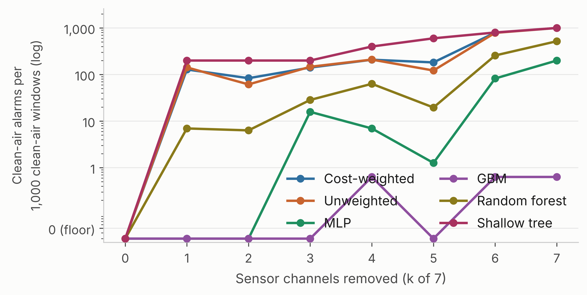{width=6.50in}

Fig. S15—Clean-air indication density (per 1,000 clean-air windows) against the number of masked channels, mean over five partitions.

| Condition | Model | Decision acc. | Passive-miss rate | Notification rate | Clean-air alarm rate | Indications per 1,000 clean-air windows |
|---|---|---|---|---|---|---|
| Clean | Cost-weighted | 0.963 | 0.0000 | 1.000 | 0.0000 | ≤ 9.4\* |
| Clean | Random forest | 0.950 | 0.0000 | 1.000 | 0.0000 | ≤ 9.4\* |
| Clean | Shallow decision tree | 0.929 | 0.0000 | 1.000 | 0.0000 | ≤ 9.4\* |
| Drift ±50% | Cost-weighted | 0.908 | 0.0000 | 1.000 | 0.0006 | 0.6 |
| Drift ±50% | Multilayer perceptron | 0.932 | 0.0006 | 0.999 | 0.0000 | 0 |
| Drift ±50% | Gradient boosting | 0.897 | 0.0000 | 1.000 | 0.0000 | 0 |
| Noise σ~n~ = 0.5 | Cost-weighted | 0.839 | 0.0000 | 1.000 | 0.1373 | 137.3 |
| Noise σ~n~ = 0.5 | Random forest | 0.866 | 0.0000 | 1.000 | 0.0070 | 7.0 |
| Dropout *k* = 1 | Cost-weighted | 0.885 | 0.0000 | 1.000 | 0.1285 | 128.5 |
| Dropout *k* = 1 | Shallow decision tree | 0.722 | 0.0000 | 1.000 | 0.2000 | 200.0 |
| Dropout *k* = 1 | Random forest | 0.942 | 0.0000 | 1.000 | 0.0070 | 7.0 |
| Dropout *k* = 3 | Cost-weighted | 0.811 | 0.0000 | 0.992 | 0.1411 | 141.1 |
| Dropout *k* = 3 | Multilayer perceptron | 0.863 | 0.0047 | 0.994 | 0.0158 | 15.8 |
| Dropout *k* = 7 | Cost-weighted | 0.350 | 0.0000 | 1.000 | 1.0000 | 1,000 |
| Dropout *k* = 7 | Shallow decision tree | 0.250 | 0.0000 | 1.000 | 1.0000 | 1,000 |
| Dropout *k* = 7 | Gradient boosting | 0.542 | 0.0000 | 1.000 | 0.0006 | 0.6 |

Table S21—Selected feature-space perturbation results, mean over five partitions; the full sweep is in Fig. 6 of the manuscript. \*Independence-reference value for a zero count in one partition, shown on the clean-condition rows only. The last column is the clean-air alarm rate multiplied by 1,000 and given to one decimal. Gradient-boosting rows are the hazard-weighted configuration.

## S30 Which Metric Selects Which Model

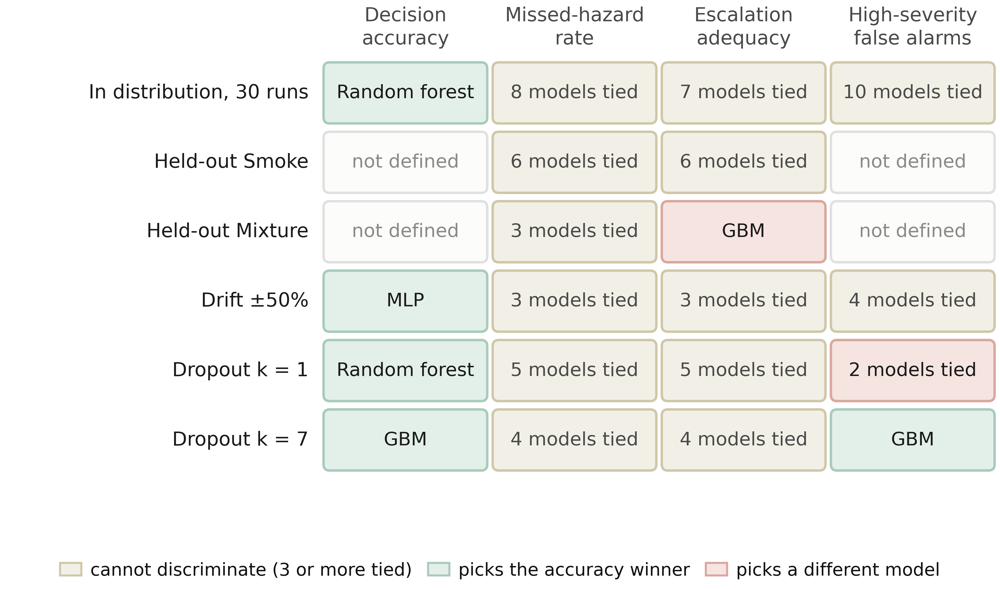{width=6.50in}

Fig. S16—Configuration with the highest observed mean on each metric, for selected evaluation conditions: the nominal comparison (ten configurations, 30 runs), class exclusion (ten configurations, five fits per withheld class) and feature-space perturbation (six configurations, five partitions). Ties are exact equality of the observed mean, with no tolerance; three or more configurations sharing the optimum are shown as no discrimination. Decision accuracy on a withheld class is zero for every configuration and does not rank them. The figure illustrates metric-dependent trade-offs; it does not select a preferred model, and five-fit differences are descriptive.
